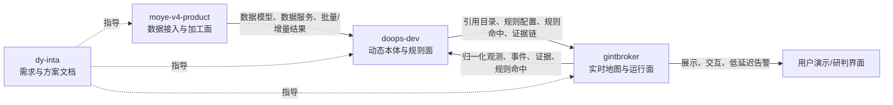

# AGENTS.md

本文件是后续 Codex/Agent 接手 `dy-inta` 工作时的“地图指引”。它不重复 PRD、场景方案和本体细节；详细业务内容回到对应文档读取。

默认使用中文回复；代码、路径、命令、接口、字段名和官方数据源名保留英文。

## 1. 当前仓库位置

`dy-inta` 是多源情报分析平台的需求、评估、方案和交接文档仓，不是运行系统源码仓。

默认工作边界：

- 文档、方案、评估、演示脚本、路线图：优先改 `dy-inta`。
- 判断“当前系统能不能做”：只读检查 `gintbroker` 最新代码和文档。
- 讨论动态本体、规则、证据治理：按需只读检查 `doops-dev`。
- 讨论数据源接入、批流加工、ODS/DWD、数据服务：按需只读检查 `moye-v4-product`。
- 修改任何其他项目：必须有用户本轮明确要求。

## 2. 必读入口

新会话不需要机械全读所有文件，先按任务选择入口：

| 任务 | 先读 | 继续读 |
| --- | --- | --- |
| 了解本仓全局定位 | `README.md` | 本文件 |
| 查 PRD 原文口径 | `PRD-v6.md` | 原始 PDF：`~/Documents/非Coding工作/DYINT/O多源情报系统/多源情报分析平台PRD_v6.0.pdf` |
| 看近期课题组领导汇报与最短 Demo 路线 | `devdoc/预警佐证来源与PRD两类场景融合方案分析-20260710.md` | `devdoc/DYINT场景2双专题交互Mock.html`、`gintbroker` 当前代码与目标环境 |
| 看当前项目与 PRD 差距 | `devdoc/PRD-v6-当前项目适配分析与UAE场景.md` | `/Users/liushen/Documents/cursorDevs/gintbroker` 当前代码 |
| 看 4 个演示场景、本体和数据方案 | `devdoc/DYINT四场景本体数据与分析方案.md` | 钉钉文档 `DYINT-Demo` 最新内容 |
| 看动态本体和数据中台融合路线 | `/Users/liushen/Documents/cursorDevs/gintbroker/docs/doops动态军事本体数据源挂接评估.md` | `doops-dev`、`moye-v4-product` 现场代码 |

如果用户只问某段内容，先读目标文档和相邻上下文即可；涉及“最新能力”“是否已经实现”“接口是否存在”时必须现场取证。

## 3. 项目地图

| 对象 | 路径或标识 | 定位 | 操作边界 |
| --- | --- | --- | --- |
| `dy-inta` | `/Users/liushen/Documents/githubDevs/dy-inta` | 需求、评估、方案、交接文档源 | 默认只改文档 |
| `gintbroker` | `/Users/liushen/Documents/cursorDevs/gintbroker` | 现有多源态势地图和实时运行面，承载地图展示、低延迟推送、部分外部采集、地理/时序计算、AI 操作入口 | 默认只读；实现改造需用户明确要求 |
| `doops-dev` | `/Users/liushen/Documents/cursorDevs/trsdatai/doops-dev` | 动态本体后端，负责对象、关系、属性、规则、动作、规则命中、证据治理和入图 | 默认只读；不要把它扩成全量采集器 |
| `moye-v4-product` | `/Users/liushen/Documents/cursorDevs/moye-v4-product` | 数据中台后端，负责数据源连接、ODS/DWD、批处理、流处理、存储生命周期、数据服务和对外 Open API | 默认只读；适合承接规范数据源接入和加工 |
| PRD PDF | `~/Documents/非Coding工作/DYINT/O多源情报系统/多源情报分析平台PRD_v6.0.pdf` | PRD 原始来源 | 需要核对原文时读取 |
| 钉钉文档 `DYINT-Demo` | 节点 `b9Y4gmKWrdgOmQNdC43lQN6dJGXn6lpz` | 演示事件包来源 | 需要最新内容时用钉钉文档工具读取 |

三类后端的推荐关系：

核心判断：不要让单个系统承担全部职责。`gintbroker` 保持实时地图和复杂地理/时序运行能力；`moye-v4-product` 承接规范化数据接入和批流加工；`doops-dev` 承接动态本体、规则、证据和治理。

## 4. 融合增强入口

需要把四场景 demo 做出更多业务价值时，优先从这几个接口面思考，而不是直接大改前端：

| 方向 | 首选承载 | 典型产物 | 关键风险 |
| --- | --- | --- | --- |
| 动态引用目录 | `doops-dev` → `gintbroker` | 关键设施、船舶/航空器 watchlist、告警标签、专题实体 | schema 版本、缓存、fallback、启停灰度 |
| 规范数据源接入 | `moye-v4-product` → `doops-dev` | 新闻、GDELT、火点、天气告警、SAR 场景、低频结构化源 | 数据许可、字段映射、任务失败隔离、审计 |
| 高频观测降维 | `gintbroker` 本地执行，向 `doops-dev` 上报摘要 | AIS/ADS-B 派生事件、导航干扰事件、地理围栏命中 | 高频数据压垮图谱、TTL、抽样、幂等 |
| 规则配置下发 | `doops-dev` → `gintbroker` | 地理围栏、时间窗口、证据融合阈值 | doops 规则 DSL 当前不足，复杂规则仍需本地执行 |
| 规则命中回读 | `doops-dev` → `gintbroker` | 地图高亮、告警列表、证据链弹窗、报告素材 | 误触发、证据冲突、人工复核和审计 |

动态本体评估文档给出的阶段路线可作为实现拆分参考：

1. 先做动态引用目录，替换硬编码目录和标签。
2. 再做数据中台托管接入和基础入图。
3. 再做增量事件、watchlist、规则命中回读。
4. 最后增强规则 DSL、数据中台出站 sink 和流式适配。

## 5. 判断实现能力的方法

不要把 `dy-inta` 文档里的设计句子当作已实现事实。判断能力时按下面顺序取证：

1. 在目标项目内用 `rg` 查 README、docs、router、service、schema、config、test。
2. 找到真实入口：API、任务调度、数据模型、前端消费字段或配置开关。
3. 给出文件路径证据，区分“已有”“可复用”“需要改造”“尚缺”。
4. 如果结论依赖外部事件、数据源政策、API 当前状态或库版本，使用官方文档或可靠来源核验。
5. 不确定时写清楚不确定性，不把推断写成事实。

## 6. 写作和术语

- 中文名优先；首次出现关键英文术语时给中英文对照。
- 后续除代码字段、路径、接口和官方源名外，尽量使用中文名。
- 结论先行，但必须保留依据、风险、取舍和验证方式。
- 不要写营销稿；文档要能指导产品、数据、工程、演示和验收。
- 不要在 `AGENTS.md` 大段复制 README、PRD 或方案正文；这里只保留导航、边界和操作规则。

## 7. 安全与合规边界

推荐叙事是“开源态势感知 + 多源验证 + 风险降级 + 民用基础设施保护”。不要输出或设计：

- 实时打击目标。
- 精确军事部署坐标。
- 武器发射点推断。
- 可用于攻击的行动建议。
- 未经验证的高风险事实断言。

可以输出或设计：

- 航行安全提示。
- 民防、港口、机场、能源设施的持续监测建议。
- 传闻降级和证据不足说明。
- 多源证据链、置信度和验证矩阵。
- 面向决策者的非进攻性风险评估。

## 8. Git 规则

本仓主要是文档仓。纯文档变更按以下规则：

- 只暂存本轮相关文档。
- 提交前运行 `git diff --check`。
- 暂存后运行 `git diff --cached --check`。
- 默认本地提交，不 push。
- 提交信息使用 Conventional Commits，例如 `docs(agents): 调整项目地图指引`。

不要默认改写历史、rebase、reset、clean 或 push。发现无关改动时不要碰，先说明。

## 9. 新会话接手提示

如果用户说“继续 dy-inta 工作”，先确认本轮目标属于文档方案、能力盘点、实现规划还是代码改造；再按第 2 节选择入口。默认不要跳到 `gintbroker`、`doops-dev` 或 `moye-v4-product` 改代码。
