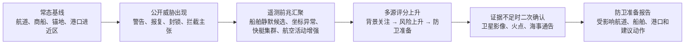
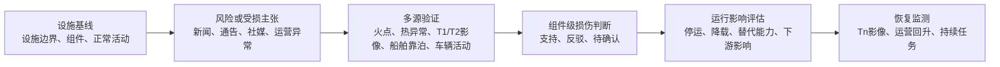

# DYINT 场景 2/3 Demo 数据、规则与补强方案

日期：2026-07-08

关联文档：

- `devdoc/DYINT四场景本体数据与分析方案.md`
- `devdoc/PRD-v6-当前项目适配分析与UAE场景.md`
- `devdoc/海贝AIS-ADSB数据盘点与场景1-4Demo可用性分析.md`
- `/Users/liushen/Documents/cursorDevs/gintbroker/docs/doops动态军事本体数据源挂接评估.md`

样例数据目录：

- `~/Documents/非Coding工作/DYINT/O多源情报系统/样例数据`

## 1. 业务目标：先把要保护什么讲清楚

这两个场景要讲的不是“系统能采很多数据”，而是一个更朴素、也更打动业务人员的问题：

> 当海上通道、商船航行和能源设施同时暴露在区域冲突风险下，系统能不能在事情变坏之前，把零散线索变成可解释的风险提醒，并帮助业务方提前做防卫准备、二次核验和持续监测？

场景 2 是主线，讲“商船和能源通道的袭击风险如何提前进入防卫准备”。它不能被写成单纯的信息降噪，也不能承诺精确预测某一时刻会发生袭击。它应该展示的是：在历史已知事件发生前，公开新闻、船舶自动识别、航空监视、海事通告和规则命中是否已经共同指向“风险正在升高”。

场景 3 是场景 2 的自然延伸。风险不一定只落在商船本身，也可能外溢到炼厂、油库、液化天然气码头、港口能源码头、电力和海水淡化综合体。场景 3 要讲清楚：当某个能源设施被新闻提及、被火点或影像变化指向、或被运营状态变化影响时，系统如何把“传闻”变成“待确认损伤”，再把“待确认损伤”变成“持续监测和恢复评估”。

这篇文档的写法因此分两层：

1. 先讲业务故事，让海事、能源、港口和安全保障人员看得懂，并能指出业务判断是否合理。
2. 再讲技术落地，让工程团队知道每个业务对象需要什么数据、如何加工、如何入图、如何出报告。

必须守住的边界：

- 可以做风险上升、证据验证、防卫准备、持续监测和服务连续性评估。
- 不做精确袭击时间、袭击路径、武器发射点或攻击方意图判断。
- 不输出进攻性行动建议，不展示可用于打击的精确军事坐标。
- 所有新闻和社媒内容先作为“主张”，只有经过多源验证后才能升级为“较可信事实”。

## 2. 场景 2：从商船风险上升到防卫准备

### 2.1 业务背景

对海湾客户而言，商船安全不是孤立的海上问题。油轮、液化天然气船、集装箱船和补给船穿过狭窄航道时，背后连接的是港口排队、能源出口、保险费用、航线绕行、船期延误和公众安全。业务人员真正关心的不是某个点位上“有没有异常”，而是：

- 哪些航道、锚地和港口进近区正在进入风险升高窗口？
- 哪些船舶需要提前提升监测或准备改变航行计划？
- 当前风险是由新闻传闻带来的，还是有船舶轨迹、航空活动或海事通告共同支撑？
- 证据还不够时，应该调取哪一片区域的卫星影像或火点数据进行二次确认？

传统做法通常是各看各的数据：新闻人员看公开报道，海事人员看船舶轨迹，安全人员看规则和通告，影像人员看遥感结果。问题在于，袭击前兆往往不是单条证据，而是多个弱信号在同一时间窗和同一海域中相互靠近。动态本体演示要解决的正是这个问题：让每条线索都挂到同一张业务对象网络上，让系统能说明“为什么现在需要准备”。

### 2.2 演示故事

建议使用 2026 年 5 月 25 日至 5 月 28 日作为主回放窗口，再用 2026 年 6 月 8 日至 6 月 11 日作为补充窗口。演示时不要一开始告诉用户“结果已经发生”，而是按历史时间线推进，让系统只使用当时已经可见的证据。



第一阶段是常态基线。系统先知道哪些航道、锚地、港口进近区和商船航次是业务关注对象，知道这些区域平时的船流密度、航速范围和正常等待状态。没有这层基线，后面的“异常”就没有参照物。

第二阶段是公开威胁出现。新闻中出现报复警告、无人机活动、海峡封锁、油轮拦截等主张时，系统不直接认定为事实，而是把它们变成“公开主张”。公开主张的价值在于给出风险方向和时间窗口，而不是单独决定预警等级。

第三阶段是遥测前兆汇聚。商船在高风险海域出现坐标缺失、速度异常、长时间无更新或静默后再出现；同一海域又出现快艇集群高速穿越、接近商船或航道；同一时间窗内航空活动增强。这些信号单独看都可能是噪声，放在同一空间和时间窗口里，才有业务意义。

第四阶段是多源评分上升。系统把新闻主张、船舶轨迹、航空活动和规则命中放到同一条评分时间线上。业务人员看到的不应是一堆告警，而应是风险为什么从“背景关注”升到“风险上升”，再升到“建议防卫准备”。

第五阶段是二次确认和报告输出。当风险已经升高但证据不足时，系统不急于下结论，而是创建二次确认任务：请求覆盖某个商船异常区域、港口进近区或能源设施关注区的卫星影像，补充火点和海事通告，最后形成防卫准备报告。

### 2.3 业务输出

场景 2 的输出要面向业务动作，而不是面向技术告警：

| 输出 | 业务人员看到什么 | 系统必须说明什么 |
| --- | --- | --- |
| 风险上升卡片 | 哪个海域、航道、船舶或港口进近区风险正在升高 | 触发原因、证据来源、置信度和不确定性 |
| 证据矩阵 | 新闻、船舶轨迹、航空活动、通告和卫星证据分别支持还是反驳 | 哪些证据已经可见，哪些还待核验 |
| 评分时间线 | 风险等级如何随时间变化 | 每个评分点只能使用当时已经可见的证据 |
| 二次确认任务 | 下一步需要看哪片区域、看什么传感器、看哪个时间窗 | 为什么当前证据不足，补什么证据可以降低不确定性 |
| 防卫准备报告 | 需要提升监测、准备护航/避险、通知海事/港口/能源运营方 | 只给保护性建议，不给进攻性建议 |

## 3. 场景 3：能源关键设施损伤与恢复监测

### 3.1 业务背景

能源设施不是地图上的一个点。一个炼厂、油库、液化天然气码头或电力和海水淡化综合体，内部有储罐、泊位、泵站、取水口、冷却设施、变电站和运输通道。业务人员关心的不是“图上有没有变化”，而是：

- 哪个设施、哪个组件受到影响？
- 影响是新闻主张、火点、影像变化、运营指标下降，还是多源共同支持？
- 损伤是否影响能源供应、港口作业、海水淡化或电力服务？
- 官方声称恢复后，影像和运营指标是否支持恢复判断？

场景 3 的价值在于把卫星影像从“看图”变成“设施运行状态证据”。它不应与场景 2 抢主叙事，而应作为场景 2 风险外溢后的设施保护链路：当袭击预警指向能源设施或港口能源码头时，系统进入设施监测模式；当新闻声称设施受损时，系统用火点、影像变化和运营状态做验证；当恢复声明出现时，系统继续用 T2、T3、Tn 影像和运营指标做恢复评估。

### 3.2 演示故事



第一阶段是设施基线。系统要先知道设施的边界、组件和正常活动模式。只知道“这里有一个设施点”是不够的；没有组件边界，就无法判断变化发生在储罐、泊位、泵站还是辅助区域，也无法判断业务影响。

第二阶段是风险或受损主张进入系统。主张可以来自新闻、官方通告、社媒、火点或运营指标下降。系统仍然先把它作为“待验证主张”，不直接当成事实。

第三阶段是多源验证。火点落入设施或缓冲区，影像显示烟羽、烧痕、结构变化或活动下降，船舶靠泊或车辆活动显著减少，官方/企业通告提到停运或降载，这些证据一起决定损伤判断的置信度。

第四阶段是组件级损伤和运行影响。业务人员需要看到“哪个组件可能受影响，为什么这样判断，对服务连续性有什么影响”。如果证据不足，系统应明确写成“待确认”，而不是把不确定性隐藏起来。

第五阶段是恢复监测。恢复不是“没有火点”就结束。系统需要继续观察 Tn 影像、设施活动、靠泊和运营声明，判断是否从“疑似受损”降级为“恢复中”或“已恢复”。

### 3.3 业务输出

| 输出 | 业务人员看到什么 | 系统必须说明什么 |
| --- | --- | --- |
| 设施监测卡片 | 哪个设施、哪个组件、当前状态是什么 | 设施边界、组件边界、证据类型和置信度 |
| 损伤评估 | 是否存在烧痕、烟羽、结构变化、活动下降 | 每个判断是支持、反驳还是待确认 |
| 运行影响 | 是否影响能源供应、港口作业、电力或海水淡化服务 | 影响范围、持续时间、替代能力和数据来源 |
| 恢复证据 | 活动是否回升，官方声明是否被影像和运营数据支持 | 恢复判断不能只依赖单一来源 |
| 持续监测任务 | 下一次看什么、什么时候看、由谁复核 | 未解决的不确定性和退出条件 |

## 4. 动态本体与数据落地方案

### 4.1 技术分层

根据 `doops动态军事本体数据源挂接评估.md`，`doops-dev` 适合承接：

- 对象定义。
- 关系定义。
- 属性和标签。
- 规则配置。
- 规则命中记录。
- 证据治理。
- 对象/关系入图。

但当前 doops 规则能力不适合直接计算：

- 地理围栏。
- 距离。
- 时间窗口。
- 轨迹聚合。
- 多目标接近。
- AIS/ADS-B 消失再出现。
- 多源时序相关性。

因此第一版演示架构应是：

```text
数据层
  新闻 / AIS / ADS-B / 卫星 / 火点 / AOI
    ↓
派生计算层
  去重、时间窗、距离、轨迹异常、快艇接近、航空活动增强
    ↓
动态本体层 doops
  对象、关系、规则元数据、规则命中、证据链、报告对象
    ↓
展示层 gintbroker 或 demo UI
  地图、时间轴、证据矩阵、预警卡、设施监测卡、报告
```

### 4.2 现有材料如何支撑业务故事

现有材料不能直接当成完整客户 demo，但已经足够支撑“历史回放 + 证据链 + 规则命中”的第一版故事。关键是把材料放到正确位置：新闻负责给出公开主张和结果线索，船舶自动识别负责给出航行前兆，航空监视负责给出空域活动背景，卫星样例负责说明二次确认方法，海贝大数据负责把演示从小样本推进到更真实的历史底座。

| 材料 | 能支撑的业务环节 | 当前可用价值 | 主要限制 |
| --- | --- | --- | --- |
| 5-6 月新闻样例 | 公开威胁、事件结果、矛盾声明、恢复声明 | 可构造 2026 年 5 月 25 日至 5 月 28 日、2026 年 6 月 8 日至 6 月 11 日两个历史回放窗口 | 缺原文归档、采集时间、来源可靠度、同源转载关系；必须补“当时可见时间” |
| 船舶自动识别小样本 | 商船异常、快艇活动、航母/补给活动样例 | 可解释“快艇集群”“商船坐标缺失/速度异常”“航母部署背景”如何进入风险评分 | 样例演示性强，面向客户需替换为海贝派生数据和身份补全结果 |
| 航空监视小样本 | 侦察、加油、预警、无人机、战机活动样例 | 可解释航空活动为什么只是风险背景和旁证，不是单独结论 | 大文件身份字段缺失，需人工映射或外部身份库 |
| 样例知识库和行为规则 | 船舶、航空、新闻、卫星的规则骨架 | 可复用“信号消失、异常停留、区域游荡、多源一致性、影像变化”等规则思想 | 需要把偏进攻性表述改成防护、验证、监测和复核语言 |
| 4 张卫星样例图 | 多时相影像变化方法 | 可演示 T0/T1/T2/Tn、目标检测、变化判断和人工复核流程 | 当前图不是能源设施损伤样例，不能直接作为场景 3 的业务证据 |
| 海贝 AIS/ADS-B 大数据 | 真实历史底座 | 可做 5-6 月海峡和阿曼湾区域的船舶/航空活动派生层 | 原始数据约 12GB，必须先做去重、分区、摘要和身份补全，不能反复全表扫描 |

### 4.3 业务对象字典（动态本体）

业务对象名称优先使用中文。英文类名、字段名和文件名统一放到后面的术语对照表，避免业务评审时被技术名词挡住。

| 场景 | 类别 | 业务对象 | 固有画像 | 动态状态 | 规则与推演能力 | 交互对象 |
| --- | --- | --- | --- | --- | --- | --- |
| 2 | 空间区域 | 海上关注区与商船航道 | 区域名称、边界、所属海域、航道方向、港口/锚地/交通分离制关系、正常船流密度 | 当前风险等级、近 24/72 小时船流变化、公开主张数量、遥测异常数量、证据完整度 | 把船舶、航空、新闻和卫星证据归到同一空间；计算高风险窗口；为二次确认任务提供区域范围 | 商船、快艇、航空器、新闻主张、海事通告、卫星任务 |
| 2 | 历史结果 | 历史袭击、拦截或海峡摩擦事件 | 事件类型、结果时间、结果区域、影响对象、结果确认来源 | 回放窗口、当时可见证据、模型命中状态、评分曲线 | 反推前兆窗口；校验系统是否提前给出风险上升；防止把结果后的信息提前使用 | 新闻主张、船舶异常、航空活动、预警报告 |
| 2 | 受保护对象 | 商船、油轮、液化天然气船和航次 | 船名、船型、船旗、运营方、货物类型、计划航线、目的港、正常航速范围 | 当前/最近位置、航速、航向、导航状态、是否偏航、是否低速或停船、最后更新时间、风险暴露窗口 | 识别高风险区域穿越、航迹缺口、坐标异常、异常减速、受影响航次 | 船舶观测、快艇活动、航道、港口、海事通告、防卫建议 |
| 2 | 威胁候选 | 快艇或巡逻艇活动 | 候选船型、身份可信度、常见活动区、速度阈值、集群阈值 | 同窗船只数、平均/最高速度、距离商船/航道/设施最近距离、接近角、持续时间 | 识别快艇集群、高速穿越、近距离伴随和同窗升级；输出“候选”而非直接定性 | 商船、航道、船舶异常、预警事件、证据链 |
| 2 | 遥测观测 | 船舶自动识别观测与异常 | 数据源、字段映射、去重键、接收质量、基线窗口 | 坐标、航速、航向、更新时间、缺口时长、位置跳变、质量评分、异常类型 | 去重、分区、轨迹分段、静默候选、坐标跳变、异常停留、同窗聚类 | 商船、快艇、航道、预警事件、数据质量说明 |
| 2 | 空域活动 | 航空器与航空支撑活动 | 机型、呼号、运营方、身份可信度、类别标签 | 位置、高度、速度、航向、空域停留、信号缺口、同窗出现次数 | 识别固定空域值班、航空活动增强、无人机活动候选、侦察/加油/预警支撑；只作旁证加权 | 航空监视观测、新闻主张、战略态势、预警事件 |
| 2 | 战略背景 | 航母、补给和前沿部署信号 | 编队对象、公开部署来源、关联港口/基地、身份可信度 | 当前粗粒度区域、活动时间窗、支援航空器同窗、新闻热度、是否与商船窗口重叠 | 识别远期压力背景；仅做背景加权，不输出精确意图和精确坐标 | 船舶观测、航空监视、新闻、预警评分 |
| 2 | 公开信息 | 新闻、社媒和官方主张 | 来源、语言、来源可靠度、原文链接、采集时间、许可状态 | 当时可见时间、主张类型、地点/时间抽取、目标对象、矛盾关系、抽取置信度 | 提取警告、报复、封锁、拦截、爆炸、停运和恢复主张；识别多源一致和矛盾降权 | 历史结果、船舶/航空证据、海事通告、人工复核 |
| 2 | 融合判断 | 袭击风险预警事件 | 预警模板、阈值、关注区域、适用船型/航道、评分版本 | 风险分、风险等级、关键触发原因、支持/反驳证据、不确定性、下一步任务 | 多源同窗升级、评分时间线、证据不足触发二次确认、未来信息泄露检查 | 商船、航道、新闻、船舶/航空证据、卫星任务、防卫报告 |
| 2/3 | 任务编排 | 卫星二次确认任务 | 传感器需求、关注区域、目标类型、分辨率/重访要求、任务优先级 | 触发原因、任务状态、可用影像、覆盖时间、云量/质量、人工复核状态 | 在证据不足时选择传感器和时间窗；管理 T0/T1/Tn；把检测结果回写证据链 | 卫星影像、火点、设施组件、预警事件、损伤评估 |
| 2 | 业务输出 | 防卫准备建议与预警报告 | 报告模板、客户关注资产、行动边界、分发对象 | 影响航道/船舶/设施、建议等级、建议措施、置信度、未决问题、复核状态 | 生成航行安全提示、提升监测、护航/避险准备、二次确认清单和证据矩阵 | 预警事件、海事部门、港口、能源运营方、指挥界面 |
| 3 | 设施资产 | 能源关键设施 | 设施名称、类型、运营方、边界、关键等级、服务对象 | 当前运行状态、风险等级、最近火点、影像覆盖、运营活动变化、恢复进度 | 建立设施画像；匹配新闻、火点和影像；计算设施暴露和业务影响 | 设施组件、火点、卫星影像、运营状态、预警事件 |
| 3 | 设施组件 | 储罐、码头、泵站、取水口、变电站等组件 | 组件类型、边界、功能、替代能力、与设施关系 | 组件状态、疑似损伤类型、活动下降、遮挡/云量影响、复核结论 | 组件级变化检测、损伤范围归因、恢复指标绑定 | 能源设施、影像检测对象、损伤评估、恢复证据 |
| 3 | 设施基线 | 正常运行基线 | 基线窗口、季节性、正常活动指标、历史火点、靠泊、车辆活动阈值 | 当前值、偏离比例、异常持续时间、基线可信度 | 判断当前异常是否超过正常波动，避免把维护、季节或天气误判为损伤 | 设施、运营指标、影像、火点、恢复证据 |
| 3 | 影像证据 | 多时相影像与检测对象 | 传感器、分辨率、拍摄时间、覆盖区域、云量、许可、T0/T1/Tn 标记 | 检测目标、变化区域、烟羽、烧痕、结构变化、活动变化、检测置信度 | 多时相对比、变化检测、目标计数、人工复核候选变化 | 设施组件、火点、损伤评估、恢复证据 |
| 3 | 热异常证据 | 火点和热异常 | 数据源、传感器、置信度字段、空间误差、时间戳 | 是否落入设施或缓冲区、火点强度、持续时间、与新闻/影像同窗关系 | 火点匹配、误差缓冲、同窗验证、与历史火点基线比较 | 设施、组件、新闻主张、损伤评估 |
| 3 | 设施结论 | 损伤评估 | 损伤类型、组件重要性、置信度规则、评估模板 | 损伤范围、受影响组件、证据状态、业务影响、复核人 | 融合影像、火点、新闻和运营状态，输出组件级损伤和不确定性 | 设施组件、火点、影像、运营状态、监测报告 |
| 3 | 运行影响 | 运行状态和供应链影响 | 服务类型、正常产能/吞吐、下游依赖、替代设施、数据来源 | 停运、降载、恢复、影响范围、持续时间、官方/企业通告置信度 | 将损伤转化为服务连续性影响，避免只讲图像变化 | 港口/能源通告、船舶靠泊、新闻、恢复证据 |
| 3 | 恢复闭环 | 恢复证据与持续监测任务 | 恢复指标、监测周期、完成标准、负责人、复核规则 | 活动回升、影像变化消退、火点消失、运营指标恢复、未解决风险 | 恢复验证、持续监测排程、状态降级和退出条件判断 | 设施、影像、运营状态、报告、下一轮任务 |

### 4.4 数据治理需求表

这张表用于把 demo 从“有几份样例数据”推进到“每类业务对象如何被数据实例化”。“加工需求”按序号写，是为了让业务人员和数据人员能逐条确认：哪些是必要步骤，哪些可以推迟，哪些判断逻辑不符合业务常识。

| 场景 | 数据域 | 数据对象 | 核心数据项 | 当前材料 / 后续来源 | 更新频率 | 加工需求 | 需扩展能力 |
| --- | --- | --- | --- | --- | --- | --- | --- |
| 2 | 历史结果与公开主张 | 历史事件、新闻主张、威胁信号 | 事件时间、地点、目标、主张类型、来源、原文链接、当时可见时间、结果确认时间、可信度、转载关系 | 新闻样例；后续补国际媒体、本地媒体、海事通告、港口通告 | demo 固定包；实时系统分钟/小时级 | 1. 区分前兆、结果、确认和背景。<br>2. 补齐当时可见时间，防止未来信息泄露。<br>3. 保留原文和译文，记录来源可靠度。<br>4. 标注同源转载和矛盾声明。 | 新闻主张抽取、事件归一、来源评分、矛盾检测、历史回放评估 |
| 2 | 商船与航道基础库 | 商船、航次、航道、锚地、港口进近区 | 船名、船型、船旗、运营方、货物类型、计划航线、目的港、区域边界、正常密度和速度基线 | 船舶自动识别小样本、海贝 AIS、地理知识库；后续补电子海图、港口官网、商业 AIS | 静态库周/月级；航次分钟/小时级 | 1. 补全船舶身份和船型。<br>2. 将临时矩形范围升级为正式区域边界。<br>3. 建立航道、锚地和港口进近区关系。<br>4. 建立正常航速、密度和等待基线。 | 船舶身份补全、航次重建、区域匹配、基线建模 |
| 2 | 船舶遥测与异常 | 船舶自动识别观测、轨迹异常、快艇活动 | 时间、经纬度、航速、航向、导航状态、缺口时长、跳变距离、异常类型、目标距离、接收质量 | 船舶自动识别小样本、海贝 5-6 月 AIS 原始 CSV | 原始流秒/分钟级；demo 派生表固定 | 1. 按真实时间分区并去重。<br>2. 统一坐标、时间和速度单位。<br>3. 标出坐标缺失、速度异常、长时间无更新。<br>4. 给每个异常附数据质量解释，避免把数据缺口直接等同静默。 | 轨迹分段、静默候选、坐标跳变、快艇集群、距离阈值、派生数据层 |
| 2 | 航空活动 | 航空器、侦察/加油/预警/无人机/战机活动 | 机型、呼号、运营方、位置、高度、速度、空域停留、身份置信度、活动类型 | 航空监视小样本、海贝 5-6 月 ADS-B；后续补公开航空监视源和客户航空数据 | 原始流秒/分钟级；demo 固定窗口 | 1. 补全航空器身份。<br>2. 区分民航、未知、支援类和高关注类别。<br>3. 处理高度、速度和信号缺口异常。<br>4. 身份不足时只输出“候选活动”。 | 航空器身份补全、固定空域值班检测、活动增强基线、同窗关联评分 |
| 2 | 战略背景 | 航母、补给和前沿部署信号 | 部署新闻、支援航空器、活动窗口、粗粒度区域、与商船风险窗口的时间距离、可信度 | 新闻、船舶和航空小样本；后续补公开报道和客户情报源 | demo 固定；真实系统小时/日级 | 1. 只做背景压力加权，不推断攻击意图。<br>2. 输出粗粒度区域，不输出精确坐标。<br>3. 与商船风险窗口建立时间关系。 | 背景态势事件化、报告脱敏、风险窗口关联 |
| 2 | 多源预警融合 | 风险预警、证据关系、防卫报告 | 风险分、等级、触发原因、支持/反驳证据、未决问题、证据时间线、评分版本 | 新闻、船舶、航空、海事通告、卫星任务输出 | demo 按回放时间推进；真实系统分钟/小时级 | 1. 统一证据编号和关系类型。<br>2. 评分只能使用当时可见证据。<br>3. 保留反证和质量缺口。<br>4. 把结论分为背景关注、风险上升、防卫准备、需要二次确认。 | 评分引擎、证据矩阵、未来信息泄露检查、报告生成 |
| 2/3 | 卫星二次确认 | 影像任务、多时相影像、检测对象 | 触发原因、关注区域、传感器、时间窗、分辨率、云量、任务状态、覆盖结果、复核结论 | 当前卫星样例图；后续补公开卫星、商业光学/雷达影像 | 任务触发；重访周期小时到天 | 1. 当前样例只能演示方法，不能当作商船或能源设施证据。<br>2. 每张影像标 T0、T1、T2、Tn。<br>3. 记录云量、分辨率、成像角度和许可限制。<br>4. 高风险结论必须有人工作复核。 | 影像检索、任务排程、船舶/设施变化检测、人工复核工作流 |
| 3 | 能源设施基础库 | 能源设施、设施组件、服务对象 | 设施名称、类型、运营方、边界、组件边界、关键等级、替代能力、服务对象 | 地理知识库字段表；需补真实能源设施边界和组件标注 | 静态库月/季度级；重大变更即时 | 1. 设施不能只做点位，必须拆到组件。<br>2. 组件至少覆盖储罐、泊位、泵站、取水口、变电站等关键对象。<br>3. 记录敏感坐标的展示脱敏级别。 | 设施目录构建、组件边界标注、关键性分级、展示脱敏 |
| 3 | 影像变化 | 多时相影像、检测对象、损伤候选 | T0/T1/T2/Tn、传感器、分辨率、云量、变化区域、烟羽、烧痕、结构变化、活动变化、置信度 | 当前卫星样例图可做方法样例；正式 demo 需能源设施影像 | 重访周期小时到天；demo 固定 | 1. 建立 T0 基线。<br>2. 把影像变化映射到设施组件。<br>3. 标注云、阴影、角度造成的不确定性。<br>4. 第一版允许人工标注候选变化。 | 多时相变化检测、组件级归因、目标计数、人工复核标注 |
| 3 | 火点和热异常 | 火点、热异常、损伤证据 | 火点时间、坐标、传感器、置信度、强度、与设施/组件距离、持续时间 | 后续补 NASA FIRMS，也可接商业热红外或夜光产品 | 小时/日级 | 1. 按空间误差建立缓冲区。<br>2. 与历史火点基线比较。<br>3. 与新闻、影像同窗验证。<br>4. 无火点也要作为反证记录。 | 火点区域匹配、缓冲区规则、历史基线、支持/反驳证据生成 |
| 3 | 运营状态和业务影响 | 运行状态、供应链影响、恢复证据 | 官方/企业通告、停运/降载/恢复、船舶靠泊、车辆活动、吞吐/产能、下游影响、替代能力 | 港口/能源企业公告、航运数据、AIS 靠泊、新闻、客户运营数据 | 通告事件触发；运营指标小时/日级 | 1. 把新闻声明和运行事实分开。<br>2. 统一吞吐、产能、靠泊和车辆活动口径。<br>3. 排除季节、维护、天气和节假日影响。<br>4. 将损伤转化为服务连续性影响。 | 运营活动基线、靠泊/车辆趋势、服务连续性评估 |
| 3 | 恢复闭环 | 设施基线、恢复证据、监测任务 | 当前值、恢复指标、监测周期、任务状态、复核人、完成标准 | 影像、火点、运营指标、官方通告 | demo T0/T1/T2/Tn；真实系统按任务周期 | 1. 恢复不能只看“无火点”。<br>2. 至少需要影像活动、运营状态、通告或靠泊/车辆活动中的两类证据。<br>3. 写清持续监测退出条件。 | 恢复评分、持续监测排程、状态降级规则、设施报告生成 |
| 2/3 | 元数据和审计 | 数据清单、来源记录、证据关系 | 数据版本、来源、采集时间、处理脚本、字段映射、许可、脱敏级别、质量问题 | 所有 demo 数据包和派生表 | 每次数据包冻结时生成 | 1. 每个结论可追溯到原始证据。<br>2. 敏感字段不进业务报告。<br>3. 记录缺失数据和不能证明的点。<br>4. 冻结 demo 数据版本，避免演示前后结论漂移。 | 数据血缘、证据审计、报告引用生成、质量门禁 |

### 4.5 业务关系与证据关系

| 关系 | 主体 → 客体 | 业务意义 |
| --- | --- | --- |
| 位于 | 船舶、航空器、新闻主张、设施 → 海上关注区或设施区域 | 把不同来源的证据放进同一个空间语境 |
| 接近 | 快艇、商船、火点、影像变化 → 航道、商船或设施组件 | 判断风险是否可能影响业务对象 |
| 声称 | 新闻来源 → 公开主张 | 保留来源说法，不把新闻直接当事实 |
| 早于 | 前兆信号 → 历史结果 | 支撑历史回放和模型验证 |
| 支持 | 新闻、船舶、航空、卫星、火点 → 预警或损伤判断 | 提升置信度 |
| 反驳 | 无火点、无影像变化、官方否认、正常运营 → 预警或损伤判断 | 降低置信度或触发人工复核 |
| 触发 | 预警事件 → 二次确认任务、报告、持续监测 | 打通工作流 |
| 影响 | 预警或损伤判断 → 商船、航道、港口、能源设施、服务对象 | 把技术发现转为业务影响 |
| 相比基线变化 | 新影像或新指标 → T0 基线 | 判断损伤、活动下降或恢复 |

### 4.6 规则设计

第一版规则应当显式、可解释，不需要一开始训练复杂模型。规则名称用业务语言表达，规则编号只作为工程落地时的内部标识。

| 场景 | 规则 | 输入 | 触发条件 | 输出 |
| --- | --- | --- | --- | --- |
| 2 | 公开威胁升级 | 新闻主张、官方/海事通告 | 72 小时内出现警告、报复、无人机、油轮拦截、海峡封锁等两类以上主张 | 威胁信号 |
| 2 | 快艇集群接近 | 船舶自动识别 | 同一关注区内多艘快艇高速出现，并接近商船、航道或港口进近区 | 船舶威胁候选 |
| 2 | 商船轨迹异常 | 船舶自动识别 | 商船在高风险区域出现坐标缺失、长时间无更新、速度异常、静默后再出现 | 船舶异常候选 |
| 2 | 航空活动增强 | 航空监视 | 侦察、加油、预警、无人机或战机活动在同一窗口内增强 | 航空支撑信号 |
| 2 | 背景态势加权 | 新闻、船舶、航空 | 航母、补给或前沿部署信号与商船风险窗口重叠 | 背景压力加权 |
| 2 | 多源同窗升级 | 新闻、船舶、航空、通告 | 24-72 小时内公开威胁、船舶异常、航空活动中至少两类同时出现 | 风险预警升级 |
| 2/3 | 证据不足二次确认 | 预警事件 | 风险较高，但缺少卫星、火点或权威通告支持 | 卫星二次确认任务 |
| 3 | 火点匹配设施 | 火点、设施区域 | 火点落入设施或缓冲区，并与新闻或影像同窗 | 损伤证据 |
| 3 | 影像变化匹配组件 | T0/T1/T2/Tn 影像 | 设施组件出现新增烧痕、烟羽、结构变化或活动下降 | 损伤评估 |
| 3 | 运行状态下降 | 靠泊、车辆、吞吐、通告 | 运营指标低于基线，且不能由季节、维护或天气解释 | 运行影响 |
| 3 | 恢复证据验证 | Tn 影像、运营指标、通告 | 活动回升、火点消失、影像变化收敛，且至少两类证据支持 | 恢复证据 |
| 3 | 持续监测 | 损伤评估、恢复证据 | 仍有不确定性，或恢复条件未满足 | 持续监测任务 |

风险评分第一版建议仍用加权规则，便于讲清楚每一分从哪里来：

```text
公开威胁升级 +20
多源新闻一致 +10
快艇集群接近 +25
商船轨迹异常 +20
航空活动增强 +15
背景态势支撑 +10
权威通告支持 +20
卫星/火点支持 +20
证据矛盾 -20
数据质量不足 -10
```

分级口径：

- `0-29`：背景关注。继续监测，不建议升级响应。
- `30-49`：风险上升。提示相关航道、商船或设施进入关注窗口。
- `50-69`：建议防卫准备。建议提升监测、准备护航/避险、通知相关运营方。
- `70+`：需要二次确认和高层简报。启动卫星、火点、海事通告或人工复核任务。

### 4.7 中英文术语对照

| 中文业务名 | 英文/工程名 |
| --- | --- |
| 海上关注区 | MaritimeAOI |
| 商船航道 | SeaLane |
| 历史袭击/拦截/海峡摩擦事件 | HistoricalAttackEvent |
| 商船/油轮/液化天然气船 | MerchantVessel |
| 航次 | Voyage |
| 快艇/巡逻艇活动 | FastBoatActivity |
| 船舶自动识别观测 | AISObservation |
| 遥测异常 | TelemetryAnomaly |
| 航空器 | Aircraft |
| 航空支撑活动 | AirSupportActivity |
| 航母/补给/前沿部署信号 | StrategicPostureSignal |
| 公开主张 | SecurityIncidentClaim |
| 威胁信号 | ThreatSignal |
| 袭击风险预警事件 | AttackWarningEvent |
| 卫星二次确认任务 | ImageryVerificationTask |
| 防卫准备建议 | DefensivePreparednessAdvice |
| 预警报告 | WarningReport |
| 能源关键设施 | CriticalEnergyFacility |
| 设施组件 | FacilityComponent |
| 设施监测基线 | FacilityMonitoringBaseline |
| 影像资产 | ImageryAsset |
| 检测对象 | DetectionObject |
| 火点/热异常 | FireHotspot / ThermalAnomaly |
| 损伤评估 | DamageAssessment |
| 运行状态 | OperationalStatus |
| 供应链影响 | SupplyChainImpact |
| 恢复证据 | RecoveryEvidence |
| 持续监测任务 | MonitoringTask |
| 证据关系 | EvidenceLink |
| 数据清单 | DataManifest |

## 5. 第一版固定 demo 包

### 5.1 建议目录

```text
scenario_2_attack_warning_demo/
  00_manifest/
    data_manifest.csv
    assumptions.md
  01_aoi/
    hormuz_oman.geojson
    merchant_shipping_lane.geojson
    port_approach.geojson
  02_news/
    news_claims.csv
    event_results.csv
    threat_signal_rules.csv
  03_ais/
    ais_points_sample.csv
    ais_anomalies.csv
    vessel_identity.csv
  04_adsb/
    adsb_points_sample.csv
    aircraft_identity.csv
    aviation_activity_signals.csv
  05_fusion/
    threat_signals.csv
    warning_events.csv
    evidence_links.csv
    warning_score_timeline.csv
    warning_report.md
  06_satellite_task/
    imagery_verification_tasks.csv
```

```text
scenario_3_energy_facility_monitoring_demo/
  00_manifest/
    data_manifest.csv
  01_facility/
    energy_facility_catalog.csv
    facility_components.geojson
    baseline_metrics.csv
  02_imagery/
    imagery_assets.csv
    detections.csv
    change_assessments.csv
  03_fire/
    firms_points.csv
    hotspot_matches.csv
  04_fusion/
    damage_assessments.csv
    recovery_evidence.csv
    monitoring_tasks.csv
    facility_report.md
```

### 5.2 场景 2 最小表

#### `event_results.csv`

用于“新闻结果反推预警模型”。

| 字段 | 说明 |
| --- | --- |
| `event_id` | 历史结果事件 ID |
| `event_time` | 结果时间 |
| `event_type` | `merchant_vessel_attack`、`interception`、`maritime_clash`、`strait_closure_claim` |
| `aoi_id` | AOI |
| `result_summary` | 历史结果摘要 |
| `known_after_time` | 结果被新闻确认或报道的时间 |

#### `threat_signals.csv`

| 字段 | 说明 |
| --- | --- |
| `signal_id` | 信号 ID |
| `signal_type` | `news_warning`、`ais_anomaly`、`fast_boat_cluster`、`air_support_activity`、`carrier_posture` |
| `observed_at` | 信号时间 |
| `aoi_id` | AOI |
| `target_ref` | 船舶/航空器/新闻主张 |
| `score_delta` | 风险分增量 |
| `evidence_ref` | 证据 |
| `notes` | 解释 |

#### `warning_score_timeline.csv`

| 字段 | 说明 |
| --- | --- |
| `event_id` | 结果事件 |
| `timestamp` | 时间点 |
| `score` | 当时可见证据下的预警分 |
| `level` | `background`、`elevated`、`prepare_defense`、`verify_now` |
| `top_reasons` | 触发原因 |
| `not_yet_known` | 当时还未知的结果信息，避免未来信息泄露 |

### 5.3 防止“未来信息泄露”

历史回放最容易犯的错误是把结果发生后的新闻拿来当发生前预警信号。必须把数据分成：

| 类型 | 用法 |
| --- | --- |
| `pre_event_signal` | 结果发生前可见，允许用于预警 |
| `event_result` | 结果事实，只用于评估，不参与提前评分 |
| `post_event_confirmation` | 结果后的确认报道，只用于验证模型是否命中 |
| `background_context` | 背景信息，低权重 |

每条新闻和遥测点都要有 `visible_at`。预警评分只能使用 `visible_at <= scoring_time` 的证据。

## 6. 仍需补充的数据

### 6.1 场景 2 P0

| 缺口 | 为什么重要 | 建议 |
| --- | --- | --- |
| 5-6 月商船被袭/拦截结果清单 | 没有结果表就无法做反推验证 | 从新闻样例人工整理 `event_results.csv`，后续补 UKMTO/JMIC/官方通告 |
| 海贝 AIS 派生层 | 小样本太演示化，客户演示需要更真实商船底座 | 按上一份文档生成去重 Parquet/DuckDB 摘要 |
| 船舶身份 enrichment | 需要区分快艇、油轮、商船、航母、补给舰 | MMSI/IMO/船型/船旗/运营方 |
| ADS-B 身份 enrichment | 大文件身份缺失，需识别侦察/加油/无人机/战机样例 | ICAO registry 或固定样例映射 |
| 正式 AOI polygon | bbox 不够可信 | 霍尔木兹、阿曼湾、航道、锚地、港口进近区 |
| 海事通告 | 新闻之外的权威来源 | UKMTO、JMIC、NAVAREA IX、港口通告 |
| 预警标签人工标注 | 第一版需要证明哪些信号是结果前可见 | 给新闻/AIS/ADS-B 标 `pre_event_signal`、`result`、`confirmation` |

### 6.2 场景 2 P1

| 缺口 | 价值 |
| --- | --- |
| 社媒/视频证据 | 补强袭击现场主张，但需媒体反查 |
| 卫星影像任务样例 | 风险高但证据不足时触发二次确认 |
| 天气/海况 | 排除低速、停船、绕航的自然原因 |
| 航运影响指标 | 证明预警与客户利益相关，如排队、延误、保费 |

### 6.3 场景 3 P0

| 缺口 | 为什么重要 |
| --- | --- |
| 能源设施 AOI 和组件边界 | 没有组件就无法做损伤监测 |
| 真实能源设施 T0/T1/T2/Tn 影像 | 当前 4 张图不是能源设施损伤样例 |
| FIRMS 火点和历史基线 | 判断爆炸/火灾主张 |
| 官方/运营状态记录 | 判断是否中断和恢复 |
| 影像人工标注 | 第一版可人工标注损伤/恢复候选 |

## 7. 验收口径

### 7.1 场景 2

| 验收项 | 最低标准 |
| --- | --- |
| 历史事件回放 | 至少 1 个 5 月事件、1 个 6 月事件 |
| 前兆窗口 | 每个事件至少回看 24-72 小时 |
| 多源证据 | 每个事件至少有新闻 + AIS + ADS-B 三类证据中的两类 |
| 预警评分 | 能展示结果发生前分数逐步上升 |
| 防未来信息泄露 | 评分时间点不能使用结果后的证据 |
| 二次确认 | 至少 1 条高风险但证据不足事件触发卫星任务 |
| 输出 | 生成防卫准备报告，不输出进攻建议 |

### 7.2 场景 3

| 验收项 | 最低标准 |
| --- | --- |
| 设施对象 | 至少 1 个能源设施，5 个组件 |
| 多时相影像 | 至少 T0/T1/T2 |
| 火点/热异常 | 至少 1 类遥感热异常证据或明确说明无火点 |
| 损伤判断 | 每个判断有支持/反驳/待确认状态 |
| 恢复监测 | 至少一条 Tn 或运营指标恢复证据 |
| 输出 | 生成设施监测报告和持续监测任务 |

## 8. 文档和工程建议

1. 后续主方案和演示稿应先讲业务故事，再展示对象、规则、数据和系统能力。业务人员先认可“要保护什么、为什么现在需要准备、哪些证据可信”，技术实现才有评价基础。
2. 场景 2 必须稳定定位为“袭击风险预警与防卫准备”。降噪只是支撑证据质量的辅助能力，不能成为主叙事。
3. 场景 2 的第一优先级是构造 `event_results.csv`、`threat_signals.csv`、`warning_score_timeline.csv`，证明历史回放、前兆识别和防未来信息泄露逻辑。
4. 场景 3 的第一优先级是补真实能源设施关注区、组件边界和多时相影像。非能源设施图片只能作为方法样例，不能作为客户业务证据。
5. 动态本体第一版只负责对象、关系、规则元数据、规则命中、证据链和报告对象；复杂轨迹、空间距离和时序窗口计算先在派生计算层完成。
6. 对外材料中的对象名、规则名和表头优先使用中文；英文类名、字段名和文件名放入术语对照或工程附录，避免业务评审被技术命名打断。
