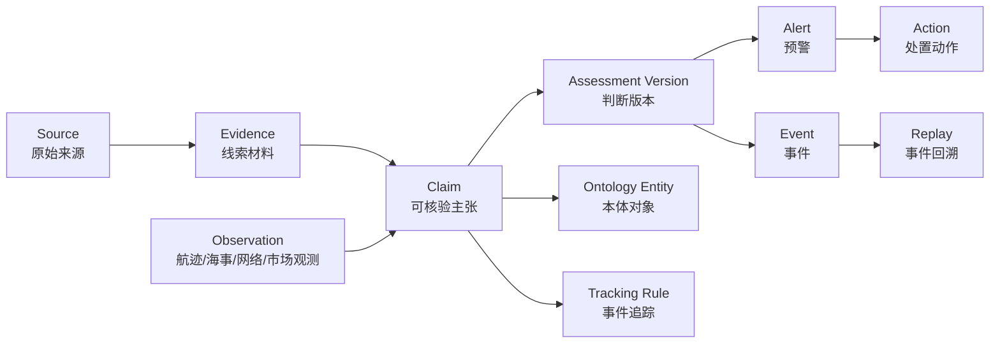

# GISA 军事专题预警分析、事件回溯与事件追踪方法对齐分析

**巡查对象：** [GISA Mock 军事专题](https://gisamock.trscd.com.cn/)

**巡查时间：** 2026 年 8 月 2 日 10:39—11:05 CST

**对照基线：** [《约旦拦截伊朗导弹事件多源验证与升级研判》](./约旦拦截伊朗导弹事件多源验证与升级研判-20260729.md)

**巡查范围：** 中东地区美伊冲突专题中的预警列表、预警详情、线索交叉验证、事件回溯播放器和事件追踪表单。本轮只做读取和交互核验，没有确认创建追踪任务，没有修改线上数据。

## 1. 结论

Mock 的产品方向与现有分析方法基本一致，已经具备“专题聚合—预警研判—本体关联—线索核验—时空回溯—持续追踪”的展示骨架。它能把一份较长的研判材料拆成地图、卡片、时间轴和跟踪配置，适合作为多源情报分析结果的运行界面。

当前只能评价为**结构部分吻合，分析方法和数据治理尚未闭合**。主要问题不在页面样式，而在五项基础语义没有稳定落到产品中：

1. 原始入口情报与后续判断没有分层，用户难以看到最初消息如何被验证和修正；
2. 来源、转载链和参与方立场没有可靠去重，界面已经出现来源错标；
3. “行动发生、宣称目标、实际命中、造成毁伤、责任归属”没有稳定拆成独立主张；
4. 事件时间、发布时间、系统发现时间和分析版本时间混在同一条时间轴中；
5. 事件追踪仍像通用表单，尚未承接本事件真正需要监测的主张、来源、升级阈值和停止条件。

演示数据还存在会直接误导研判的串值：5 枚变成 50 枚，IRNA 和 CENTCOM 线索被标成约旦官方，霍尔木兹条目使用南海坐标，空袭事件追踪预填 AIS 船艇行为关键词，关注区域地图也落在东南亚。这些问题会同时污染风险评分、地图联动、本体选择、回溯和追踪，不应按普通文案缺陷处理。**在用于客户演示或业务验收前，必须先完成 P0 数据正确性 Gate。**

## 2. 当前页面已经具备的能力

| 页面区域 | 当前可见能力 | 与分析工作的关系 |
| --- | --- | --- |
| 军事专题列表 | 中东美伊、南海等专题入口，显示最新动态摘要 | 对应按地区、冲突和任务组织分析工作区 |
| 专题总览 | 预警、事件、海事本体、飞行器数量 | 对应专题对象和分析产物汇总 |
| 预警列表 | 风险等级、标题、摘要、时间、位置、相关线索 | 对应面向值班人员的快速发现和排序 |
| 预警详情 | 风险分、置信度、分析结论、预警本体、预警区域、事件线索、主张验证和综合建议 | 已覆盖研判报告的主要展示要素 |
| 事件线索 | 按时间展示官方或媒体材料 | 可承接入口消息和后续增量来源 |
| 线索交叉验证 | 以问题卡展示结论、依据、缺口和置信度 | 形式上接近现有“主张核验矩阵” |
| 事件回溯 | 时间范围、实体数量、滑块、上一帧、下一帧、播放和实时切换 | 可承接时空观测和事件阶段回放 |
| 事件追踪 | 事件名称、行为关键词、本体、时间窗口、关注区域、描述和 AI 生成 | 可承接持续监测规则的创建入口 |

这些能力说明产品并不缺少主要页面。下一步重点是让每个页面读取同一套事实对象和版本关系，避免一个页面中数量正确、另一个页面变成 50 枚，或者预警属于中东而跟踪区域落在南海。

## 3. 与现有多源分析方法的逐项对照

| 分析环节 | 现有方法要求 | Mock 当前表现 | 对齐判断 | 需要补齐 |
| --- | --- | --- | --- | --- |
| 入口情报 | 开门见山展示原始消息、来源、事件时间及初始未知项 | 详情直接展示综合结论，线索列表中有来源标题 | 部分吻合 | 增加“原始入口情报”卡，保留原文摘要、原始来源和首次取得时间，不用后续结论覆盖入口消息 |
| 主张拆解 | 发射、来向、数量、目标意图、拦截、命中、毁伤、归因分别核验 | 已有问题卡，但问题、主体和依据发生串值 | 形式吻合，语义未对齐 | 每项主张使用稳定 `claim_id`、主体、谓词、客体、时间、地点、状态和结论版本 |
| 来源独立性 | 区分一手参与方、官方转述、独立媒体和传感器；转载按原始链去重 | 只显示“类型、来源”，IRNA、CENTCOM 已被错标为约旦官方 | 不吻合 | 增加 `origin_source_id`、发布者、原始提供者、转载关系、来源组和参与方标识 |
| 事实与声明 | 明确区分“伊方宣称目标”“约方确认拦截”“独立来源确认损害” | 分析结论中有“待核”，但验证卡把单方声明写成确定 | 不吻合 | 状态统一为待核、部分支持、确认、争议、否定、过期；参与方声明不能自动提升为事实 |
| 时间管理 | 同时保存 `event_time`、`publish_time`、`observed_at` 和判断版本时间 | 卡片、线索、播放器和追踪窗口只显示单一时间，未标时区 | 不吻合 | 所有时间显示时区和类型；回溯按事件时间播放，证据到达和判断变更另设轨道 |
| 置信度 | 置信度属于具体主张和结论，并说明依据、冲突和缺口 | 详情有 88 分，验证卡也有高/中，但没有计算规则且与材料质量矛盾 | 部分吻合 | 展示置信度适用对象、评分因子、来源独立数、反证和最后更新时间 |
| 本体关联 | 关联参与方、设施、船舶、航空器和地区，但不能把“相关”写成“被命中” | 可展示多个基地并在地图联动 | 能力吻合，关系语义不足 | 每条关联标明关系类型：宣称目标、风险影响区、出现观测、确认受损或背景设施 |
| 多源影响验证 | 航运、航空、天气、网络、市场等数据只用于各自能证明的范围 | 页面展示航空、海事、新闻、卫星数量，但详情未说明数据如何影响结论 | 部分吻合 | 在结论旁显示各数据源的“证据角色”和限制，零结果不得显示为事件未发生 |
| 判断演进 | 保留旧判断、新材料和替代理由 | 播放器能回放实体位置，不能回放结论如何改变 | 不吻合 | 增加判断版本轨道，显示某条证据何时使结论从待核变为确认或争议 |
| 事件回溯 | 回答“当时知道什么、对象在哪里、判断为何变化” | 当前主要回放地图实体和一个时间位置 | 部分吻合 | 将实体轨迹、证据到达、主张状态、风险等级和处置动作做成同步但可分层的轨道 |
| 事件追踪 | 指定要跟踪的主张、来源、时间窗、区域、触发阈值、升级动作和停止条件 | 有名称、关键词、本体、时间和区域，缺主张、来源、阈值、动作及停止条件 | 部分吻合 | 从通用关键词订阅升级为结构化监测任务 |
| 业务处置 | 建议要有责任人、动作、依据、升级和撤销条件 | 当前只有综合建议文本 | 不吻合 | 增加人员出行、驻地安全、航运、采购、通信等责任卡和触发状态 |

## 4. 实际巡查发现的数据和语义问题

### 4.1 P0：会改变事实判断的问题

| 问题 | 页面现状 | 正确边界 | 影响 |
| --- | --- | --- | --- |
| 导弹数量串值 | 验证卡显示“来袭数量为 50 枚”，依据又写“美国武装部明确给出 50 枚” | 本次入口情报的 5 枚来自约旦武装部队；美方只确认多枚 | 直接改变事件规模、风险评分和报告可信度 |
| 攻击主体反转 | 验证卡问题写“美国发射导弹袭击？”，依据却是 Petra 的伊朗来袭通报 | 入口事件是伊朗发射、约旦拦截；美方打击是后续独立事件 | 把两个方向的行动并成同一事实 |
| 来源错标 | IRNA 线索和 CENTCOM 通报均显示“来源：约旦官方” | IRNA 属伊朗官方，CENTCOM 属美国官方，Petra 属约旦官方 | 破坏来源独立性、立场识别和转载去重 |
| 拦截依据错配 | 页面写“双方确定全部拦截”，依据写伊朗发言人和革命卫队确认拦截 | 约旦与 CENTCOM 称完成拦截；伊方确认的是发射和目标声明 | 将攻击方声明错当拦截证明 |
| 伤亡置信度过高 | “是否存在人员伤亡”显示“伊方确定、置信度高” | 伊朗地方或媒体伤亡口径可记录为参与方主张，仍需医疗、地方、现场或独立来源补强 | 把来源可靠性误当结论置信度 |
| 地理坐标串场 | 霍尔木兹巡逻、通航评估和商船登临条目使用约 12°N/114°E、15°N/113°E、9°N/115°E 等南海坐标 | 霍尔木兹专题必须使用对应海峡区域或不展示未核实坐标 | 地图定位、本体关联、范围检索和回溯全部失真 |
| 预警位置与本体范围不一致 | 主预警卡显示约 32.72°N、51.73°E，详情却关联伊朗沿海 5 处基地 | 单一坐标、多个目标集合和影响范围必须是三种不同几何对象 | 用户会把中心点误解为真实打击点或五个基地的共同位置 |

### 4.2 P0：事件追踪配置串场

巡查“事件追踪”弹窗时，页面预填了：

- 事件名称：伊朗遭受美国新一轮“猛烈打击”事件追踪；
- 行为关键词：船艇接触、近距离接近、AIS 航迹；
- 军事本体：5 处伊朗沿海基地；
- 时间窗口：2026/07/30 00:35 至 2026/07/31 00:35；
- 关注区域：地图显示泰国、越南、菲律宾及南海区域；
- 描述：仍是美国对伊朗空袭的摘要。

事件主题是导弹、无人机、空袭和报复循环，关键词却来自海事接触场景，关注区域也落在东南亚。该配置如果被确认，会把无关 AIS 轨迹持续送入空袭事件，并漏掉 Petra、IRNA、CENTCOM、空域、拦截和设施损害等真正相关信号。

时间窗口也存在两个疑点：页面标注“默认近 7 天”，实际预填只有 24 小时；预警时间为 08:35，追踪窗口从 00:35 开始，可能存在 UTC/CST 转换，但界面没有时区说明。产品必须明确时间的时区和生成规则，不能让用户自行猜测。

### 4.3 P1：不会立即改写事实，但会削弱研判闭环的问题

1. 预警详情直接从综合结论开始，没有呈现“最初拿到的消息长什么样”。
2. “相关线索 4”只显示数量，用户不能在列表层识别来源构成、冲突和最新变化。
3. 预警与事件使用近似相同标题和摘要，但没有说明二者的语义区别和生成关系。
4. 回溯播放器显示时间、实体和地图变化，没有同步展示证据进入、主张状态、置信度和判断版本。
5. “解除预警”没有展示解除条件、批准主体、依据和审计影响。
6. “AI 一键生成”没有告诉用户将生成关键词、区域、主张还是完整追踪规则，也没有生成前的字段校验。
7. 预警本体只列对象，没有说明它是宣称目标、可能受影响对象、背景设施还是确认受损对象。
8. 综合建议是长文本，没有拆成责任人、立即动作、触发条件和撤销条件。

## 5. 推荐的最小统一数据关系

不需要为 Mock 另建一套重型模型。现有专题、预警、事件和本体可以保留，补齐以下关系即可支撑分析闭环：

最少新增或明确的字段如下：

| 对象 | 最少字段 | 用途 |
| --- | --- | --- |
| `Source` | `source_id`、发布者、原始提供者、国家/组织、参与方标识、来源组 | 解决来源错标和转载去重 |
| `Evidence` | `evidence_id`、原始链接、原文摘要、`publish_time`、`observed_at`、`origin_source_id` | 保留材料原貌和取得顺序 |
| `Claim` | `claim_id`、主体、谓词、客体、时间、地点、状态、支持/反驳材料 | 拆开发射、目标、命中、毁伤和归因 |
| `Observation` | 类型、采样时刻、覆盖范围、数值、探测限制、证据角色 | 防止把市场、AIS 或零结果越界解释 |
| `AssessmentVersion` | 结论、风险级别、置信度、缺口、`supersedes`、变更原因 | 支持判断演进和审计 |
| `EntityRelation` | 对象、关系类型、有效时间、来源、置信度 | 区分宣称目标、相关区域和确认受损 |
| `TrackingRule` | 追踪主张、来源范围、时间窗、区域、触发阈值、升级动作、停止条件 | 让事件追踪真正服务于研判 |
| `Action` | 责任对象、立即动作、依据、状态、升级和撤销条件 | 将综合建议转成可执行任务 |

## 6. 三个页面应如何对齐

### 6.1 预警分析：从结论卡升级为可审计研判卡

建议保留现有视觉布局，在详情中按以下顺序展示：

1. **入口情报：** 原始消息、来源、事件时间、首次公开时间和当时不能确认的内容；
2. **当前结论：** 已确认事实、参与方声明、分析判断和无法验证项分别列出；
3. **主张矩阵：** 每项主张显示状态、置信度、支持材料、反驳材料和缺口；
4. **判断变化：** 显示哪个新材料替代了哪个旧判断；
5. **业务影响：** 人员、航空、航运、供应链、通信和合规分开展示；
6. **行动建议：** 责任人、动作、触发和撤销条件；
7. **本体与地图：** 对象关系必须说明是宣称目标、风险影响、观测出现还是确认受损。

风险分和置信度分不要并列成两个没有解释的数字。点击后至少能看到：评分对象、更新时间、参与计算的主张、独立来源数、反证、关键缺口及自动/人工调整记录。

### 6.2 事件回溯：回放“判断如何形成”，不只回放地图点位

建议将当前单条播放器拆成四条可开关轨道：

| 轨道 | 展示内容 | 回答的问题 |
| --- | --- | --- |
| 事件轨道 | 发射、拦截、打击、设施损害、船舶事件 | 发生了什么 |
| 证据轨道 | Petra、IRNA、CENTCOM、AP、UKMTO 等材料首次进入时间 | 当时掌握了什么 |
| 判断轨道 | 待核、确认、争议、否定及风险等级变化 | 结论为什么改变 |
| 处置轨道 | 人员点名、暂停出行、航线评估、预警升级和解除 | 当时采取了什么动作 |

播放器移动到某一时刻时，右侧详情应恢复那个时点的结论，而不是始终显示当前最终结论。后续证据可以标记旧判断已被替代，但不能删除历史版本。

地图对象应说明“为何在这一帧出现”。例如基地可能因为伊方宣称其为目标而出现，船舶可能因为 UKMTO 报告而出现，两者不能使用同一种“确认目标”样式。对外演示不展示可用于攻击的精确军事部署或武器发射点；军事设施采用公开、概略位置，并突出关系和置信度。

### 6.3 事件追踪：从关键词订阅升级为主张监测任务

以当前预警为例，追踪配置不应预填 AIS 船艇接触，而应围绕待决问题：

| 配置项 | 建议示例 |
| --- | --- |
| 追踪对象 | 美方是否追加对伊直接行动；约旦是否出现第三次来袭；科威特重要设施损害是否补齐；油轮能否具名并完成归因 |
| 来源范围 | Petra、IRNA、CENTCOM、科威特官方、AP、UKMTO、IMO、NAVAREA IX、MARAD |
| 关键词 | Jordan、missile、drone、intercept、Kuwait、tanker、Hormuz、strike、damage 等，并绑定实体和同义词 |
| 时间窗 | 明确 CST/UTC；按最后一次已确认行动或首次公开时间启动 6/24/48 小时窗口 |
| 关注区域 | 约旦、科威特、霍尔木兹分别建区，不用一个南海范围覆盖全部事件 |
| 触发条件 | 新东道国确认来袭；CENTCOM 发布新打击；船舶伤亡、失能、拖带或污染；双方公布一致行动边界 |
| 升级动作 | 更新对应主张、通知值班人员、重算风险、启动业务连续性复核；不自动发布未经人工复核的高风险结论 |
| 停止条件 | 连续满足静默窗口、运行稳定、无新海事事件，并存在可核对的行动边界；记录人工批准人和理由 |

“AI 一键生成”适合生成候选规则，但必须先做四项校验：专题与关键词是否同域、区域是否覆盖所选实体、时间窗和时区是否一致、追踪主张是否有明确触发条件。生成后由分析人员确认，不能直接启用。

## 7. 产品改进优先级

### P0：演示和验收前必须完成

1. 修复 5/50 枚、攻击主体、来源归属、拦截依据和伤亡置信度等事实错误。
2. 清理中东专题中的南海坐标、区域和 AIS 海事关键词串值。
3. 建立专题、事件、预警、线索、本体和追踪配置的引用完整性校验。
4. 将参与方声明、东道国确认、独立确认和分析推断使用不同字段及视觉标识。
5. 所有时间显示类型和时区；禁止在未标注的情况下进行 UTC/CST 自动偏移。
6. 追踪任务保存前校验关键词、本体、区域和事件类型是否一致。

### P1：形成可用的研判闭环

1. 增加入口情报卡和可核验主张矩阵。
2. 增加原始来源链、转载去重和支持/反驳材料关系。
3. 回溯播放器增加证据、判断和处置轨道。
4. 保存判断版本及 `supersedes` 关系，支持查看旧结论及替代理由。
5. 追踪任务增加主张、来源、触发阈值、升级动作和停止条件。
6. 综合建议改为责任卡，并显示执行、撤销和审计状态。

### P2：提升解释力和演示效果

1. 风险分和置信度分提供因子解释及人工调整记录。
2. 支持并列展示主要解释和替代解释，避免把单一叙事当成事实。
3. 在地图上按关系类型、置信度和有效时间区分对象样式。
4. 支持从当前结论一键跳到导致变化的关键材料，而不是只显示线索数量。
5. 对传感器零结果显示覆盖范围、更新时间和探测限制。

## 8. 最小验收清单

| 验收项 | 通过标准 |
| --- | --- |
| 入口情报 | 能看到 7 月 29 日 5 枚导弹原始消息、Petra/IRNA/CENTCOM 各自口径及初始未知项 |
| 来源正确性 | IRNA、Petra、CENTCOM、AP、UKMTO 来源不串位；转载可回到原始信息链 |
| 主张分层 | 发射、目标声明、拦截、命中、毁伤、归因分别有状态和依据 |
| 时间一致性 | 事件、发布、发现、分析版本时间均带类型和时区；追踪窗口与显示一致 |
| 地理一致性 | 中东专题不出现南海坐标；点、区域和对象集合语义明确 |
| 本体关系 | 每个基地或船舶说明为何关联，不把宣称目标显示为确认受损 |
| 回溯有效性 | 任一时间点可恢复当时材料、判断、风险级别和处置状态 |
| 追踪有效性 | 规则围绕待核主张生成，来源、关键词、区域、阈值和停止条件一致 |
| 置信度可解释 | 能说明评分对象、独立来源、冲突、缺口和更新时间 |
| 业务处置 | 建议具有责任人、动作、升级和撤销条件，并可审计 |
| 安全边界 | 不展示武器发射点推断、实时打击目标或未经验证的精确军事部署 |

## 9. 建议的联调顺序

先用当前约旦入口事件做一条完整的黄金样例，不同时修 21 条预警：

1. 固定 Petra、IRNA、CENTCOM、AP、UKMTO 五类材料及来源标识；
2. 固定 5 枚导弹、目标声明、拦截结果、美方回应、科威特外溢、油轮损害六组主张；
3. 修正所有时间、时区、坐标和本体关系；
4. 让预警详情能够复现研判文档的事实边界；
5. 让事件回溯重放 7 月 29 日入口、7 月 30 日美方回应、约旦第二次来袭、科威特和海事转折及 8 月 2 日决策窗口；
6. 由待核主张生成一条事件追踪规则，验证触发、人工复核、版本更新和解除流程；
7. 黄金样例通过后，再用同一校验规则批量检查其他预警和事件。

这一路径能同时验证产品交互、数据模型和分析方法。只修页面文案无法阻止来源、坐标和追踪配置再次串场。
