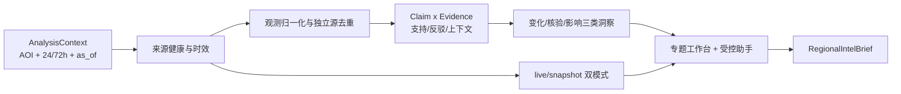

# PRD v6.0 中东实时情报分析演示能力评估与实施计划

- 评估日期：2026-07-22
- 需求基线：[PRD-v6.md](../PRD-v6.md)
- 运行系统：`gintbroker`
- 现场环境：`https://gisademo.trscd.com.cn/`（内网）
- 文档定位：内部能力评估、方案取舍、详细实施与风险保障的单一真源
- 客户版材料：[中东重点区域实时情报分析演示计划-客户版.md](中东重点区域实时情报分析演示计划-客户版.md)

## 1. 结论

当前系统已经具备较好的全球态势展示底座，也有中东专题、新近开源情报、航班/军机、卫星、关键设施、趋势、专题分类和 AI 助手入口。它可以演示“实时数据正在进入系统，也能按区域和主题汇集”。

但当前还不能直接作为“实时情报分析”演示。页面主要回答“系统里有什么”，没有稳定回答客户真正关心的五个问题：

1. 最近发生了什么变化；
2. 哪些事件值得关注；
3. 哪些来源相互支持或冲突；
4. 对航运、空域和关键设施可能有什么影响；
5. 哪些判断仍不确定，下一步需要继续观察什么。

本轮 Gate：**需结构性补强后再作为客户版实时情报分析演示**。

建议把演示主线改成：

> 用户选择中东重点区域和最近 24/72 小时时间窗，系统汇聚新近公开信息与实时态势，识别重要变化，组织多源证据，给出影响研判、不确定性和后续监测项，并生成可追溯的区域情报简报。

这条主线比“回放一个过去事件”更有现场价值，也比直接宣称已经实现 PRD 完整 L1→L2→L3 更可信。

## 2. 本轮依据与证据边界

本轮已读取并对照：

- `PRD-v6.md`；
- `devdoc/PRD-v6-当前项目适配分析与UAE场景.md`；
- `devdoc/预警佐证来源与PRD两类场景融合方案分析-20260710.md`；
- `devdoc/美伊专题与PRD两类场景数据准备清单及结构规范-20260714.md`；
- `gintbroker` 的 `gisa-project-context`、README、专题方案、数据源对照、动态本体评估；
- `gintbroker` 当前 Topic、情报助手、相关性分析和报告代码；
- 2026-07-22 内网环境页面、公开只读 API 和数据健康状态。

本轮没有修改 `gintbroker`，没有发送 AI 对话、部署或改动环境。运行数据计数会持续变化，本文只把它们作为 2026-07-22 现场快照，不作为长期固定指标。

## 3. PRD 对演示的真正要求

PRD 的重点不是地图上有多少点，而是把数据变成情报产品：


近期演示应先实现 `L1 + 多源核验 + L3-lite`：发现区域线索，完成证据组织和影响简报。真实卫星任务、目标识别和连续影像变化检测仍属于后续 L2 专项，不能在未接通时包装成实时能力。

## 4. 当前环境已确认能力

### 4.1 运行面

2026-07-22 现场快照：

| 项目 | 当前事实 | 可用于演示的价值 |
|---|---|---|
| 系统版本 | `/api/health` 返回 `0.9.81` | 已有可运行的统一态势面 |
| 数据健康 | 15 个源为 green、1 个 yellow、1 个 red；总体 `status=error` | 已有健康监控基础，但页面需把降级显式带入分析 |
| 航空 | 全球航班约 4,782、军机约 89，分钟级刷新 | 可支撑中东空域和军机活动背景 |
| 海事 | 船舶只有 11 条，低于最低期望；AIS proxy 未连接 | 当前不适合把实时海事作为必走主链 |
| GDELT | 约 1,380 条，健康状态 green | 可作为结构化事件背景和趋势输入 |
| 新闻 | 当前缓存 18 条，健康状态 green | 可提供新近 OSINT 线索 |
| 卫星 | 约 491 个轨道对象 | 可展示空间态势，不等于卫星影像核验 |
| LiveUAMap | 0 条，状态 red，未成功抓取 | 必须显示不可用，不能按 0 条事实解释 |

### 4.2 中东专题

页面已经具备：

- 中东地区美伊冲突专题入口和区域镜头；
- 新近新闻、7 日趋势、专题分类、实体列表和分页；
- 冲突情报、关键设施、舰艇动向、空中活动四类概览；
- 专题规则版本和后端分类记录；
- 新闻原文 URL、发布时间、翻译状态、专题匹配证据；
- 地图、专题面板与 AI 助手同屏展示。

2026-07-22 页面现场可见约 854 条累计冲突情报、3 个关键设施、0 个舰艇动向、1 个空中活动；首屏包含当天新闻。这个结果说明专题链路和增量数据已工作，但“854”是专题累计/窗口统计，不等于 854 个已确认的实时冲突事件。

### 4.3 当前分析和 AI 能力

已有能力包括：

- 按实体别名、动作词、区域和规则版本做专题匹配；
- 对航班、船舶、新闻、GDELT 和相关性结果做缓存检索；
- 按坐标或少量已知区域生成邻近目标简报；
- 计算 GPS 干扰与网络中断、军机/舰船与 GDELT 等空间相关性线索；
- 生成全球态势统计摘要；
- 通过 AI 助手触发地图聚焦和候选目标展示。

这些能力是很好的分析底座，但目前更多是规则检索和模板化汇总，还不是可审计的区域情报研判。

## 5. 为什么当前效果还不足以说服客户

### P0-1：专题匹配被误读为事实确认

Topic classifier 的 `confirmed/probable` 表示“是否满足专题匹配规则”，不是“新闻所述事件已经被多源证实”。当前核心命中主要依赖实体别名与动作关键词，共现后即可给出固定分类分数。

对客户页面必须改名或分层：

- `topic_match_status`：是否属于专题；
- `claim_verification_status`：事件主张是否被独立来源支持；
- `assessment_confidence`：系统研判置信度及理由。

三者不能继续混成一个“已确认”。

### P0-2：当前情报列表不是多源证据链

现场抽取的中东专题前 20 条均来自 `news_rss_aggregate`。GDELT、航空、海事、设施等数据虽然存在于系统中，但还没有围绕同一主张组织成支持、反驳、上下文和重复来源。

客户看到的是多条新闻，不是“多源核验后的洞察”。

### P0-3：风险分数缺少可解释、可校准依据

页面显示 `3/10`、`9/10`、情绪和“常规/关键”等结果，但当前分数不能证明是事件发生概率、影响程度或证据可信度。单条标题也可能得到较高风险分。

近期演示应改为三项分开：

- 证据强度：弱/中/强；
- 影响等级：低/中/高；
- 信息状态：已核实/部分核实/待核实/存在冲突。

每项都要显示触发理由，未完成校准前不要使用精确概率式分数。

### P0-4：专题实体未真正空间化

中东专题当前 19 个配置实体中，没有可直接消费的经纬度。页面地图上的大量标记主要来自全球图层，容易让客户误以为它们已经与专题事件建立了关系。

至少需要补齐：

- 重点区域 AOI；
- 关键设施和交通节点；
- 专题实体稳定 ID、别名、位置、来源和有效期；
- “为什么这个地图对象与当前事件有关”的关系说明。

### P0-5：缺少“变化”和“基线”

当前趋势主要展示情报条数，不能回答“与过去 24 小时、过去 7 天基线相比，哪里发生了异常变化”。没有基线，系统只能罗列数据，难以形成洞察。

近期应先做 3 类简单、可解释的变化：

1. 事件量和来源结构相对 7 日基线的变化；
2. 重点 AOI 内军机、航班、船舶或干扰信号的数量/状态变化；
3. 关键设施周边新出现的事件、告警或公开信息。

### P0-6：AI 助手还不能承担区域研判

当前情报助手是确定性意图路由和缓存摘要：

- “波斯湾”能进入区域简报，但“中东”“伊朗”等泛区域问题会落到全局摘要；
- 通用回答主要列图层数量、相关新闻和相关性样本；
- “联网搜索”开关当前并未直连外部搜索；
- 没有围绕专题问题生成证据矩阵、矛盾点、影响对象和下一步监测项。

因此，演示前不要让用户任意提问。先提供 3～5 个经过验证的区域问题模板，并让助手只基于结构化证据包回答。

### P0-7：当前报告不是 PRD L3 报告

`/api/ai/report` 主要汇总军机、船舶、地震、GDELT、相关性和 AI pin 数量。它不是 PRD 要求的事件摘要、证据链、验证矩阵、影响评估、不确定性和报告归档。

近期至少需要一个 `RegionalIntelBrief`，不必先建设完整报告平台，但字段必须稳定、可追溯。

### P1：实时源稳定性和演示降级不足

- AIS 当前未连接，海事数据不应作为必走主链；
- LiveUAMap 当前 red，页面不能把“源不可用”显示成“没有事件”；
- 外部数据源随时可能延迟、限流或为空；
- 页面需要 `as_of`、覆盖状态、最后成功时间和数据缺口说明。

降级时应使用“最近一次有效快照”，明确标注快照时间和来源状态；不能退回旧事件后继续称为实时分析。

## 6. 推荐演示故事

建议主场景采用“中东重点区域 24/72 小时态势研判”，首选波斯湾—霍尔木兹—周边关键设施和空海通道，叙事聚焦航行安全、空域变化和关键基础设施风险，不输出进攻性行动建议。

主角不是系统管理员，而是需要在突发事件中快速形成值班简报的区域情报分析员。其现场压力是：新闻不断更新、来源相互转述、航迹和设施数据分散在不同界面，部分数据源还会临时中断；如果判断过早，容易把单源传闻升级为事实，如果判断过晚，又可能错过航运、空域和设施风险的准备窗口。

系统要改变的工作动作，是把“人工逐条刷新闻和地图”变成“先看重要变化，再核验证据，最后形成可追溯简报”。决策者不需要浏览 800 多条记录，只需要知道当前最重要的三件事、可信到什么程度、影响什么、还缺什么证据。

客户在 8～10 分钟内看到：

1. 选择区域、时间窗和关注对象；
2. 系统先显示数据覆盖：哪些源正常、哪些延迟、最新到什么时间；
3. 给出最近 24/72 小时 3～5 个重要变化，而不是 800 多条列表；
4. 点击一个变化，查看支持、反驳、上下文和重复来源；
5. 地图定位相关设施、航迹和事件，说明关联依据；
6. 输出影响研判：对航运、空域、关键设施和持续监测的影响；
7. 明确未知项和后续监测任务；
8. 导出一页区域情报简报。

建议首批固定问题：

- 最近 24 小时中东专题发生了哪些值得关注的变化？
- 哪些变化已经有两个以上独立来源支持？
- 哪些关键设施或交通通道受到潜在影响？
- 当前有哪些数据源不可用，可能导致哪些判断盲区？
- 接下来 6/12/24 小时最需要持续监测什么？

## 7. 近期必须补的产品和数据

### 7.1 区域分析上下文

新增统一 `AnalysisContext`：

```text
analysis_id, topic_id, aoi_id, time_window, as_of,
focus_entities[], focus_assets[], data_source_scope[], baseline_window
```

它负责冻结“分析什么、看多长时间、基于哪些数据”。页面、规则和 AI 助手必须共用同一上下文。

### 7.2 最小证据模型

复用 [美伊专题与 PRD 两类场景数据准备清单及结构规范](美伊专题与PRD两类场景数据准备清单及结构规范-20260714.md) 中已有的 `observations`、`claims`、`evidence_links`、`anomalies` 和 `verification_matrix`，不要再建平行语义。

近期最小字段：

```text
claim_id, statement, event_time, geometry,
supporting_evidence[], contradicting_evidence[], context_evidence[],
independence_groups[], verification_status, confidence_reason,
information_gaps[], as_of
```

### 7.3 数据覆盖与来源健康

只先治理演示涉及的 5～8 个源：RSS 新闻、GDELT、ADS-B、AIS、关键设施目录、GPS 干扰、网络中断、可选 SAR/火点。

每个源至少返回：

```text
source_id, status, last_success, freshness, coverage,
records_in_window, attribution, limitations
```

### 7.4 事件归并与重复来源处理

- 同一 URL、转载和同源稿件归到同一 `independence_group`；
- 主题相似不等于同一事件，时间、地点、主体和动作至少满足三项；
- 事件聚类必须保留原始条目，不覆盖来源；
- 自动归并结果允许分析师拆分、合并和降级。

### 7.5 三类可解释洞察

近期不做开放式“万能推理”，先实现：

1. **变化洞察**：相比基线，哪些指标明显上升、下降或出现新对象；
2. **多源核验洞察**：同一主张得到哪些独立来源支持，哪里存在矛盾；
3. **影响洞察**：事件与关键设施、航道、空域和持续监测对象有什么已知关联。

每条洞察都必须带输入记录、规则版本、生成时间和不确定性。

### 7.6 区域情报简报

`RegionalIntelBrief` 至少包含：

- 分析范围和 `as_of`；
- 三条核心判断；
- 重要变化；
- 证据矩阵；
- 影响对象；
- 反证与信息缺口；
- 数据源健康；
- 后续监测清单；
- 数据分类和免责声明。

## 8. 方案粗拆

### 14 天演示版

适用边界：不新增复杂外部数据源，不接真实卫星任务，不建设 `moye/doops` 三系统联调；只在 `gintbroker` 现有数据和页面上补区域分析闭环。

| 工作包 | 主要工作 | 产物 | 粗略工作量 | Gate |
|---|---|---|---:|---|
| W0 故事与验收冻结 | 冻结 AOI、24/72 小时窗、3～5 个问题、可讲/不可讲边界 | 演示故事、验收清单、主持人口径 | 1 人日 | `STORY_FROZEN` |
| W1 数据可信底座 | 5～8 个源的 freshness/coverage；修 AIS 或从主链降级；设施/区域空间化；事件去重和金标样本 | 数据健康卡、AOI/设施数据、最小事件包、样本集 | 4～5 人日 | `DATA_READY` |
| W2 洞察与证据 | 事件归并、Claim×Evidence、基线变化、影响关联、三类洞察模板和反例验证 | `RegionalInsight`、证据矩阵、规则测试 | 5～6 人日 | `INSIGHT_READY` |
| W3 页面、助手与简报 | 区域问题入口、三条洞察首屏、证据抽屉、数据缺口、上下文绑定 AI 助手、一页简报、完整状态矩阵 | 可交互区域分析工作台 | 6～7 人日 | `DEMO_FLOW_READY` |
| W4 验证、发布与彩排 | live/snapshot 双模式、同一 `as_of` 回放、浏览器回归、断源降级、性能验证、目标环境发布、双模式彩排和录屏 | 测试环境版本、验证记录、脚本、兜底资产 | 5～6 人日 | `CUSTOMER_DEMO_READY` |

工作包直接投入约 21～25 人日，另需预留 3～4 人日用于跨角色联调、数据波动复核、目标环境问题收敛和最终演示修正。内部应按 **24～29 人日** 配置，由后端/数据、前端、情报内容/数据质量、测试/发布四条线并行，在 **14 个自然日** 内完成。这个估算已经纳入证据样本标注、断源演练、双视口浏览器回归、目标环境彩排和最终缓冲；单人串行不可承诺 14 天完整交付。

### 极限压缩版

若只有约一周：

- 只做一个中东 AOI；
- 主数据只用 RSS/GDELT/ADS-B/关键设施；
- AIS 未恢复就从主讲路径移除；
- 只实现三条固定洞察和一页 HTML 简报；
- AI 助手只开放 3～5 个推荐问题；
- 不做开放式聊天、PDF、真实卫星任务、完整事件状态机。

不可裁剪：来源、时间、`as_of`、独立来源去重、信息缺口、实时/快照标识和断源降级。

## 9. 验收口径

### 必须通过

- 用户能明确选择 AOI 和 24/72 小时时间窗；
- 首屏不是数据计数，而是 3～5 条可解释变化和洞察；
- 每条洞察至少能反查到输入记录、来源、时间和规则；
- “专题匹配”与“事实核实”在页面上明确分开；
- 至少一条主张有两个独立来源支持，或被明确标为单源待核实；
- 数据源故障显示为 coverage gap，不显示为 0 事件；
- 地图对象与专题事件有可解释关系，不混用全球背景点；
- AI 助手回答只引用当前分析上下文和证据包；
- 简报包含结论、不确定性、影响和后续监测项；
- 断开一个外部源后，主流程仍可完成并显示降级原因。

### 不作为快速演示版承诺

- PRD 中 90% 以上目标识别精度；
- 真实卫星订购和自动补采；
- 90%～99% 概率式置信度；
- 全量实时 AIS、RF 和客户私有数据覆盖；
- 生产级 99.9% 可用性；
- 动态本体和数据中台已经全面接管数据生产。

## 10. 风险、防护与回滚

| 风险 | 防护 | 回滚/降级 |
|---|---|---|
| 突发新闻尚未证实 | 默认作为线索；两个独立来源或人工复核后再升级 | 降级为“待核实”，保留原文和反证 |
| 单源故障或延迟 | freshness/coverage、超时、最后成功时间可见 | 使用最近一次有效快照并显示 `as_of` |
| 规则误匹配 | 专题匹配和事实核实分层；保留规则证据 | 人工排除，重新计算洞察 |
| AI 生成无引用结论 | AI 只能总结结构化证据包，不允许新增事实 | 回退确定性模板简报 |
| 实时数据量波动导致画面不稳定 | 洞察按窗口和基线计算，不依赖固定数量 | 切换同一时间点的冻结快照 |
| 敏感或进攻性表达 | 聚焦航行安全、空域风险和民用基础设施保护 | 隐藏精确敏感坐标和行动建议 |
| 新页面影响全球态势主链 | 复用现有专题 `demo_workspace_mode` 能力标识隔离 | 新 API 异常自动返回原专题页；必要时回滚 release |

## 11. 实施决策

采用“现有专题工作台增强 + 确定性证据分析 + 受控智能摘要 + live/snapshot 双模式”。默认 AOI 为波斯湾—霍尔木兹海峡—周边关键设施，默认问题为“重要变化、多源核验、影响与后续监测”。

不等待 AIS 或 LiveUAMap 恢复后才开工；AIS 作为可选增强，LiveUAMap 不进入本次主链。新增能力复用现有专题 `demo_workspace_mode` 能力标识启停，不新增远端环境开关，不改动全球态势和专题页的默认契约。

## 12. 需求与方案复核

### 12.1 目标、非目标与成功定义

目标：

- 让区域情报分析员在 8～10 分钟内完成“看变化—核证据—判影响—出简报”；
- 基于当前或明确标记时间的新近数据，而不是将旧事件伪装成实时结果；
- 每条洞察可追溯、可解释、可降级，断源时不误报为“零事件”；
- 在 14 个自然日内形成可现场交互、经过目标环境验证的客户演示版。

非目标：

- 不在本次建设完整 PRD L2 卫星任务与目标识别链；
- 不新增复杂数据中台/动态本体联调，不改造已有 Topic 生产链；
- 不开放无边界联网搜索或自由问答；
- 不给出进攻性行动建议、精确敏感坐标或未经验证的高风险断言；
- 不承诺全量 AIS、RF、卫星影像或客户私有数据已接入。

成功定义以第 9 节的 10 项必须通过及本文第 16 节验证矩阵为准，不以“页面能打开”或“有三条文字”代替验收。

### 12.2 关键旧契约

- 专题列表、详情、概览、情报列表、趋势、实体和简报现有 `/api/topics/*` 契约保持兼容；
- `TopicDetailPanel` 现有 `loading/ready/empty/partial/forbidden/error` 状态不得退化；
- 专题未进入 `demo_workspace_mode=demo`、新 analysis API 不可用或客户退出区域分析时，全球态势、地图图层和当前 AI 助手行为保持不变；
- 已有 Topic classifier 的 `confirmed/probable` 只作专题匹配结果，不修改其存量语义；新页面以独立 `verification_status` 表达事实核实状态；
- 不执行历史数据清理、覆盖或 schema 破坏性迁移。

### 12.3 候选方案与取舍

| 方案 | 优点 | 决定性风险 | 结论 |
|---|---|---|---|
| A. 现有专题工作台增强 | 复用地图、专题、数据健康、助手和发布链；交付面最小 | 需严格隔离新老语义 | **推荐** |
| B. 新建独立区域研判页 | 界面自由度高 | 地图、助手和数据状态重复建设，14 天内仍有较高联调风险 | 不采用 |
| C. 同期打通三系统完整生产链 | 长期架构更完整 | 多仓、多环境、数据契约和切换风险超出演示周期 | 后续单独立项 |
| D. 只做固定 mock/录屏 | 快 | 无法回应客户对当前数据和真实分析的期待 | 不可作主方案 |

### 12.4 推荐方案的最小闭环



洞察计算为确定性主链；大模型只重组已结构化的证据包，不新增事实。模型超时、回答无引用或格式不合格时，直接回退确定性模板。

### 12.5 客户版发布自审

客户一句话故事：

> 面对中东重点区域快速更新、真假交织的信息，系统先找出值得关注的变化，再用多来源证据核验并说明对航运、空域和关键设施的影响，最终形成可追溯的区域情报简报。

对外文档 Gate：**可直接用于客户计划沟通**，但不代表运行能力已完成。依据：

- 开篇先回答值班和研判问题，没有从系统模块或内部架构讲起；
- 每个阶段都有客户可见结果，D3 有数据覆盖和候选变化，D7 有首版交互研判，D11 有完整预演，D14 演示就绪；
- 未暴露项目名、代码路径、内部材料、API 或内部风险编号；
- 专业性体现在证据独立性、支持/冲突、数据截止时间、覆盖缺口、影响判断和后续监测，而不是堆叠“智能、融合、闭环”口号；
- 对外明确 14 天，对内按 24～29 人日、四线并行、三天稳定性与发布收口窗口、裁剪顺序、Gate 和双模式保障支撑，不以放宽证据标准换时间。

## 13. 关键未知项与 Gate

Gate 阈值必须在取样前冻结，不得看完结果后修改。

| Gate | 会改变什么 | 验证方法 | Pass | Fail 分支 | 当前状态 |
|---|---|---|---|---|---|
| G0 新近数据是否足以形成洞察 | live 主讲还是 snapshot 主讲 | 对 72h 样本做来源、时间、地点、可追溯性统计 | ≥20 条可用观测、≥3 个来源家族，且有一个主张获得≥2 个独立组支持 | live 仍展示当前覆盖；证据展开用明确 `as_of` 的近期快照 | pending |
| G1 独立来源分组是否可信 | 能否声称多源支持 | 人工标注 30 组转载/独立报道样本 | 独立组精度≥90%，同 URL/明显转载合并率 100% | 页面只显示“多条信息”，不显示“多个独立源”；增加人工复核 | pending |
| G2 AOI/设施空间化是否可用 | 地图是否能进入主链 | 逐条核对显示对象的坐标、来源、精度和有效期 | 所有上图对象 100% 有可追溯位置；低精度对象有可见标识 | 不上图，只在证据卡显示文字地名 | pending |
| G3 三类洞察是否稳定 | 能否对客户讲“分析” | 金标 fixture + 规则测试 + 反例 | 每类至少 3 个正例和 3 个反例；无证据输入不产生强结论 | 将失败类型降级为数据卡或待核实线索 | pending |
| G4 助手是否可控 | 是否进入现场主讲 | 20 个允许/越界/证据不足问题集 | 事实引用覆盖 100%，无证据新增事实 0，越界问题 100% 拒答或收窄 | 隐藏自由输入，只保留 3～5 个确定性推荐问题 | pending |
| G5 双模式能否完整降级 | 现场是否可交付 | 分别断开一个必选源和一个可选源 | 主流程完成，且页面显示源状态、最后成功时间和快照时间 | 禁止发布；修复后重跑 | pending |
| G6 性能是否适合现场 | 是否需要预计算/缓存 | 目标环境连续 30 次查询，分冷/热缓存 | 热缓存 API p95≤2s，内网首条洞察可见≤5s，零 5xx | 演示前预计算固定上下文；缩小窗口和输入上限 | pending |

G0～G4 只允许用只读样本或本地 fixture 验证；G5 断源演练必须在本地/测试配置下完成，不修改共享生产凭据或外部系统。

## 14. 设计契约与影响面

### 14.1 数据与 API 契约

新增读取接口：

```text
GET /api/topics/{topic_id}/analysis
  ?aoi_id=persian_gulf_hormuz
  &window=24h|72h
  &mode=live|snapshot
  &snapshot_id=<optional>
```

单一响应返回 `AnalysisContext`、`SourceCoverage[]`、`RegionalInsight[]`、`ClaimEvidence[]`、`MapRelation[]`、`RegionalIntelBrief` 和 `recommended_questions[]`。前端不自行拼接不同时间点的多个响应。

关键规则：

- 接口复用现有 `require_local_operator` 权限边界和限流策略，不新增公网暴露面；
- `analysis_id` 由 `topic_id + aoi_id + window + as_of + ruleset_version + snapshot_id` 稳定生成；
- `as_of` 为本次分析截止时间，所有证据不得晚于该时间；
- `mode=snapshot` 时 `snapshot_id` 必填，缺失、未批准、契约版本不匹配或超出当前 topic/AOI 时返回可判定 4xx，不自动挑选“最新快照”；
- `topic_match_status`、`verification_status`、`evidence_strength`、`impact_level` 四个字段独立；
- 所有用户可见事实必须带 `evidence_ids[]`；
- `coverage.status=unavailable` 与 `records_in_window=0` 是两种状态，不得互换；
- snapshot 仅保存必要的引用元数据、有限摘要和计算结果，不复制整篇版权文章，不保存密钥或用户隐私数据。

### 14.2 默认数据范围

| 类型 | 本次地位 | 失效时处理 |
|---|---|---|
| 公开新闻/RSS | 必选线索 | 使用最后有效快照，标记时间 |
| GDELT | 必选事件背景/趋势 | 降级为新闻线索，显示覆盖缺口 |
| ADS-B/军机与航班 | 必选空域背景 | 使用快照，不输出实时断言 |
| 关键设施/AOI 目录 | 必选影响对象 | 目录验证不通过则不发布 |
| AIS | 可选海事增强 | 从主链移除，不阻断演示 |
| GPS 干扰/网络中断 | 可选关联信号 | 不生成对应洞察 |
| LiveUAMap | 不进本次主链 | 只显示源不可用，不解释为无事件 |
| 卫星轨道数据 | 仅作背景 | 不作影像核验证据 |

### 14.3 代码影响面（计划）

后端：

- `backend/routers/topics.py`：新增只读 analysis 路由；
- `backend/services/region_intel/`：新增上下文、来源覆盖、归并、证据、洞察、快照和简报服务；
- `backend/data/region_intel/`：存放 AOI/设施目录、金标 fixture 和可审计 snapshot manifest；
- `backend/tests/region_intel/`：完成契约、去重、证据、洞察、脏数据、降级和 API 测试。

前端：

- `frontend/src/lib/topics/regionalIntel.ts`：严格解析新契约；
- `frontend/src/components/TopicDetailPanel.tsx`：挂载区域分析工作台，保留旧模式；
- `frontend/src/components/region-intel/`：数据覆盖、洞察卡、证据抽屉、影响对象、简报和空/错误/降级状态；
- `frontend/src/components/IntelligenceAssistant.tsx`：仅新增与当前 `analysis_id` 绑定的推荐问题与回答渲染；
- `frontend/src/__tests__/region-intel/` 与 `frontend/e2e/topics/regional-intel.spec.ts`：单测和端到端回归。

配置与发布：

- 复用已有 `demo_workspace_mode=demo` 与 analysis API capability 作为显示条件，不新增远端环境变量；
- 不修改 Jenkins job/global 配置，不新增数据库破坏性迁移；
- 新 analysis API 失败时前端自动回到原专题工作台；如影响旧主链，通过既有 `rollback-previous` 回退到 previous release。

## 15. 具体实施计划

本节是后续执行真源。完成某一小批不等于整体完成；只要总目标未完成且未命中第 21 节停止条件，必须继续下一批。

### T0：基线、执行卡与范围锁定（1 人日）

目标：将目标 revision、环境、默认 AOI、3 个客户问题、数据源和回滚点固定为执行基线。

输入：本文、客户版计划、当前 `main`/upstream、测试环境只读 API。

修改范围：只更新本文执行记录；不改代码、环境和数据。

步骤：

1. 记录 `git status --short --branch`、upstream、HEAD、未推送提交和无关脏改动。
2. 只读导出 `/api/health`、中东专题 catalog/overview/items/entities/trend 摘要，记录 `as_of`。
3. 冻结 AOI `persian_gulf_hormuz`、`24h/72h`、必选源和可选源。
4. 冻结客户主讲的 3 个问题及 3 类洞察，建立 Gate 取样表。

验证：执行记录具备 revision、环境、时间、数据源、默认问题、回滚点六类信息；任一缺失则 T0 未通过。

暂停条件：目标分支已 diverged、存在无法隔离的用户改动，或测试环境全部不可读。

提交与记录：只读取证不提交；更新第 20 节。

### T1：契约、AOI/设施目录与金标样本（2～2.5 人日）

目标：先固定语义和样本，避免前后端各自猜字段。

输入：T0 基线、已有 Topic DTO/位置资产、30 组独立源标注样本、至少 9 组洞察正例和 9 组反例。

修改范围：`backend/services/region_intel/contracts.py`、`backend/data/region_intel/`、契约与资产测试。

步骤：

1. 定义第 14.1 节 DTO 和状态枚举，严禁用 `confirmed` 同时表示专题匹配和事实核实。
2. 建立 AOI 边界、关键设施/通道目录，为坐标添加来源、精度和有效期。
3. 建立去重、冲突、缺失、时间异常、断源和无显著变化 fixture。
4. 输出 JSON schema/OpenAPI 契约测试，前端可以基于 fixture 并行开工。

验证：

```bash
cd /Users/liushen/Documents/cursorDevs/gintbroker
.venv/bin/pytest backend/tests/region_intel/test_contracts.py backend/tests/region_intel/test_assets.py -q
git diff --check
```

预期：契约字段、状态枚举、AOI 和所有上图对象通过；金标样本不含密钥、完整版权正文或敏感精确坐标。

暂停条件：不能为必选设施提供可追溯位置，或专题契约修改要求破坏现有 API。

提交与记录：验证通过后单独本地提交 `feat(intel): 定义区域分析契约与样本`，记录短 hash，暂不 push。

### T2：来源覆盖、观测归一化与 snapshot（3～3.5 人日）

目标：形成统一 `as_of` 下的可用观测集，并能显式处理断源。

输入：T1 契约和 fixture；新闻/GDELT/ADS-B/设施现有读取面；AIS 作为可选。

修改范围：`source_coverage.py`、`normalizer.py`、`snapshot.py`、`snapshot_cli.py`、对应测试。

步骤：

1. 对每个源计算 `status/last_success/freshness/coverage/records_in_window/limitations`。
2. 统一事件时间、系统可见时间和数据更新时间；时区全部转 UTC，展示层再本地化。
3. 缺时间、时间未来偏移、过期、无来源、无几何和翻译失败按第 17 节处理。
4. 实现无网络写入副作用的 `snapshot_cli`，显式传入 topic、AOI、window、`as_of` 和输出路径，生成可重现 snapshot bundle。
5. snapshot manifest 包含 `approval_status`、`as_of`、输入指纹、规则/契约版本和来源状态；不覆盖旧快照。只有 T8 复核后标记为 `approved_for_demo` 的 snapshot 可被客户演示路径选择。

验证：

```bash
cd /Users/liushen/Documents/cursorDevs/gintbroker
.venv/bin/pytest backend/tests/region_intel/test_source_coverage.py backend/tests/region_intel/test_normalizer.py backend/tests/region_intel/test_snapshot.py -q
cd backend
../.venv/bin/python -m services.region_intel.snapshot_cli --help
cd ..
git diff --check
```

覆盖点：正常源、空但正常、延迟、不可用、未从成功、快照回放、不同 `as_of` 不混用。

暂停条件：不能区分“零记录”与“源不可用”，或 snapshot 无法回证输入指纹。

提交与记录：通过后本地提交 `feat(intel): 建立来源覆盖与分析快照`，记录 hash，暂不 push。

### T3：事件归并、Claim x Evidence 和三类洞察（4～4.5 人日）

目标：把“多条新闻”转换为可审计的变化、核验和影响洞察。

输入：T2 观测、T1 金标样本和 AOI/设施目录。

修改范围：`dedup.py`、`claims.py`、`baseline.py`、`insights.py`、`impact.py`、API 应用层与测试。

步骤：

1. 使用 canonical URL、publisher family、内容指纹、时间/地点/主体/动作归并事件，保留每条原始观测。
2. 建立 `support/contradict/context/duplicate` 关系；方案不能确证时使用 `unknown`，不得猜测。
3. 用 7 日基线计算 24/72 小时变化；样本不足时只输出“样本不足”，不输出异常结论。
4. 将事件与设施/通道/空域的关联限定为明确几何、目录关系或可追溯规则；粗粒度 1° grid 只作线索，不作结论。
5. 每条洞察生成证据强度、影响等级、信息缺口、规则版本和 `evidence_ids[]`。
6. 完成 G0～G3 取样和判定，将 Fail 类型降级而不隐藏。

验证：

```bash
cd /Users/liushen/Documents/cursorDevs/gintbroker
.venv/bin/pytest backend/tests/region_intel/test_dedup.py backend/tests/region_intel/test_claims.py backend/tests/region_intel/test_baseline.py backend/tests/region_intel/test_insights.py backend/tests/region_intel/test_api.py -q
git diff --check
```

合并策略：去重、Claim/Evidence 和洞察可用同一金标数据集连续验证；但“两条独立报道”与“同稿转载”必须分开计分，不得合并为一个正例。

暂停条件：G1 不通过且页面仍会声称“多个独立源”；或任一强结论缺少 `evidence_ids[]`。

提交与记录：通过后本地提交 `feat(intel): 实现证据归并与区域洞察`，记录 hash，暂不 push。

### T4：区域分析工作台（4～4.5 人日，可与 T2/T3 后半段并行）

目标：将结构化洞察变成 8～10 分钟可完成的客户交互路径。

输入：T1 前端 fixture，T3 API 契约，当前专题页两个目标视口 `1440x900` 与 `1920x1080`。

修改范围：第 14.3 节所列前端路径、样式、翻译、单测和 E2E。

步骤：

1. 先完成 DTO 解析、`demo_workspace_mode`/capability 门禁和旧模式回退，再做视觉样式。
2. 按顺序呈现：区域/窗口 → 数据覆盖 → 3～5 条洞察 → 证据抽屉 → 地图关联 → 影响/缺口 → 简报。
3. 完成 `loading/empty/error/partial/live/snapshot/stale/no-significant-change` 状态；不允许空白卡片或假数。
4. 专题背景点与当前洞察关联点使用明确不同的视觉语义；低精度位置显示范围，不画成精确点。
5. 完成键盘焦点、抽屉关闭返回、长标题、中英文时间/地名 fallback 和滚动状态。

验证：

```bash
cd /Users/liushen/Documents/cursorDevs/gintbroker/frontend
npm run test:ci -- src/__tests__/region-intel/ src/__tests__/topics/client.contract.test.ts
npm run lint -- src/components/region-intel src/components/TopicDetailPanel.tsx src/lib/topics
npx tsc --noEmit
npm run build
```

浏览器验证：两个视口分别截取首屏、证据抽屉、降级状态和简报图；检查 Console 无 error，Network 无重复风暴和 5xx。

暂停条件：主流程必须横跨多个无关页面、任一状态使用未标记 mock，或未进入 demo workspace/新 API 失败时仍改变旧页。

提交与记录：通过后本地提交 `feat(intel): 建设中东区域研判工作台`，记录 hash，暂不 push。

### T5：受控助手与区域简报（2.5～3 人日）

目标：使助手和简报只表达当前分析上下文中已有的证据和不确定性。

输入：T3 `analysis_id` 和证据包，T4 页面，20 个问题的 G4 测试集。

修改范围：简报 formatter、助手上下文路由、推荐问题和渲染测试。

步骤：

1. 默认开放 3～5 个推荐问题，每次提交携带 `analysis_id`；禁止泛区域问题回退到全球摘要。
2. 回答中的可核验句子必须引用 `evidence_ids[]`；无证据时输出“当前无法确认”和信息缺口。
3. 简报固定包含范围/`as_of`、三条核心判断、证据、影响、反证/缺口、来源健康和后续 6/12/24h 监测项。
4. 大模型输出必须经 schema 和引用完整性检查；超时、无引用、越界或解析失败回退模板。

验证：

```bash
cd /Users/liushen/Documents/cursorDevs/gintbroker
.venv/bin/pytest backend/tests/region_intel/test_brief.py backend/tests/region_intel/test_assistant.py -q
cd frontend
npm run test:ci -- src/__tests__/region-intel/ src/__tests__/components/IntelligenceAssistant.test.tsx
npm run lint -- src/components/IntelligenceAssistant.tsx src/components/region-intel
npx tsc --noEmit
```

暂停条件：G4 未通过，或助手可在无 `analysis_id`/无证据时输出新事实。

提交与记录：通过后本地提交 `feat(intel): 绑定区域助手与情报简报`，记录 hash，暂不 push。

### T6：本地总验证与故障演练（2～2.5 人日）

目标：在进入发布前证明新功能、旧契约和降级路径同时可用。

输入：T1～T5 所有本地提交和 Gate 证据。

修改范围：仅修复回归发现的本范围问题；不混入无关重构。

步骤：

1. 跑完整 region-intel 后端套件、Topic 相关契约、前端定向套件、lint/type check/build。
2. 分别演练 RSS/GDELT/ADS-B 一个必选源不可用、AIS 不可用、大模型超时和 snapshot 回放。
3. 在两个视口完成主路径与状态矩阵截图；不同断源测试必须分开运行，避免互相污染。
4. 用 30 次冷/热查询完成 G6，记录 p50/p95/5xx 和页面首条洞察时间。

验证：

```bash
cd /Users/liushen/Documents/cursorDevs/gintbroker
.venv/bin/pytest backend/tests/region_intel backend/tests/topics/test_topic_api_v2.py backend/tests/test_topics_api.py backend/tests/test_fetch_health.py -q
cd frontend
npm run test:ci -- src/__tests__/region-intel/ src/__tests__/topics/ src/__tests__/components/IntelligenceAssistant.test.tsx
npm run lint
npx tsc --noEmit
npm run build
npx playwright test e2e/topics/regional-intel.spec.ts
git diff --check
```

暂停条件：任一定向测试/build 失败、G5/G6 不通过、旧专题契约退化或出现未解释的 Console error/5xx。

提交与记录：只有回归修复产生差异时才单独提交 `fix(intel): 收敛区域演示回归问题`；记录全部命令结果和 hash。

### T7：发布到内网测试环境并合并回归（2～2.5 人日）

目标：通过现有 `Shadowbroker` Jenkins job 将已验证的完整 revision 发布到 `gisa-195`，在 HTTPS 主入口完成真实浏览器回归。

输入：T6 通过的完整 40 位 `RC_COMMIT`、当前 committed release 和 previous release。

修改范围：不修改 Jenkins job/global 配置、Dockerfile、Compose 契约或共享凭据；只用现有流水线参数。

执行卡：

```text
JOB=Shadowbroker
PIPELINE_ACTION=build-deploy
RC_COMMIT=<T6 验证的 40 位 SHA>
PUSH_IMAGES=true
DEPLOY_TARGET=gisa-195
RUN_TOPIC_SCHEMA_EXPAND=false
ONTOLOGY_ADMIN_MODE=不构建
IMAGE_TAG=留空，使用不可变 release id
回滚=既有 rollback-previous + EXPECTED_CURRENT_RELEASE_ID
```

步骤：

1. 按 [$ci-devops-release-regression](/Users/liushen/Documents/cursorDevs/trsdevops/devops_console/.agents/skills/ci-devops-release-regression/SKILL.md) 执行发布回归；先 fetch 并判定 ahead/behind/diverged，只推送已在 T6 验证的提交集。
2. 校验 Jenkins checkout SHA = `RC_COMMIT`、三类镜像 digest、committed release marker 和运行容器一致。
3. 检查 `/api/health`、新 analysis API、旧 Topic API；总体 health 可因已知外部源非 green，但新 API 不得 5xx，且源降级必须正确。
4. 在 `https://gisademo.trscd.com.cn/` 执行 live/snapshot 主路径、证据抽屉、地图关联、助手和简报；检查 Console/Network。
5. 模拟 analysis API 404/503 和非 demo workspace，复验系统自动返回原专题页。

验收点：运行 release 与 `RC_COMMIT` 一致；新旧路径均可用；主流程 8～10 分钟内完成；无无引用强结论；降级标识与 API 一致。

暂停条件：远端已更新且关系不清、Jenkins 检出/镜像/运行 revision 不一致、目标环境数据或配置超出执行卡、或业务回归失败。新 API 失败时复验原专题页回退；若影响旧主链，执行 `rollback-previous`。

提交与记录：本阶段不产生代码提交；记录 Jenkins build URL/结果、release id、digest、截图和回归结果。本计划文档不构成执行授权；后续用户明确启动本计划的完整执行时，本阶段所列普通 push、既有 Jenkins build、内网测试部署和回归视为该次执行范围；任何生产写入、数据清理、凭据或 CI/CD 配置修改仍需单独确认。

### T8：客户彩排与演示包冻结（1.5 人日）

目标：使现场演示不依赖临时猜测、固定数量或单一外部源。

输入：T7 测试环境 release、客户版计划、live 当前分析和一份明确 `as_of` 的快照。

修改范围：演示脚本、主持人口径、截图/录屏、快照 manifest 和本文执行记录。

步骤：

1. 按客户路径完整彩排两次：一次 live，一次关闭任一可选源后进入 snapshot。
2. 口径禁止将专题匹配说成事实确认、将轨道对象说成卫星影像、将粗粒度空间相关说成因果关系。
3. 冻结当日主用 snapshot、录屏和截图，标注时间和数据状态；不使用无时间的“备用假实时”材料。
4. 逐项签字第 9 节和第 16 节验收矩阵，未通过项明确降级或从主讲移除。

验证：两次彩排均在 8～10 分钟完成；主路径无手工改库、无临时替换数据、无越界结论；备用包在无外网时仍能说明证据处理和降级逻辑。

暂停条件：快照时间/来源状态不可见、主持人必须使用未核验数字才能讲通，或彩排仍出现不可恢复中断。

提交与记录：文档/演示资产校验后单独本地提交 `docs(demo): 冻结中东区域情报演示包`；只在本次完整执行任务已包含 push 时推送。

## 16. 验证矩阵

| 验证层 | 样本/路径 | 通过标准 | 失败处理 |
|---|---|---|---|
| 静态契约 | schema、状态枚举、敏感字段扫描 | 无语义混用，无密钥/完整版权正文 | 停在 T1/T2 |
| 定向单测 | 30 组去重样本、18 组洞察正反例、脏数据样本 | G1/G3 达标，无证据不产生强结论 | 降级对应洞察类型 |
| API 契约 | live/snapshot、24h/72h、正常/空/断源 | 单一 `as_of`，状态可区分，无 5xx | 禁止前端联调 |
| 旧契约回归 | 专题 list/detail/items/entities/trend/brief；非 demo workspace；analysis API 404/503 | 三种情况均返回旧页且契约与基线一致 | 回退当前小批 |
| 前端状态 | loading/empty/error/partial/live/snapshot/stale/no-change | 每个状态有明确文案，无假数和空白区 | 停在 T4 |
| 视觉/可达性 | 1440x900、1920x1080，首屏/抽屉/简报 | 主路径无溢出，焦点可恢复，关键文字可读 | 修复后重截全组图 |
| 助手安全 | 20 个允许/越界/无证据问题 | 引用 100%，新增无证据事实 0 | 回退确定性模板/隐藏自由输入 |
| 故障注入 | 必选源、可选源、模型分别失效 | 主路径完成，缺口和快照时间可见 | 禁止发布 |
| 性能 | 目标环境 30 次冷/热查询 | G6 达标，无 5xx | 预计算/缩小窗口/降低输入上限 |
| CI/发布 | `RC_COMMIT` → image digest → release marker → runtime | 四者一致，健康和业务回归达标 | 新 API 失败回原专题页；影响旧主链则 rollback-previous |
| 现场彩排 | live 一次，snapshot/断源一次 | 各 8～10 分钟，结论与证据一致 | 移除不稳定支线，重跑彩排 |

合并策略：正常 live 主路径可在同一轮浏览器操作中合并验证首屏、证据、地图、助手和简报；不同断源、不同视口和 demo/旧工作台必须分开运行，以免状态污染。后端已被精确单测覆盖的纯归并边界，目标环境只做代表性只读回归，不重复写数据。

## 17. 脏数据与历史数据处理

本次默认只读取证，不执行 `UPDATE/DELETE/ALTER/DROP`，不覆盖原始记录。

| 异常类型 | 检测 | 处理 | 用户可见语义 |
|---|---|---|---|
| 重复 URL/转载/聚合稿 | canonical URL、publisher family、内容指纹 | 合并为同一 independence group，保留原记录 | “多条记录，1 个独立来源组” |
| 时间缺失/无时区 | schema 检查、时区解析 | 仅作上下文，不进入精确基线 | “时间待核实” |
| 未来时间/严重延迟 | 与系统时间和 `last_success` 比较 | 隔离于当前窗口，记录 quality reason | 不参与当前结论 |
| 地点缺失/低精度 | 几何校验、精度级别 | 不上精确点；可用文字地名/范围 | “位置为区域级” |
| 来源/原文 URL 缺失 | 必填检查 | 不用于强结论，保留诊断记录 | “来源不完整” |
| 翻译失败/内容为空 | 翻译状态、文本长度 | 回退原文标题；不猜译 | 显示原文和翻译状态 |
| 主张冲突 | 主体/动作/时间/地点对齐后比较 | 建立 contradict 关系，禁止自动“择一为真” | “存在冲突，待复核” |
| 窗口样本太少 | 最小样本数与基线覆盖 | 不输出变化强度，只展示观测 | “样本不足以判断变化” |
| 源不可用 | 健康状态、最后成功时间 | 切换最后有效 snapshot，保留覆盖缺口 | “数据暂不可用”，绝不显示为 0 事件 |

每轮取证记录：来源/存储对象、受影响记录稳定 ID、字段、脱敏摘要、数量、时间跨度、影响路径、旧表现和新处理。不将 token、密码、完整 Secret、完整版权正文或敏感原始数据写入文档。

## 18. 风险清单、预防与回退

| 风险 | 触发信号 | 预防 | 降级/回退 | 责任阶段 |
|---|---|---|---|---|
| 当日缺少强事件 | G0 Fail | 72h 窗口、三类洞察、“无显著变化”正常结果 | live 讲覆盖/当前变化，证据展开用明确 `as_of` 快照 | T0/T3/T8 |
| 媒体回声被当多源 | G1 Fail | independence group 金标集和阈值 | 禁用“多独立源”文案，人工复核 | T1/T3 |
| 单源传闻被确认 | 强结论无两个独立组 | 专题匹配/核实/影响分层 | 降级为待核实，保留反证 | T3 |
| 坐标精度夸大 | G2 Fail | 坐标来源和精度等级 | 隐藏点位或改为区域范围 | T1/T4 |
| 外部源失效/限流 | coverage unavailable/stale | 超时、最后成功时间、snapshot | 显示缺口；可选源移出主链 | T2/T6/T8 |
| 快照被误称实时 | mode/snapshot_id 不可见 | 页面/简报固定显示 `as_of` 和模式 | 禁止使用该快照演示 | T2/T4/T8 |
| AI 无引用断言 | schema/引用检查失败 | 证据包绑定、答案白名单 | 回退模板，隐藏自由输入 | T5/T6 |
| 新界面影响旧主链 | 非 demo workspace 或 analysis API 失败时旧页仍有差异 | additive API/组件隔离与自动旧页回退 | 必要时 rollback-previous | T4/T7 |
| 现场响应慢 | G6 Fail | 有界窗口、单响应、预计算 | 使用当日快照或缩小窗口 | T3/T6 |
| 无意中暴露敏感信息 | 日志/快照/简报扫描命中 | 字段白名单、脱敏、不保存密钥/完整正文 | 删除演示资产中的敏感副本，重建 snapshot；不动原数据 | T1/T2/T8 |
| 连续日历排期出现关键角色断档 | D3/D7/D11/D13/D14 任一里程碑没有后端/数据、前端或验证责任人 | T0 冻结 14 天人员覆盖表、主备责任人与每日交接；关键角色错峰而非全员持续高强度投入 | 当日只推进已具备责任人的独立小批；未闭环问题不得越过下一硬里程碑 | T0/全程 |
| 14 天资源或进度不足 | D3 未形成数据覆盖和样本基线、D7 无首版交互研判，或 D11 无完整预演 | 四线并行、D3/D7/D11 硬里程碑、D12～D14 只做验证与收口 | 依次移除 AIS、可选关联信号、自由问答；不裁剪证据、`as_of`、缺口和降级 | 全程 |

## 19. 工期与资源可行性

对外承诺 14 天成立的最低内部配置：

| 角色 | 建议投入 | 主要责任 |
|---|---:|---|
| 后端/数据 | 9～11 人日 | 覆盖、归并、证据、洞察、API、快照和性能收敛 |
| 前端 | 7～8 人日 | 工作台、证据抽屉、地图关联、简报、完整状态矩阵和双视口修正 |
| 情报内容/数据质量 | 4～5 人日 | 样本标注、独立来源复核、洞察反例、主持人口径、不确定性 |
| 测试/发布/彩排 | 4～5 人日 | 故障注入、性能、浏览器、目标环境、双模式彩排和交付冻结 |

总投入 **24～29 人日**。14 天按连续日历排期，不把最后 4 天视为空档，也不以连续高强度加班作为计划成立的前提。D1～D11 完成建设和完整预演，D12～D14 专门用于故障验证、目标环境回归、演示修正和最终冻结：

T0 必须同步冻结人员覆盖表：D3、D7、D11、D13、D14 各有明确主责和备份；每日结束完成代码、样本、环境和未决问题交接。若关键角色覆盖无法满足，14 天承诺不能只靠临时加班维持，应在 D1 重新裁剪可选范围。

| 日期 | 必达里程碑 | 失败时当日动作 |
|---|---|---|
| D1 | T0 基线、范围、客户问题和 Gate 阈值冻结 | 仅在分支/环境不可用时停止 |
| D2～D3 | T1 契约、AOI/设施目录、金标 fixture 和数据覆盖评估；形成候选变化 | 移除无法核验的对象，不放宽可信阈值；D3 未达标即启用范围裁剪 |
| D4～D6 | T2 来源覆盖、归一化、snapshot；T3 去重、证据和基线主链；T4 基于 fixture 并行开发 | AIS 仍不可用则正式移出主讲；G1 Fail 则禁用“多独立源”表述 |
| D7 | T3 首批 3 条洞察与 T4 首版工作台合并，完成第一轮客户可见研判 | 首版无法端到端完成时，停止可选能力，优先收敛证据主链 |
| D8～D10 | 完成 T3/T4；T5 接通受控助手与简报；补齐异常、空状态和无显著变化 | G4 Fail 则隐藏自由输入；失败洞察类型降级为数据卡或待核实线索 |
| D11 | 完整预演版：3～5 条洞察、证据、地图、助手、简报和双模式路径全部贯通 | 未通过的可选支线从主讲移除；核心证据路径未通过则不得进入发布 |
| D12 | T6 全套回归、断源/模型超时故障演练、性能和双视口验证 | 任一核心路径失败即修复并重跑，不以目标环境验证代替本地验证 |
| D13 | T7 目标环境发布与新旧路径合并回归；完成 live/snapshot 两轮彩排 | 新 API 失败回原专题页；影响旧主链则回滚，不在环境现场热修 |
| D14 | T8 收敛演示问题、复核新近数据、必要时完成一次受控重发，冻结脚本/简报/快照/录屏并签字 | 只接受阻断演示的最小修复；重发后重跑完整主链；移除不稳定支线，不降低证据标准 |

可行性结论：在投入 24～29 人日、四条工作线能够并行、不新增复杂外部源、AIS 不作必选且沿用现有发布链的前提下，14 天可交付。该排期已增加数据与证据校核、异常状态补齐以及 3 天验证收口窗口，能够承受一次目标环境发布失败或一轮中等规模演示问题修正。若只有单人执行、关键角色无法并行、同期要求三系统联调，或将真实卫星影像/AIS 恢复改为硬验收，该承诺不成立，必须重新评估范围和日期。

## 20. 执行记录表

| 日期 | 批次/阶段 | 状态 | 输入 revision/`as_of` | 验证证据 | commit/build/release | 问题与下一步 |
|---|---|---|---|---|---|---|
| - | T0 | NOT_STARTED | - | - | - | 从 T0 开始 |

状态只使用 `NOT_STARTED / IN_PROGRESS / DONE_LOCAL / CI_VERIFIED / BLOCKED`。每完成一个可验证小批立即更新；失败也要记录命令、样本、现象和是否可重现。恢复执行时从最后一个已验证 commit 后的首个未完成阶段继续，不重放已成功发布或外部写操作。

## 21. 继续与停止条件

必须继续：

- 当前小批验证通过，总验收矩阵仍有未完成项；
- 某一可选源或某一可选洞察失败，但已有明确降级分支；
- 只是没有观察到强事件，但数据覆盖和“无显著变化”结果可被正确表达；
- 当前无代码改动但仍有彩排、发布回证或执行记录未收口。

必须停止：

- 用户改动与本计划无法隔离，Git 冲突或远端 diverged 且关系不清；
- 需要执行生产写入、历史数据清理/覆盖、数据库破坏性迁移、凭据/权限/CI/CD/Jenkins 配置修改或计划未列明的外部系统写操作；
- 需将客户承诺扩展到真实卫星任务、必选 AIS、开放式联网问答或进攻性分析；
- 定向测试/build 失败且在当前阶段无法定位，或出现无引用强结论、敏感信息暴露、revision 不一致；
- 最低资源不成立且仍要求 14 天交付完整范围，或 D7/D11 两个里程碑连续未达标且范围未获裁剪。

## 22. 暂不处理事项与后续执行入口

暂不处理：完整 PRD L2、真实卫星订购、概率型置信度校准、全量 AIS/RF、三系统联调、PDF 报告平台、开放式外网搜索、客户私有数据接入和生产级 SLO。这些项不得在当前演示中以措辞包装成已实现。

后续执行时直接使用：

[$checkpointed-plan-executor](/Users/liushen/Documents/cursorDevs/trsdevops/devops_console/.agents/skills/checkpointed-plan-executor/SKILL.md) `/Users/liushen/Documents/githubDevs/dy-inta/devdoc/PRD-v6-中东实时情报分析演示内部方案与实施计划-20260722.md`
