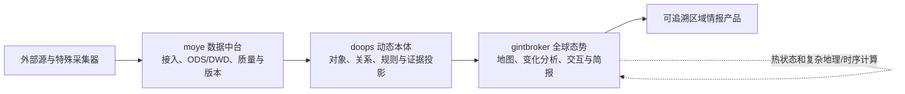
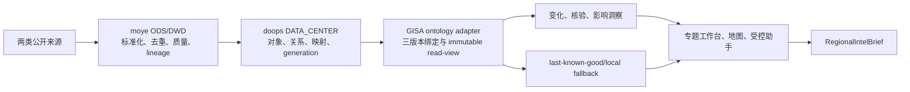

# PRD v6.0 中东实时情报分析演示能力评估与实施计划

- 评估日期：2026-07-23（基于 2026-07-22 运行快照和 2026-07-23 三仓代码/文档复核）
- 需求基线：[PRD-v6.md](../PRD-v6.md)
- 目标系统：`moye-v4-product` 数据中台、`doops-dev` 动态本体平台、`gintbroker` 全球态势系统
- 现场环境：`https://gisademo.trscd.com.cn/`（内网）
- 文档定位：内部能力评估、方案取舍、详细实施与风险保障的单一真源
- 客户版材料：[中东重点区域实时情报分析演示计划-客户版.md](中东重点区域实时情报分析演示计划-客户版.md)

## 1. 结论

`gintbroker` 已经具备较好的全球态势展示底座，也有中东专题、新近开源情报、航班/军机、卫星、关键设施、趋势、专题分类和 AI 助手入口。它可以演示“实时数据正在进入系统，也能按区域和主题汇集”。

但当前还不能直接作为“实时情报分析”演示。页面主要回答“系统里有什么”，没有稳定回答客户真正关心的五个问题：

1. 最近发生了什么变化；
2. 哪些事件值得关注；
3. 哪些来源相互支持或冲突；
4. 对航运、空域和关键设施可能有什么影响；
5. 哪些判断仍不确定，下一步需要继续观察什么。

上一版计划的主要缺陷是把数据中台和动态本体平台排除在近期范围之外，只在 `gintbroker` 内补分析闭环。这虽然能快速改善页面，却不能证明数据治理、业务模型可配置和跨专题扩展能力，无法满足本项目的核心定位。

本轮 Gate：**必须完成 `moye -> doops -> gintbroker` 的最小真实贯通后，才可作为客户版实时情报分析演示**。

建议把演示主线改成：

> 新近公开信息先经数据中台接入、标准化、去重和质量治理，再由动态本体平台组织为区域、事件、主体、设施、证据和影响关系，最终由全球态势系统识别重要变化、完成多源核验和影响研判，并生成可逐级追溯的区域情报简报。

这条主线比“回放一个过去事件”更有现场价值，也能实际展示三平台如何共同支撑业务匹配、灵活配置和后续扩展。三系统真实贯通仍会新增环境、身份、数据模型、映射、版本和故障边界，但通过固定两类首批来源、交付至少 3 条核心洞察、受控助手、契约先行并行开发和合并验证，可按 **16 个自然日、42～48 人日、六条工作线并行**规划。15 天作为内部演示就绪目标，第 16 天用于正式交付和单平台失败修正。

## 2. 本轮依据与证据边界

本轮已读取并对照：

- `PRD-v6.md`；
- `devdoc/PRD-v6-当前项目适配分析与UAE场景.md`；
- `devdoc/预警佐证来源与PRD两类场景融合方案分析-20260710.md`；
- `devdoc/美伊专题与PRD两类场景数据准备清单及结构规范-20260714.md`；
- `gintbroker` 的 `gisa-project-context`、README、专题方案、数据源对照、动态本体评估；
- `gintbroker` 当前 Topic、情报助手、相关性分析和报告代码；
- `gintbroker/docs/doops动态军事本体数据源挂接评估.md`、动态本体 285 缺口清单、2026-07-22 对接实现计划及其终态评审；
- `gintbroker` 当前动态本体执行台账和 2026-07-22 合并复核证据；
- `doops-dev` 当前数据接入、`DATA_CENTER`、对象/关系同步、增量 Kafka 入图、规则触发和 OpenAPI 代码；
- `moye-v4-product` 当前 HTTP/DB/MQ/File 连接、ODS/DWD、批流处理、数据服务和 Kafka 输出相关代码；
- 2026-07-22 内网环境页面、公开只读 API 和数据健康状态。

本轮没有修改三套运行系统，没有发送 AI 对话、部署或改动环境。`doops`、`moye` 的目标联调环境地址、服务身份和当前部署版本尚未取得，列为 T0 硬 Gate。2026-07-23 只读检查还显示 `moye-v4-product/product` 落后 upstream 261 个提交、`doops-dev/dev` 落后 upstream 29 个提交；这不直接说明当前分支不可用，但 D1 必须先确认目标环境实际 revision 和兼容版本，不能把未经评审的同步/升级塞入 16 天主线。运行数据计数会持续变化，本文只把它们作为 2026-07-22 现场快照，不作为长期固定指标。

## 3. PRD 对演示的真正要求

PRD 的重点不是地图上有多少点，而是依托可治理的数据和可演进的业务模型，把数据变成情报产品：



近期演示应先实现一条有界但真实的 `moye -> doops -> gintbroker` 纵向切片，并在其上完成 `L1 + 多源核验 + L3-lite`。原始正文、大文件和高频轨迹不全量入图；`moye` 保留原始/归一化事实，`doops` 保存业务对象、关系、证据引用和规则结果，`gintbroker` 保留地图热状态和复杂地理/时序计算。真实卫星任务、目标识别和连续影像变化检测仍属于后续 L2 专项。

## 4. 当前环境已确认能力

### 4.1 运行面

2026-07-22 现场快照：

| 项目 | 当前事实 | 可用于演示的价值 |
|---|---|---|
| 系统版本 | `/api/health` 返回 `0.9.81` | 已有可运行的统一态势面 |
| 数据健康 | 15 个源为 green、1 个 yellow、1 个 red；总体 `status=error` | 已有健康监控基础，但页面需把降级显式带入分析 |
| 航空 | 全球航班约 4,782、军机约 89，分钟级刷新 | 可支撑中东空域和军机活动背景 |
| 海事 | 船舶只有 11 条，低于最低期望；AIS proxy 未连接 | 当前不适合把实时海事作为必走主链 |
| GDELT | 约 1,380 条，健康状态 green | 可作为结构化事件背景和趋势输入 |
| 新闻 | 当前缓存 18 条，健康状态 green | 可提供新近 OSINT 线索 |
| 卫星 | 约 491 个轨道对象 | 可展示空间态势，不等于卫星影像核验 |
| LiveUAMap | 0 条，状态 red，未成功抓取 | 必须显示不可用，不能按 0 条事实解释 |

### 4.2 中东专题

页面已经具备：

- 中东地区美伊冲突专题入口和区域镜头；
- 新近新闻、7 日趋势、专题分类、实体列表和分页；
- 冲突情报、关键设施、舰艇动向、空中活动四类概览；
- 专题规则版本和后端分类记录；
- 新闻原文 URL、发布时间、翻译状态、专题匹配证据；
- 地图、专题面板与 AI 助手同屏展示。

2026-07-22 页面现场可见约 854 条累计冲突情报、3 个关键设施、0 个舰艇动向、1 个空中活动；首屏包含当天新闻。这个结果说明专题链路和增量数据已工作，但“854”是专题累计/窗口统计，不等于 854 个已确认的实时冲突事件。

### 4.3 当前分析和 AI 能力

已有能力包括：

- 按实体别名、动作词、区域和规则版本做专题匹配；
- 对航班、船舶、新闻、GDELT 和相关性结果做缓存检索；
- 按坐标或少量已知区域生成邻近目标简报；
- 计算 GPS 干扰与网络中断、军机/舰船与 GDELT 等空间相关性线索；
- 生成全球态势统计摘要；
- 通过 AI 助手触发地图聚焦和候选目标展示。

这些能力是很好的分析底座，但目前更多是规则检索和模板化汇总，还不是可审计的区域情报研判。

### 4.4 数据中台已确认能力

`moye-v4-product` 代码已具备 HTTP、数据库、Kafka/RocketMQ、File/MinIO/FTP/SFTP 等接入方式，支持 ODS/DWD、Spark/PySpark、部分流处理、调度、质量/错误数据、数据服务和任务监控。它适合承担公开信息的接入、标准化、去重、质量标记、存储生命周期和可重放加工。

当前未确认项：目标环境、可用服务身份、首批 HTTP 源能否访问、具体 ODS/DWD 模型是否已存在、`/moye/out` 服务级认证，以及能否按 24/72 小时窗口稳定提供演示数据。不能把代码存在写成环境已 ready。

### 4.5 动态本体平台已确认能力

`doops-dev` 代码已具备本体、对象、关系、属性、规则、数据接入记录、`DATA_CENTER` 适配、PySpark 任务结果监听、对象/关系同步、Kafka 增量入图和规则触发能力。本体 285 已包含 `MilitaryTopic`、`MilitaryFocusArea`、`Actor`、`SituationEvent`、`MilitaryIntelligence` 及多类设施/航空/海事对象类型。

当前关键缺口：

- 本体 285 的关系实例仍不足，不能宣称关系驱动查询已 ready；
- `MilitaryTopic`、`MilitaryFocusArea` 等部分类型只有结构、缺少可用实例；
- 面向 GISA 的稳定 key、批量精确查询、字段权威、关系实例查询和服务身份尚未全部通过运行 Gate；
- `gintbroker` 动态本体对接计划仅 T0A～T3A 完成，T3B.0～T18 仍为 `PENDING`，当前代码中尚无可运行的 `DoopsTopicKnowledgeProvider`。

因此，16 天方案采用更窄的“演示纵向切片”，不假设完整 Provider 迁移已经完成：先用一个中东 AOI、两类低/中频来源、有限对象/关系和只读应用适配完成真实贯通；现有 Topic 实现继续作为兼容基线、shadow 对照和故障回退。

## 5. 为什么当前效果还不足以说服客户

### P0-1：专题匹配被误读为事实确认

Topic classifier 的 `confirmed/probable` 表示“是否满足专题匹配规则”，不是“新闻所述事件已经被多源证实”。当前核心命中主要依赖实体别名与动作关键词，共现后即可给出固定分类分数。

对客户页面必须改名或分层：

- `topic_match_status`：是否属于专题；
- `claim_verification_status`：事件主张是否被独立来源支持；
- `assessment_confidence`：系统研判置信度及理由。

三者不能继续混成一个“已确认”。

### P0-2：当前情报列表不是多源证据链

现场抽取的中东专题前 20 条均来自 `news_rss_aggregate`。GDELT、航空、海事、设施等数据虽然存在于系统中，但还没有围绕同一主张组织成支持、反驳、上下文和重复来源。

客户看到的是多条新闻，不是“多源核验后的洞察”。

### P0-3：风险分数缺少可解释、可校准依据

页面显示 `3/10`、`9/10`、情绪和“常规/关键”等结果，但当前分数不能证明是事件发生概率、影响程度或证据可信度。单条标题也可能得到较高风险分。

近期演示应改为三项分开：

- 证据强度：弱/中/强；
- 影响等级：低/中/高；
- 信息状态：已核实/部分核实/待核实/存在冲突。

每项都要显示触发理由，未完成校准前不要使用精确概率式分数。

### P0-4：专题实体未真正空间化

中东专题当前 19 个配置实体中，没有可直接消费的经纬度。页面地图上的大量标记主要来自全球图层，容易让客户误以为它们已经与专题事件建立了关系。

至少需要补齐：

- 重点区域 AOI；
- 关键设施和交通节点；
- 专题实体稳定 ID、别名、位置、来源和有效期；
- “为什么这个地图对象与当前事件有关”的关系说明。

### P0-5：缺少“变化”和“基线”

当前趋势主要展示情报条数，不能回答“与过去 24 小时、过去 7 天基线相比，哪里发生了异常变化”。没有基线，系统只能罗列数据，难以形成洞察。

近期应先做 3 类简单、可解释的变化：

1. 事件量和来源结构相对 7 日基线的变化；
2. 重点 AOI 内军机、航班、船舶或干扰信号的数量/状态变化；
3. 关键设施周边新出现的事件、告警或公开信息。

### P0-6：AI 助手还不能承担区域研判

当前情报助手是确定性意图路由和缓存摘要：

- “波斯湾”能进入区域简报，但“中东”“伊朗”等泛区域问题会落到全局摘要；
- 通用回答主要列图层数量、相关新闻和相关性样本；
- “联网搜索”开关当前并未直连外部搜索；
- 没有围绕专题问题生成证据矩阵、矛盾点、影响对象和下一步监测项。

因此，演示前不要让用户任意提问。先提供 3～5 个经过验证的区域问题模板，并让助手只基于结构化证据包回答。

### P0-7：当前报告不是 PRD L3 报告

`/api/ai/report` 主要汇总军机、船舶、地震、GDELT、相关性和 AI pin 数量。它不是 PRD 要求的事件摘要、证据链、验证矩阵、影响评估、不确定性和报告归档。

近期至少需要一个 `RegionalIntelBrief`，不必先建设完整报告平台，但字段必须稳定、可追溯。

### P0-8：当前没有数据中台—动态本体—态势应用的真实业务链路

现有专题数据主要由 `gintbroker` 自行采集、分类和存储；数据中台未成为首批演示数据的治理权威，动态本体也未成为事件、证据、设施和影响关系的业务权威。即使页面补出洞察和简报，客户仍无法判断：

- 新数据源如何规范接入和治理；
- 新增区域、对象或关系是否必须改代码；
- 同一对象跨来源如何保持稳定身份；
- 数据模型、本体模型和最终研判结果如何对版；
- 新专题如何复用既有对象、关系和证据，而不是再建一套静态配置。

本轮必须用两类低/中频来源完成一条真实纵向链路，并现场展示一条记录的 `source_record -> ODS/DWD -> ontology_object/relation -> analysis/evidence -> brief` 追溯，以及一次本体对象或关系配置变化如何形成新版本结果。仅展示三套平台页面、静态截图或手工复制同一份样例，不算贯通。

### P1：实时源稳定性和演示降级不足

- AIS 当前未连接，海事数据不应作为必走主链；
- LiveUAMap 当前 red，页面不能把“源不可用”显示成“没有事件”；
- 外部数据源随时可能延迟、限流或为空；
- 页面需要 `as_of`、覆盖状态、最后成功时间和数据缺口说明。

降级时应使用“最近一次有效快照”，明确标注快照时间和来源状态；不能退回旧事件后继续称为实时分析。

## 6. 推荐演示故事

建议主场景采用“中东重点区域 24/72 小时态势研判”，首选波斯湾—霍尔木兹—周边关键设施和空海通道，叙事聚焦航行安全、空域变化和关键基础设施风险，不输出进攻性行动建议。

主角不是系统管理员，而是需要在突发事件中快速形成值班简报的区域情报分析员。其现场压力是：新闻不断更新、来源相互转述、航迹和设施数据分散在不同界面，部分数据源还会临时中断；如果判断过早，容易把单源传闻升级为事实，如果判断过晚，又可能错过航运、空域和设施风险的准备窗口。

系统要改变的工作动作，是把“人工逐条刷新闻和地图”变成“先看重要变化，再核验证据，最后形成可追溯简报”。决策者不需要浏览 800 多条记录，只需要知道当前最重要的三件事、可信到什么程度、影响什么、还缺什么证据。

客户在 8～10 分钟内看到：

1. 先选择一条洞察，回看其数据源、数据中台任务/模型版本、本体对象/关系版本和最终分析 `as_of`；
2. 选择区域、时间窗和关注对象；
3. 系统显示数据覆盖：哪些源正常、哪些延迟、最新到什么时间；
4. 给出最近 24/72 小时至少 3 个重要变化，而不是 800 多条列表；
5. 点击一个变化，查看支持、反驳、上下文和重复来源；
6. 查看事件与 AOI、主体、设施、通道和证据的本体关系，并在地图定位；
7. 输出影响研判、未知项和后续监测任务；
8. 导出一页区域情报简报；
9. 在动态本体平台新增/调整一个关注对象或关系，发布新版本后刷新研判结果，证明业务扩展不依赖前端改版。

建议首批固定问题：

- 最近 24 小时中东专题发生了哪些值得关注的变化？
- 哪些变化已经有两个以上独立来源支持？
- 哪些关键设施或交通通道受到潜在影响？
- 当前有哪些数据源不可用，可能导致哪些判断盲区？
- 接下来 6/12/24 小时最需要持续监测什么？

## 7. 近期必须补的三平台业务契约

### 7.1 数据中台治理契约

首期固定两类低/中频公开来源进入真实主链，优先 RSS 新闻和 GDELT；关键设施/通道目录作为 doops 业务对象治理，ADS-B 只作 `gintbroker` 热状态背景，不要求每个航迹点经过图谱。每条治理后的记录至少包含：

```text
source_system, source_record_id, source_url, source_published_at,
ingested_at, normalized_at, event_time, title, summary, language,
location, actor_refs[], asset_refs[], content_fingerprint,
independence_group, quality_status, quality_reasons[],
data_model_id, data_model_version, pipeline_run_id, lineage_ref
```

`moye` 是首批来源接入、ODS/DWD、字段标准化、去重/质量结果和加工 lineage 的权威；`gintbroker` 不在业务查询时直接读取 `moye /out`，也不在页面拼接数据中台内部 DTO。

### 7.2 动态本体业务模型

首期复用本体 285 已有类型，避免新建平行本体：

- `MilitaryTopic`：中东重点区域专题；
- `MilitaryFocusArea`：波斯湾、霍尔木兹及客户指定 AOI；
- `Actor`：国家、组织和其他公开主体；
- `SituationEvent`：经治理的情势事件；
- `MilitaryIntelligence`：公开情报及证据摘要；
- `InfrastructureDomain` 下适用对象：港口、机场、能源设施和交通通道。

首期必须形成并能查询至少四类业务关系：

```text
MilitaryIntelligence --supports|contradicts|contextFor--> SituationEvent
SituationEvent --occursIn--> MilitaryFocusArea
Actor --participatesIn|mentionedIn--> SituationEvent
SituationEvent --affects|relatedTo--> Infrastructure/Route
```

D2 的单记录纵向链必须能稳定读取至少一条实际关系；D8 前必须完成上述四类关系实例及查询。若目标 doops OpenAPI 不能满足，必须由平台团队补通用关系查询或提供同等可审计的版本化关系投影；不得把前端手工拼接关系、静态 JSON 或只有关系定义没有实例写成“动态本体已贯通”。

### 7.3 稳定身份与三版本绑定

每条进入分析链的对象必须同时保留：

```text
source_key = source_system + source_record_id
data_version = data_model_id + data_model_version + pipeline_run_id
ontology_version = ontology_id + object_type_id + mapping_version + ontology_generation
analysis_version = analysis_id + ruleset_version + as_of
```

稳定 key 用于定位同一逻辑记录，不等于内容版本。`data_version -> ontology_version -> analysis_version` 必须可以逐级回证；任何一层缺失时，只能显示原始线索，不能生成“平台贯通”的强结论。

### 7.4 区域分析上下文

统一 `AnalysisContext`：

```text
analysis_id, topic_id, aoi_id, time_window, as_of,
focus_entities[], focus_assets[], data_source_scope[], baseline_window,
data_snapshot_refs[], ontology_snapshot_ref, mapping_version, ruleset_version
```

页面、确定性规则、助手和简报必须共用同一上下文，不得拼接不同数据批次或不同本体版本。

### 7.5 最小证据模型

复用 [美伊专题与 PRD 两类场景数据准备清单及结构规范](美伊专题与PRD两类场景数据准备清单及结构规范-20260714.md) 中已有的 `observations`、`claims`、`evidence_links`、`anomalies` 和 `verification_matrix`：

```text
claim_id, statement, event_time, geometry,
supporting_evidence[], contradicting_evidence[], context_evidence[],
independence_groups[], verification_status, confidence_reason,
information_gaps[], source_lineage_refs[], ontology_relation_refs[], as_of
```

同一 URL、转载和同源稿件归到同一 `independence_group`；事件聚类保留原记录，不覆盖数据中台 lineage；支持/反驳/上下文必须对应实际本体关系实例或版本化关系投影。

### 7.6 数据覆盖与来源健康

每个来源同时返回采集健康和平台加工健康：

```text
source_id, ingest_status, pipeline_status, ontology_projection_status,
last_success, freshness, coverage, records_in_window,
projected_records, rejected_records, attribution, limitations
```

`source unavailable`、`pipeline failed`、`ontology projection failed` 和 `records_in_window=0` 是四种不同状态，禁止合并成“0 条数据”。

### 7.7 三类可解释洞察与简报

近期先实现：

1. **变化洞察**：相比基线，哪些指标明显上升、下降或出现新对象；
2. **多源核验洞察**：同一主张得到哪些独立来源支持，哪里存在矛盾；
3. **影响洞察**：事件通过哪些本体关系关联到设施、航道、空域和持续监测对象。

`RegionalIntelBrief` 至少包含分析范围/`as_of`、三条核心判断、重要变化、证据矩阵、本体关系、影响对象、反证/缺口、三平台健康、版本链和后续监测清单。每条洞察必须带输入记录、数据模型版本、本体/映射版本、规则版本和不确定性。

## 8. 方案粗拆

### 16 天三平台纵向切片

适用边界：真实打通两类低/中频来源、一个固定中东 AOI、四类核心关系、至少 3 条洞察和一个分析工作台；不追求全量数据迁移、全部 Topic root 切主、完整动态本体 Provider 生产化或开放式自由问答。

| 工作包 | 主要工作 | 产物 | 粗略工作量 | Gate |
|---|---|---|---:|---|
| W0 范围、环境与贯通 spike | 同日冻结 AOI、问题、两类来源、对象/关系和三平台环境；次日让一条记录真实经过三平台 | 执行卡、单记录 lineage、初版本体关系 | 5～6 人日 | `VERTICAL_SLICE_PROVED` |
| W1 数据中台治理 | 建立两类来源的接入、ODS/DWD、去重、质量、版本、调度和 lineage | 数据模型、质量卡、可重放事件包 | 7～8 人日 | `DATA_PLATFORM_READY` |
| W2 动态本体与映射 | 复用本体 285，补齐对象、四类关系、实例、字段映射、版本和只读查询 | 本体版本、关系实例、映射清单、入图审计 | 8～9 人日 | `ONTOLOGY_READY` |
| W3 态势适配与情报分析 | 契约先行并行建立只读适配、三版本绑定、至少 3 条洞察、动态变更和 fallback | `RegionalInsight`、证据矩阵、shadow 对账 | 9～10 人日 | `ANALYSIS_READY` |
| W4 页面、助手与简报 | 基于冻结 fixture 并行展示 lineage、本体关系、洞察、地图、受控助手、简报和状态矩阵 | 可交互三平台研判工作台 | 6～7 人日 | `DEMO_FLOW_READY` |
| W5 跨平台验证、发布与彩排 | 合并正常路径验证，拆分断源/断平台/版本错配；连续完成目标环境发布、动态变更和彩排 | 验证记录、演示版本、脚本、兜底资产 | 7～8 人日 | `CUSTOMER_DEMO_READY` |

各工作包存在共享建模和验证活动，去重后的总投入按 **42～48 人日** 配置，由数据中台、动态本体、GISA 后端、前端、情报内容/数据质量、测试/发布六条线并行，在 **16 个自然日** 内完成。相比上一版，压缩来自范围固定、契约先行、前后端并行和验证合并，不来自降低三平台链路、证据、本体关系、动态变更或故障降级标准。

### 工期压缩规则

- 首批来源固定为 RSS 新闻和 GDELT，不在周期内临时增加第三来源；
- 最低交付固定为 3 条核心洞察，数据充分时扩展到 5 条，不把扩展数量作为阻断项；
- 助手只开放 3～5 个推荐问题和证据内追问，不建设开放式自由问答；
- T1 冻结三个中立 DTO 后，数据中台、动态本体、GISA 后端和前端立即并行；前端先用同契约 fixture，不等待真实数据全部完成；
- 复用本体 285、现有 `DATA_CENTER`、Topic 页面和发布链，不同期完成全部 Provider/root 迁移；
- 正常主路径、血缘、关系、洞察、地图、助手和简报在同一轮合并验证；平台故障、版本错配和 generation 切换仍分开验证；
- D13～D16 只允许阻断演示的缺陷修复和数据刷新，不再增加来源、洞察类型或视觉支线。

### 不可裁剪项

- 至少一条真实 `moye -> doops -> gintbroker` 记录链；
- 至少 2 个来源家族和实际独立源去重；
- 至少 4 类有实例的业务关系；
- 数据模型、本体/映射和分析三版本绑定；
- lineage、来源、时间、`as_of`、信息缺口和断平台降级；
- 一次本体对象或关系变更后形成新版本结果。

若压缩范围，优先移除 AIS、可选 GPS/网络关联、自由问答和非核心视觉增强；不得退回“平台只展示页面、数据仍由 GISA 本地静态提供”的伪贯通。

## 9. 验收口径

### 必须通过

- 至少一条用户可见洞察能反查到 `moye` 源记录/模型/run、`doops` 对象/关系/mapping/generation 和 GISA `analysis_id/as_of`；
- 首批两类来源真实经过数据中台治理，不能由脚本绕过平台直接复制到 doops；
- `SituationEvent`、`MilitaryIntelligence`、`MilitaryFocusArea` 及相关设施/主体存在实际实例，至少四类关系可查询；
- 修改一个允许演示的本体对象或关系后形成新 generation，GISA 刷新后只展示完整新版本，不出现半新半旧；
- 用户能明确选择 AOI 和 24/72 小时时间窗；
- 首屏不是数据计数，而是至少 3 条可解释变化和洞察；
- 每条洞察至少能反查到输入记录、来源、时间、数据版本、本体关系和规则；
- “专题匹配”与“事实核实”在页面上明确分开；
- 至少一条主张有两个独立来源支持，或被明确标为单源待核实；
- 数据源、数据中台任务、doops 投影任一故障均显示为对应 coverage gap，不显示为 0 事件；
- 地图对象与专题事件有可解释关系，不混用全球背景点；
- AI 助手回答只引用当前分析上下文和证据包；
- 简报包含结论、不确定性、影响和后续监测项；
- 分别断开一个外部源、`moye` 和 `doops` 后，主流程能查看最后有效结果并显示降级原因。

### 不作为快速演示版承诺

- PRD 中 90% 以上目标识别精度；
- 真实卫星订购和自动补采；
- 90%～99% 概率式置信度；
- 全量实时 AIS、RF 和客户私有数据覆盖；
- 生产级 99.9% 可用性；
- 数据中台和动态本体已经接管所有实时图层、全部专题或生产级数据链路。

## 10. 风险、防护与回滚

| 风险 | 防护 | 回滚/降级 |
|---|---|---|
| 三平台环境、网络或服务身份未就绪 | D1 冻结地址、版本、权限、owner 和最小读写样本；D2 完成单记录贯通 | D2 仍未贯通则 16 天承诺失效，停止对外声称三平台演示，不以静态复制替代 |
| `moye -> doops` DATA_CENTER 任务失败 | 固定模型/映射版本、运行日志、输入输出分母和可重跑 run | 保留最近成功数据版本，修复后以新 run 重放，不覆盖旧证据 |
| doops 只有结构没有实例/关系 | 四类关系正反样本和查询 Gate | 不进入客户主讲；不得由前端静态拼接冒充关系 |
| stable key 或版本绑定不唯一 | source key 唯一性、duplicate/ambiguous 分桶、三版本链 | 拒绝 candidate，继续使用 local/snapshot，不静默任选 |
| 三平台形成半新半旧结果 | immutable data/ontology/analysis snapshot 和原子 active pointer | 整个 analysis cohort 回退到上一完整版本 |
| 突发新闻尚未证实 | 默认作为线索；两个独立来源或人工复核后再升级 | 降级为“待核实”，保留原文和反证 |
| 单源故障或延迟 | freshness/coverage、超时、最后成功时间可见 | 使用最近一次有效快照并显示 `as_of` |
| 规则误匹配 | 专题匹配和事实核实分层；保留规则证据 | 人工排除，重新计算洞察 |
| AI 生成无引用结论 | AI 只能总结结构化证据包，不允许新增事实 | 回退确定性模板简报 |
| 实时数据量波动导致画面不稳定 | 洞察按窗口和基线计算，不依赖固定数量 | 切换同一时间点的冻结快照 |
| 敏感或进攻性表达 | 聚焦航行安全、空域风险和民用基础设施保护 | 隐藏精确敏感坐标和行动建议 |
| 新页面或上游平台影响全球态势主链 | 复用现有专题 `demo_workspace_mode` 隔离；业务查询只走 doops 适配，不把 moye 放入地图热路径 | 新 API/上游异常自动返回原专题页或最后有效快照；必要时回滚 release |

## 11. 实施决策

采用“`moye` 治理数据 + `doops` 组织业务知识 + `gintbroker` 完成实时展示和研判”的三层纵向切片。默认 AOI 为波斯湾—霍尔木兹海峡—周边关键设施，默认问题为“重要变化、多源核验、影响与后续监测”。

依赖方向固定：

- 数据采集与加工面：`外部源/特殊 collector -> moye -> doops`；
- 业务查询与控制面：`gintbroker -> doops`；
- `gintbroker` 运行时不直接查询 `moye` 内部模型；
- 低延迟地图、特殊 collector 和复杂地理/时序计算仍由 `gintbroker` 承担；结果以低频、高价值事件/证据投影进入 doops；
- 原始正文、大文件和全量轨迹不入图，只保存引用、摘要和稳定身份。

不等待 AIS 或 LiveUAMap 恢复；AIS 作为可选增强，LiveUAMap 不进入主链。现有 Topic 实现保持 local authority 和 fallback，新三平台结果先以 isolated analysis root/shadow 进入，不在本次强行完成所有 Topic root 的 doops 切主。

## 12. 需求与方案复核

### 12.1 目标、非目标与成功定义

目标：

- 让区域情报分析员在 8～10 分钟内完成“看变化—核证据—判影响—出简报”；
- 真实证明至少一条信息经过数据中台治理、动态本体组织和态势应用分析；
- 通过一次本体对象/关系变更证明新区域、新对象和新关系可版本化扩展；
- 基于当前或明确标记时间的新近数据，而不是将旧事件伪装成实时结果；
- 每条洞察可追溯、可解释、可降级，断源时不误报为“零事件”；
- 在 16 个自然日内形成可现场交互、经过三平台目标环境验证的客户演示版。

非目标：

- 不在本次建设完整 PRD L2 卫星任务与目标识别链；
- 不迁移全部数据源，不让数据中台接管全部实时图层；
- 不完成 GISA 动态本体专项计划 T3B.0～T18 的全部生产化 root 切主；
- 不让前端直连 doops 或 moye，不让 GISA 业务查询直接依赖 moye；
- 不开放无边界联网搜索或自由问答；
- 不给出进攻性行动建议、精确敏感坐标或未经验证的高风险断言；
- 不承诺全量 AIS、RF、卫星影像或客户私有数据已接入。

成功定义以第 9 节全部必须通过项及本文第 16 节验证矩阵为准，不以“三个平台页面都能打开”“手工复制了一份样例”或“有三条文字”代替验收。

### 12.2 关键旧契约

- 专题列表、详情、概览、情报列表、趋势、实体和简报现有 `/api/topics/*` 契约保持兼容；
- `TopicDetailPanel` 现有 `loading/ready/empty/partial/forbidden/error` 状态不得退化；
- 专题未进入 `demo_workspace_mode=demo`、新 analysis API 不可用或客户退出区域分析时，全球态势、地图图层和当前 AI 助手行为保持不变；
- 已有 Topic classifier 的 `confirmed/probable` 只作专题匹配结果，不修改其存量语义；新页面以独立 `verification_status` 表达事实核实状态；
- `moye` 的 `dataModelId/pipeline_run_id`、doops 的对象/关系 ID 和内部认证字段不得直接透传前端；
- doops 不可用时不得回查 moye 作为业务旁路；使用最后有效 doops/analysis snapshot 或原 Topic 页；
- 不执行历史数据清理、覆盖或 schema 破坏性迁移。

### 12.3 候选方案与取舍

| 方案 | 优点 | 决定性风险 | 结论 |
|---|---|---|---|
| A. 三平台有界纵向切片 + 现有专题工作台增强 | 真实展示数据治理、本体建模和态势研判；复用现有地图/专题/fallback | 跨环境与版本 Gate 较多，需严格控制来源和关系范围 | **推荐** |
| B. 继续只增强 GISA 页面 | 最快 | 无法证明数据中台和动态本体价值，与项目定位不符 | 不采用 |
| C. 同期完成全部数据迁移和 Topic root 切主 | 长期架构最完整 | 当前 Provider、关系实例、身份和部署 Gate 尚未通过，16 天不可控 | 后续按专项计划推进 |
| D. 只做固定 mock/录屏 | 快 | 无法回应客户对当前数据和真实分析的期待 | 不可作主方案 |

### 12.4 推荐方案的最小闭环



洞察计算为确定性主链；大模型只重组已绑定数据 lineage 和本体关系的证据包，不新增事实。模型超时、回答无引用或格式不合格时，回退确定性模板。新 data/ontology generation 只有完整构建、对账和原子激活后才对用户可见。

### 12.5 客户版发布自审

客户一句话故事：

> 面对中东重点区域快速更新、真假交织的信息，数据中台先形成可信数据，动态本体把事件、主体、设施和证据组织成业务关系，全球态势系统据此找出重要变化、完成核验并形成可逐级追溯的区域情报简报。

对外文档 Gate：**可直接用于客户计划沟通**，但不代表运行能力已完成。依据：

- 开篇先回答值班和研判问题，没有从系统模块或内部架构讲起；
- 每个阶段都有客户可见结果，D2 有三平台单记录贯通，D5 有数据治理结果，D8 有本体关系和首版研判，D12 有完整预演，D16 演示就绪；
- 未暴露项目名、代码路径、内部材料、API 或内部风险编号；
- 专业性体现在证据独立性、支持/冲突、数据截止时间、覆盖缺口、影响判断和后续监测，而不是堆叠“智能、融合、闭环”口号；
- 对外明确 16 天，对内按 42～48 人日、六线并行、D2/D5/D8/D12 硬里程碑和四天联测发布收口支撑，不以静态样例替代三平台贯通。

## 13. 关键未知项与 Gate

Gate 阈值必须在取样前冻结，不得看完结果后修改。

| Gate | 会改变什么 | 验证方法 | Pass | Fail 分支 | 当前状态 |
|---|---|---|---|---|---|
| G0 三平台环境和身份是否 ready | 16 天承诺是否成立 | D1 只读核对目标版本、地址、网络、owner、最小权限和回滚边界 | 三平台测试环境可达；具备受控配置/发布身份；无共享生产写入 | D1 结束仍缺任一平台环境/owner，暂停对外日期并升级协调 | pending |
| G1 单记录纵向链是否真实 | 是否可继续三平台方案 | D1～D2 选择一条脱敏记录，经过 moye ODS/DWD、doops object/relation、GISA read-view | 三层 ID/version/lineage 可回证，非手工复制，页面可见 | D2 Fail：16 天承诺不成立；不得回退伪贯通 | pending |
| G2 数据中台模型是否可用 | 是否能形成新近数据主链 | 两类来源的正常/重复/空/坏时间/断源样本 | 标准字段完整率 100%；重复/坏数据有明确分桶；run 可重放 | 任一来源 Fail 则停止该源修复；两类未齐则不进入正式演示 | pending |
| G3 本体实例和关系是否可查询 | 是否能声称动态本体驱动 | 至少 6 个对象正例、4 类关系正反例、一次 generation 变更 | 对象/关系实例可从通用 API 或审计投影查询；新旧 generation 不混读 | 平台补通用查询；未补齐则关系展示退出主讲，不用静态拼接 | pending |
| G4 stable key/三版本绑定是否唯一 | 是否能逐级追溯和原子切换 | full-match、missing、duplicate/ambiguous、version mismatch、projection failed 样本 | matched=denominator；其余阻断分桶均为 0；版本链完整 | 整个 candidate 不激活，继续 last-known-good/local | pending |
| G5 新近数据是否足以形成洞察 | live 主讲还是 snapshot 主讲 | 对 72h 治理后样本统计来源、时间、地点和关系覆盖 | ≥12 条可用观测、≥2 个来源家族，且一个主张获≥2 独立组支持 | live 展示覆盖；证据展开用明确 `as_of` 的近期 snapshot | pending |
| G6 独立来源分组是否可信 | 能否声称多源支持 | 人工标注 30 组转载/独立报道样本 | 独立组精度≥90%，同 URL/明显转载合并率 100% | 只显示“多条信息”，不显示“多个独立源” | pending |
| G7 AOI/设施空间化是否可用 | 地图是否进入主链 | 核对坐标、来源、精度、有效期和本体 binding | 上图对象 100% 可追溯；低精度对象有可见标识 | 不上图，仅在关系卡显示文字地名 | pending |
| G8 三类洞察是否稳定 | 能否对客户讲“分析” | 金标 fixture + 规则测试 + 反例 | 每类至少 3 正例/3 反例；无证据不产生强结论 | 失败类型降级为数据卡或待核实线索 | pending |
| G9 助手是否可控 | 是否进入现场主讲 | 20 个允许/越界/证据不足问题 | 引用覆盖 100%，无证据新增事实 0，越界 100% 拒答/收窄 | 隐藏自由输入，仅保留推荐问题 | pending |
| G10 三平台降级是否完整 | 现场是否可交付 | 分别断源、停 moye、停 doops、版本错配、模型超时 | 地图不受阻；分析显示 last-known-good/as_of/缺口；无半版本 | 禁止发布；修复后逐项重跑 | pending |
| G11 性能是否适合现场 | 是否需要预计算/缓存 | 目标环境连续 30 次查询，分冷/热缓存 | 热缓存 API p95≤2s，首条洞察≤5s，零 5xx | 预计算固定上下文、缩小窗口和输入上限 | pending |

G0/G1 是决定 16 天承诺能否成立的启动 Gate，必须最晚在 D2 关闭；G2 必须在 D5 关闭，G3/G4 必须在 D8 关闭，否则不得进入真实洞察合并和完整前端联调。各 Gate 阈值不得看完结果后修改。主动断平台仅在隔离的开发/测试配置中执行，不修改共享生产凭据、数据或平台全局配置。

## 14. 设计契约与影响面

### 14.1 数据与 API 契约

三平台先冻结中立交换契约，禁止 GISA 依赖 moye 内部表名或 doops 动态 property 名：

```text
GovernedObservationV1
  source_key, source_url, event_time, normalized_fields,
  independence_group, quality_status, data_model_version,
  pipeline_run_id, lineage_ref

OntologyProjectionV1
  ontology_object_key, object_type, attributes,
  relation_refs[], mapping_version, ontology_generation,
  governed_observation_refs[]

RegionalAnalysisV1
  analysis_id, as_of, data_snapshot_refs[], ontology_snapshot_ref,
  insights[], claims[], evidence[], map_relations[], brief
```

GISA 新增读取接口：

```text
GET /api/topics/{topic_id}/analysis
  ?aoi_id=persian_gulf_hormuz
  &window=24h|72h
  &mode=live|snapshot
  &snapshot_id=<optional>
```

单一响应返回 `AnalysisContext`、`SourceCoverage[]`、`DataLineage[]`、`OntologyRelation[]`、`RegionalInsight[]`、`ClaimEvidence[]`、`MapRelation[]`、`RegionalIntelBrief` 和 `recommended_questions[]`。前端不自行拼接不同时间点或本体 generation 的多个响应。

关键规则：

- 接口复用现有 `require_local_operator` 权限边界和限流策略，不新增公网暴露面；
- `analysis_id` 由 `topic_id + aoi_id + window + as_of + data_snapshot_set + ontology_generation + mapping_version + ruleset_version + snapshot_id` 稳定生成；
- `as_of` 为本次分析截止时间，所有证据不得晚于该时间；
- `mode=snapshot` 时 `snapshot_id` 必填，缺失、未批准、契约版本不匹配或超出当前 topic/AOI 时返回可判定 4xx，不自动挑选“最新快照”；
- `topic_match_status`、`verification_status`、`evidence_strength`、`impact_level` 四个字段独立；
- 所有用户可见事实必须带 `evidence_ids[]`；
- 所有 evidence 必须能反查 `lineage_ref` 和 `ontology_object/relation_ref`；
- `coverage.status=unavailable` 与 `records_in_window=0` 是两种状态，不得互换；
- snapshot 仅保存必要的引用元数据、有限摘要和计算结果，不复制整篇版权文章，不保存密钥或用户隐私数据。

### 14.2 默认数据范围

| 类型 | 本次地位 | 失效时处理 |
|---|---|---|
| 公开新闻/RSS | 必选；经 moye ODS/DWD 后入 doops | 使用最后有效数据/本体快照，标记时间 |
| GDELT | 必选；经 moye 治理后作为事件背景 | 降级为新闻线索，显示 pipeline/projection 缺口 |
| ADS-B/军机与航班 | GISA 热状态背景；只将高价值事件/摘要选择性投影 | 使用热状态快照，不输出未经本体关联的影响断言 |
| 关键设施/AOI 目录 | doops 必选业务对象 | binding/关系验证不通过则不进入主讲 |
| AIS | 可选海事增强 | 从主链移除，不阻断演示 |
| GPS 干扰/网络中断 | 可选关联信号 | 不生成对应洞察 |
| LiveUAMap | 不进本次主链 | 只显示源不可用，不解释为无事件 |
| 卫星轨道数据 | 仅作背景 | 不作影像核验证据 |

### 14.3 代码影响面（计划）

`moye-v4-product`（优先配置和 fixture；只有现有能力不满足冻结契约时才改代码）：

- 首批 HTTP/File 来源连接、ODS/DWD 模型、字段标准、质量规则、调度与数据服务；
- 必要的 doops 出站 envelope/数据服务字段补齐及定向测试；
- 运行记录、错误数据、模型版本和 lineage 证据。

`doops-dev`（优先复用已有 `DATA_CENTER` 和通用 OpenAPI）：

- 本体 285 的演示对象/关系实例、数据接入记录、映射版本和 generation；
- 对象/关系 DATA_CENTER mapping、全量/增量导入和规则审计；
- 若 G3 不通过，仅补通用关系实例查询或版本化关系投影，不开发 GISA 专用 facade。

`gintbroker` 后端：

- `backend/routers/topics.py`：新增只读 analysis 路由；
- `backend/services/region_intel/`：新增 doops 只读 adapter、三版本绑定、上下文、来源覆盖、证据、洞察、快照和简报服务；
- `backend/data/region_intel/`：存放 AOI/设施目录、金标 fixture 和可审计 snapshot manifest；
- `backend/tests/region_intel/`：完成契约、去重、证据、洞察、脏数据、降级和 API 测试。

前端：

- `frontend/src/lib/topics/regionalIntel.ts`：严格解析新契约；
- `frontend/src/components/TopicDetailPanel.tsx`：挂载区域分析工作台，保留旧模式；
- `frontend/src/components/region-intel/`：数据覆盖、洞察卡、证据抽屉、影响对象、简报和空/错误/降级状态；
- `frontend/src/components/IntelligenceAssistant.tsx`：仅新增与当前 `analysis_id` 绑定的推荐问题与回答渲染；
- `frontend/src/__tests__/region-intel/` 与 `frontend/e2e/topics/regional-intel.spec.ts`：单测和端到端回归。

配置与发布：

- 复用已有 `demo_workspace_mode=demo` 与 analysis API capability 作为显示条件，不新增远端环境变量；
- 不修改三平台 CI/CD 全局配置，不新增数据库破坏性迁移；
- 三平台配置只使用独立演示 namespace/model/ontology generation，不覆盖现有生产对象；
- 新 analysis API/doops 失败时前端自动回到最后有效 analysis snapshot 或原专题工作台；如影响旧主链，通过既有 `rollback-previous` 回退 GISA release；moye/doops 分别停用演示任务/generation，不删除历史数据。

## 15. 具体实施计划

本节是后续执行真源。三平台建设可并行，但依赖关系不可倒置：先用一条真实记录证明纵向链路，再扩大数据、关系、洞察和界面。任何阶段不得用手工复制结果或静态 JSON 代替数据中台、动态本体平台的实际运行结果。

### T0：三平台基线、环境与授权冻结（2 人日，D1 硬 Gate）

目标：固定三仓 revision、目标环境、服务身份、演示命名空间、客户问题、回滚点及操作授权。

输入：本文、客户版计划、三项目当前代码与文档、三套开发/测试环境。

修改范围：只读取证和更新执行记录；不改代码、平台全局配置和历史数据。

步骤：

1. 分别记录 `moye-v4-product`、`doops-dev`、`gintbroker` 的分支、HEAD、upstream、ahead/behind、无关脏改动和可回退 revision。
2. 记录三平台测试入口、健康状态、认证方式、最小服务身份、网络连通性、数据/本体 namespace；敏感值只登记保管位置，不写入本文。
3. 冻结 AOI `persian_gulf_hormuz`、24h/72h 窗口、RSS/GDELT 两类首批来源、3 个客户问题、4 类最低关系和至少 3 条目标洞察。
4. 冻结 `GovernedObservationV1`、`OntologyProjectionV1`、`RegionalAnalysisV1` 契约及数据模型、本体 generation、mapping/ruleset 的版本规则。
5. 为数据任务、本体 generation 和 GISA capability 分别定义关闭开关、last-known-good 和回退责任人。

验证：G0 通过；三平台的 revision、环境、身份、namespace、契约、责任人和回滚点完整且互相一致。

暂停条件：任一平台无可用测试环境/服务身份，三平台网络不可达，或现有用户改动无法隔离。不得用本机 fixture 绕过该 Gate。

提交与记录：只读取证不提交；更新第 20 节。

### T1：单记录三平台纵向贯通（3～4 人日，D2 硬 Gate）

目标：用一条真实公开记录证明 `source → moye ODS/DWD → doops 对象/关系 → GISA 查询展示` 全链路成立。

输入：T0 契约、一个稳定公开来源、一组演示对象和一条最低关系。

修改范围：三平台独立演示 namespace 下的最小配置/映射；仅在冻结契约无法由现有通用能力表达时做最小代码补齐。

步骤：

1. 在 moye 创建首个来源、数据模型和 ODS/DWD 映射，运行一次有明确 `pipeline_run_id` 的任务。
2. 用 DATA_CENTER/既有同步面将治理结果投影到 doops，生成可按 stable key 查询的对象和至少一条关系。
3. GISA 通过 doops 通用读取面查询投影，不直查 moye 表，也不回退本地 Topic 冒充成功。
4. 从界面或只读 API 反查原始来源、`pipeline_run_id`、本体对象/关系、generation、mapping version 和 `as_of`。
5. 重放同一记录验证幂等；制造一次错误字段验证隔离和错误可见性。

验证：G1 通过；同一稳定 ID 在三平台可追踪，重复运行不产生重复对象/关系，错误记录不污染成功 generation。

暂停条件：D2 结束前仍不能完成单记录闭环、关系只能靠手工建造、或版本/血缘无法反查。命中后重新评估总日期，不进入 T2～T6 的规模化开发。

提交与记录：三仓分别按可验证最小批提交，记录完整 SHA、配置版本、run id、generation 和查询证据；默认不 push。

### T2：数据中台首批来源治理与数据服务（7～8 人日，D3～D5）

目标：将 RSS 新闻和 GDELT 两类首批来源纳入可复用、可调度、可审计的数据治理链，形成统一观测和数据质量结果。

输入：T1 纵向链路、来源许可和字段样本、30 组去重/异常金标样本。

修改范围：moye 来源连接、数据模型、ODS/DWD、质量规则、调度、出站 envelope/数据服务及定向测试；不建设 GISA 专用数据表。

步骤：

1. 定义来源字段、事件时间/入库时间、主体、地点、动作、原文引用、独立来源组和许可边界。
2. 配置 ODS 原样留痕与 DWD 标准化，完成时区、枚举、地理精度、URL、publisher family 和内容指纹处理。
3. 建立空值、未来时间、严重延迟、重复、无来源、无几何、翻译失败的隔离与质量原因。
4. 配置全量初始化和有水位线的增量调度；重试幂等，失败任务不推进水位线。
5. 输出 `GovernedObservationV1`，记录 `data_model_version/pipeline_run_id/lineage_ref` 和来源健康。

验证：

```bash
cd /Users/liushen/Documents/cursorDevs/moye-v4-product
mvn -pl moye-backend,moye-storage-engine,moye-stream-engine,moye-batch-engine -am -DskipTests compile
mvn -pl moye-backend -Dtest=OutApiControllerTest,DataModelServiceTest,DataModelServiceImplTest,DataModelScheduleServiceImplTest,OutApiServiceImplTest,KafkaMessageProducerImplTest test
mvn -pl moye-batch-engine -Dtest=OutPysparkFinalResultKafkaServiceTest test
git diff --check
```

另以固定 `as_of` 样本核对输入数、ODS 数、DWD 成功/隔离/重复数守恒，以及两次增量重放结果一致。G2 通过后才可宣布“数据已由数据中台治理”。

暂停条件：来源许可不明、输入/输出计数不守恒、错误记录会污染成功批次、或血缘只能依赖日志人工拼接。

提交与记录：按“模型与质量规则”“调度与出站契约”分批提交，记录任务 run id 与验证结果。

### T3：动态本体对象、关系与版本化投影（8～9 人日，D3～D8）

目标：将中东专题的数据组织为可配置对象与业务关系，证明模型变化无需改写整条分析流程。

输入：T1 纵向链、T2 按冻结契约持续产出的治理观测、现有本体 285 结构、AOI/设施/watchlist 目录和 4 类最低关系。

修改范围：doops 独立 ontology/generation、对象/关系实例、DATA_CENTER mapping、全量/增量投影、关系读取与审计；不开发 GISA 私有 facade。

步骤：

1. 冻结 `SituationEvent/Actor/MilitaryFocusArea/MilitaryIntelligence/Infrastructure` 等首批类型和 stable key 规则。
2. 至少实例化“事件发生于区域、事件涉及主体、事件影响设施/通道、情报支持或反驳事件”四类关系。
3. 配置 moye 字段到本体对象/关系的 mapping，分别验证全量初始化、增量更新、重复消息、孤儿关系和乱序消息。
4. generation 发布前验证对象/关系数量、悬空引用、schema/mapping 兼容性；通过后原子切换，不向 GISA 暴露半版本。
5. 新增/调整一个关注对象或业务关系，发布新 generation，保留旧 generation 可回退和审计。

验证：计划新增并执行契约级定向测试：

```bash
cd /Users/liushen/Documents/cursorDevs/trsdatai/doops-dev
mvn -DskipTests compile
mvn -Dtest='DataCenterRegionalIntelContractTest,RegionalIntelProjectionTest,RegionalIntelRelationQueryTest,RegionalIntelGenerationIsolationTest' test
git diff --check
```

同时以只读查询证明四类关系、正反向遍历、generation 隔离、增量幂等和回退。G3/G4 通过后才可宣布“分析依托动态本体”。

暂停条件：只有模型结构没有关系实例、stable key 冲突、孤儿关系无法隔离、或 generation 切换会出现对象/关系半版本。

提交与记录：按“演示本体与映射”“关系投影与 generation 隔离”分批提交，记录 generation、mapping version 和查询样本。

### T4：GISA 本体读取适配、版本绑定与降级（5 人日，D6～D9）

目标：让 GISA 只通过 doops 获取业务对象/关系，并将三平台版本绑定为一个可复现分析上下文。

输入：T1 纵向链路、冻结 DTO/fixture、T2 数据服务和 T3 持续形成的对象/关系查询；D6 起按 fixture 开发，D8 后切真实关系联调。

修改范围：`backend/services/region_intel/`、只读 analysis API、演示资产和测试；保留原 Topic provider 作为 shadow oracle/last-known-good，不作为主链成功证据。

步骤：

1. 实现 doops 只读 adapter、超时/熔断/缓存和契约解析；业务代码不直连 moye。
2. 构造 `AnalysisContext`，强绑定 data snapshot、ontology generation、mapping/ruleset、`as_of` 和 AOI/window。
3. 检测版本错配、对象缺失、关系缺失、陈旧 generation；任何错配均拒绝生成新强结论。
4. 保存有限 last-known-good 分析快照，明确显示 snapshot/live、`as_of`、平台/来源缺口。
5. 新 API/capability 失败时回到最后有效分析或旧专题工作台，不阻断全球态势主链。

验证：

```bash
cd /Users/liushen/Documents/cursorDevs/gintbroker
.venv/bin/pytest backend/tests/region_intel/test_doops_adapter.py backend/tests/region_intel/test_version_binding.py backend/tests/region_intel/test_degradation.py backend/tests/region_intel/test_api.py -q
git diff --check
```

覆盖正常、空结果、超时、401/403、契约不兼容、generation 错配、last-known-good 和旧页回退。G4/G10 通过。

暂停条件：GISA 必须直查 moye 才能工作、版本错配仍输出混合结果、或 doops 故障会阻断原地图主链。

提交与记录：适配器/版本绑定、API/降级分批提交，记录契约样本和回退证据。

### T5：证据归并、关系推理与区域洞察（4～5 人日，D8～D11）

目标：将治理观测和本体关系转换为至少 3 条有证据、有反证、有影响对象的可审计洞察；数据充分时扩展到 5 条。

输入：T4 `AnalysisContext`、30 组独立来源样本、洞察正反例、7 日基线。

修改范围：去重、Claim/Evidence、基线、关系查询、影响和简报服务及测试。

步骤：

1. 使用 canonical URL、publisher family、内容指纹和语义要素归并记录，保留每条原始观测和独立来源组。
2. 建立 `support/contradict/context/duplicate` 证据关系，不能确认时保持 `unknown`。
3. 用 7 日基线计算 24/72h 变化；样本不足时只输出“样本不足”。
4. 仅依据明确 AOI、设施目录或本体关系生成影响判断；相关性不表述为因果。
5. 每条洞察携带 evidence、lineage、ontology relation、证据强度、缺口、版本和后续监测项。

验证：

```bash
cd /Users/liushen/Documents/cursorDevs/gintbroker
.venv/bin/pytest backend/tests/region_intel/test_dedup.py backend/tests/region_intel/test_claims.py backend/tests/region_intel/test_baseline.py backend/tests/region_intel/test_insights.py backend/tests/region_intel/test_brief.py -q
```

G5～G8 通过；强结论引用覆盖 100%，同稿转载不计为多个独立来源。

暂停条件：任一强结论缺少平台血缘或关系依据，或者关系不存在时仍能产生同样结论。

提交与记录：按“证据归并”“洞察与简报”分批提交，保存金标结果和失败样本。

### T6：工作台、受控助手与动态配置演示（6～7 人日，D8～D12）

目标：形成 8～10 分钟客户路径，并可现场展示本体配置变化如何作用于分析结果。

输入：T4 API fixture、T5 洞察契约和持续产出、20 个允许/越界/证据不足问题、两个目标视口。

修改范围：区域分析工作台、证据/血缘抽屉、本体关系视图、简报、助手、状态矩阵、单测和 E2E。

步骤：

1. 按“覆盖与版本 → 洞察 → 证据与血缘 → 本体关系 → 地图影响 → 简报/助手”组织主路径。
2. 完成 loading/empty/error/partial/live/snapshot/stale/no-change/version-mismatch 状态，禁止空白卡和假数。
3. 助手必须携带 `analysis_id`，可核验句子引用 evidence；超时、无引用或越界时回退确定性模板。
4. 展示“新增/调整关注对象或关系 → 发布新 generation → GISA 刷新后出现新关系/监测项”，同时可回到旧 generation。
5. 保证非演示 workspace、analysis API 404/503 时旧专题页不变。

验证：

```bash
cd /Users/liushen/Documents/cursorDevs/gintbroker/frontend
npm run test:ci -- src/__tests__/region-intel/ src/__tests__/topics/client.contract.test.ts src/__tests__/components/IntelligenceAssistant.test.tsx
npm run lint -- src/components/region-intel src/components/TopicDetailPanel.tsx src/components/IntelligenceAssistant.tsx src/lib/topics
npx tsc --noEmit
npm run build
npx playwright test e2e/topics/regional-intel.spec.ts
```

浏览器在 `1440x900`、`1920x1080` 验证主路径、动态配置、版本错配和降级；Console 无 error，Network 无重复风暴/未解释 5xx。G9 通过。

暂停条件：动态变化依赖改代码/手工改库，助手无 `analysis_id` 仍能新增事实，或新功能影响旧专题页。

提交与记录：工作台、助手/动态演示分批提交，记录截图、视频和 E2E 结果。

### T7：三平台本地联测与故障注入（3～4 人日，D12～D13）

目标：证明三平台正常路径、异常路径、旧功能和性能同时满足演示要求。

输入：T2～T6 全部已验证小批及 Gate 证据。

修改范围：只修复本范围回归，不混入无关重构。

步骤：

1. 运行三仓定向测试、GISA 前端 lint/type check/build/E2E 和旧 Topic 契约回归。
2. 分开注入来源断流、moye 任务失败、doops 超时、generation 错配、模型超时和 GISA 新 API 失败。
3. 验证 last-known-good、恢复追平、无半版本、无重复对象/关系、地图主链不受阻。
4. 目标环境同规格下运行 30 次冷/热查询，记录 p50/p95/5xx/首条洞察时间。

验证：第 16 节除发布和彩排外全部通过；G10/G11 达标。任一失败修复后重跑相关平台及跨系统用例，不能只重测页面。

暂停条件：出现数据丢失、版本污染、无法回退、敏感信息暴露、旧主链退化或无法解释的 5xx。

提交与记录：回归修复独立提交；记录故障注入前后版本、时间、恢复点和验证证据。

### T8：三平台测试环境发布与联合回归（2 人日，D13～D14）

目标：将三个已验证 revision/config version 部署到各自测试环境，建立可追踪 release set 并完成真实浏览器回归。

输入：T7 通过的三仓完整 SHA、数据任务版本、本体 generation、当前/previous release。

修改范围：不修改 CI/CD 全局配置、共享凭据和生产数据；仅使用既有发布方式与独立演示 namespace。

步骤：

1. 发布顺序为 moye 数据任务/服务、doops generation/服务、GISA release；每步验证后再进入下一步。
2. 记录三仓 SHA、镜像/制品 digest、数据模型/任务版本、ontology generation/mapping version 和运行实例，形成 release set。
3. 运行三平台健康、单记录血缘回查、四类关系查询、analysis API、旧 Topic API 和浏览器主路径。
4. 在隔离配置下分别停 moye、停 doops、制造版本错配，确认降级；恢复后验证追平和一致性。
5. 任一平台发布失败只回退该平台到 compatible previous，并复核整套版本兼容矩阵；不在环境现场热修。

验收点：运行 release set 与验证输入一致；主路径无手工补数；新旧路径可用；三平台故障均有可见、可恢复降级。

暂停条件：revision/digest/config/generation 不一致，远端已更新且关系不清，或目标环境行为超出执行卡。

提交与记录：本阶段不产生业务代码提交；记录 build/release、digest、generation、run id、截图和回归结果。任何生产写入、数据清理、凭据或 CI/CD 配置修改仍需单独确认。

### T9：动态变化彩排与演示包冻结（2 人日，D15～D16）

目标：证明演示既能使用当前数据，也能通过平台配置适应新的关注对象和关系，并准备可审计备用路径。

输入：T8 release set、live 分析、批准的 last-known-good 快照和客户版计划。

修改范围：演示脚本、主持人口径、快照 manifest、截图/录屏和执行记录。

步骤：

1. 完整彩排 live 主路径；再执行一次动态本体变化，验证新 generation 对分析和监测项的影响。
2. 分别彩排数据中台延迟、动态本体不可用和外部源不可用三种降级，不把故障说成“没有事件”。
3. 冻结 release set、当日 snapshot、至少 3 条洞察、简报、截图/录屏及所有 `as_of`；禁止无时间的“备用假实时”。
4. 逐项签字第 9、13、16 节；未通过能力从主讲移除，但三平台真实链路、血缘、四类关系和动态变化不得裁剪。

验证：两次完整彩排均在 8～10 分钟完成；无手工改库、无临时替换数据、无越界结论；从界面可回查平台血缘和版本。

暂停条件：主持人必须依赖未核验数字、动态变化无法稳定复现、或任一核心 Gate 未关闭。

提交与记录：演示资产校验后单独提交 `docs(demo): 冻结三平台中东情报演示包`；默认不 push。

## 16. 验证矩阵

| 验证层 | 样本/路径 | 通过标准 | 失败处理 |
|---|---|---|---|
| 环境与身份 | 三平台测试入口、服务身份、网络、namespace | G0 通过；最小权限且不记录敏感值 | 不启动开发 |
| 单记录纵向链 | source→ODS/DWD→对象/关系→GISA | G1 通过；stable ID、血缘、版本可回查，重放幂等 | D2 重新排期，禁止 fixture 替代 |
| moye 数据模型 | RSS/GDELT 两类来源、ODS/DWD、全量/增量、错误隔离 | G2 通过；计数守恒、血缘完整、失败不推进水位 | 停止投影，修复后重跑 |
| doops 本体投影 | 对象、四类关系、全量/增量、孤儿/乱序 | G3/G4 通过；无半版本、关系可遍历、旧 generation 可回退 | 不发布 generation |
| 跨系统版本绑定 | 数据 snapshot、generation、mapping/ruleset、`as_of` | `analysis_id` 唯一绑定，错配被拒绝 | 使用 compatible last-known-good |
| 静态契约 | 三个中立 DTO、状态枚举、敏感字段扫描 | 无内部表/property 泄漏，无密钥/完整版权正文 | 停止联调 |
| 情报定向单测 | 30 组去重、洞察正反例、脏数据 | G5～G8 达标，无证据/关系不产生强结论 | 降级对应洞察类型 |
| API 契约 | live/snapshot、24h/72h、正常/空/断源/错配 | 单一 `as_of`，状态可区分，无未解释 5xx | 禁止前端联调 |
| 旧契约回归 | 专题 list/detail/items/entities/trend/brief；非 demo workspace；analysis API 404/503 | 三种情况均返回旧页且契约与基线一致 | 回退当前小批 |
| 动态变化 | 新增/调整关注对象或关系，切换新/旧 generation | 不改 GISA 代码即可改变关系/监测项，结果可回退 | 禁止对外宣称灵活配置 |
| 前端状态 | loading/empty/error/partial/live/snapshot/stale/no-change/version-mismatch | 每个状态有明确文案，无假数和空白区 | 停在 T6 |
| 视觉/可达性 | 1440x900、1920x1080，首屏/抽屉/简报 | 主路径无溢出，焦点可恢复，关键文字可读 | 修复后重截全组图 |
| 助手安全 | 20 个允许/越界/无证据问题 | 引用 100%，新增无证据事实 0 | 回退确定性模板/隐藏自由输入 |
| 故障注入 | 来源、moye、doops、版本错配、模型、GISA API 分别失效 | G10 通过；地图不受阻，无半版本，缺口/快照时间可见 | 禁止发布 |
| 性能 | 目标环境 30 次冷/热查询 | G11 达标，无 5xx | 预计算/缩小窗口/降低输入上限 |
| 发布一致性 | 三仓 SHA、digest、任务版本、generation、runtime | release set 全部一致，compatible previous 明确 | 回退对应平台并重跑全链 |
| 现场彩排 | live、动态变化、三类降级 | 各 8～10 分钟，结论、血缘、关系与版本一致 | 核心项失败则延期，不以静态材料替代 |

合并策略：正常 live 主路径可合并验证覆盖、血缘、关系、洞察、地图、助手和简报；不同平台故障、不同 generation、不同视口和 demo/旧工作台必须分开运行，以免状态污染。跨系统用例必须保留同一个 correlation id/run id，不能只用页面截图代替平台证据。

## 17. 脏数据与历史数据处理

本次默认只读取证，不执行 `UPDATE/DELETE/ALTER/DROP`，不覆盖原始记录。

| 异常类型 | 检测 | 处理 | 用户可见语义 |
|---|---|---|---|
| 来源主键重复/漂移 | source key、canonical URL、业务字段比对 | 隔离冲突并保留原始记录；不覆盖旧对象 | “存在身份冲突，待复核” |
| moye 字段映射失败 | DWD schema/枚举/类型校验 | 进入错误区，不推进成功水位线 | “部分记录治理失败” |
| 重复 URL/转载/聚合稿 | canonical URL、publisher family、内容指纹 | 合并为同一 independence group，保留原记录 | “多条记录，1 个独立来源组” |
| 时间缺失/无时区 | schema 检查、时区解析 | 仅作上下文，不进入精确基线 | “时间待核实” |
| 未来时间/严重延迟 | 与系统时间和 `last_success` 比较 | 隔离于当前窗口，记录 quality reason | 不参与当前结论 |
| 地点缺失/低精度 | 几何校验、精度级别 | 不上精确点；可用文字地名/范围 | “位置为区域级” |
| 来源/原文 URL 缺失 | 必填检查 | 不用于强结论，保留诊断记录 | “来源不完整” |
| 翻译失败/内容为空 | 翻译状态、文本长度 | 回退原文标题；不猜译 | 显示原文和翻译状态 |
| 主张冲突 | 主体/动作/时间/地点对齐后比较 | 建立 contradict 关系，禁止自动“择一为真” | “存在冲突，待复核” |
| 本体对象重复/歧义 | stable key、类型、generation 检查 | 阻止 generation 发布，进入人工消歧队列 | “对象关系待核实” |
| 孤儿/悬空关系 | 关系两端存在性与类型约束 | 隔离关系，不进入当前 projection | 不展示该关系 |
| 数据/本体版本错配 | snapshot、generation、mapping/ruleset 比对 | 拒绝新分析，回退 compatible last-known-good | “当前版本不一致，显示最近有效结果” |
| generation 部分成功 | 对象/关系计数与发布标记 | 不切换 active generation，清理只限演示 namespace 且另行授权 | “本体更新未完成” |
| 窗口样本太少 | 最小样本数与基线覆盖 | 不输出变化强度，只展示观测 | “样本不足以判断变化” |
| 源/moye/doops 不可用 | source/pipeline/projection health 和最后成功时间 | 分层显示故障；切换 compatible last-known-good | “数据/治理/关系暂不可用”，绝不显示为 0 事件 |

每轮取证记录：来源/存储对象、受影响记录稳定 ID、字段、脱敏摘要、数量、时间跨度、影响路径、旧表现和新处理。不将 token、密码、完整 Secret、完整版权正文或敏感原始数据写入文档。

## 18. 风险清单、预防与回退

| 风险 | 触发信号 | 预防 | 降级/回退 | 责任阶段 |
|---|---|---|---|---|
| 三平台环境/身份未就绪 | G0 Fail | D1 前确认入口、权限、网络、namespace 和责任人 | 不启动规模开发；解决后重排日期 | T0 |
| 单记录纵向链不通 | G1 Fail | D2 先做最小 spike，不并行堆界面 | D2 当日重新基线；禁止静态数据替代 | T1 |
| 数据中台仅“过一下”无治理 | 无 ODS/DWD/质量/lineage | G2 计数守恒和错误隔离验收 | 不宣称中台能力，停止投影 | T2 |
| 本体有结构无关系实例 | G3 Fail | 四类最低关系和正反向查询先行 | 不进入主讲；补齐实例后重验 | T3 |
| stable key/版本漂移 | G4 Fail、重复对象或混合 generation | 三版本绑定、幂等和原子发布 | 回退 compatible generation/snapshot | T1/T3/T4 |
| 当日缺少强事件 | G5 Fail | 72h 窗口、三类洞察、“无显著变化”正常结果 | live 讲覆盖/当前变化，证据展开用明确 `as_of` 快照 | T5/T9 |
| 媒体回声被当多源 | G6 Fail | independence group 金标集和阈值 | 禁用“多独立源”文案，人工复核 | T2/T5 |
| 单源传闻被确认 | 强结论无两个独立组 | 专题匹配/核实/影响分层 | 降级为待核实，保留反证 | T5 |
| 坐标精度夸大 | G7 Fail | 坐标来源和精度等级 | 隐藏点位或改为区域范围 | T2/T5/T6 |
| 外部源或 moye 任务失效 | source/pipeline unavailable/stale | 超时、水位线、错误隔离、最后成功时间 | 显示层级缺口，使用 compatible snapshot | T2/T7/T9 |
| doops 不可用/半版本 | projection unavailable 或 generation 不完整 | 原子发布、generation 隔离、last-known-good | 不生成新分析，保持地图主链 | T3/T4/T7 |
| 快照被误称实时 | mode/snapshot_id 不可见 | 页面/简报固定显示 `as_of` 和模式 | 禁止使用该快照演示 | T4/T6/T9 |
| AI 无引用断言 | schema/引用检查失败 | 证据包绑定、答案白名单 | 回退模板，隐藏自由输入 | T5/T6 |
| 新界面影响旧主链 | 非 demo workspace 或 analysis API 失败时旧页仍有差异 | additive API/组件隔离与自动旧页回退 | 必要时回退 GISA previous release | T4/T6/T8 |
| 现场响应慢 | G11 Fail | 有界窗口、单响应、缓存和预计算 | 使用当日快照或缩小窗口 | T4/T7 |
| 无意中暴露敏感信息 | 日志/快照/简报扫描命中 | 字段白名单、脱敏、不保存密钥/完整正文 | 删除演示资产中的敏感副本，重建 snapshot；不动原数据 | T1/T2/T9 |
| 三仓版本或他人改动漂移 | revision/release set 不一致 | T0/T8 冻结 SHA/config/generation，逐仓隔离提交 | 停止发布，重做兼容矩阵 | 全程 |
| 连续日历排期关键角色断档 | D2/D5/D8/D12/D16 无明确主备 | T0 冻结 16 天覆盖表和每日交接 | 不越过下一硬里程碑；重排日期 | T0/全程 |
| 16 天资源或进度不足 | D2 链路不通、D8 无四类关系、D12 无完整预演 | 六线并行，硬里程碑逐项验收 | 可裁 AIS/附加信号/自由问答和第 4～5 条洞察；不可裁三平台链路、血缘、四类关系、版本和降级 | 全程 |

## 19. 工期与资源可行性

对外承诺 16 天成立的最低内部配置：

| 角色 | 建议投入 | 主要责任 |
|---|---:|---|
| 数据中台 | 7～8 人日 | 两类来源接入、ODS/DWD、质量、调度、血缘和数据服务 |
| 动态本体 | 8～9 人日 | 对象/四类关系、mapping、generation、增量投影和查询 |
| GISA 后端 | 8～9 人日 | doops adapter、版本绑定、证据、至少 3 条洞察、API、快照 |
| 前端 | 6～7 人日 | 工作台、血缘/关系、助手、简报、状态和双视口 |
| 情报内容/数据质量 | 5～6 人日 | 样本、独立来源、关系/洞察正反例、主持人口径 |
| 测试/发布/彩排 | 8～9 人日 | 合并正常路径验证、拆分故障、三平台发布和动态变化彩排 |

总投入 **42～48 人日**，人日总量不等于日历天数。16 天成立的前提是六条工作线并行，且 G0/G1 最晚 D2 关闭；D2 失败必须重新基线日期，不以加班或假数据维持原承诺。实施组织至少保证数据中台、动态本体、GISA 后端、前端四个主责可并行，情报内容和测试发布可共享但必须有明确主备。

| 日期 | 必达里程碑 | 失败时当日动作 |
|---|---|---|
| D1 | T0 三平台环境、身份、revision、契约和责任人冻结 | 任一平台不就绪则先解决环境，不启动规模开发 |
| D2 | T1 单记录真实纵向链闭环，G0/G1 关闭；前端拿冻结契约并行 | 未达标立即重新评估日期，禁止静态替代 |
| D3～D5 | T2 完成 RSS/GDELT 两类治理；T3 本体模型/首批关系并行 | G2 不通过不扩大数据；两类来源未齐则不进入正式演示 |
| D6～D8 | T3 完成四类关系与 generation；T4 adapter/版本绑定按 fixture 并行并切真实关系 | 半版本或 stable key 不通过则停止真实洞察合并 |
| D9～D11 | T4/T5 贯通，形成至少 3 条可回查洞察；T6 完成主要界面 | 缺血缘/关系的洞察降级；不足 3 条则重排或启用批准快照 |
| D12 | 完整预演版：工作台、受控助手、简报、动态配置全部贯通 | 自由问答/可选信号可裁，动态配置和证据链不可裁 |
| D13 | T7 三平台故障、恢复、性能和旧功能合并回归 | 任一核心故障路径失败则禁止发布 |
| D14 | T8 三平台测试环境发布、release set 与联合回归 | 回退失败平台，重跑兼容矩阵，不现场热修 |
| D15 | T9 完成 live、动态变化、三类降级彩排，形成演示就绪候选 | 只修复阻断演示问题，不新增范围 |
| D16 | 刷新新近数据、完成必要的单平台重发、最终彩排和交付冻结 | 核心 Gate 未关闭则延期，不降低证据标准 |

可行性结论：在投入 42～48 人日、六条工作线能够并行、首批数据固定为两类、最低交付固定为 3 条洞察、四类核心关系、不把 AIS/卫星影像和开放式问答设为硬依赖的前提下，**16 天可以交付**。D13～D16 连续用于联测、发布、彩排和冻结，可承受一次单平台发布失败或一轮小规模阻断问题修正；不能承受 D2 后仍未打通纵向链、平台环境长期不可用、中途增加来源/关系类型，或同期扩为全量数据/本体迁移。15 天可作为内部演示就绪目标，不宜作为正式对外承诺。

## 20. 执行记录表

| 日期 | 批次/阶段 | 状态 | 输入 revision/`as_of` | 验证证据 | commit/build/release | 问题与下一步 |
|---|---|---|---|---|---|---|
| - | T0 | NOT_STARTED | - | - | - | 从 T0 开始 |
| - | T1 | NOT_STARTED | - | - | - | 等待 T0 |
| - | T2 | NOT_STARTED | - | - | - | 等待 T1 |
| - | T3 | NOT_STARTED | - | - | - | 等待 T1，可与 T2 并行 |
| - | T4 | NOT_STARTED | - | - | - | 等待 T1/T3 契约 |
| - | T5 | NOT_STARTED | - | - | - | 等待 T4 |
| - | T6 | NOT_STARTED | - | - | - | 可基于 T4 fixture 提前并行 |
| - | T7 | NOT_STARTED | - | - | - | 等待 T2～T6 |
| - | T8 | NOT_STARTED | - | - | - | 等待 T7 |
| - | T9 | NOT_STARTED | - | - | - | 等待 T8 |

状态只使用 `NOT_STARTED / IN_PROGRESS / DONE_LOCAL / CI_VERIFIED / BLOCKED`。每完成一个可验证小批立即更新；失败也要记录命令、样本、现象和是否可重现。恢复执行时从最后一个已验证 commit 后的首个未完成阶段继续，不重放已成功发布或外部写操作。

## 21. 继续与停止条件

必须继续：

- 当前小批验证通过，总验收矩阵仍有未完成项；
- 某一可选源或某一可选洞察失败，但已有明确降级分支；
- 只是没有观察到强事件，但数据覆盖和“无显著变化”结果可被正确表达；
- 当前无代码改动但仍有彩排、发布回证或执行记录未收口。

必须停止：

- 用户改动与本计划无法隔离，Git 冲突或远端 diverged 且关系不清；
- 任一平台的测试环境、服务身份或网络不具备，且无法在 D1 恢复；
- D2 结束前无法用一条真实记录完成 moye→doops→GISA 纵向闭环，或有人要求用静态数据/手工建关系替代；
- 跨仓 revision、数据任务版本、ontology generation 和 GISA release 漂移且无法形成 compatible release set；
- 需要执行生产写入、历史数据清理/覆盖、数据库破坏性迁移、凭据/权限/CI/CD/Jenkins 配置修改或计划未列明的外部系统写操作；
- 需将客户承诺扩展到真实卫星任务、必选 AIS、开放式联网问答或进攻性分析；
- 定向测试/build 失败且在当前阶段无法定位，或出现无引用强结论、敏感信息暴露、revision 不一致；
- 最低资源不成立且仍要求 16 天交付完整范围，或 D8/D12 两个里程碑连续未达标且范围未获裁剪。

## 22. 暂不处理事项与后续执行入口

暂不处理：完整 PRD L2、全量历史数据迁移、所有 Topic root 动态化、全量关系治理、全来源实时流处理、真实卫星订购、概率型置信度校准、全量 AIS/RF、PDF 报告平台、开放式外网搜索、客户私有数据接入和生产级 SLO。这些项不得在当前演示中以措辞包装成已实现。

后续执行时直接使用：

[$checkpointed-plan-executor](/Users/liushen/Documents/cursorDevs/trsdevops/devops_console/.agents/skills/checkpointed-plan-executor/SKILL.md) `/Users/liushen/Documents/githubDevs/dy-inta/devdoc/PRD-v6-中东实时情报分析演示内部方案与实施计划-20260722.md`
