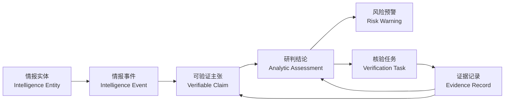

# 多源情报与侦查最小动态本体：七类结构与四案例推理说明

> 设计与材料复核时间：2026 年 9 月 9 日
> 文档定位：应然的业务本体设计，不对应任何既有编号本体库，也不以任何当前平台实现为约束。
> 案例数据：引用本仓既有历史查证文档和航迹样例台账；本文没有重新查询外部实时数据。

## 一、先说结论

面向新闻、官方通报、公开言论、AIS、ADS-B、海事警告、遥感、市场和网络等多源情报，最小动态本体可以收敛为七类对象：

1. **情报实体 / Intelligence Entity**：现实世界中的人、组织、国家、设施、航空器、船舶和区域；
2. **情报事件 / Intelligence Event**：正在核验或持续演化的一件事；
3. **可验证主张 / Verifiable Claim**：某条材料中可以被单独支持或反驳的一句话；
4. **证据记录 / Evidence Record**：一篇报道、一份通报、一组航迹指标或一次观测；
5. **研判结论 / Analytic Assessment**：针对主张或事件形成的版本化判断；
6. **风险预警 / Risk Warning**：需要业务人员关注、确认和持续管理的风险状态；
7. **核验任务 / Verification Task**：证据不足或冲突时，系统明确交给人或数据流程的补证事项。

这七类不是某个现成本体库中已经存在的固定对象，也不是对当前 Runtime 实现的描述。它们是本文建议的**多源情报最小动态本体内核 / Minimal Dynamic Intelligence Ontology Kernel**，可以在任意支持对象、关系、规则和动作的平台中建设。

七类对象的职责可以用一句话概括：

> **实体说明“涉及谁和什么”，事件说明“正在处理哪件事”，主张说明“具体要核实什么”，证据说明“看到了什么”，研判说明“目前能判断到哪一步”，预警说明“业务上要不要持续关注”，任务说明“下一步还要查什么”。**

特朗普 8 月 1 日的公开言论、7 月 26 日暂停互袭、7 月 29 日约旦拦截和 7 月 30 日美国对伊打击，虽然入口不同，但都可以沿同一条链路处理：



新的证据不是覆盖旧结论，而是产生新版研判，进而更新、升级、解除或撤回预警。动态本体的“动态”主要体现在这个持续修订过程，而不是对象数量多。

## 二、设计边界：什么放进本体，什么不放

### 2.1 本体只保存可复用的业务语义

本体保存：

- 实体、事件、主张、证据、研判、预警和任务的稳定身份；
- 它们之间有业务含义的关系；
- 证据资格、主张核验、预警升降级和任务闭环规则；
- 每一次判断使用的证据版本、规则版本、时间和限制。

本体不保存：

- 全量 AIS、ADS-B 原始点；
- 全尺寸卫星影像、新闻正文和接口原始响应；
- 需要专用时空引擎计算的航迹切段、断面穿越和栅格分析过程；
- 没有校准依据的“事件发生概率 84%”一类伪精确分数。

原始数据仍由各自的数据系统管理。本体只保存可复算摘要、受控引用和对某个主张的证据作用。

### 2.2 专题不是第八类核心对象

“美伊冲突”“霍尔木兹航运”等专题适合做查询范围、工作空间或展示视图。第一期用 `topicKey`、标签或事件集合表达即可，不必为了组织页面再增加一个核心对象类型。

当专题本身需要独立权限、生命周期、负责人和跨事件规则时，可以在应用层增加“情报专题 / Intelligence Topic”，但它不改变七类内核。

### 2.3 三条不能合并的边界

1. **事件不能与主张合并。** “伊方宣称摧毁 3 架 F-35”是主张；是否真的摧毁是需要核验的现实事件结果。
2. **信源不能与证据记录混淆。** 美联社是来源机构，一篇具体报道才是一条证据记录；同一机构可以发布多次修订。
3. **研判不能写回主张的真假字段。** 同一主张会随着新证据得到不同版本的判断，历史版本必须保留。

## 三、七类对象及其完整属性

以下中文名用于业务页面和建模，英文名及英文属性键用于接口、规则和版本兼容。`必填`表示进入推理链所需的最小字段，不表示原始采集阶段必须一次补齐所有内容。

### 3.1 情报实体 / Intelligence Entity

英文类型名：`IntelligenceEntity`。用于统一表示人员、组织、国家、资产、设施、地点和分析区域。第一期不再为政治人物、军队、船舶、飞机和区域分别建立平行顶层类型，通过 `entityKind` 区分；只有出现独立属性、权限或动作需求时再派生专门类型。

| 中文属性名 | 英文属性键 | 类型 | 必填 | 说明 |
| --- | --- | --- | --- | --- |
| 实体标识 | `entityKey` | STRING | 是 | 跨事件稳定业务键 |
| 实体类别 | `entityKind` | ENUM | 是 | `PERSON`、`ORGANIZATION`、`STATE`、`MILITARY_UNIT`、`ASSET`、`FACILITY`、`PLACE`、`AREA` |
| 中文名称 | `nameZh` | STRING | 是 | 业务显示名称 |
| 英文名称 | `nameEn` | STRING | 否 | 原文或通用英文名 |
| 别名 | `aliases` | STRING_LIST | 否 | 不同语言、缩写和历史名称 |
| 国家或地区代码 | `countryCode` | STRING | 否 | 只表示登记或地理归属，不自动表示指挥关系 |
| 空间引用 | `geometryRef` | STRING | 否 | 指向受控 GIS 数据，不在本体中复制高精度几何 |
| 空间精度 | `spatialPrecision` | ENUM | 否 | `EXACT`、`APPROXIMATE`、`CITY`、`REGION`、`COUNTRY`、`UNKNOWN` |
| 生效时间 | `validFrom` | DATETIME | 否 | 名称、身份或归属开始有效的时间 |
| 失效时间 | `validUntil` | DATETIME | 否 | 身份或归属结束有效的时间 |
| 实体状态 | `status` | ENUM | 是 | `ACTIVE`、`INACTIVE`、`UNKNOWN` |
| 模型版本 | `schemaVersion` | STRING | 是 | 对象结构版本 |

### 3.2 情报事件 / Intelligence Event

英文类型名：`IntelligenceEvent`。表示需要持续核验和研判的一件事。事件可以先以候选状态存在，不要求入口消息已经把所有事实证明完毕。

| 中文属性名 | 英文属性键 | 类型 | 必填 | 说明 |
| --- | --- | --- | --- | --- |
| 事件标识 | `eventKey` | STRING | 是 | 跨版本稳定业务键 |
| 中文标题 | `titleZh` | STRING | 是 | 面向业务人员的事件名称 |
| 事件类别 | `eventType` | ENUM | 是 | 如 `MILITARY_ACTION`、`MARITIME_INCIDENT`、`DIPLOMATIC_SIGNAL`、`OPERATIONAL_CHANGE` |
| 开始时间 | `startAt` | DATETIME | 否 | 已知或估计的事件开始时间 |
| 结束时间 | `endAt` | DATETIME | 否 | 持续事件结束时间 |
| 时间精度 | `timePrecision` | ENUM | 是 | `INSTANT`、`MINUTE`、`HOUR`、`DAY`、`RANGE`、`UNKNOWN` |
| 地点文字 | `locationText` | STRING | 否 | 原始材料中的区域级地点说明 |
| 空间精度 | `spatialPrecision` | ENUM | 否 | 防止粗略地点被画成精确坐标 |
| 事件状态 | `status` | ENUM | 是 | `CANDIDATE`、`ONGOING`、`ENDED`、`DISPUTED`、`RESOLVED` |
| 所属专题键 | `topicKeys` | STRING_LIST | 否 | 应用侧专题、工作空间或查询视图的业务键，不把专题强制建成第八类对象 |
| 首次发现时间 | `firstObservedAt` | DATETIME | 是 | 系统首次发现该事件线索的时间 |
| 事件版本 | `eventVersion` | INT | 是 | 事件信息修订版本 |
| 内容摘要值 | `contentDigest` | STRING | 是 | 判断输入是否实质变化 |
| 创建时间 | `createdAt` | DATETIME | 是 | 本体对象创建时间 |
| 更新时间 | `updatedAt` | DATETIME | 是 | 最近一次事件对象更新 |
| 已知限制 | `limitations` | STRING_LIST | 否 | 时间、空间、对象或来源缺口 |

### 3.3 可验证主张 / Verifiable Claim

英文类型名：`VerifiableClaim`。一条主张只回答一个可以被证据支持或反驳的问题。主体、动作、目标、数量、命中、毁伤、归因、因果和条件必须按需拆开。

| 中文属性名 | 英文属性键 | 类型 | 必填 | 说明 |
| --- | --- | --- | --- | --- |
| 主张标识 | `claimKey` | STRING | 是 | 稳定业务键 |
| 中文主张 | `statementZh` | STRING | 是 | 可直接交给业务人员核对的一句话 |
| 主张类别 | `claimType` | ENUM | 是 | `OCCURRENCE`、`TARGET`、`QUANTITY`、`DAMAGE`、`ATTRIBUTION`、`CAUSALITY`、`INTENT`、`AGREEMENT`、`OPERATIONAL_STATUS` |
| 谓词代码 | `predicateCode` | STRING | 是 | 如 `attack_occurred`、`navigation_recovered` |
| 语义极性 | `polarity` | ENUM | 是 | `POSITIVE`、`NEGATIVE`、`CONDITIONAL` |
| 规范化值 | `normalizedValue` | JSON | 否 | 数量、状态、范围或结构化条件 |
| 数值单位 | `unit` | STRING | 否 | 如 `missile`、`vessel`、`hour` |
| 事件时间起点 | `eventTimeStart` | DATETIME | 否 | 主张适用的事实时间 |
| 事件时间终点 | `eventTimeEnd` | DATETIME | 否 | 时间窗或持续区间 |
| 时间精度 | `timePrecision` | ENUM | 否 | 与事件时间对应的精度 |
| 影响领域 | `affectedDomains` | STRING_LIST | 否 | 军事、航空、航运、人员、能源、政治等 |
| 原文片段 | `sourceSpan` | STRING | 否 | 从原文抽取该主张的直接依据 |
| 抽取方法 | `extractionMethod` | ENUM | 是 | `MANUAL`、`RULE`、`MODEL`、`HYBRID` |
| 抽取版本 | `extractionVersion` | STRING | 是 | 规则或模型版本 |
| 抽取置信档位 | `extractionConfidenceBand` | ENUM | 否 | `HIGH`、`MEDIUM`、`LOW`，只说明抽取正确性 |
| 内容摘要值 | `contentDigest` | STRING | 是 | 主张内容去重与修订 |
| 生命周期状态 | `lifecycleStatus` | ENUM | 是 | `ACTIVE`、`WITHDRAWN`、`SUPERSEDED`；不是事实真假 |
| 创建时间 | `createdAt` | DATETIME | 是 | 主张进入本体的时间 |

### 3.4 证据记录 / Evidence Record

英文类型名：`EvidenceRecord`。一篇新闻、一份官方通报、一条公开帖子、一份 NAVAREA 警告、一组 ADS-B/AIS 聚合指标或一次卫星观测都可以成为证据记录。它保存来源和观测边界，不直接保存“这条证据证明什么”；后者属于证据与主张之间的关系属性。

| 中文属性名 | 英文属性键 | 类型 | 必填 | 说明 |
| --- | --- | --- | --- | --- |
| 证据标识 | `evidenceKey` | STRING | 是 | 稳定业务键 |
| 证据类别 | `evidenceType` | ENUM | 是 | `PUBLIC_STATEMENT`、`NEWS_REPORT`、`OFFICIAL_NOTICE`、`TRACK_SUMMARY`、`SATELLITE_OBSERVATION`、`MARKET_OBSERVATION`、`NETWORK_OBSERVATION` |
| 数据模态 | `modality` | ENUM | 是 | `TEXT`、`AIS`、`ADS_B`、`SAR`、`OPTICAL`、`THERMAL`、`MARKET`、`NETWORK` |
| 来源性质 | `sourceNature` | ENUM | 是 | `PARTICIPANT_STATEMENT`、`INDEPENDENT_REPORT`、`AUTHORITATIVE_NOTICE`、`OBJECTIVE_OBSERVATION`、`DERIVED_METRIC` |
| 来源系统 | `sourceSystem` | STRING | 是 | 采集系统或数据源代码 |
| 来源名称 | `sourceName` | STRING | 是 | 面向读者的来源名 |
| 来源引用 | `sourceRef` | STRING | 是 | 原始 URL、文档编号、记录键或受控数据引用 |
| 中文标题 | `titleZh` | STRING | 否 | 证据记录的显示标题 |
| 中文摘要 | `summaryZh` | STRING | 否 | 不替代原文引用 |
| 独立来源组 | `independenceGroup` | STRING | 是 | 同一原始信息链、转载链或传感方法家族只计一次 |
| 记录版本 | `recordVersion` | INT | 是 | 同一证据记录的修订版本 |
| 内容摘要值 | `contentDigest` | STRING | 是 | 识别内容是否变化 |
| 事件时间 | `eventTime` | DATETIME | 否 | 材料描述的事件发生时间 |
| 发布时间 | `publishedAt` | DATETIME | 否 | 来源公开发布的时间 |
| 观测时间 | `observedAt` | DATETIME | 否 | 传感器或数据记录实际观测世界的时间 |
| 采集时间 | `fetchedAt` | DATETIME | 是 | 系统实际取得该记录的时间；不得冒充观测时间 |
| 生效时间 | `validFrom` | DATETIME | 否 | 通告或状态开始有效 |
| 失效时间 | `validUntil` | DATETIME | 否 | 通告或状态结束有效 |
| 分析区域 | `areaRef` | STRING | 否 | 区域业务键，不保存敏感精确位置 |
| 窗口起点 | `windowStart` | DATETIME | 否 | 聚合观测的起点 |
| 窗口终点 | `windowEnd` | DATETIME | 否 | 聚合观测的终点 |
| 覆盖状态 | `coverageStatus` | ENUM | 是 | `SUFFICIENT`、`PARTIAL`、`INSUFFICIENT`、`UNKNOWN` |
| 观测结果 | `observationResult` | ENUM | 否 | `DETECTED`、`NOT_DETECTED`、`NOT_APPLICABLE` |
| 质量状态 | `qualityStatus` | ENUM | 是 | `QUALIFIED`、`LIMITED`、`REJECTED`、`UNKNOWN` |
| 原始数据引用 | `rawDataRef` | STRING | 否 | 指向受控存储或复现查询，不保存秘密和大文件 |
| 处理方法 | `interpretationMethod` | STRING | 否 | 聚合、切段、去重或判读方法版本 |
| 已知限制 | `limitations` | STRING_LIST | 否 | 覆盖、时效、许可、字段和可探测性限制 |

`observedAt`表示数据真正观测世界的时间，`fetchedAt`表示系统取得数据的时间。历史复盘按`eventTime/observedAt`归入事件窗；`fetchedAt`用于回答“当时系统是否已经知道”。迟到数据可以生成新版历史研判，但不能覆盖旧时点的在线判断记录。

### 3.5 研判结论 / Analytic Assessment

英文类型名：`AnalyticAssessment`。同一类型同时承载“主张级核验”和“事件级综合研判”，通过 `scopeType` 区分，避免建立两套几乎相同的对象。

| 中文属性名 | 英文属性键 | 类型 | 必填 | 说明 |
| --- | --- | --- | --- | --- |
| 研判标识 | `assessmentKey` | STRING | 是 | 每个版本独立标识 |
| 研判范围 | `scopeType` | ENUM | 是 | `CLAIM`或`EVENT` |
| 目标标识 | `targetKey` | STRING | 是 | 被评价的主张或事件业务键 |
| 研判版本 | `assessmentVersion` | INT | 是 | 对同一目标严格递增 |
| 证据状态 | `status` | ENUM | 是 | `SUPPORTED`、`CONTRADICTED`、`CONFLICTING`、`INSUFFICIENT` |
| 置信档位 | `confidenceBand` | ENUM | 否 | `HIGH`、`MEDIUM`、`LOW`；需说明依据，不冒充概率 |
| 支持来源组数 | `supportGroupCount` | INT | 是 | 按独立来源组计数 |
| 反驳来源组数 | `contradictGroupCount` | INT | 是 | 按独立来源组计数 |
| 背景来源组数 | `contextGroupCount` | INT | 是 | 不直接证明主张的背景材料 |
| 知识截止时间 | `knowledgeCutoff` | DATETIME | 是 | 该版本实际使用材料的截止时间 |
| 事实有效时间 | `validAt` | DATETIME | 否 | 判断针对的历史事实时点 |
| 评估时间 | `evaluatedAt` | DATETIME | 是 | 规则或分析人员形成判断的时间 |
| 中文结论 | `conclusionZh` | STRING | 是 | 业务可直接阅读的结论 |
| 中文解释 | `explanationZh` | STRING | 是 | 哪些证据、哪些规则导致该判断 |
| 限制与缺口 | `limitations` | STRING_LIST | 否 | 当前不能验证的内容 |
| 证据快照摘要 | `evidenceSnapshotDigest` | STRING | 是 | 绑定实际使用的证据版本集合 |
| 输入摘要值 | `inputDigest` | STRING | 是 | 相同输入不重复生成版本 |
| 规则版本 | `ruleVersion` | STRING | 是 | 可复现推理逻辑 |
| 是否实质变化 | `materialChange` | BOOLEAN | 是 | 区分“材料更新但结论未变” |
| 中文变化原因 | `changeReasonZh` | STRING | 否 | 新证据如何改变或维持结论 |

### 3.6 风险预警 / Risk Warning

英文类型名：`RiskWarning`。预警不是另一份情报摘要，而是有业务生命周期的风险状态。它可以被确认、更新、解除或撤回，必须能追溯到产生它的研判版本。

| 中文属性名 | 英文属性键 | 类型 | 必填 | 说明 |
| --- | --- | --- | --- | --- |
| 预警标识 | `warningKey` | STRING | 是 | 稳定业务键 |
| 中文标题 | `titleZh` | STRING | 是 | 面向业务用户的标题 |
| 预警类别 | `warningType` | ENUM | 是 | 军事升级、航空运行、航运安全、能源供应、人员安全等 |
| 风险等级 | `riskLevel` | ENUM | 是 | `LOW`、`MEDIUM`、`HIGH`、`CRITICAL` |
| 风险阶段 | `stage` | STRING | 是 | 如`CONDITIONAL_PAUSE`、`ACTION_REPORTED`、`RECOVERED` |
| 预警状态 | `status` | ENUM | 是 | `OPEN`、`ACKNOWLEDGED`、`RESOLVED`、`RETRACTED` |
| 作用范围 | `scopeKey` | STRING | 是 | 事件、区域和风险领域形成的稳定范围键 |
| 首次触发时间 | `triggeredAt` | DATETIME | 是 | 首次达到预警条件的时间 |
| 首次发现时间 | `firstObservedAt` | DATETIME | 是 | 系统首次看到触发材料的时间 |
| 更新时间 | `updatedAt` | DATETIME | 是 | 最近一次状态变化 |
| 到期时间 | `expiresAt` | DATETIME | 否 | 只用于必须复核的临时预警，不自动表示风险解除 |
| 中文结论 | `conclusionZh` | STRING | 是 | 为什么预警 |
| 中文影响 | `impactZh` | STRING | 是 | 对人员、航空、航运或业务的影响 |
| 中文建议 | `adviceZh` | STRING | 是 | 防御性、可撤销的处置建议 |
| 触发规则 | `triggerRuleKey` | STRING | 是 | 可定位到规则及版本 |
| 研判标识 | `assessmentKey` | STRING | 是 | 当前依据的研判版本 |
| 负责人角色 | `ownerRole` | STRING | 否 | 管理、研判、出行、航运等 |
| 解除原因 | `resolutionReasonZh` | STRING | 否 | 解除或撤回时必填 |
| 预警版本 | `warningVersion` | INT | 是 | 状态修订版本 |

### 3.7 核验任务 / Verification Task

英文类型名：`VerificationTask`。每个任务只解决一个明确缺口，不能用“继续关注”代替完成条件。

| 中文属性名 | 英文属性键 | 类型 | 必填 | 说明 |
| --- | --- | --- | --- | --- |
| 任务标识 | `taskKey` | STRING | 是 | 稳定业务键 |
| 中文标题 | `titleZh` | STRING | 是 | 如“核验5枚导弹是否全部拦截” |
| 任务类别 | `taskType` | ENUM | 是 | `FACT_CHECK`、`DATA_COLLECTION`、`HUMAN_REVIEW`、`QUALITY_REVIEW` |
| 优先级 | `priority` | ENUM | 是 | `LOW`、`MEDIUM`、`HIGH`、`URGENT` |
| 任务状态 | `status` | ENUM | 是 | `OPEN`、`IN_PROGRESS`、`COMPLETED`、`CANCELLED`、`OVERDUE` |
| 负责人角色 | `ownerRole` | STRING | 是 | 角色而非个人敏感身份 |
| 中文目标缺口 | `targetGapZh` | STRING | 是 | 当前缺什么 |
| 中文完成条件 | `completionCriteriaZh` | STRING | 是 | 什么证据到位才算完成 |
| 所需证据类别 | `requiredEvidenceTypes` | STRING_LIST | 否 | 官方、现场、航迹、遥感等 |
| 创建时间 | `createdAt` | DATETIME | 是 | 任务生成时间 |
| 截止时间 | `dueAt` | DATETIME | 否 | 需要时设置 |
| 关闭时间 | `closedAt` | DATETIME | 否 | 完成或取消时记录 |
| 中文结果 | `resultZh` | STRING | 否 | 核验结果与限制 |
| 结果研判标识 | `resultAssessmentKey` | STRING | 否 | 任务完成后产生的新版研判 |
| 任务版本 | `taskVersion` | INT | 是 | 状态修订版本 |

## 四、十二类关系及其关系属性

关系属性用于说明“为什么建立这条边、在什么条件下有效、它对推理起什么作用”。不能把支持、反驳、主体、目标等语义塞进无属性的通用`related_to`。

| 中文关系名 | 英文关系名 | 起点 → 终点 | 关系属性（中文 / 英文键） |
| --- | --- | --- | --- |
| 事件涉及实体 | `EventInvolvesEntity` | 情报事件 → 情报实体 | 参与角色 / `role`；角色状态 / `roleStatus`；生效时间 / `validFrom`；失效时间 / `validUntil`；中文理由 / `reasonZh`；关系版本 / `relationVersion` |
| 事件包含主张 | `EventHasClaim` | 情报事件 → 可验证主张 | 主张顺序 / `claimOrder`；纳入原因 / `inclusionReasonZh`；事件版本 / `eventVersion` |
| 主张涉及实体 | `ClaimConcernsEntity` | 可验证主张 → 情报实体 | 语义角色 / `semanticRole`；适用性 / `applicability`；空间精度 / `spatialPrecision`；中文理由 / `reasonZh`；关系版本 / `relationVersion` |
| 证据由实体产生 | `EvidenceProducedByEntity` | 证据记录 → 情报实体 | 来源角色 / `sourceRole`；归因方式 / `attributionType`；发布时间 / `publishedAt`；中文理由 / `reasonZh`；关系版本 / `relationVersion` |
| 证据作用于主张 | `EvidenceBearsOnClaim` | 证据记录 → 可验证主张 | 证据立场 / `stance`；证据强度 / `strength`；证据用途 / `evidenceUse`；范围匹配 / `scopeMatch`；资格状态 / `qualificationStatus`；证明范围 / `proofScope`；独立来源组 / `independentSourceGroup`；适用性 / `applicability`；中文理由 / `reasonZh`；事实有效时间 / `validAt`；来源版本 / `sourceVersion`；关系版本 / `relationVersion` |
| 研判评价目标 | `AssessmentAssesses` | 研判结论 → 可验证主张或情报事件 | 目标类型 / `targetType`；目标版本 / `targetVersion`；评估角色 / `assessmentRole`；事实有效时间 / `validAt`；关系版本 / `relationVersion` |
| 研判使用证据 | `AssessmentUsesEvidence` | 研判结论 → 证据记录 | 是否纳入 / `included`；贡献作用 / `contributionRole`；资格状态 / `qualificationStatus`；排除原因 / `exclusionReasonZh`；证据版本 / `evidenceVersion`；质量状态 / `qualityStatus` |
| 新研判替代旧研判 | `AssessmentSupersedes` | 研判结论 → 研判结论 | 替代时间 / `supersededAt`；是否实质变化 / `materialChange`；旧状态 / `previousStatus`；新状态 / `newStatus`；中文变化原因 / `changeReasonZh` |
| 研判触发预警 | `AssessmentTriggersWarning` | 研判结论 → 风险预警 | 触发规则 / `triggerRuleKey`；指令 / `directive`；触发时间 / `triggeredAt`；触发版本 / `triggerVersion`；中文理由 / `reasonZh` |
| 研判创建任务 | `AssessmentCreatesTask` | 研判结论 → 核验任务 | 创建原因 / `reasonZh`；优先级 / `priority`；创建时间 / `createdAt` |
| 任务核验主张 | `TaskVerifiesClaim` | 核验任务 → 可验证主张 | 目标缺口 / `targetGapZh`；指派时间 / `assignedAt`；结果引用 / `resultRef`；完成状态 / `completionStatus` |
| 任务产出证据 | `TaskProducesEvidence` | 核验任务 → 证据记录 | 产出时间 / `producedAt`；结果作用 / `resultRole`；是否采纳 / `accepted`；质量状态 / `qualityStatus` |

关键枚举统一如下：

- `role`：行动方`ACTOR`、所宣称目标`DECLARED_TARGET`、实际受影响对象`AFFECTED_TARGET`、地点`LOCATION`、斡旋方`MEDIATOR`；
- `roleStatus`：参与方自述`DECLARED`、证据确认`CONFIRMED`、分析推断`INFERRED`、存在争议`DISPUTED`；
- `sourceRole`：原始发布方`ORIGINATOR`、转述发布方`PUBLISHER`、传感器运营方`SENSOR_OPERATOR`；`attributionType`对应直接`DIRECT`、引用`QUOTED`或转发`TRANSMITTED`；
- `stance`：陈述该主张`ASSERTS`、支持`SUPPORT`、反驳`CONTRADICT`、背景`CONTEXT`、未知`UNKNOWN`；
- `strength`：直接`DIRECT`、间接`INDIRECT`、有限`LIMITED`；
- `evidenceUse`：事实核验`EVENT_FACT`、运行状态`OPERATIONAL_STATUS`、影响判断`IMPACT`、背景`CONTEXT`；
- `scopeMatch`：匹配`MATCH`、部分匹配`PARTIAL`、不匹配`MISMATCH`；`proofScope`说明证据实际能证明到的对象、时间、空间和事实层次；
- `qualificationStatus`：合格`QUALIFIED`、排除`EXCLUDED`、待核`UNRESOLVED`；
- `applicability`：适用`APPLICABLE`、部分适用`PARTIAL`、不适用`NOT_APPLICABLE`；
- `contributionRole`：支持`SUPPORT`、反驳`CONTRADICT`、背景`CONTEXT`或限制条件`LIMITATION`；
- `directive`：创建或更新`UPSERT`、解除`RESOLVE`、撤回`RETRACT`、不动作`NONE`。

同一证据对不同主张可以具有不同`stance`。例如，一条加油机活动摘要可以支持“支援能力仍在”，却只能作为“攻击已经发生”的背景，不能给证据记录本身设置一个全局“支持”或“反驳”。

`EvidenceRecord.independenceGroup`是证据记录的来源链真值；`EvidenceBearsOnClaim.independentSourceGroup`是形成某版研判时冻结的关系快照。通常二者相同；只有一份材料包含多个可独立归因的原始信息源时，才按原文片段拆成多条证据记录，而不是随意在关系上改组。

## 五、十条通用规则

四个案例共用同一组规则；每个场景只改变主张模板、观察窗和升降级条件，不新增本体类型。

| 编号 | 中文规则名 | 英文规则名 | 核心逻辑 | 输出 |
| --- | --- | --- | --- | --- |
| R01 | 主张拆解规则 | `ClaimDecompositionRule` | 把一条材料中的主体、动作、目标、数量、结果、归因、因果和条件拆为独立主张；单方宣称目标不得与实际命中合并 | 可验证主张及其原文片段 |
| R02 | 来源独立性规则 | `SourceIndependenceRule` | 同一通讯社转载、同一官方声明转述、同一对象多点和同一传感方法家族按一个`independenceGroup`计数 | 去重后的独立来源组 |
| R03 | 证据资格规则 | `EvidenceQualificationRule` | 检查来源引用、时间、适用范围、有效期、覆盖、质量和版本；不合格证据保留但不参与结论 | `QUALIFIED/EXCLUDED/UNRESOLVED`及原因 |
| R04 | 模态能力边界规则 | `ModalityCapabilityRule` | 参与方声明直接确认“该方说了什么”；独立报道按其原始采集和引用范围支持事实；ADS-B/AIS直接证明限定范围内的位置、存在或聚合活动；市场、天气和网络通常只证明影响或运行状态；任何模态不得越权证明战果 | 证据用途和证明范围 |
| R05 | 未检出边界规则 | `NonDetectionBoundaryRule` | 只有覆盖充分、目标在该传感器可探测范围内且时间空间匹配时，“未检出”才可成为有限反证；否则只能形成数据缺口 | 反证、背景或缺口 |
| R06 | 主张研判规则 | `ClaimAssessmentRule` | 合格的直接权威、第一手独立报道或客观证据，可以在其证明范围内单源支持；仅依赖间接或转述型报道时至少需要两个独立来源组；支持与反驳并存为`CONFLICTING`；其余为`INSUFFICIENT` | 主张级研判版本 |
| R07 | 事件聚合规则 | `EventAggregationRule` | 按同一事件、主体、区域和时间窗聚合多个主张研判；不能用背景证据替代关键事实，不能把相邻事件自动连成因果链 | 事件级综合研判 |
| R08 | 迟到数据与版本修订规则 | `LateEvidenceRevisionRule` | 事实窗口由`eventTime/observedAt`决定；迟到入库的数据可以进入新的历史研判版本，旧时点在线判断保留；相同输入不重复生成版本 | 新版研判及替代关系 |
| R09 | 预警生命周期规则 | `WarningLifecycleRule` | 风险条件成立则创建或更新预警；材料不足不得自动解除；必须满足场景规定的组合恢复条件才能`RESOLVE`；原依据被反证才`RETRACT` | 预警创建、升级、维持、解除或撤回 |
| R10 | 核验任务闭环规则 | `VerificationTaskLifecycleRule` | `INSUFFICIENT`或`CONFLICTING`的关键主张生成一个明确任务；新证据解决缺口后关闭任务并触发重新研判 | 任务及任务结果证据 |

### 5.1 主张状态的基本计算

通用判定顺序如下：

1. 同一独立来源组在同一立场只计一次；
2. 直接官方材料只直接确认“该机构作出该表述”或其权限范围内的运行通告，不自动确认战果；
3. 合格客观观测或权威运行通告，在其证明范围内可形成单源直接支持；
4. 仅依赖间接或转述型新闻时，至少两个独立原始信息链才形成多源支持；
5. 有合格支持也有合格反驳时，状态为`CONFLICTING`；
6. 有合格直接反驳，或至少两个独立反驳组且无支持时，为`CONTRADICTED`；
7. 有合格直接支持，或至少两个独立支持组且无反驳时，为`SUPPORTED`；
8. 其余情况为`INSUFFICIENT`。

参与方战果、命中、毁伤和归因类主张必须有独立现场、东道国、医疗、遥感或其他适用观测补强。两家媒体都转述同一方声明，仍然只有一个来源组。

### 5.2 场景策略不是新的本体类型

四个案例分别使用以下策略包：

| 中文策略名 | 英文策略名 | 主要判断 |
| --- | --- | --- |
| 条件停打稳定性策略 | `ConditionalPauseStabilityPolicy` | 取消行动是否有正式边界、协议是否得到相关方确认、支援态势是否收缩、航行条件是否恢复 |
| 暂停互袭持续性策略 | `MutualPauseContinuityPolicy` | 直接行动是否停止、是否出现新行动、军事支援和海事风险是否解除 |
| 导弹拦截核验策略 | `MissileInterceptionVerificationPolicy` | 发射、来向、数量、所宣称目标、拦截、损害和后续回应分别核验 |
| 回应打击核验策略 | `RetaliatoryStrikeVerificationPolicy` | 行动是否发生、公开目标类别、实际毁伤、因果理由、后续报复和降级条件分别核定 |

策略包只配置主张模板、所需证据、时间窗、区域、阈值和预警条件。换成另一个国家、另一处海峡或另一类事件时，七类对象和十二类关系保持不变。

## 六、八个驱动动作

| 编号 | 中文动作名 | 英文动作名 | 执行主体 | 输入 | 输出 |
| --- | --- | --- | --- | --- | --- |
| A01 | 登记证据记录 | `RegisterEvidenceRecord` | 自动 | 新闻、官方材料、公开帖子或派生观测摘要 | 版本化证据记录 |
| A02 | 拆解并登记主张 | `ExtractAndRegisterClaims` | 模型＋规则＋人工复核 | 证据原文及事件上下文 | 可验证主张、事件包含主张关系 |
| A03 | 建立证据关系 | `LinkEvidenceToClaim` | 规则＋人工复核 | 证据、主张和适用范围 | 带立场、强度、资格和理由的证据关系 |
| A04 | 重新评估主张 | `ReassessClaim` | 自动 | 主张及合格证据版本集合 | 新版主张级研判、替代关系 |
| A05 | 更新事件综合研判 | `UpdateEventAssessment` | 自动＋人工确认 | 同一事件的最新主张研判 | 新版事件级研判 |
| A06 | 创建或更新预警 | `UpsertRiskWarning` | 规则触发，关键结论可人工确认 | 事件研判和场景策略 | 新建、升级、维持、解除或撤回预警 |
| A07 | 创建核验任务 | `CreateVerificationTask` | 自动 | 关键证据缺口或冲突 | 明确对象、完成条件和所需证据的任务 |
| A08 | 回写核验结果 | `ApplyVerificationResult` | 人工或受控数据流程 | 新证据及任务结果 | 任务关闭、证据登记和重新研判 |

自动动作不得直接生成进攻性建议，也不得把推断写成已确认行动。预警和建议面向人员安全、航空、航运、能源、民用设施和业务连续性。

## 七、案例一：特朗普 8 月 1 日公开言论怎样触发动态推理

来源文档：[政治人物公开主张驱动的动态本体情报分析预警演示方案](./政治人物公开主张驱动的动态本体情报分析预警演示方案-20260908.md)。

本案中的七类对象实例为：

| 对象类型 | 本案实例 |
| --- | --- |
| 情报实体 / `IntelligenceEntity` | 特朗普、美国、伊朗、沙特、阿曼、霍尔木兹海峡及区域支援航空器类别 |
| 情报事件 / `IntelligenceEvent` | “特朗普宣布有条件取消拟议对伊攻击”事件 |
| 可验证主张 / `VerifiableClaim` | 准备、取消、协议、立即开放四项主张 |
| 证据记录 / `EvidenceRecord` | 原帖、各方表态、新闻、ADS-B窗口摘要、PortWatch日度指标、NAVAREA警告 |
| 研判结论 / `AnalyticAssessment` | 四项主张研判及“条件停打不稳定”事件研判 |
| 风险预警 / `RiskWarning` | 黄色/中等级“条件停打不稳定”预警 |
| 核验任务 / `VerificationTask` | 核验共同协议、正式行动状态、航行安全和通行恢复 |

### 7.1 入口和主张拆解

归档记录显示，原帖发表于`2026-08-02T02:05:00Z`。一条帖子被 R01 拆为四个主张：

| 主张 | `predicateCode` | 需要什么证据 |
| --- | --- | --- |
| 美方已经完成高强度攻击准备 | `attack_readiness_present` | 官方准备态表述、行动前后支援活动和同钟点基线 |
| 原计划攻击已经取消 | `planned_attack_cancelled` | 正式取消边界及后续是否出现相同范围的行动 |
| 协议参数已经达成 | `agreement_parameters_reached` | 相关方对参与方、范围、状态和文本的一致确认 |
| 霍尔木兹将立即、完全开放 | `navigation_recovery_immediate` | 通行量、航行警告、海事事件和正式通航安排 |

帖子本身形成一条`PUBLIC_STATEMENT`证据记录。它以`ASSERTS`关系连接四个主张，只能直接确认“特朗普公开作出这些表述”，不能直接把四项内容判为事实。

### 7.2 具体数据怎样进入证据层

航迹回放统一使用东经54—60、北纬24—29的宽范围初筛区域，以`observed_at`归窗：

| 窗口 | ADS-B记录 | 美国军机对象 | 合格连续航段 | 加油机对象 | 证据作用 |
| --- | ---: | ---: | ---: | ---: | --- |
| 前24小时 | 892 | 12 | 6 | 7 | 与准备态主张相关，但低于异常阈值 |
| 后24小时 | 1,075 | 11 | 8 | 7 | 没有立即大规模增加，也没有全面撤空 |
| 前48小时 | 1,929 | 19 | 13 | 13 | 后48小时的比较基线 |
| 后48小时 | 1,973 | 25 | 15 | 15 | 支援对象仍在增加，只构成间接支持 |
| 前72小时 | 2,808 | 24 | 20 | 17 | 后72小时的比较基线 |
| 后72小时 | 2,829 | 33 | 21 | 21 | 支援状态持续，不直接证明攻击 |

前24小时的14日同钟点基线中，美国军机对象中位数为10、第75百分位为14；加油机为8/10；合格航段为7/7。实际值12、7、6没有达到“发文前异常集结”。这条航迹摘要对“准备状态”是有限支持，对“攻击已经实施”只能是背景。

其他证据包括：

- 7月30日至8月5日，GISA已有52行、46个逻辑来源标识的RSS候选，以及300行、153个逻辑来源标识的GDELT候选；筛出的9条高相关RSS标题都有摘要和中文标题，但只有5条进入专题；
- 8月3日伊朗方面否认正在与美国谈判，只确认与阿曼讨论通航；它反驳“美伊协议参数已确定”；
- IMF PortWatch的7月30日至8月5日日度通行量为`4、8、5、3、6、7、5`，发文前三个日历日均值5.67、后三日均值5.33，没有出现立即开放式跃升；
- NAVAREA IX在8月4日发布`271/26`商船安全事件警告，说明航道安全条件仍未完全兑现；
- 没有取得美国正式取消行动命令和美伊阿曼共同协议文本。

### 7.3 推理和结果

| 研判目标 | 证据关系 | 结果 |
| --- | --- | --- |
| 准备状态主张 | 官方准备态材料`SUPPORT`；航迹摘要`SUPPORT/INDIRECT`；14日基线限制异常解释 | `SUPPORTED`：准备和支援能力仍在，但没有提前异常集结证据 |
| 取消攻击主张 | 原帖`ASSERTS`；后续未见同范围直接行动，但缺正式取消命令 | `INSUFFICIENT`：可以确认表态，不能确认完整行动命令 |
| 协议参数主张 | 降级倡议为`CONTEXT`；伊方否认美伊谈判为`CONTRADICT`；无共同文本 | `CONFLICTING` |
| 立即开放主张 | PortWatch未跃升、NAVAREA仍有安全事件；无共同通航文本 | `INSUFFICIENT`，且恢复条件未满足 |

R07把四项主张合成事件级结论：**有条件停打信号存在，但协议和通航条件未兑现，支援态势没有全面收缩。** R09创建黄色/中等级“条件停打不稳定”预警；R10生成共同协议文本、正式行动状态、航行警告和通行恢复四类核验任务。

9月1日后来出现的新行动只能生成新的证据、事件阶段和研判版本。它可以证明8月初风险没有得到稳定解除，不能倒推系统在8月3日已经知道具体行动日期和目标。

## 八、案例二：7 月 26 日“暂停互袭”为什么不能推理成稳定停火

来源文档：[美伊暂停互袭多源数据验证实录](./美伊暂停互袭多源数据验证实录-20260727.md)；航迹数据见[美伊三事件航迹交叉验证与数据质量样例台账](./美伊三事件航迹交叉验证与数据质量样例台账-20260804.md)。

本案中的七类对象实例为：

| 对象类型 | 本案实例 |
| --- | --- |
| 情报实体 / `IntelligenceEntity` | 美国、伊朗、霍尔木兹海峡、区域支援航空器和商业能源船舶类别 |
| 情报事件 / `IntelligenceEvent` | “7月26日美伊直接行动短暂停顿”及后续失效阶段 |
| 可验证主张 / `VerifiableClaim` | 短暂停顿、稳定停火、支援解除、航运恢复和新行动五项主张 |
| 证据记录 / `EvidenceRecord` | 美联社、新华社及转载链，ADS-B日度摘要、AIS区域摘要、市场指标和7月29日新行动材料 |
| 研判结论 / `AnalyticAssessment` | “暂停存在但不稳定”到“暂停失效”的三个版本 |
| 风险预警 / `RiskWarning` | 降级观察预警，随后升级为直接交火高风险预警 |
| 核验任务 / `VerificationTask` | 核验共同停火边界、后续直接行动和霍尔木兹运行状态 |

### 8.1 主张和证据

核心主张拆为：

1. 7月26日前后双方直接攻击曾短暂停顿；
2. 双方已经形成稳定、可执行的停火；
3. 军事支援态势已经解除；
4. 霍尔木兹航运已经恢复正常；
5. 7月29日出现新的伊朗方向直接行动。

暂停消息中，美联社原稿及其转载属于同一`independenceGroup`，不能算两个来源；现有样例台账把新华社原稿列为另一来源组。因此“短暂停顿”在样例中得到两个来源组支持，“稳定停火”仍缺共同文本、期限和监督机制。正式入库前还要回查新华社材料是否转引同一原始消息；若同源，必须合并而不能重复计数。

ADS-B显示暂停期间核心空中支援没有撤空：

| UTC日期 | ADS-B记录 | 军机对象 | 美国对象 | KC-135/KC-46对象 |
| --- | ---: | ---: | ---: | ---: |
| 7月25日 | 7,327 | 123 | 82 | 41 |
| 7月26日 | 11,213 | 197 | 82 | 45 |
| 7月27日 | 12,434 | 240 | 78 | 42 |
| 7月28日 | 16,842 | 229 | 72 | 42 |

霍尔木兹关注区7月26—28日保存217条AIS观测、128个唯一对象，其中货船80个、化学品油轮13个、成品油轮12个、LNG船6个、原油油轮7个。它能够反驳“已经一艘船都没有”，却不能证明航运恢复正常。

### 8.2 判断怎样变化

初始版本：

- “直接行动曾短暂停顿”有两个独立报道组支持，评为`SUPPORTED`；
- “已经稳定停火”只有暂停表述，没有共同文本，评为`INSUFFICIENT`；
- 41、45、42、42个核心加油机对象说明支援背景维持，“军事态势已解除”不成立；
- AIS存在性证据说明能源运输对象仍暴露在高风险通道，不能形成“航运恢复正常”的结论。

7月29日05:45 CST，约旦通报拦截从伊朗方向飞来的5枚导弹，伊方确认发射。新证据通过R08进入历史事件窗，产生新版研判：

```text
版本1：直接攻击短暂停顿，但稳定停火证据不足
        ↓ 7月29日新行动
版本2：短暂停顿已经结束，稳定停火主张被现实行动反驳
        ↓ 7月30日美方直接打击
版本3：已形成一轮可确认的美伊直接交火，预警升级
```

油价在7月26日降温消息后曾下跌约7%；7月29日新行动24小时后，WTI和Brent较事件前分别上涨约6.9%和8.1%。市场数据证明风险预期发生变化，只作为影响证据，不能独立证明军事行动原因。

这个案例最能说明动态本体的价值：它不把“暂停”删除，而是保留“当时确有短暂停顿”这一历史事实，同时用新研判替代“暂停仍在维持”的旧判断。

## 九、案例三：约旦拦截事件怎样确认行动又限制过度解读

来源文档：[约旦拦截伊朗导弹事件多源验证与升级研判](./约旦拦截伊朗导弹事件多源验证与升级研判-20260729.md)；航迹数据见[样例台账](./美伊三事件航迹交叉验证与数据质量样例台账-20260804.md)。

本案中的七类对象实例为：

| 对象类型 | 本案实例 |
| --- | --- |
| 情报实体 / `IntelligenceEntity` | 约旦、伊朗革命卫队、美国中央司令部、约旦空域和所宣称美军设施 |
| 情报事件 / `IntelligenceEvent` | “7月29日约旦拦截伊朗方向导弹”事件 |
| 可验证主张 / `VerifiableClaim` | 拦截发生、来向、数量、所宣称目标、拦截结果和美方回应六项主张 |
| 证据记录 / `EvidenceRecord` | Petra、IRNA、CENTCOM、美联社及约旦区域ADS-B摘要 |
| 研判结论 / `AnalyticAssessment` | 六项主张研判及“暂停被打破”的事件研判 |
| 风险预警 / `RiskWarning` | 约旦及周边航空、人员和地区升级预警 |
| 核验任务 / `VerificationTask` | 核验逐枚轨迹、残骸、设施损害和后续回应 |

### 9.1 六项主张必须分开

| 编号 | 主张 | 不能混入的内容 |
| --- | --- | --- |
| C1 | 约旦空域发生导弹拦截 | 不等于确认每枚结果 |
| C2 | 导弹来自伊朗方向 | 不等于取得逐枚弹道 |
| C3 | 来袭数量为5枚 | 主要是约方计数口径 |
| C4 | 伊方宣称目标为约旦境内美军设施 | 所宣称目标不等于实际命中 |
| C5 | 5枚导弹均被有效拦截 | 仍缺逐枚轨迹、残骸和设施调查 |
| C6 | 事件引发美方直接军事回应 | 必须等美方行动材料出现 |

Petra直接支持C1、C2、C3和约方拦截口径；IRNA直接确认伊方发射和C4所宣称目标；CENTCOM支持来袭和拦截口径。它们都是参与方来源，接近事件，但各自在数量、目标和战果上仍有利益立场。

### 9.2 航迹证据怎样“踩刹车”

约旦关注区事件窗为2026年7月28日20:00至29日04:00 UTC：

| 指标 | 事件窗口 | 前一日同钟点 | 推理作用 |
| --- | ---: | ---: | --- |
| ADS-B记录 | 250 | 356 | 记录数不代表对象数 |
| 军机对象 | 18 | 21 | 事件日没有超过前一日 |
| 美国对象 | 17 | 19 | 说明可见对象结构 |
| KC-135/KC-46对象 | 14 | 18 | 高强度支援背景持续，但不是异常峰值 |
| C-17/A400M对象 | 4 | 1 | 机型结构不同，需要更长基线解释 |

因此，航迹摘要对“约旦方向支援环境活跃”是`SUPPORT/INDIRECT`，对“事件发生”只是`CONTEXT`，对“导弹命中和拦截比例”不具备证明能力。R04会阻止系统把飞机航迹越权用于导弹战果判断。

### 9.3 动态推理结果

- C1“发生拦截”：约旦官方直接材料和其他方材料相互支持，评为`SUPPORTED`；
- C2“来自伊朗方向”：约方方向判断与伊方认领相互支持，评为`SUPPORTED`；
- C3“5枚”：作为约方明确计数可采用，但保留“缺第二套逐枚计数”的限制；
- C4“所宣称目标”：只能确认伊方作出该目标声明，不能自动创建“基地被命中”事件；
- C5“全部拦截”：约方和美方口径相互支持，但逐枚独立核算不足，结论必须带限制；
- C6“美方直接回应”：初始为`INSUFFICIENT`；7月30日CENTCOM行动通报和独立报道进入后，生成新版`SUPPORTED`研判。

事件级研判从“暂停被打破、等待后续回应”变为“伊朗行动与美方回应形成一轮直接交火”。预警随研判升级，但核验任务继续追踪实际落点、逐枚拦截、设施损害和参与方高战果主张。

这说明动态本体不要求所有数据都加强风险。前一日同钟点21个军机对象、18个加油机对象反而限制了“事件后军机异常暴增”这一错误解释。

## 十、案例四：7 月 30 日美国对伊打击怎样区分行动、目标和毁伤

来源文档：[美国7月30日对伊打击多源验证与中东降级路径研判](./美国7月30日对伊打击多源验证与中东降级路径研判-20260802.md)；航迹数据见[样例台账](./美伊三事件航迹交叉验证与数据质量样例台账-20260804.md)。

本案中的七类对象实例为：

| 对象类型 | 本案实例 |
| --- | --- |
| 情报实体 / `IntelligenceEntity` | 美国中央司令部、伊朗革命卫队、伊朗、约旦、霍尔木兹海峡及相关区域资产类别 |
| 情报事件 / `IntelligenceEvent` | “7月30日美国对伊实施回应打击”事件及后续条件停打阶段 |
| 可验证主张 / `VerifiableClaim` | 行动发生、目标类别、实际毁伤、回应关系和稳定停火五项主张 |
| 证据记录 / `EvidenceRecord` | CENTCOM、美联社、伊朗媒体、ADS-B行动窗摘要、AIS商业暴露摘要和海事材料 |
| 研判结论 / `AnalyticAssessment` | 行动确认、毁伤不足和后续降级条件未满足的版本化研判 |
| 风险预警 / `RiskWarning` | 美伊直接交火高风险预警及后续条件性维持状态 |
| 核验任务 / `VerificationTask` | 核验实际毁伤、后续直接行动和霍尔木兹降级条件 |

### 10.1 主张拆解

| 主张 | 证据要求 |
| --- | --- |
| 美国于7月30日08:00 CST开始对伊朗实施打击 | 美方一手行动通报和独立报道 |
| 美方公布的目标包括指挥、导弹、无人机和沿海防御设施 | 确认“美方公布了这些目标类别” |
| 数十个目标均已被命中或摧毁 | 现场、伊方、医疗或前后时相影像等独立损害材料 |
| 美方行动是对7月29日伊朗导弹行动的回应 | 美方明确因果表述；只代表其公开行动理由 |
| 后续有条件停打等于双方已经稳定停火 | 双方共同文本、执行边界和连续静默窗口 |

CENTCOM和美联社能够高置信确认“行动发生”和美方公布的目标类别；它们不能直接证明所有目标被摧毁。伊朗媒体最初报告格什姆岛受伤，后来修订为3人死亡、2人受伤，说明损害信息仍在变化，必须独立版本化。

### 10.2 ADS-B和AIS分别发挥什么作用

中东聚合航迹显示：

| 窗口 | ADS-B记录 | 军机对象 | 美国对象 | 核心加油机对象 | E-3对象 |
| --- | ---: | ---: | ---: | ---: | ---: |
| 前一日同钟点 | 888 | 21 | — | 11 | 0 |
| 行动前2小时 | 801 | 24 | — | 11 | 1 |
| 行动2小时 | 961 | 26 | 20 | 17 | 1 |
| 行动后2小时 | 538 | 27 | 11 | 8 | 0 |

核心加油机呈`11→17→8`，支持“行动窗口内保障活动增强”。E-3B在行动前已经存在，因此不能写成“行动开始后突然出现预警机”。这些航迹都不能确认某架飞机参战、携带何种载荷或攻击了哪个目标。

同一行动两小时窗口还有205条AIS记录、202个唯一船舶对象，其中199个只有一个点，占98.5%。这只能说明商业和能源船舶当时仍在风险区可见，不能画连续航线或判断改道。

打击后五日，霍尔木兹关注区日度可见对象为43、47、47、45、30，共257条记录。它说明商业暴露没有消失；接收覆盖和最后一日完整性不足，使它不能替代实际过峡统计。

### 10.3 研判和预警怎样演化

| 研判目标 | 结果 | 原因 |
| --- | --- | --- |
| 行动是否发生 | `SUPPORTED` | CENTCOM一手通报与美联社独立跟进 |
| 美方公布的目标类别 | `SUPPORTED`，限定为“公开目标类别” | 证明美方说了什么，不证明每个目标实际属性和命中 |
| 所有目标均被摧毁 | `INSUFFICIENT` | 缺完整目标清单、现场和独立战损评估 |
| 行动窗口存在支援增强 | `SUPPORTED`，强度为间接 | 核心加油机11→17→8，且行动前已有E-3B |
| 双方已经稳定停火 | `INSUFFICIENT/CONFLICTING` | 后续只有有条件停打表态，海上封锁和核心议题仍未形成共同文本 |

事件级研判首先将预警升级到“美伊直接行动已发生”。特朗普后续有条件停打表态进入后，系统不删除高风险历史，而是生成新版研判：直接空袭暂时停顿，但海事、能源和再升级条件没有解除。

R10继续生成三类任务：核验实际毁伤；核验后续直接行动；核验霍尔木兹封锁、海事事件和通航恢复。预警只有在双方一致行动边界、海事事件减少、空域限制缓解和连续静默窗口同时满足后才可解除。

## 十一、四个案例证明了什么

| 能力 | 特朗普8月1日言论 | 7月26日暂停互袭 | 7月29日约旦拦截 | 7月30日美国打击 |
| --- | --- | --- | --- | --- |
| 主张拆解 | 一条帖子拆成准备、取消、协议和开放四项 | 暂停与稳定停火分开 | 发射、数量、目标、拦截和回应分开 | 行动、目标类别、毁伤和因果分开 |
| 多源去重 | 官方、新闻、航迹、NAVAREA、PortWatch分组 | 美联社原稿与转载只计一组 | 约、伊、美参与方分别计组 | CENTCOM、媒体、伊方和观测分别计组 |
| 模态边界 | ADS-B只支持支援活动，不证明攻击 | AIS/ADS-B不证明停火 | ADS-B不能证明导弹和拦截战果 | ADS-B支持保障结构，AIS只说明商业暴露 |
| 反证能力 | 伊方否认和通行未恢复限制协议主张 | 7月29日新行动反驳稳定停火 | 前一日基线否定“军机异常暴增” | 缺战损材料阻止“全部摧毁” |
| 版本修订 | 后续证据维持再升级风险 | 暂停→失效→一轮交火 | C6从证据不足变为支持 | 行动确认→条件停打但风险未解除 |
| 动作闭环 | 黄色预警＋协议/通航补证 | 保留监测并随新行动升级 | 升级预警＋逐枚和损害任务 | 高风险预警＋战损和降级条件任务 |

七类对象没有限制业务范围。真正决定某个案例怎样推理的是主张拆解、证据关系属性和场景策略。新场景通常只需要：

1. 定义事件范围和主张模板；
2. 把已有数据映射为证据记录；
3. 配置哪些证据能够支持、反驳或只能作为背景；
4. 配置预警升级与解除的组合条件；
5. 复用同一套研判版本和任务闭环。

## 十二、建设和验收原则

### 12.1 最小建设顺序

1. 先实现七类对象、十二类关系和统一枚举；
2. 再实现R01—R06，完成“材料→主张→证据→主张研判”；
3. 再实现R07—R10，完成事件研判、预警和任务闭环；
4. 用约旦案例做开发样例，用暂停互袭和美国打击做独立验证；
5. 最后接入特朗普8月1日案例，验证同一模型能否处理政治公开言论、航迹和通航条件。

### 12.2 必须通过的业务验收

- 同一篇报道的多个转载不能增加独立来源数；
- 一条公开言论可以拆成多个主张，且各自主张状态可以不同；
- 参与方宣称的目标、实际命中和毁伤不能合并；
- ADS-B和AIS不能越权证明攻击、战果或因果；
- 覆盖不足时的“未检出”不能自动反驳主张；
- 迟到数据能够生成新版历史研判，旧时点判断仍可回看；
- 新证据只更新受影响的主张、事件、预警和任务；
- 预警解除必须有明确组合条件和原因，不能因一段时间没有新消息自动解除；
- 每个判断都能回到证据记录、关系属性、规则版本和知识截止时间；
- 页面始终显示“能证明什么、不能证明什么”。

### 12.3 事实与设计边界

- 本文七类对象、十二类关系、十条规则和八个动作是推荐设计，不是已部署事实；
- 四个案例的数据是对应文档结论时点的历史快照，不能冒充当前态势；
- 航迹数字是区域聚合和历史复盘，不用于实时军事目标定位；
- 风险建议仅用于人员安全、航运、航空、能源、民用设施和业务连续性；
- 第一版达到“能解释主张如何被证据更新、预警为何变化、下一步查什么”后即停止，不扩展成全量情报知识图谱。

## 十三、材料来源

1. [政治人物公开主张驱动的动态本体情报分析预警演示方案](./政治人物公开主张驱动的动态本体情报分析预警演示方案-20260908.md)
2. [美伊暂停互袭多源数据验证实录](./美伊暂停互袭多源数据验证实录-20260727.md)
3. [约旦拦截伊朗导弹事件多源验证与升级研判](./约旦拦截伊朗导弹事件多源验证与升级研判-20260729.md)
4. [美国7月30日对伊打击多源验证与中东降级路径研判](./美国7月30日对伊打击多源验证与中东降级路径研判-20260802.md)
5. [美伊三事件航迹交叉验证与数据质量样例台账](./美伊三事件航迹交叉验证与数据质量样例台账-20260804.md)
6. [面向多源情报与侦查的最小化动态本体设计](../case-design/面向多源情报与侦查的最小化动态本体设计-20260908.md)
