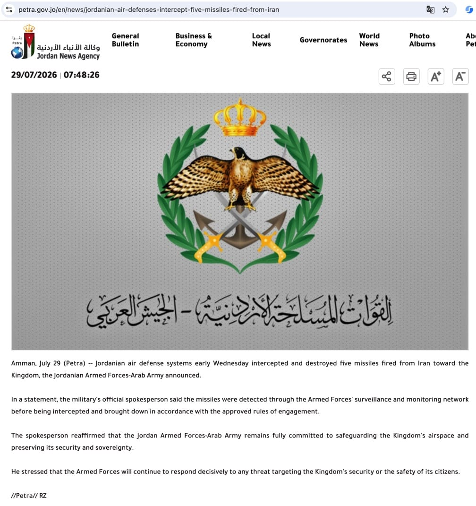

# 从 5 枚导弹拦截到跨日直接行动：约旦入口情报多源验证与业务研判

**入口情报来源：** [约旦通讯社《Jordanian Air Defenses Intercept Five Missiles Fired from Iran》](https://petra.gov.jo/en/news/jordanian-air-defenses-intercept-five-missiles-fired-from-iran)、[伊朗国通社《US air base, CENTCOM headquarters in Jordan targeted: IRGC》](https://en.irna.ir/news/86222477/US-air-base-CENTCOM-headquarters-in-Jordan-targeted-IRGC)

**事件时间：** 2026 年 7 月 29 日 05:45 CST；约旦通讯社于 12:48 CST 发布通报。

**分析窗口：** 2026 年 7 月 29 日 05:45 至 7 月 31 日 13:20 CST。

**结论时点：** 2026 年 7 月 31 日 13:20 CST。本文只对结论时点前取得的公开材料负责。

*图源：约旦通讯社 7 月 29 日入口报道。图片用于呈现原始报道形态，不作为导弹数量、目标或拦截效果的独立证明。*

## 0. 接到情报：原始消息长什么样

分析人员最初拿到的是约旦、伊朗和美国三方范围不同的公开口径，信息还不足以组成完整战报：

> **7 月 29 日 05:45 CST：约旦武装部队称拦截 5 枚从伊朗方向飞来的导弹；伊朗革命卫队确认发射，并称约旦境内的美军基地和指挥中心为目标。**

| 来源 | 原始消息直接说明了什么 | 当时不能据此认定什么 |
| --- | --- | --- |
| 约旦武装部队 / Petra | 约方监测系统发现 5 枚从伊朗飞向约旦的导弹，防空系统实施拦截和击落 | 伊方具体任务命令、导弹实际目标、逐枚落点和完整损害 |
| 伊朗革命卫队 / IRNA | 伊方承认发射，并宣称目标是约旦境内的美军基地和美国中央司令部指挥中心 | 宣称目标是否等于实际弹道，是否命中或造成损害 |
| 美国中央司令部 | 记录到伊朗发射多枚弹道导弹，称其针对中东美军并全部被拦截 | 不能提供约方“5 枚”计数的独立证明，也不能代替约旦境内的损害调查 |

三方材料共同确认了发射、来向、拦截和伊方目标意图，却没有给出可独立复核的弹道、落点和设施检查。入口情报的准确表述是：“伊朗公开承认对约旦境内美军目标实施新一轮直接行动，约旦和美方均称完成拦截。”现有材料不支持“美军基地已被击中”。

这条短消息立即触发六项业务问题：

| 业务对象 | 需要马上回答的问题 | 错判的直接后果 |
| --- | --- | --- |
| 管理层 | 7 月 26 日的停顿是否结束，是否需要上调地区风险级别 | 把一次新的直接行动误报为局势仍在降温 |
| 约旦及周边驻地 | 是否存在人员、残骸、通信、电力或设施风险 | 人员点名、避险和备用联络启动过晚 |
| 航空与出行 | 约旦空域是否会反复触发拦截、临时关闭、绕飞和返航 | 行程中断，人员在途中失去替代方案 |
| 航运与供应链 | 直接交火是否向霍尔木兹海事行动和制裁扩散 | 船期、保险、合规和结算风险被低估 |
| 能源与采购 | 油价上涨是短时冲击还是供应风险重新计价 | 追涨采购或错过必要的供应保障窗口 |
| 对外沟通 | 哪些是已确认事实，哪些只是参与方目标或战果声明 | 将“宣称目标”写成“实际命中”，损害报告可信度 |

**回溯背景：** [《美伊“暂停互袭”多源数据验证实录》](./美伊暂停互袭多源数据验证实录-20260727.md)记录了 7 月 26 日短暂停顿、7 月 29 日入口事件及截至 7 月 30 日 12:40 CST 的滚动核验。本文把此前情报作为背景和数据基线，独立回答这条入口情报如何演变、对业务意味着什么。

## 1. 结论先行

入口情报的核心部分得到约旦、伊朗和美国三方材料交叉印证：约旦确认防空系统拦截 5 枚从伊朗飞来的导弹；伊朗革命卫队确认实施发射，并公开宣称目标为约旦境内的美军基地和指挥中心；美国中央司令部也确认多枚伊朗弹道导弹针对中东美军并称全部被拦截。可以高置信度确认“伊朗对约旦境内美军目标发起新一轮直接行动”，7 月 26 日开始的美伊短暂停顿由此结束。

需要严格限制结论边界：

- “5 枚”来自约旦军方通报；伊方确认发射，但公开材料没有提供可独立核对的发射总数。
- “美军基地和指挥中心”是伊方公布的目标意图，不等于导弹实际航迹、落点或命中结果。
- 约旦和美国中央司令部均称来袭导弹被拦截，结论相互支持；现有公开材料仍不能逐枚核算拦截状态，也不能替代约旦境内的残骸和设施检查。
- 截至 7 月 30 日 08:30 CST，公开材料仍不足以确认美方已直接打击伊朗；随后，美国中央司令部公开宣布从 08:00 CST 开始打击，并在约 10:00 CST 完成一轮针对伊朗革命卫队目标的行动。新证据使此前的时点判断失效。
- 7 月 30 日 13:33 CST，约旦通讯社又发布一份新通报：约旦防空系统在周四黎明拦截 5 枚瞄准约旦领土的伊朗导弹，并称无人伤亡。美联社把这次拦截置于美方完成对伊打击之后。20:25 CST，伊朗革命卫队经 IRNA 认领对约旦 Al Azraq 空军基地的行动，并宣称摧毁 3 架美军 F-35、造成人员死亡；23:32 CST，CENTCOM 明确否认任何美军飞机受损，并称近期来袭均被拦截或未抵达目标区域。由此可以确认伊方认领第二次约旦方向行动，但其高战果主张遭美方直接反驳且没有独立证据支持。
- 新的地区外溢证据已经出现。美联社援引科威特军方称，伊朗来袭击中科威特北部一家中资企业建筑，建筑严重受损并造成 1 名工人死亡。当前尚未取得科威特军方可直连原文，企业名称、具体地点、来袭武器和伊方责任声明也未补齐；该事件采用“科威特军方经美联社发布”的中高置信口径，不把中资身份扩大解释为专门针对中国目标。
- 伊方随后又宣称打击科威特 Ali Al Salem 空军基地和巴林 Sheikh Isa 空军基地，并公布设施、装备损失说法。截至结论时点，尚未取得科威特、巴林或独立来源对这些战果的确认；这些材料只能证明伊方正把公开行动叙事扩大到多个驻美军国家，不能证明其宣称的命中和毁伤。
- 09:00—13:20 CST 的增量复核没有发现约旦第三次拦截、CENTCOM 新一轮对伊打击公告，或科威特、巴林官方对伊方基地战损主张的确认。[IRNA 09:21 CST 新稿](https://en.irna.ir/news/86224084/Baghaei-US-attack-on-a-residential-home-in-Qeshm-is-reminiscent)继续强调格什姆岛住宅伤亡，但没有增加医院、现场或独立影像证据。当前新增变化主要在外交归责和舆论动员层面，不构成军事风险下调信号。
- 事件序列已经从“一轮双方交火”升级为“跨两个自然日、多国方向的连续直接行动主张，并向民用设施和双海运咽喉外溢”。行动主体的公开表态在增多，战果真实性却更加对立，必须把“行动认领”“来袭/拦截”“命中”和“毁伤”分开管理。

当前预警判断维持：**高风险、多线扩散，战损待核**。09:00 后没有新增直接行动公告，只能说明公开行动节奏暂时放缓，不能抵消约旦跨日来袭、科威特实际伤亡和伊方多国基地行动主张。霍尔木兹一周过峡船舶量据 Lloyd's List Intelligence 从 82 艘降至 39 艘，红海—曼德海峡方向又出现船舶掉头和通行下降，航运压力已由单一咽喉演变为双咽喉风险。市场尚未同步恐慌不构成下调依据。下一关键分水岭仍是美方是否追加打击、东道国是否确认新的来袭或实际战损，以及斡旋能否形成可核对的行动边界。

## 2. 入口情报为什么构成新事件

7 月 26 日的“暂停互袭”没有书面停火条件、期限和监督安排，只能说明双方直接行动一度减少。7 月 29 日的导弹事件同时满足三个重判条件：

1. 发射方公开承认行动，不再只是第三方发现或匿名消息；
2. 目标被公开指向美军设施，具有明确的美伊直接对抗属性；
3. 导弹进入约旦防空处置链，风险从双边军事设施扩散至第三国空域、民航和公共安全。

因此，新分析以 7 月 29 日 05:45 CST 为 `T0`。旧实录提供停顿背景、入口事件的初始核验和截至 12:40 CST 的滚动记录；本文重新围绕这条入口情报组织问题、业务影响和后续转折，不把旧实录的章节直接续写过来。

## 3. 核验问题与证据分层

### 3.1 需要分别回答的问题

入口情报包含六个不能混写的主张：

| 编号 | 待核主张 | 判断所需的最低证据 |
| --- | --- | --- |
| C1 | 约旦空域发生导弹拦截 | 约旦官方通报，辅以独立媒体或现场材料 |
| C2 | 导弹来自伊朗方向 | 约旦军方观测与伊方行动声明相互印证 |
| C3 | 数量为 5 枚 | 约旦军方计数；最好有第二套传感器、盟军或现场记录复核 |
| C4 | 目标是约旦境内美军基地和指挥中心 | 发射方目标声明与美方或约方处置说明；只能证明所宣称目标 |
| C5 | 5 枚导弹均被有效拦截 | 逐枚轨迹、拦截记录、落点与损害调查 |
| C6 | 事件引发美方直接军事回应 | 美军一手声明与独立媒体、伊方现场或传感器材料交叉确认 |

### 3.2 来源独立性

本轮没有把新闻转载数量当成独立来源数量。材料按原始信息链归为四组：

| 独立组 | 代表来源 | 能证明什么 | 不能单独证明什么 |
| --- | --- | --- | --- |
| 约旦官方组 | [7 月 29 日首次拦截通报](https://petra.gov.jo/en/news/jordanian-air-defenses-intercept-five-missiles-fired-from-iran)、[7 月 30 日第二次拦截通报](https://petra.gov.jo/en/news/air-defenses-intercept-five-iranian-missiles-targeting-kingdom-jaf) | 约方探测、数量口径、拦截处置、无人伤亡口径及跨日重复来袭 | 伊方内部命令、实际弹道、逐枚毁伤结果及第二次事件的精确时间 |
| 伊朗官方组 | [第一次发射声明](https://en.irna.ir/news/86222477/US-air-base-CENTCOM-headquarters-in-Jordan-targeted-IRGC)、[第二次约旦方向行动认领](https://en.irna.ir/news/86223773/IRGC-strike-obliterates-3-US-F-35s-kills-troops-in-Jordan)、[科威特基地行动主张](https://en.irna.ir/news/86223825/IRGC-hits-US-airbase-in-Kuwait-in-fresh-wave-of-attacks)、[巴林基地行动主张](https://en.irna.ir/news/86224031/Iranian-Army-strikes-key-US-base-in-Bahrain-in-26th-phase-of) | 伊方承认两次约旦方向行动，并把公开行动叙事扩大到科威特和巴林 | 不能单独证明命中、飞机或设施损失、人员伤亡；科威特和巴林主张仍缺东道国确认 |
| 美国官方组 | [导弹来袭和拦截通报](https://t.me/U_S_CENTCOM/2778)、[对伊打击开始通报](https://t.me/U_S_CENTCOM/2780)、[霍尔木兹封锁执行数据](https://t.me/U_S_CENTCOM/2779)、[战果否认通报](https://t.me/U_S_CENTCOM/2781)、[美国财政部制裁通报](https://home.treasury.gov/news/press-releases/sb0581) | 美方确认第一次来袭、拦截结果、后续直接行动和航运管制；直接否认美军飞机受损 | 自方否认不能替代东道国现场调查；美方公布的目标效果和海事数据仍需独立复核 |
| 科威特官方转述组 | [美联社 7 月 30 日更新](https://apnews.com/article/iran-war-us-hormuz-strait-july-30-2026-8dc77ed6a65f389ea4af84635d2473bd)援引科威特军方 | 科威特军方称伊朗来袭击中北部一家中资企业建筑，造成严重损坏和 1 名工人死亡 | 当前未取得可直连的科威特军方原文；企业、地点、武器、受害者身份和伊方声明不完整 |
| 独立新闻组 | [美联社 7 月 29 日综合更新](https://apnews.com/article/iran-war-us-hormuz-strait-july-29-2026-e31d249ba6443decdd3e63cd00f0fb84)、[7 月 30 日后续更新](https://apnews.com/article/iran-war-us-hormuz-strait-july-30-2026-8dc77ed6a65f389ea4af84635d2473bd) | 汇总多方声明、补充第二次约旦拦截的行动顺序、科威特伤亡和埃及港口船舶火灾 | 无法替代军方传感器、现场勘验和完整战损评估；其科威特信息仍是官方转述而非另一套传感器证据 |

Petra、IRNA 和 CENTCOM 都是事件参与方的一手渠道，接近事实但存在立场和战果表达偏差。美联社提供编辑核验和多方对照，但其对军事细节的描述仍可能源自上述参与方。判断置信度时按原始信息链去重。

## 4. 主张核验结果

| 主张 | 当前结论 | 置信度 | 主要依据 | 仍缺什么 |
| --- | --- | --- | --- | --- |
| 约旦发生导弹拦截 | 确认 | 高 | 约旦武装部队经 Petra 发布正式通报；美联社随后纳入事件更新 | 拦截点、残骸和现场调查未完整公开 |
| 导弹来自伊朗方向 | 确认 | 高 | 约方方向判断与伊朗革命卫队承认发射相互印证 | 不影响总体归因；逐枚发射信息未公开 |
| 来袭数量为 5 枚 | 采用约方口径 | 中高 | 约旦武装部队明确给出 5 枚 | 缺伊方数量说明和独立传感器计数 |
| 目标为约旦境内美军基地和指挥中心 | 确认这是伊方公开宣称的目标 | 高（目标声明） | IRNA 转发革命卫队声明；美联社转述相关说明 | 不能据此确认实际弹道和具体目标对象 |
| 第一次来袭是否全部被拦截 | 约方和美方均称全部拦截，逐枚独立核算不足 | 中高 | 约旦武装部队通报；CENTCOM 第 2778 条即时通报 | 逐枚拦截记录、落点、残骸和设施检查 |
| 第一次来袭没有人员或设施损害 | 未确认 | 低 | 公开材料未见可靠的完整损害通报 | 约旦政府后续调查、医院和设施运营信息 |
| 美方随后直接打击伊朗 | 确认 | 高 | CENTCOM 宣布 7 月 30 日 08:00 CST 开始行动；美联社报道约 10:00 CST 完成一轮重打击 | 官网归档直链、目标清单和独立战损评估仍不完整 |
| 美方打击造成伊方所称人员和设施损害 | 有地方官方伤亡口径，未完成独立验证 | 中 | 伊朗地方官员经 IRNA 称格什姆岛一家 3 人死亡、2 名儿童受伤；美联社纳入后续报道 | 医疗记录、现场材料、卫星前后影像和其他独立来源复核 |
| 7 月 30 日是否再次有伊朗导弹来袭 | 约方确认第二次跨日来袭，伊方随后认领行动 | 高（行动发生）；中（具体目标） | Petra 称拦截 5 枚并无人伤亡；IRNA 转发革命卫队对 Al Azraq 基地的行动声明 | 缺分钟级时间、弹道、逐枚拦截记录和独立传感器材料 |
| 第二次来袭是否发生在美方打击后 | 美联社明确按“美方打击后”报道；约方未公布分钟级时间 | 中 | 美联社对行动顺序的编辑核验补强了 Petra 的“周四黎明”宽时间窗 | 仍需约方、美方传感器时间或伊方行动时间补齐 |
| 第二次来袭是否是对美方打击的报复 | 伊方将其表述为报复行动，但具体因果链仍属参与方口径 | 中 | IRNA/革命卫队认领并使用报复叙事；行动顺序与美联社报道相容 | 缺可核对的行动命令和分钟级时间，不能仅凭事后声明完成因果证明 |
| 第二次行动摧毁 3 架 F-35并造成美军死亡 | 伊方主张、美方否认，暂不采信战果 | 低 | IRNA 发布高战果主张；CENTCOM 第 2781 条明确称没有美军飞机受损 | 东道国现场、人员名单、残骸、卫星影像或其他独立证据 |
| 伊方命中科威特和巴林美军基地并造成装备损失 | 有行动主张，战果未确认 | 低 | IRNA 分别发布 Ali Al Salem 和 Sheikh Isa 基地行动声明 | 科、巴官方或美方针对性通报、现场材料和独立影像 |
| 科威特中资企业建筑遇袭并造成死亡 | 采用科威特军方经美联社发布的口径 | 中高 | 美联社明确援引科威特军方，报道建筑严重受损和 1 名工人死亡 | 科方原文直链、现场材料、企业和地点、武器类型及伊方责任声明仍缺 |
| 双方是否已进入连续多轮互攻 | 已确认跨日多次直接行动，公开行动主张扩展至多个国家 | 高（行动连续性）；低至中（具体战果） | 两次约方拦截、伊方第二次认领、美方直接打击、科威特伤亡及科/巴方向新主张 | 各方向的实际命中、损害和行动时间仍需分项核验 |

## 5. 判断演进和关键时间线

| 时间（CST） | 事件或新材料 | 当时可以作出的判断 | 对后续研判的影响 |
| --- | --- | --- | --- |
| 7 月 26 日 | 美伊直接行动短暂停顿，油价明显回落 | 存在短时降温信号；没有稳定停火依据 | 作为 `T0` 前背景基线 |
| 7 月 29 日 05:45 | 约旦称拦截 5 枚从伊朗方向飞来的导弹 | 停顿已被打破，约旦空域和美军设施风险上升 | 建立导弹事件卡，启动 6/24/48 小时窗口 |
| 7 月 29 日白天 | 伊朗革命卫队确认发射并公布所宣称目标 | 发射归因和目标意图得到交叉印证 | 将事件定性为美伊直接军事行动，而非不明空情 |
| 7 月 29 日晚间至 30 日凌晨 | 美方威胁回应；美国财政部公布霍尔木兹航运和保险相关制裁 | 政策和合规风险已经升级，但不能替代军事回应证据 | 航运、保险和交易对手复核进入并行任务 |
| 7 月 30 日 08:30 | 24 小时核验尚未取得美方直接打击的一手或独立确认 | 当时只能写“连续直接互攻尚未确认” | 这是受证据发布时间限制的时点结论，不应事后删除 |
| 7 月 30 日 08:00—10:00 | CENTCOM 宣布开始并完成一轮针对伊朗革命卫队目标的直接打击 | 一轮美伊直接交火已经形成 | 以 08:00 为新基点重启 6/24 小时观察 |
| 7 月 30 日 12:40 | 完成官方、媒体、市场、航空和天气复核 | 尚不能确认伊方再次回应；地区风险没有下调依据 | 继续观察连续多轮互攻和跨域扩散 |
| 7 月 30 日 13:33 | Petra 发布约旦武装部队第二份通报，称周四黎明拦截 5 枚瞄准约旦领土的伊朗导弹，无人伤亡 | 跨日重复来袭得到约方确认；与美方打击的精确先后仍不清楚 | 将“伊方是否再次行动”从单纯预警项升级为 P0 核验项 |
| 7 月 30 日 14:00 | 完成 6 小时节点复核 | CENTCOM 公开频道尚无第 2780 条之后的新行动通报；已覆盖的 IRNA RSS 未见第二次发射说明；油价重新回升，航空活动仍在 | 不把第二次来袭直接写成报复，但人员、航空和驻地措施继续升级 |
| 7 月 30 日 14:40 | IRNA 发布革命卫队新警告，称将严厉回应协助美方攻击伊朗的国家 | 伊方威慑对象已从美军目标扩展到被其认定为提供协助的国家 | 约旦、海湾驻美军国家和相关民用设施的误判、外溢风险上升；警告不等于已经实施具体行动 |
| 7 月 30 日下午 | 美联社后续稿将第二次约旦拦截置于美方打击之后，并援引科威特军方报告中资企业建筑受损、1 名工人死亡 | 第二次行动的先后顺序得到编辑核验补强；区域外溢已出现人员伤亡 | 把预警由“升级观察”调整为“区域扩散”，新增中资机构和第三国商业设施保护措施 |
| 7 月 30 日 17:40 | 完成官方声明、市场、航空、天气、海事和网络复核 | CENTCOM 最新仍为第 2780 条，IRNA 未确认第二次发射；油价较 14:00 小幅回落，黄金和股指期货走高；航空活动仍在，未见新伊朗国家级网络告警 | 军事升级与运行市场并非同步失序，维持高风险但不使用“区域全面瘫痪”表述 |
| 7 月 30 日 20:25 | IRNA 转发革命卫队声明，认领 Al Azraq 基地方向行动，并宣称摧毁 3 架 F-35、造成人员死亡 | “伊方未确认第二次行动”的旧判断被新证据替代；行动认领提高置信度，战果仍只是单方主张 | 把第二次行动与其战果拆成两个主张分别定级 |
| 7 月 30 日 21:39 | IRNA 宣称新一轮行动命中科威特 Ali Al Salem 空军基地 | 伊方公开行动叙事继续向海湾驻军国扩展 | 科威特方向上调监测，但不把宣称命中写成确认战损 |
| 7 月 30 日 23:32 | CENTCOM 第 2781 条否认 F-35 等飞机受损，称近期来袭均被拦截或未抵达目标区 | 第二次约旦行动的高战果主张形成参与方直接冲突 | 在取得独立证据前，F-35 损失和美军死亡均维持低置信度 |
| 7 月 31 日 03:55 | IRNA 宣称伊朗军方无人机打击巴林 Sheikh Isa 空军基地 | 伊方把基地打击叙事扩展到第三个驻美军国家 | 巴林纳入驻地安全和空域监测；战果待东道国或独立来源核验 |
| 7 月 31 日 06:01 | 伊朗外长就达米埃塔港事件警告所谓“假旗行动”，未直接承认或否认伊朗责任 | 伊方外交叙事试图避免与埃及关系破裂，但不构成责任排除证据 | 埃及事件继续独立建卡、归因未知 |
| 7 月 31 日 09:00 | 完成 48 小时与美方打击后 24 小时节点复核 | 未发现约旦第三次拦截通报；伊方新增科威特、巴林行动主张；美方未公开新一轮打击，但发布战果否认；双咽喉船流压力加深 | 维持“高风险、多线扩散，战损待核”，重点从是否再次行动转向战损核验和下一轮节奏 |
| 7 月 31 日 09:21 | IRNA 发布伊朗外交部发言人对格什姆岛住宅伤亡的谴责 | 伊方继续把平民伤亡用于外交归责；伤亡数字仍来自同一伊朗官方信息链 | 提高对舆论动员和报复正当化叙事的关注，不提高独立战损置信度 |
| 7 月 31 日 13:20 | 完成官方、独立媒体、航空、天气、网络和市场增量复核 | 未发现约旦第三次拦截、CENTCOM 追加打击或科威特、巴林基地战损确认；航空活动仍可见，未出现新伊朗国家级网络告警 | 判断从“持续直接互攻”细化为“高压间歇”，预警级别不变 |

时间线中“08:30 尚未确认”与“08:00 已开始打击”并不矛盾。前者记录分析人员在当时已取得的公开材料，后者来自随后发布或取得的证据。第二次来袭也存在同样问题：Petra 的发布时间明确，事件只写“周四黎明”；美联社补强了先后顺序，但没有补齐分钟级事件时间。情报系统必须同时保存 `event_time`、`publish_time` 和 `observed_at`，不能用发布时间倒推精确行动顺序。

## 6. 关联方向的交叉验证

### 6.1 伊拉克方向：代理人冲突不能并入同一攻击链

7 月 28 日至 29 日，美国和沙特打击伊拉克境内武装目标。美方称其回应此前 72 小时内 30 余次无人机攻击；伊拉克人民动员力量随后提出 20 人死亡主张。该方向与美伊直接冲突在时间上重叠，会提高报复和外溢风险，但现有材料没有证明它与 7 月 29 日约旦导弹由同一命令链组织，也不能把伊拉克伤亡数字直接作为伊朗导弹行动的结果。

处置上单独建立事件卡，分别记录责任方声明、伤亡、设施损害和后续报复。只有取得明确的行动声明或可验证指挥联系，才合并因果链。

### 6.2 科威特和埃及方向：民用设施与港口船舶风险已经落地

美联社援引科威特军方称，7 月 30 日上午一轮伊朗来袭击中科威特北部一家中资企业建筑，造成建筑严重损坏和 1 名工人死亡。这是本轮入口事件后首条涉及中资商业设施和实际死亡的官方转述，业务意义高于单纯的来袭或拦截计数。当前仍缺科威特军方原始通报直链、企业名称、准确地点、武器类型、现场勘验和伊方责任声明，因此只能确认“科威特军方如此通报”，不能确认该建筑是预定目标，更不能因为企业具有中资背景就推断伊方专门针对中国机构。

埃及达米埃塔港另有两艘天然气相关船舶起火。英国海事安全企业 Ambrey 称火灾由无人机袭击引发，埃及总理办公室称初步调查发现无人机痕迹并继续调查来源；涉事对象包括一处美国所有的浮式储存设施和一艘希腊油轮，尚无人员受伤。胡塞方面否认负责，[伊朗外长](https://en.irna.ir/news/86224060/Araghchi-warns-against-Israel-s-false-flag-operations-in-the)没有直接承认或否认伊方责任，而是警告所谓“假旗行动”；两者都是参与方表态，均不能完成归因。[约旦外交部门](https://petra.gov.jo/en/news/jordan-condemns-drone-attack-on-ships-at-egypts-damietta-port)随后谴责袭击并声援埃及，同样未作责任归属。该事件继续独立建卡，说明港口内船舶、能源物流和第三国商业资产面临的风险已不限于霍尔木兹断面。

伊方对科威特 Ali Al Salem 和巴林 Sheikh Isa 基地的两项新增行动主张，目前都缺东道国或独立证据确认。它们在预警上有价值：显示伊方正在把“协助美方”的威慑叙事转化为多国基地行动声明；但在战损评估上价值有限，不能据此认定无人机库、油罐、直升机或其他装备已被摧毁。

对中资机构而言，立即核对约旦、科威特、巴林、卡塔尔、沙特、伊拉克和埃及的人员及项目分布，按“是否邻近军用设施、能源节点、港口或防空处置区”做内部风险分级；输出只到业务连续性和人员保护层面，不公开具体人员位置和敏感设施相对关系。

### 6.3 霍尔木兹方向：军事风险、航运管制与制裁风险同时上升

伊朗革命卫队海军声称攻击并拦停 3 艘油轮，但截至结论时点，公开材料仍缺船名、船旗、位置、时间和损害。[国际海事组织已确认事件清单](https://www.imo.org/en/mediacentre/hottopics/pages/middle-east-highlighted-incidents.aspx)和 [NAVAREA IX 航行警告](https://hydrography.paknavy.gov.pk/navarea-ix-warnings/)没有提供对应确认。该主张保持“待核”，不能写成已发生事实。

另一方面，美国财政部已经确认制裁与霍尔木兹航运、保险安排有关的企业及 8 艘船舶。即使 3 艘油轮主张最终不能成立，船东、保险人、交易对手和结算链的合规成本也已经上升。

CENTCOM 第 2779 条公开信息称，截至 7 月 29 日，美方在其对伊航运管制行动中累计改变 20 艘商船航向、使 2 艘船失去航行能力并登临检查 2 艘。该数据是美方行动口径，不能单独证明霍尔木兹“自由开放”或“完全关闭”，但可以确认船舶面临的风险已同时来自伊方海事行动主张、美方实际拦截措施和新增制裁。

[IMF PortWatch](https://portwatch.imf.org/api/search/v1/collections/dataset/items/3da2b9ca97684916b75c4013f95d18ab)仍只更新至 7 月 23 日；当天过峡总量 10 艘、其中油轮 2 艘，不能覆盖入口事件后的即时变化。更接近当前窗口的 Lloyd's List Intelligence 周度统计显示，7 月 13—19 日有 82 艘船通过霍尔木兹，7 月 20—26 日降至 39 艘，周环比约下降 52.4%。该数据不等于结论时点的实时船流，但足以否定“通航已恢复正常”的宽泛判断。

压力不只在霍尔木兹。[美联社区域战线分析](https://apnews.com/article/iran-us-war-saudi-iraq-yemen-egypt-85aefd04354af77b20999da367c297f2)援引 Ambrey 称，胡塞宣布限制沙特相关航运后，红海和亚丁湾已有超过 10 艘船掉头；自 7 月 21 日以来，曼德海峡通行量较 6 月下降约 30%。沙特可借道埃及 Ain Sokhna—SUMED—Sidi Kerir 体系分流部分出口，但成本、装卸和路径复杂度上升。业务上应按“霍尔木兹 + 曼德海峡”双咽喉压力管理，而不是只盯一处封锁叙事。

### 6.4 市场方向：风险重定价持续，但没有同步恐慌

以 7 月 29 日 05:45 CST 前最后可比价为基线，24 小时后 WTI 和 Brent 原油期货约上涨 6.9% 和 8.1%，黄金约上涨 2.4%，美国标普 500 股指期货约下跌 1.8%；VIX 在下一个常规收盘较事件前约上涨 13.4%。跨资产方向一致，说明风险偏好下降并持续到 24 小时节点。

美方打击开始前，WTI 和 Brent 的 5 分钟样本约为 84.20 和 90.29；7 月 30 日 12:20 CST 附近一度回落至约 83.76 和 89.80。到 14:00 CST，两者又回升至约 84.79 和 91.13，较 12:20 分别上涨约 1.2% 和 1.5%，也分别高于美方打击开始前约 0.7% 和 0.9%。此前的短时回落没有保持，市场仍在根据第二次来袭、战损和后续行动重新计价。

7 月 31 日 08:50 CST 的同口径样本显示，WTI 约 84.04、Brent 约 89.39、黄金约 4,150.8、标普 500 股指期货约 7,494.75、比特币约 64,684。相较 7 月 30 日 17:40，WTI 基本持平，Brent 约回落 1.5%，黄金约上涨 0.6%，股指期货约上涨 1.5%，比特币约上涨 0.3%。新增多国行动主张尚未触发跨资产同步恐慌，但油价仍处高位，市场韧性不能替代军事、航运和现场证据，也不能解释为局势已经降温。

作为另一组收盘后代理指标，7 月 31 日 08:15 CST 附近可取得的美国交易所基金数据显示：USO 和 BNO 较前收分别约下降 1.43% 和 1.50%，GLD 和 SPY 分别约上涨 1.63% 和 1.65%。该组数据与期货样本共同指向“风险资产没有同步失序、油价从高位回落”，但交易时段、基金跟踪误差和其他宏观消息使其不能直接归因于军事降温。

同一窗口还有伊拉克打击、海事主张、美国制裁和供需消息。行情只用于确认风险定价方向，不把全部涨跌归因于约旦导弹或美方某一轮打击，也不作为采购和交易的唯一依据。

### 6.5 航空和天气方向：活动增加不等于风险解除

7 月 30 日 14:00 CST 的 ADSB.lol 同口径快照显示：霍尔木兹关注区 20 个新鲜目标、15 架在空中；约旦周边 14/14；马六甲对照区 16/16；直布罗陀对照区 23/20。与 12:40 快照相比，各区域数量有升有降。两次快照只能说明采样时仍有航空活动，不能判断航班是否按计划运行，也不能据此下调重复导弹来袭和防空处置带来的风险。

约旦和海湾关注机场 14:00 CST 附近的最新 METAR 主要记录静风或小风、霾或尘导致的局地能见度下降；迪拜、阿布扎比和马斯喀特为 CAVOK 或无显著天气，未见足以单独解释区域性航班中断的强对流天气。航班取消、绕行和返航仍以 NOTAM、机场和航司公告为准。

7 月 31 日 08:50 CST 再次按 15 秒新鲜度口径采样：约旦周边 25 个新鲜目标、23 架在空中；霍尔木兹关注区 66/59；马六甲对照区 50/49；直布罗陀对照区 10/6。数量受时段、航路和接收覆盖显著影响，只能说明采样时仍有航空活动，不能计算“恢复率”。08:00—08:30 CST 的 OJAI、OJAM 有霾或轻度能见度影响，OKKK、OMAA、OMDB、OBBI、OOMS 为 CAVOK 或无显著天气；没有证据把区域运行风险主要归因于恶劣天气。

13:16 CST 采用相同 250 海里关注圈和 15 秒新鲜度再次采样：约旦周边 34/27，霍尔木兹 91/72，马六甲 45/45，直布罗陀 47/41。相较 08:50，部分区域明显增加，直布罗陀的变化尤其说明接收覆盖和时段效应很强，不能将增量解释为航班恢复。13:00 CST 附近 METAR 显示 OJAI 能见度 5,000 米并有霾，OJAM、OKKK 和 OOMS 能见度 7,000—8,000 米，OMAA、OMDB、OBBI 为 CAVOK；仍无广域强对流天气解释。

### 6.6 地表、卫星和网络方向：未检出不等于未发生

FIRMS 对伊朗西部相关广域的筛查没有发现可明确归因于新攻击的大范围新增热异常。FIRMS 适合发现达到传感器阈值的热源，不能排除小范围、短时或被云层遮挡的损伤。具体目标效果仍需准确时间和范围，以及 Sentinel-1/2、Landsat 或商业影像的前后时相对照。

IODA 显示伊朗在 7 月 30 日 05:05—07:05 CST 附近出现约 2 小时 BGP 路由异常，随后恢复。14:00 CST 复查未返回新的伊朗国家级告警。异常与军事行动时间接近，但没有足够材料判定原因。它只支持“公网通信曾出现短时不稳定”，不支持网络攻击归因；没有新国家级告警也不能排除地区或运营商级异常。

对 7 月 30 日 17:40 至 7 月 31 日 08:50 CST 的 IODA 国家级告警再次查询，未返回新的伊朗国家级记录。这个零结果只说明该时段没有触发该接口的国家级告警阈值，不排除地区、运营商、移动网络或主动管制层面的异常。

将查询窗口延长至 7 月 31 日 13:17 CST，结果仍为零条新增伊朗国家级告警。网络风险判断不变：没有证据支持全国性长时间中断，但地区、运营商和应用层异常仍需独立监测。

## 7. 综合研判

### 7.1 最符合当前材料的解释

伊朗在 7 月 29 日实施了一次目标意图明确的直接行动；美国随后直接打击伊朗革命卫队目标。约旦又确认周四黎明拦截第二批 5 枚伊朗导弹，美联社将其置于美方打击之后，伊朗革命卫队随后认领 Al Azraq 基地方向行动。科威特军方又报告伊朗来袭造成中资企业建筑严重受损和 1 名工人死亡。事件已经从“暂停被打破”升级为跨两个自然日的多次直接行动并向第三国商业设施外溢，约旦也从一次导弹过境和拦截风险转为重复承受来袭的前沿风险区。

第二次来袭由约方通报、伊方认领，行动存在的置信度已经提高；但伊方宣称摧毁 3 架 F-35 和造成美军死亡，遭 CENTCOM 直接否认，且没有东道国现场、人员、残骸或影像支持。最合理的拆分判断是：“第二次行动发生”高置信，“具体目标”中等置信，“伊方高战果”低置信。把后两项随行动认领一起写成确认事实，会把宣传战误当战损评估。

各方当前动向可以概括为：

- **美国：** 保持“一轮重打击 + 霍尔木兹航运管制 + 制裁 + 信息反驳”的组合施压。截至 13:20 CST，CENTCOM 公开频道没有宣布第 2780 条之后的新一轮对伊打击，但第 2781 条集中否认伊方飞机毁伤和海事叙事。这个间歇更像行动节奏和叙事控制，不能单独解释为停止升级。
- **伊朗：** 从警告协助美方的国家，转为连续发布约旦、科威特和巴林基地行动主张，意在展示跨国回应能力并抬高美国区域驻军成本。其弱点是高战果主张缺独立证明，且与美方口径直接冲突。
- **约旦及海湾东道国：** 约旦仍以防空拦截、无人伤亡和主权防卫为核心，尚未发现第三次拦截通报；科威特已有民用商业建筑伤亡口径，巴林基地战损仍无东道国确认。各国会同时承受保护领空、维持与美安全关系、避免被伊方视为参战方的三重压力。
- **埃及和沙特：** 埃及继续调查达米埃塔港无人机来源；沙特面临曼德海峡航运压力，并通过替代出口路径降低单点中断，但成本上升。两国更有动力推动降温，同时不会放弃自身航运和能源安全措施。
- **斡旋方：** 巴基斯坦外交部门称有关缓和局势、尤其霍尔木兹问题的接触仍在继续，但同时称形势脆弱；伊朗国内又出现拒绝“美式停火”、坚持回应的公开强硬表态。斡旋渠道仍在，但尚未形成可核对的停火条件、时间表或监督安排。

截至 13:20 CST，各方动向呈现“军事高压间歇、外交归责加码、海运压力延续”的组合。美方没有公布追加波次，伊方也没有发布 09:00 后的新行动认领，但伊朗外交部门继续放大格什姆岛平民伤亡，能够为后续回应提供国内和外交叙事。约旦、科威特和巴林没有新增公开战损确认，使伊方此前的高战果仍停留在宣传层。这个间歇不满足下调条件，因为双方都没有承诺停止行动，海运和驻地风险也没有出现结构性改善。

军事、代理人、海事和经济风险正在并行上升，但尚无证据证明各方向已经合并为统一命令链。科威特伤亡、埃及船舶火灾、沙特能源设施受损和伊拉克武装冲突应分别建卡、分别归因。把它们强行串联会高估指挥协同，也会掩盖人员、港口、航运、能源和合规风险各自的触发条件。

### 7.2 情景矩阵

| 情景 | 当前匹配度 | 未来 24 小时应看到的信号 | 研判动作 |
| --- | --- | --- | --- |
| A. 暂停新的直接打击，转入高压对峙 | 中 | 美方不追加打击；约旦及海湾国家不再发现新来袭；双方继续宣传和制裁施压 | 维持高风险观察，不因“无新公告”提前下调 |
| B. 进入连续多轮、跨国直接互攻 | 高风险、较强匹配 | 伊方已认领第二次约旦行动并声称攻击科威特、巴林；若美方追加波次或东道国确认新来袭则进一步匹配 | 人员、航空、驻地和业务连续性措施按高风险执行 |
| C. 直接交火节奏放缓，风险转向双咽喉、港口和代理人 | 高 | 霍尔木兹周度通行显著下降，曼德海峡出现掉头和通行下降；若再出现实名船舶或港口事件则继续强化 | 军事主线与航运、代理人主线分别升级，供应链按双咽喉受压测算 |
| D. 参与方高战果被夸大或否定 | 高 | 伊方公布 F-35、机库、油罐等高战果，美方否认且独立证据缺失 | 行动认领可用于预警，战果数字不得用于损失、保险或人员决策 |
| E. 斡旋形成可执行降温 | 低 | 双方公布一致的暂停时间、对象边界和第三方安排；船流和空域连续改善 | 先验证安排是否执行，再分阶段下调，不以单方表态触发 |

### 7.3 预警触发器

以下任一情况出现时，预警继续上调：

- 约旦、美军及盟友设施出现第三次导弹、无人机来袭，或科威特、巴林出现经东道国确认的伤亡和设施损害；
- 美方确认第二轮或持续性对伊直接打击；
- 约旦、伊拉克或海湾国家发布新的空域关闭、拦截或人员伤亡通报；
- 取得有船名、船旗、位置和损害的船舶事件，或 IMO、NAVAREA IX、船东确认事故；
- 沙特或海湾重要民用能源设施受损得到官方和独立来源双重确认；
- 伊朗出现持续网络、通信或电力中断，并获得运营商或基础设施部门说明；
- 正式制裁清单继续扩大，命中本单位船东、保险人、银行或交易对手。

只有同时满足以下条件，才讨论下调：以科威特伤亡事件或最后一次可确认直接行动中较晚者为基点，至少 24 小时没有新行动；约旦及相关 FIR 的临时限制解除且航班运行稳定；没有新的已确认船舶、港口或能源设施事件；斡旋方给出双方可以核对的行动边界。单次油价回落、零散航班恢复或网络恢复均不能单独触发下调。

## 8. 行动建议

| 责任对象 | 立即行动 | 依据 | 升级或撤销条件 |
| --- | --- | --- | --- |
| 管理层 | 统一口径为“已确认跨日多次直接行动；伊方已认领第二次约旦方向行动，并新增科威特、巴林基地行动主张；具体战损高度争议”；把约旦、科威特、巴林及其他海湾驻地按多线扩散场景管理 | 行动是否发生与战果是否成立的证据等级不同；高战果主张遭美方直接否认 | 东道国、现场或独立影像补齐后重判；出现新来袭或美方追加波次时继续升级 |
| 研判团队 | 将两次“约旦导弹”分别建卡，另建“美方对伊打击”“科威特民用建筑伤亡”“科威特基地主张”“巴林基地主张”“达米埃塔港船舶火灾”“双咽喉船流”事件卡 | 各事件的主体、对象、时间精度和证据链不同；同一伊方公报中的行动认领和战果也要拆开 | 新材料只更新对应主张；责任方、目标、命中和战果字段分别管理，不覆盖历史判断版本 |
| 人员与出行负责人 | 暂停非必要的约旦、伊朗、伊拉克、科威特、巴林及波斯湾高风险区域出行；必要行程当日核对 NOTAM、机场和航司公告，准备延期、绕飞和就地避险方案 | 重复导弹来袭已扩散为多个驻军国行动主张，科威特已有人员死亡口径 | 新空域关闭、大量取消/返航或新的驻军国来袭时扩大停行；最后一次确认行动后至少 24 小时无新来袭且运行稳定再评估恢复 |
| 驻地安全负责人 | 对约旦、科威特、巴林及海湾驻地完成人员点名，检查室内避险区域、紧急联络链、备用通信、电力和远程办公；对未经证实的基地战损只作风险提示，不转发为事实 | 约旦重复来袭，科威特商业建筑出现实际损害和死亡，伊方新增多国基地行动主张 | 当地预警、通信/电力中断、机场关闭、残骸警戒或新攻击出现时启动业务连续性预案 |
| 境外机构与项目负责人 | 核对中资机构、承包商、仓库和营地的人员状态及连续运行方案；对临近军用设施、能源节点、港口或防空处置区的项目提高内部风险级别，不公开具体位置清单 | 科威特事件首次把中资商业设施及人员伤亡带入本轮证据链；尚不能判定为针对中国机构 | 取得企业和现场确认后细化处置；若同类机构再次受损，启动区域级人员疏散或停工评估 |
| 航运与供应链负责人 | 同时测算霍尔木兹和曼德海峡受限场景；索取船名、船旗、预计过峡时间、替代航线、保险意见和 7—14 天安全库存，复核交易对手制裁命中 | 霍尔木兹周度通行约下降 52.4%，曼德海峡通行约下降 30%并出现超过 10 艘船掉头；两组口径不同但方向一致 | 船方、IMO、NAVAREA 或港口确认新事件时调整航线和窗口；双咽喉同时恶化时启动替代来源与库存预案 |
| 能源与采购负责人 | 同时维护供应和价格预案；核对库存、合同浮动条款、替代来源和物流周期，不因盘中波动追价 | 原油和避险资产在 24 小时窗明显重定价，短时回落不足以证明风险下降 | 48 小时价格继续上行且海事或设施事件确认时提高保障；供需和通航持续改善后再降级 |
| 信息与通信负责人 | 检查跨运营商、卫星电话或其他备用联络方式；将通信异常与军事事件分开记录，不做未经证实的攻击归因 | 伊朗出现短时 BGP 异常，原因未知 | 持续或多区域中断时启动备用链路；恢复后保留事件记录供复盘 |

所有建议面向人员安全、民用运行、供应保障和合规控制，不用于识别打击目标、推断武器发射点或提供进攻性行动指导。

## 9. 后续核验计划

### 9.1 时间窗口

| 窗口 | 基点 | 到点时间 | 核验重点 |
| --- | --- | --- | --- |
| 首次导弹事件 48 小时 | 7 月 29 日 05:45 CST | 7 月 31 日 05:45 CST | **已完成：** 伊方已认领第二次约旦行动；未发现第三次约旦拦截通报；战果相互矛盾；外交斡旋未形成可核对安排 |
| 美方打击后 6 小时 | 7 月 30 日 08:00 CST | 7 月 30 日 14:00 CST | **已完成：** 发现约旦第二次拦截通报；尚缺精确事件时间和伊方确认；CENTCOM 尚无第 2780 条之后的新行动通报 |
| 美方打击后 9 小时 40 分 | 7 月 30 日 08:00 CST | 7 月 30 日 17:40 CST | **已完成：** 第二次拦截的“打击后”顺序获得美联社补强；科威特出现商业建筑受损和死亡；IRNA 发布扩大威慑对象的警告；CENTCOM 未公布追加波次 |
| 美方打击后 24 小时 | 7 月 30 日 08:00 CST | 7 月 31 日 08:00 CST | **已完成：** 美方未公开追加打击波次；伊方新增约旦、科威特、巴林行动主张；F-35 战果遭美方否认；双咽喉船流压力加深 |
| 美方打击后 48 小时 | 7 月 30 日 08:00 CST | 8 月 1 日 08:00 CST | 是否形成新的行动规律、斡旋效果、航运和能源风险是否具备调整条件 |
| 第二次约旦行动认领后 24 小时 | 7 月 30 日 20:25 CST | 7 月 31 日 20:25 CST | 东道国或独立来源能否确认目标、命中、人员和飞机损失；是否出现第三次约旦来袭 |
| 09:00 后高压间歇 12 小时 | 7 月 31 日 09:00 CST | 7 月 31 日 21:00 CST | 是否出现新一轮直接行动、东道国战损确认或可核对斡旋安排；不能因数小时无公告提前下调 |

### 9.2 P0 核验清单

1. 优先取得第二次来袭的精确时间、弹道和独立战损材料；伊方已经认领行动，下一核验重点是其目标与战果能否获得东道国、现场或独立影像支持。
2. 分开核对两次来袭的约旦卫生、民防、机场和基础设施运行通报，补齐残骸、伤亡和次生损害。
3. 取得科威特军方原始通报、企业和现场确认、受害者信息；分别核验“中资企业建筑伤亡”和“Ali Al Salem 基地战果”，不得因都在科威特而合并证据链。
4. 核对达米埃塔港两艘船舶的船名、IMO 编号、所有权、损害和港口运行状态；在责任方确认前保持“无人机致火、归因未知”。
5. 对伊方损害主张取得地方政府、医院、独立媒体及卫星前后时相材料；没有准确时间和范围时不做目标级影像归因。
6. 持续核查 IMO、NAVAREA IX、船东和保险市场，分别维护霍尔木兹和曼德海峡船流基线；优先寻找船名、船旗、位置和损害，不用匿名转述替代对象信息。
7. 固定同一行情合约和时区完成 6/24/48 小时事件窗，同时记录库存、制裁和其他并发消息。
8. 复核相关 FIR 的 NOTAM、机场到离港和航司公告；ADS-B 只用于活动快照与航路异常提示。
9. 监测 IODA 和运营商通报；网络异常只做风险提示，归因必须另有技术和官方材料。

## 10. 当前不应使用的表述

- “约旦境内美军基地已被命中并摧毁 3 架 F-35”——伊方已经认领第二次行动，但美方明确否认飞机受损，独立战损材料缺失。
- “两次来袭的导弹全部被摧毁且没有任何损失”——约方称两次均完成拦截，第二次明确称无人伤亡；逐枚核算、残骸和设施调查仍不完整。
- “美伊已进入无限期全面战争”——已经发生跨日多次直接行动，持续范围、行动目的和后续轮次仍待观察。
- “伊朗第二次报复取得重大成功”——伊方使用报复叙事并认领行动，不等于其命中和战果主张得到验证。
- “科威特和巴林美军基地已经遭到严重破坏”——目前只有伊方行动与战果声明，缺东道国和独立证据。
- “伊朗专门攻击了中国企业”——科威特军方经美联社通报中资企业建筑受损和死亡，尚无证据证明中资身份是目标选择原因。
- “埃及港口船舶由伊朗袭击”——初步调查只确认无人机致火，责任方未知。
- “3 艘油轮遇袭已确认”——缺船名、位置、损害和海事机构记录。
- “地区空域全面关闭”——公开快照仍有航空活动，具体限制应按 FIR、NOTAM、机场和航司判断。
- “网络异常由攻击造成”——时间相关不能替代技术归因。
- “油价变化完全由约旦导弹事件造成”——同一窗口存在多项军事、制裁和供需消息。

## 11. 更新规则

后续版本保留每一时点的判断，不用新结论覆盖旧结论。新材料进入时至少记录：

| 字段 | 含义 |
| --- | --- |
| `event_time` | 事件实际发生或估计发生时间 |
| `first_public_at` | 当前已知的首次公开时间 |
| `publish_time` | 当前材料的发布时间 |
| `observed_at` | 分析人员首次取得材料的时间 |
| `origin_source_id` | 原始信息链标识，用于转载去重 |
| `evidence_role` | 触发线索、核验证据、背景基线或影响证据 |
| `analytic_confidence` | 对当前分析结论的置信度，不等同于来源可靠性 |
| `supersedes` | 当前结论替代的上一版本及替代理由 |

当新证据改变核心判断时，更新“结论先行、主张核验结果、情景矩阵、预警触发器和行动建议”五处，并保留变更时间与依据。

## 12. 数据源台账和复核口径

### 12.1 本轮实际使用的数据渠道

| 类型 | 数据渠道 | 本轮用途 | 结论时点覆盖 | 主要限制 |
| --- | --- | --- | --- | --- |
| 约旦官方 | Petra / 约旦武装部队 | 确认两次拦截、来向、约方数量及第二次无人伤亡口径 | 已覆盖 7 月 29 日、30 日两份通报 | 第二次只写“周四黎明”；未公开逐枚记录和完整设施调查 |
| 伊朗官方 | IRNA / 伊朗革命卫队 / 伊朗军方 | 确认第一次和第二次约旦方向行动认领；发现科威特、巴林基地行动主张、海事主张、扩大威慑对象警告和格什姆岛伤亡归责 | RSS 构建时间更新至 7 月 31 日 13:12 CST；09:21 CST 后未见新行动声明 | 参与方声明不能独立证明命中、装备损失和人员死亡；重复外交表态不增加来源独立性 |
| 美国官方 | CENTCOM 公开频道及官网 | 确认第一次来袭、拦截结果、美方回应、航运管制数据，并核对伊方 F-35 战果主张 | 13:20 CST 公开频道最新仍为第 2782 条；第 2781 条明确否认任何美军飞机受损 | 数小时无新公告不等于停止行动；自方否认仍需东道国、现场或独立材料复核 |
| 美国政策 | 美国财政部 | 核对霍尔木兹航运、保险和船舶制裁 | 已覆盖 7 月 30 日通报 | 证明法律和合规变化，不证明海上军事事件发生 |
| 科威特官方转述 | 科威特军方经美联社发布 | 核对中资企业建筑损害和死亡 | 已覆盖 7 月 30 日美联社后续稿 | 尚未取得科威特军方原文直链和完整事件字段 |
| 埃及官方转述 | 埃及总理办公室经美联社发布；约旦外交部门 | 核对达米埃塔港两艘船舶火灾的初步原因及地区外交反应 | 已取得“发现无人机痕迹、继续调查来源”和约旦谴责口径 | 责任方、完整船舶对象和最终损害调查仍不完整 |
| 独立新闻 | 美联社及多家国际媒体 | 对照约、伊、美三方声明；补强第二次拦截顺序、科威特伤亡、埃及船舶火灾、双咽喉船流和斡旋进展 | 已复查至 7 月 31 日 13:20 CST，未发现改变核心结论的新独立材料 | 官方转述不等于独立传感器或现场确认；转载不能增加独立来源数量 |
| 航行安全 | IMO 已确认事件清单、NAVAREA IX | 核查有对象信息的船舶事故和正式航行警告 | 09:00 CST 复查：IMO 仍更新至 7 月 27 日 62 起；NAVAREA IX 索引已到 266/26，未见对应 3 艘油轮确认 | 清单和警告存在时滞，也不是完整冲突事件库 |
| 船流趋势 | IMF PortWatch、Lloyd's List Intelligence、Ambrey | 比较霍尔木兹日度/周度过峡量和曼德海峡变化 | PortWatch 最新仍为 7 月 23 日；Lloyd's List 覆盖至 7 月 26 日；Ambrey 提供 7 月 21 日后红海变化 | 统计窗口和方法不同，不可直接拼成实时船舶清单；媒体转述仍需保留来源链 |
| 区域船舶活动 | Global Fishing Watch | 补充 PortWatch 滞后区间的区域存在量 | 已取得至 7 月 26 日 | 区域存在时间不等于断面过峡数，AIS 接收覆盖不均 |
| 航空活动 | ADSB.lol、OpenSky | 获取约旦、霍尔木兹和对照区的同口径快照 | 已采样至 7 月 31 日 13:16 CST | 受接收覆盖和时段影响；快照不能说明正常率和恢复趋势 |
| 航空气象 | Aviation Weather Center METAR | 排除强对流等明显天气解释 | 已覆盖关注机场至 7 月 31 日 13:00 CST 附近最新报文 | 不能代替 NOTAM、航司和机场运行状态 |
| 热异常 | NASA FIRMS VIIRS | 筛查大范围新增热源 | 已回查事件前基线和 7 月 29 日更新 | 会漏掉小规模、短时、遮挡或非热源损伤 |
| 卫星目录 | Copernicus STAC、AWS Sentinel-1、Earth Search | 查找雷达和光学前后时相 | 已确认可用场景，目标级处理未完成 | 过境时刻离散；云量、分辨率和准确范围限制归因 |
| 网络可用性 | IODA | 发现国家和网络级连接异常 | 7 月 30 日 17:40 至 7 月 31 日 13:17 CST 未见新伊朗国家级告警 | 异常只能说明可见性变化，不能单独归因于攻击；零结果不覆盖地区和运营商层面 |
| 市场行情 | Yahoo Finance 5 分钟及日线样本、美国交易所基金代理 | 计算原油、黄金、股指和波动率事件窗 | 期货样本更新至 7 月 31 日 08:50 CST；基金代理更新至 08:15 CST，资产继续分化 | 免费行情、交易时段、基金跟踪误差和合约差异限制精确归因 |

### 12.2 计算和解释约定

- **事件窗基线：** 取 `T0` 前最后一条可比行情，不用新闻发布时间替代事件发生时间。跨资产比较保留各自交易时段，不把闭市期间的空值当成价格不变。
- **船流变化：** PortWatch 按日度断面通行口径比较；Global Fishing Watch 只描述区域活动。两者不直接拼接为一条连续序列。
- **航空快照：** “新鲜目标”按接口返回时间戳筛选，“在空中”按目标状态字段统计。结果同时报告采样时刻、区域和对照区，不从一次快照推断恢复率。
- **传感器零结果：** 写成“在当前覆盖和探测阈值内未检出”，不写成“事件没有发生”。空结果还要区分无覆盖、数据未更新、请求失败和有效覆盖内为零。
- **伤亡与战损：** 参与方数字先记录为主张；至少取得地方政府、医疗机构、现场图像、独立媒体或前后时相影像中的第二类材料，才提高置信度。
- **时间版本：** 每次结论绑定 `observed_at`。后续证据可以替代分析判断，不能倒改当时是否已经取得材料。

### 12.3 尚未补齐的数据缺口

1. 伊方已经认领第二次约旦方向行动，但仍缺分钟级时间、弹道、实际目标和独立战损材料。
2. 两次事件的逐枚拦截记录、残骸位置和完整设施检查没有公开；第二次只有约方无人伤亡口径。
3. 伊方关于 3 架 F-35、美军死亡、科威特和巴林基地装备损失的主张均缺独立证据；CENTCOM 只明确否认了飞机损失等近期主张，不能替代各东道国现场调查。
4. 科威特民用建筑事件缺军方原始通报直链、企业和现场确认、受害者身份、武器类型；不能判断中资身份是否与目标选择有关，也不能与伊方 Ali Al Salem 基地声明合并。
5. 达米埃塔港事件缺完整船舶对象、损害和责任方信息；“无人机致火”不能直接推导伊朗或代理人责任。
6. CENTCOM 官网归档、完整目标清单和可信的独立战损评估尚不完整。
7. 3 艘油轮主张缺船名、船旗、准确时间、位置、损害和船方说明。
8. PortWatch 尚未覆盖入口事件后的船流；免费 AIS 在霍尔木兹的对象级持续覆盖不足。
9. 目标级卫星核验缺准确范围、合适的前后时相和高分辨率材料。
10. 约旦相关 FIR 的完整历史 NOTAM、航班计划完成率和航司取消原因尚未形成统一数据集。
11. IODA 的短时异常缺运营商说明和网络层技术取证，不能完成原因归属。
