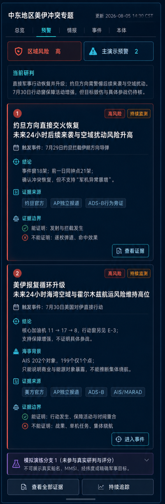
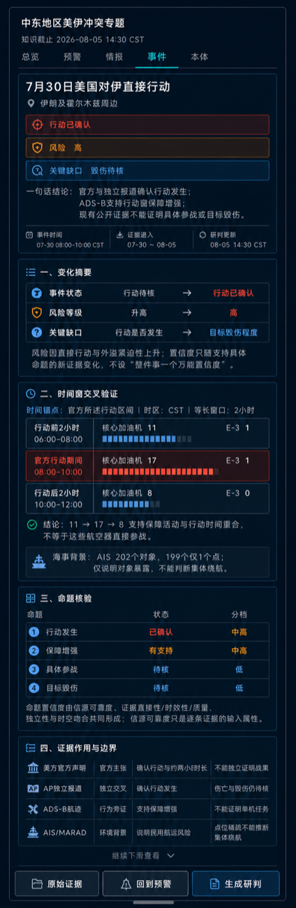

# 美伊专题预警页与事件页原型内容及 OSINT 查证记录

> 日期：2026-08-05
>
> 面向对象：业务、产品、数据、前端、演示与评审人员
>
> 对应页面：`https://gisamock.trscd.com.cn/` → “中东地区美伊冲突专题”右侧预警页、事件页
>
> 数据口径：历史回溯；时间统一以 UTC 查询、以 CST 展示；不提供实时军事目标定位

## 1. 先说结论

右侧页面的目标已经从材料堆叠调整为一张可审计的研判答卷。用户进入页面后，应能依次看懂五件事：

1. **发生了什么：** 7 月 29 日约旦发生伊朗方向导弹发射与拦截；7 月 30 日美方实施约两小时直接打击。
2. **哪些事实已经确认：** 行动发生可以由参与方材料、官方通报和独立媒体交叉确认。
3. **航迹增加了什么信息：** ADS-B 支持“行动窗保障活动增强”；约旦案例的同钟点基线则反证“事件后军机异常暴增”。
4. **哪些结论仍不能下：** 航迹不能证明具体航空器参战、目标毁伤或商船集体改道；AIS 点位稀疏时只能说明对象暴露和船型结构。
5. **状态变化为什么影响风险与置信度：** 直接行动会提高严重度和紧迫性，所以风险上升；只有支持某个具体命题的独立证据增加，那个命题的置信度才上升。行动已确认不等于战果也已确认。

两张原型图如下。新版按当前专题页右侧抽屉的真实宽度重排：外框 `424px`，内部内容壳 `399—400px`；图片是完整滚动稿，不是把宽版页面等比缩小。

## 2. AI 听记反馈回顾：业务同事真正不满意的是什么

钉钉 AI 听记《多源情报分析讨论-0804PM》表明，会议实际讨论重点是内容能否形成专业研判，配色和组件并非主要矛盾。业务反馈可归纳为八条：

| 反馈 | 背后的真正问题 | 处理方式 |
| --- | --- | --- |
| “暂停互袭”看不出明显动态变化 | 案例缺少可展示的前后差异 | 降为历史前态，不再作为主演示案例 |
| 页面有很多预警、事件和新闻，但没有最终结论 | 展示了材料，没有回答用户最关心的问题 | 预警页增加“当前研判”和每案一句话结论 |
| 一个事件关联很多预警，主线混乱 | 事件、命题和预警的粒度不一致 | 冻结“一案一条主演示预警” |
| 约旦页面把军机变化讲得过强 | 缺少同范围、同钟点基线，容易把高活跃背景误报为异常 | 展示事件窗 18 对象、前一日同窗 21 对象，明确不支持“暴增” |
| 7 月 30 日案例需要 ADS-B 与 AIS 一起出现 | 用户要看到多源交叉，而不是单一新闻复述 | ADS-B 进入行动支援链；AIS 单列民用海事影响链 |
| AIS 数量接近时仍想讲出剧烈变化 | 数据能力和叙事欲望发生冲突 | 真实数据只讲“对象暴露”；另设紫色模拟分支，不污染真实研判 |
| 确认地点和 AI 推断地点容易混淆 | 页面没有把事实与推断隔离 | 只使用区域级确认定位；推断位置应使用虚线、淡化和明确标签 |
| 技术人员先找数据，再想页面效果 | 没有先冻结业务问题和可证命题 | 先写结论、证据边界和动作，再选择数据与组件 |

业务同事需要系统从多源材料中形成有边界、会反证、能解释变化的判断，单纯增加数据量无法解决这个问题。

## 3. 两个主演示案例如何形成完整故事

### 3.1 前态：短暂停顿只负责交代背景

7 月 26 日前后出现了直接行动短暂停顿和外交降温信号，但没有形成公开、稳定、可执行的停火边界。它在演示中只回答“为什么后来需要重新评估”，不单独生成一条主演示预警。

### 3.2 案例一：约旦拦截——确认事件，同时给过度解读踩刹车

初中生式理解：新闻告诉我们“确实有人发射、约旦确实拦截”；飞机航迹告诉我们“当时周边本来就很忙，而且没有比前一天同一时段更忙”。所以系统既确认冲突恢复，又拒绝把普通高活跃背景说成“军机突然暴增”。

页面最终结论：

> 发射与拦截获多方材料支持；事件窗 18 个军机对象，低于前一日同窗 21 个，不支持“军机异常暴增”。维持高风险监测，但规模判断保持克制。

### 3.3 案例二：7 月 30 日美国对伊打击——把行动、支援和战果拆开

初中生式理解：官方和媒体告诉我们“行动发生了”；加油机在行动前、中、后的数量像一座小山——11、17、8——说明行动时保障活动更强；但这仍不能告诉我们“哪架飞机投了什么”或“目标是否真的被摧毁”。

页面最终结论：

> 美方约两小时直接行动已获确认；核心加油机对象数前窗 11、行动窗 17、后窗 8，支持保障活动与行动时间重合。具体参战关系、目标毁伤和商船改道仍待补证。

## 4. 预警页设计：先给判断，再给证据和边界

预警页用于回答“值班人员现在应如何看待局势”，不再重复排列事件卡片。

### 4.1 页面从上到下回答四个问题

| 模块 | 用户问题 | 页面回答 |
| --- | --- | --- |
| 当前研判 | 整体局势是什么状态 | 直接行动恢复并升级，区域风险为高；目标毁伤待补证 |
| 主演示预警 1 | 约旦事件意味着什么 | 事件已确认，但 ADS-B 不支持“军机暴增” |
| 主演示预警 2 | 7 月 30 日行动有什么信号支撑 | ADS-B 支持保障增强，AIS 只提供海事背景 |
| 模拟演练分支 | 没有足够真实连续 AIS 时如何展示产品能力 | 使用明确隔离的合理样例，且不进入真实评分 |

### 4.2 为什么必须同时显示“能证明”和“不能证明”

多源情报产品的专业性体现在主动限制结论：

- `18 < 21` 是一条有价值的反证：确认事件，但否定“军机异常峰值”。
- `11 → 17 → 8` 是一条行为旁证：支持行动窗保障增强，但不能推导具体参战关系。
- `202 个对象、199 个仅一个点位` 是一条覆盖边界：能说明商业与能源对象可见，不能画成连续航线。
- 没有卫星或现场材料时，“目标毁伤”命题的置信度保持低，不能随着“行动已确认”一起上调。

### 4.3 为什么不显示 82 分、84 分一类精确数字

现阶段还没有经过历史样本校准的评分模型、阈值和误报统计。直接显示精确分数会制造“算法已经科学验证”的错觉。因此原型使用“高、中高、低”等分档，并在页面上解释分档针对哪个命题。以后只有在完成标注集、回测、校准和人工复核机制后，才应开放数值分数。

## 5. 事件页设计：变化摘要必须解释“为什么变”

### 5.1 变化摘要只放事件级变化，置信度下沉到具体命题

事件页总览只保留三类用户一眼就能理解的变化：

| 事件级维度 | 前态 | 现态 | 为什么变化 |
| --- | --- | --- | --- |
| 事件状态 | 行动待核 | 行动已确认 | 美方官方声明与 AP 独立报道相互印证 |
| 风险等级 | 升高 | 高 | 直接军事行动使严重度和紧迫性上升，并可能外溢至空域、航运和能源运行 |
| 关键缺口 | 行动是否发生 | 目标毁伤程度 | “是否发生”已经解决，待核问题转移到“造成了什么结果” |

置信度不再做成事件级徽章，而是在“命题核验”区逐条展示：

| 命题 | 前态 | 现态 | 新证据造成的变化 |
| --- | --- | --- | --- |
| 行动发生 | 待核、中 | 已确认、中高 | 官方声明与独立报道直接回答该命题 |
| 保障增强 | 待核、中 | 有支持、中高 | ADS-B 的 `11→17→8` 与官方行动窗重合 |
| 具体参战 | 待核、低 | 待核、低 | 公开航迹没有任务、载荷和指挥关系 |
| 目标毁伤 | 待核、低 | 待核、低 | 仍缺前后时相卫星、现场图像或独立损害评估 |

“行动命题置信度”“毁伤命题置信度”不是新增的两套固定算法，也不应做成两个永久总指标；它们只是通用“命题置信度”模型在本案例中的两条命题。页面可以新增、删除或改名命题，但计算框架不变。

关系链应固定为：**逐条证据的信源可靠度、直接性、时效性和数据质量，经过独立性去重、时空吻合和反证扣减，形成某条命题的置信度；命题结论再更新事件状态。风险等级则由发生概率、影响严重度、紧迫性和暴露面决定。** 因此风险和置信度不是同一个旋钮：事件越严重，风险可以越高；证据不足的命题仍必须保持低置信。

### 5.2 风险变化如何测算

原型采用可解释的分档逻辑，不输出未经校准的伪精确分数：

1. 先判断是否出现新的直接行动事实。
2. 再判断潜在影响是否从军事目标扩展到民航、港口、商船、能源或人员安全。
3. 再判断紧迫性：后续行动是否可能在数小时至一天内继续。
4. 数据质量差或来源冲突时，不机械降低风险，而是扩大不确定性并触发人工复核。

在 7 月 30 日案例中，直接行动已经确认，且霍尔木兹商业航运处于高风险背景，因此区域风险进入“高”。ADS-B 的保障增强可小幅加强紧迫性判断，但它不是风险升高的唯一原因。

### 5.3 置信度变化如何测算

置信度围绕一个具体命题累计证据，而不是围绕整张事件卡统一打分：

1. **来源是否独立：** 同一声明被十家媒体转载，仍然只算一个信息组。
2. **证据是否直接回答命题：** 官方行动声明能回答“行动是否发生”；AIS 不能回答这个问题。
3. **时间和空间是否一致：** ADS-B 的 11→17→8 与官方两小时行动窗重合，因此能支持“保障增强”。
4. **数据是否通过字段级质量门禁：** 当前只用对象身份、时间、位置、机型/船型；不用尚有疑点的 ADS-B `speed` 和 AIS `heading/rot` 推导机动。
5. **是否存在反证或空缺：** 没有卫星/现场材料，毁伤命题不能升级；约旦同钟点基线更高，阻止“暴增”命题升级。

这里的“信源可靠度”只描述一条证据来源本身，例如来源是否为原始发布者、历史上是否稳定、是否可能受当事方立场影响。它不是结论，也不能直接复制为命题置信度。高可靠来源说了一句与当前命题无关的话，不能提高该命题置信度；多个媒体转载同一份声明，也不能当成多份独立证据重复加分。

## 6. OSINT 与航迹数据台账

### 6.1 公开来源台账

| 编号 | 来源与 URL | 来源角色 | 支持什么 | 不能单独支持什么 | 2026-08-05 访问状态 |
| --- | --- | --- | --- | --- | --- |
| J-N01 | [Petra：Jordanian Air Defenses Intercept Five Missiles Fired from Iran](https://petra.gov.jo/en/news/jordanian-air-defenses-intercept-five-missiles-fired-from-iran) | 约旦官方通讯社、事件一方 | 7 月 29 日拦截、来向、约旦方“5 枚”计数 | 伊方完整发射序列、逐枚弹道、最终毁伤 | 2026-08-05 可访问并核对正文 |
| J-N02 | [IRNA：US air base, CENTCOM headquarters in Jordan targeted: IRGC](https://en.irna.ir/news/86222477/US-air-base-CENTCOM-headquarters-in-Jordan-targeted-IRGC) | 伊朗国家通讯社、行动认领方 | 伊方认领及其所宣称目标 | 实际弹道、命中和战果 | URL 保留；自动抓取受限，需浏览器人工复核 |
| J-N03 | [CENTCOM 第 2778 条](https://t.me/U_S_CENTCOM/2778) | 美军官方、相关方 | 美方对来袭和拦截的口径 | 约旦境内逐枚落点和完整战损 | 原始链接保留；自动抓取受限 |
| J-N04 | [AP：US military launches strikes on Iran a day after it foiled missile attack](https://apnews.com/article/e31d249ba6443decdd3e63cd00f0fb84) | 独立国际媒体 | 交叉确认约旦拦截、伊方认领及后续美方行动 | 不能代替传感器逐枚核验 | 2026-08-05 可访问并核对正文 |
| U-N01 | [CENTCOM 第 2780 条](https://t.me/U_S_CENTCOM/2780) | 美军官方、行动方 | 美方行动与约两小时时长 | 不能独立证明所有目标毁伤 | 原始链接保留；自动抓取受限 |
| U-N02 | [AP：US and Iran trade missile barrages](https://apnews.com/article/8dc77ed6a65f389ea4af84635d2473bd) | 独立国际媒体 | 交叉确认美方打击及地区后续事态 | 完整目标清单和独立战损 | 2026-08-05 可访问并核对正文 |
| U-N03 | [CENTCOM：Operation Epic Fury](https://www.centcom.mil/OPERATIONS-AND-EXERCISES/EPIC-FURY/) | 美军官方专题 | 行动背景和官方公开材料入口 | 不能替代 7 月 30 日具体事件的独立核验 | 2026-08-05 可检索 |
| M-N01 | [MARAD 2026-004 海事安全通告](https://www.maritime.dot.gov/msci/2026-004-persian-gulf-strait-hormuz-and-gulf-oman-iranian-attacks-commercial-vessels) | 美国海事主管部门通告 | 商船袭击风险、GNSS 干扰/欺骗/压制仍存在 | 某艘船是否改道或失联 | 2026-08-05 可访问并核对正文 |

来源去重规则：约旦、伊朗、美国均是事件参与方，其材料属于不同当事方信息组；AP 属于独立媒体组；AIS、ADS-B 属于传感器/行为观测组；MARAD 属于海事安全通告组，不能计入“新闻数量”。

### 6.2 约旦案例 ADS-B 台账

| 用途 | UTC 查询窗口 | CST 展示窗口 | 经纬度范围 | 记录/对象 | 国家、类别与机型 | 可做的交叉分析 |
| --- | --- | --- | --- | ---: | --- | --- |
| 事件窗 | 2026-07-28 20:00—2026-07-29 04:00 | 7 月 29 日 04:00—12:00 | 东经 34.8—38.9、北纬 31.3—33.6 | 250 / 18 | 美国 17、德国 1；核心加油机 14；运输机 4（C-17、A400M） | 与官方事件时间对齐，判断支援背景是否持续 |
| 前一日同钟点基线 | 2026-07-27 20:00—2026-07-28 04:00 | 7 月 28 日 04:00—12:00 | 同上 | 356 / 21 | 核心加油机 18；另有 C-17、约旦 Air Tractor、法国 C-160R | 排除昼夜节律和覆盖差异造成的“看起来突然增加” |

核心判断：事件窗对象数和核心加油机数都低于前一日同钟点。因此 ADS-B 支持“持续高活跃背景”，不支持“事件导致军机异常暴增”。

### 6.3 7 月 30 日案例 ADS-B 台账

统一范围：东经 34—65、北纬 12—43；三个窗口等长，均为两小时。

| 窗口 | UTC | CST | 记录/对象 | 核心加油机 | E-3 | 分析用途 |
| --- | --- | --- | ---: | ---: | ---: | --- |
| 前窗 | 2026-07-29 22:00—30 日 00:00 | 06:00—08:00 | 801 / 24 | 11 | 1 | 说明行动前已有保障态势 |
| 行动窗 | 2026-07-30 00:00—02:00 | 08:00—10:00 | 961 / 26 | 17 | 1 | 与官方约两小时行动窗重合，保障结构增强 |
| 后窗 | 2026-07-30 02:00—04:00 | 10:00—12:00 | 538 / 27 | 8 | 0 | 核心加油机回落，形成“前平—中升—后降”的时间形状 |

行动窗国家与机型结构：

| 国家 | 对象 | 主要类别/机型 | 正确解读 |
| --- | ---: | --- | --- |
| 美国 | 20 | KC-135R、KC-135T、KC-46A、E-3B、C-40A、C-130H | 支援、预警和运输背景；不能逐架判定参战 |
| 土耳其 | 3 | Bayraktar TB-2、A400M | 区域活动背景，不自动归入美方行动链 |
| 俄罗斯 | 1 | IL-76MD | 运输背景 |
| 沙特阿拉伯 | 1 | KC-130J | 单列，不混入 17 个核心加油机统一口径 |
| 德国 | 1 | A400M | 运输背景 |

`17` 只统计 KC-135 和 KC-46 系列，以确保前、中、后窗口的分类口径一致。E-3 在前窗已经存在，不能写成“行动开始后突然出现”。

### 6.4 7 月 30 日案例 AIS 台账

| UTC 窗口 | 经纬度范围 | 记录/对象 | 船型结构 | 可做的分析 | 不能做的分析 |
| --- | --- | ---: | --- | --- | --- |
| 2026-07-30 00:00—02:00 | 东经 34—65、北纬 12—43 | 205 / 202 | 货船 126、原油油轮 30、化学品油轮 19、成品油轮 14、LNG 5、LPG 2，另有少量作业船等 | 说明高风险区域内仍有商业和能源运输对象暴露；与 MARAD 风险通告关联 | 199 个对象只有一个点，不能判断完成过峡、集体绕航、速度变化或信号消失 |

两个对象级历史案例只用于说明能源运输链暴露：

| 船名 | 类型 | 国家/登记 | 身份 | 历史观测范围 | 能做什么 | 不能做什么 |
| --- | --- | --- | --- | --- | --- | --- |
| BAHLA | 原油油轮 | 马绍尔群岛 | MMSI 538009083；IMO 9870812 | 7 月 29 日至 8 月 3 日 8 点；东经 43.3873—60.0594、北纬 12.1700—24.3714 | 与港口、船期、保险和能源运输材料核对区域航行连续性 | 单凭这些点证明穿越霍尔木兹时刻或因冲突改道 |
| MAOMING PAN | LNG 船 | 新加坡 | MMSI 563208200；IMO 9941453 | 7 月 25 日至 8 月 2 日 6 点；东经 51.5628—55.0570、北纬 24.9018—25.9243 | 与卡塔尔 LNG 码头、离港记录和船期交叉，说明能源链暴露 | 单凭 6 点重建完整航线或判断异常机动 |

### 6.5 命题—证据—结论矩阵

| 命题 | 新闻/官方 | ADS-B | AIS/海事通告 | 最终状态 |
| --- | --- | --- | --- | --- |
| 7 月 29 日发生伊朗方向发射和约旦拦截 | 约旦通报、伊方认领、AP 交叉 | 不直接观测导弹 | 不回答 | 已确认；逐枚弹道和战果待核 |
| 约旦事件导致军机异常暴增 | 没有可靠来源直接支持 | 事件窗 18，低于前一日同窗 21 | 不回答 | **不支持** |
| 7 月 30 日美方实施直接打击 | CENTCOM 通报、AP 交叉 | 只作行为旁证 | 不回答 | 已确认 |
| 行动窗保障活动增强 | 官方时间提供锚点 | 核心加油机 11→17→8，E-3 前窗已存在 | 不回答 | 支持，中高置信 |
| 具体航空器直接参战 | 官方未给完整任务链 | 公开航迹没有任务、载荷、指挥关系 | 不回答 | 不支持，待核 |
| 目标被摧毁或具体战果成立 | 当事方主张不等于独立验证 | 不提供毁伤信息 | 不回答 | 低置信，待卫星/现场证据 |
| 商业航运处在高风险环境 | AP 和 MARAD 支持区域风险 | 不回答 | AIS 显示商业/能源对象暴露 | 支持 |
| 商船发生集体绕航或信号消失 | 新闻和通告只说明风险 | 不回答 | 点位过稀，无法形成连续轨迹 | 不支持；仅可做模拟演练 |

## 7. 模拟 AIS 样例的制作与隔离台账

由于当前两小时 AIS 数据中 98.5% 的对象只有一个点，真实数据无法高质量展示“连续窗口对象骤降 + 多船偏离历史航路”的产品能力。根据 MARAD 对商船攻击风险和 GNSS 干扰、欺骗、压制的公开警示，制作一条少量、合理、可解释的演练样例。

| 字段 | 内容 |
| --- | --- |
| 样例编号 | `SIM-AIS-20260805-01` |
| 数据性质 | 完全模拟；不是从真实船舶补点，不对应任何真实船名、MMSI 或经纬度 |
| 业务目的 | 展示未来在 AIS 覆盖充分时，系统如何发现“通信异常或绕航异常待核” |
| 规则 | 连续两个 15 分钟窗口内，有效回报对象从 57 降至 18；12 艘相对各自历史航路偏离 |
| 输出 | 只触发“海事通信或绕航异常待核”，不直接宣称袭击、封锁或集体失联 |
| 页面标签 | 紫灰色“模拟演练分支”“合理样例数据”“不参与真实研判与评分” |
| 评分隔离 | 不进入真实风险等级、置信度、变化摘要、历史事件链或对外报告 |
| 替换条件 | 获得至少两个连续时间窗、多点对象占比达标且通过身份一致性检查的真实 AIS 后，删除模拟分支 |

这里特意没有给模拟船舶添加真实名称和坐标，因为“给真实对象补一段看似合理的轨迹”会让用户误以为数据来自传感器，属于不可接受的证据污染。

## 8. 原型图生成说明

### 8.1 产物与真实宽度基准

2026 年 8 月 5 日现场核对当前专题页代码后，右侧容器为 `right-[4px] top-[76px] bottom-9 w-[424px]`，内部主内容壳为 `399px`，底部装饰为 `400px`。因此新版冻结以下布局基准：

- 页面交付宽度固定为 `424px`；不再用 `1024px` 宽图代替真实抽屉。
- 内容安全宽度按 `399—400px` 设计，两侧只保留抽屉自身的内边距和边框。
- 所有核心模块使用单列；时间窗纵向堆叠；宽证据矩阵改为紧凑列表或继续下滑查看。
- 当前两张图是完整滚动稿，高度可超过首屏；在 1920×1080 视口中，抽屉首屏可用高度约为 `968px`。

| 页面 | 文件 | 画布 | 用途 |
| --- | --- | --- | --- |
| 预警页 v2 | `devdoc/assets/美伊专题原型-预警页-20260805-v2-424px.png` | 424×1295 | 评审“未来型预警标题、一案一预警、证据边界、模拟隔离” |
| 事件页 v2 | `devdoc/assets/美伊专题原型-事件页-20260805-v2-424px.png` | 424×1296 | 评审“事件级变化摘要、分命题核验、等长时间窗交叉验证” |

两张 v2 图由 ImageGen 分别生成，并以对应 v1 页面作为视觉参考；生成时已经按窄抽屉重组信息，随后裁切到抽屉边界并归一到 `424px` 宽。v1 的 `1024×1536` 文件保留为历史版本，不再作为当前评审基准。原始生成图保留在 Codex 生成目录，仓库内 v2 副本为本项目交付物。

### 8.2 生成提示词摘要

预警页提示词冻结了以下内容：深海军蓝和青色细边框；真实 `424px` 窄抽屉；顶部五页签；预警标题必须写“未来 24 小时的风险与影响”，已发生事件只作触发条件；约旦 `18 对 21`；7 月 30 日 `11→17→8`；AIS `202/199 单点`；每案“能证明/不能证明”；紫灰色模拟演练分支。

事件页提示词冻结了以下内容：总览只显示事件状态、风险等级和关键缺口；置信度下沉到“行动发生、保障增强、具体参战、目标毁伤”四条命题；行动前 2 小时、官方行动期间、行动后 2 小时三个等长窗口纵向排列；证据作用与边界使用窄屏列表；区域级定位；不展示精确军事目标。

### 8.3 从本次反馈抽象出的通用页面规则

1. **预警标题与事件标题分工：** 预警标题采用“风险对象 + 预测时间窗 + 可能影响”，例如“未来 24 小时后续来袭与空域扰动风险升高”；事件标题只陈述已经发生的事实。
2. **事件级输出与证据级输入分层：** 事件级只显示状态、风险和关键缺口；信源可靠度留在证据详情；置信度只绑定可证伪的具体命题。
3. **时间语义完整：** 显示事件时间、证据进入时间、研判更新时间；比较窗口必须写清锚点、时区、起止和持续时长。
4. **可比后才能比较：** ADS-B/AIS 的前后变化必须保持同经纬度、同对象口径、等长窗口；点事件优先用事件中心窗和前一日同钟点基线，不制造“行动中”伪区间。
5. **变化摘要必须能解释重算：** 每一行保存旧值、新值、触发证据、未解决缺口和算法版本；新证据只影响它直接回答的命题。
6. **窄屏使用渐进披露：** 首屏先给结论和边界，证据明细、原始 URL、经纬度和查询口径通过展开或下滑查看，禁止把桌面宽表硬塞进右侧抽屉。
7. **真实、派生、推断、模拟四层隔离：** 模拟数据不得进入真实风险、置信度、变化摘要、导出报告或历史事件链。

## 9. 前端实现与验收建议

### 9.1 第一优先级：先把信息模型做对

1. 一条预警绑定一个主事件和一组明确命题，不再把同一事件拆成多条重复预警。
2. `risk_level` 与 `confidence_by_claim` 分开存储；禁止事件卡只有一个万能 `confidence`。
3. 变化摘要保存旧值、新值、触发证据、算法版本、知识截止时间和人工复核记录。
4. 原始事实、派生指标、分析推断、模拟样例使用不同字段和视觉标签。
5. 海事通告与新闻分别计数；同一原始声明的转载按一个信息组去重。

### 9.2 第二优先级：把真实数据能支持的交互做出来

- 约旦预警默认显示事件窗与前一日同钟点切换，不做不等长窗口倍数比较。
- 7 月 30 日事件页使用单图时间切换或三段时间轴，突出 `11→17→8`。
- AIS 真实层默认展示点位、船型、国家和覆盖说明；多点不足时禁用“完整航线、改道、断面穿越”按钮。
- 点击任何结论都能展开原始 URL、查询窗口、经纬度范围、对象口径和“不能证明”说明。
- 模拟图层默认关闭；开启时整页保持“模拟演练”水印，并从导出报告和评分接口中排除。

### 9.3 验收清单

- [ ] 页面打开三秒内能看到最终研判，不需要先读完新闻列表。
- [ ] 约旦案例显示 `18 < 21`，并明确写出“不支持军机异常暴增”。
- [ ] 7 月 30 日案例显示 `11→17→8`，E-3 标明“行动前已存在”。
- [ ] “命题核验”分别显示行动发生、保障增强、具体参战和目标毁伤；页面没有一个万能“事件置信度”，毁伤命题保持低并说明证据缺口。
- [ ] AIS 显示 `202 个对象、199 个单点`，不绘制虚假的连续真实航线。
- [ ] 模拟样例有紫灰色隔离、唯一编号和“不参与评分”声明。
- [ ] 每个新闻/官方证据都有可点击原始 URL；海事通告不计入新闻。
- [ ] 不展示导弹精确轨迹、实时军事部署坐标或可用于攻击的行动建议。

## 10. 与既有文档的关系

本文件负责“原型内容冻结 + OSINT 查证记录 + 图像交付”，不替代以下完整分析：

- [美伊两案例演示口径与军事专题页数据映射-20260804.md](美伊两案例演示口径与军事专题页数据映射-20260804.md)
- [美伊三事件航迹交叉验证与数据质量样例台账-20260804.md](美伊三事件航迹交叉验证与数据质量样例台账-20260804.md)
- [美伊专题风险置信度与航迹证据融合分析-20260804.md](美伊专题风险置信度与航迹证据融合分析-20260804.md)
- [约旦拦截伊朗导弹事件多源验证与升级研判-20260729.md](约旦拦截伊朗导弹事件多源验证与升级研判-20260729.md)
- [美国7月30日对伊打击多源验证与中东降级路径研判-20260802.md](美国7月30日对伊打击多源验证与中东降级路径研判-20260802.md)
