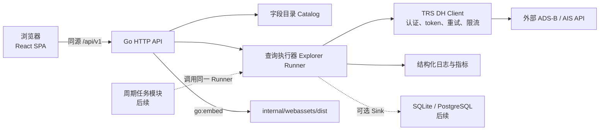

# 航迹数据 API 探索与采集工具技术方案及实施计划

- **状态：** 已补强，待复审
- **基准日期：** 2026 年 7 月 31 日
- **需求与接口依据：** [《飞机与船舶航迹数据服务 API 实测与高效接入指南》](飞机与船舶航迹数据服务API实测与高效接入指南-20260731.md)
- **交互依据：** [《飞机与船舶航迹数据 API 探索工具交互 Mock》](飞机与船舶航迹数据API探索工具交互Mock.html)
- **实现仓：** 新建独立仓库 `isxylands/dy-track-explorer`，本地路径 `/Users/liushen/Documents/githubDevs/dy-track-explorer`
- **本轮实施范围：** Go 后端、React 前端、真实只读查询、调用诊断、单体交付
- **后续扩展：** 周期采集、本地持久化、任务管理、运行记录、配置与监控

## 1. 结论

推荐新建独立运行仓库 `isxylands/dy-track-explorer`，采用 **Go 模块化单体 + React 单页应用**。`dy-inta` 继续只保存需求、调研、Mock、方案和执行记录，不承载运行代码。Go 负责上游认证、token 复用、请求校验、ADS-B/AIS 调用、自适应时间切片、去重、诊断和指标；React 负责 API 探索工作台及后续管理页面。生产构建将前端静态资源嵌入 Go 二进制，形成一个进程、一个端口、一个部署单元。

前端选用 `React + TypeScript + Vite + Ant Design + React Router + TanStack Query`。这套组合适合数据密集型工具，也能自然扩展任务、运行记录、存储、配置和监控页面。当前原型的深色视觉、三栏工作台和字段联动保留为定制业务组件，不改造成通用后台卡片页。

后端基于 Go 标准库 `net/http`，不引入 Gin、Fiber 或微服务框架。当前接口数量和中间件复杂度不需要额外 Web 框架；认证管理、上游访问、查询执行、字段目录和 HTTP API 按包隔离。后续调度与存储作为同一进程内的新模块接入，共用查询执行器，不复制采集逻辑。

首期不实现周期任务和业务数据持久化，但架构必须支持两种查询模式：

- `direct`：严格执行一次上游调用，用于看清实际请求、响应、字段和错误。
- `complete`：把当前查询时间窗切到单片不超过一页，按本次响应中的 `id` 去重，返回带 `completeness=best_effort` 的尽力结果。它用于规避普通翻页的确定性缺陷，也作为后续周期任务的执行内核，但不表示上游历史快照权威完整。

本方案风险等级为**标准**。首期只有外部只读调用，不写业务数据库。提供方当前仅暴露明文 HTTP，这是使用方已接受且无法在本项目内修复的外部限制；本方案不把它描述成安全链路，也不把改造提供方设为实施 Gate，只在客户端和部署侧避免扩大暴露面。未来启用本地存储后，数据留存、磁盘容量、备份和迁移升级为高风险项，在进入该阶段前执行文中最小 Gate。

## 2. 目标、成功标准与边界

### 2.1 首期目标

1. 把已确认的 HTML Mock 实现为可长期维护的真实 Web 应用。
2. 浏览器不接触上游用户名、密码和 token，由 Go 后端统一认证和调用。
3. 用户能在一个工作台内同时看到中文参数解释、英文字段、实际请求、原始响应、样本值和字段备注。
4. ADS-B 与 AIS 都能完成真实小范围查询，明确展示 HTTP 状态、业务 `code`、`requestid`、耗时、响应大小、分页信息和字段质量提示。
5. 尽力查询模式不使用普通 `pageNum++` 遍历，采用时间切片和本次结果集内的 `id` 去重，并显式说明上游历史可能补录或重整。
6. 工程结构允许后续增加任务、运行记录、本地数据、监控和设置页面，不重写首期查询链路和应用壳。

### 2.2 可判定成功标准

| 编号 | 成功标准 | 通过条件 |
| --- | --- | --- |
| S1 | 原型主链路实现 | ADS-B/AIS、参数编辑、请求预览、响应高亮、字段联查、筛选、复制和代码生成可用 |
| S2 | 真实上游闭环 | 使用受控小样本完成两类真实查询；前端展示内容与 Go 捕获的脱敏请求、上游 JSON 一致 |
| S3 | 应用层秘密收敛 | 浏览器网络响应、页面、日志、错误信息和 Git 中不出现用户名、原始密码或 token；不把该判定扩写成上游传输安全 |
| S4 | 错误语义正确 | HTTP 非 2xx、业务非 `200`、业务 `604`、超时、响应过大和 JSON 异常分别可判定；`604` 最多刷新并重放一次 |
| S5 | 尽力查询语义准确 | fake 上游构造 `totalPages > 1` 时自动二分；单秒仍超 1000 条时明确失败；结果按本次响应中的 `id` 去重；API 始终返回 `best_effort` 和结果指纹，页面对同参数重跑发生的变化给出不稳定警告 |
| S6 | 可扩展前端 | 新增一个测试路由和页面模块不需要修改探索页内部组件；导航、路由、权限占位和 API 客户端有固定入口 |
| S7 | 可交付运行 | 前后端测试通过；前端可嵌入 Go；单二进制或容器启动后健康检查、页面和 API 均可访问 |
| S8 | 可观测 | 每次调用有 `query_id`、结构化日志和基础指标；不记录敏感 header 或完整登录 URL |

### 2.3 本轮不做

- 不实现周期任务、任务持久化、业务数据落表和数据清理。这些不影响首期真实探索闭环，按第 8 节触发后续增量。
- 不开发自有用户账号、密码和权限系统。首期默认本机或受信内网使用；多人访问时接现有 OIDC/SSO。
- 不把该 API 解释为唯一事实源，不自动给出事件归因、航班运行结论或船舶真实穿越结论。
- 不把地图回放设为首屏主功能。空间展示仍是辅助视图，必须建立在字段、时间和点位密度已经看清的前提上。
- 不提前拆微服务，不引入消息队列、分布式调度、服务注册或 Kubernetes 专属逻辑。

## 3. 已确认事实与核心问题

### 3.1 已确认事实

| 类型 | 事实 | 对方案的影响 |
| --- | --- | --- |
| 仓库 | `dy-inta` 是文档工作区，没有 Go、Node、CI 或运行工程 | 运行代码落在独立 `dy-track-explorer` 仓；本仓只保留方案与执行证据 |
| 认证 | 登录使用时间戳与两次 MD5，业务请求使用 `TRSDH-Access-Token` | 凭据和 token 只能留在 Go 进程；需要 token 缓存与单次刷新重放 |
| 成功判定 | 未登录时可能 HTTP 200、业务 `code=604` | 后端和前端都不能只看 HTTP 状态 |
| 查询 | ADS-B/AIS 参数结构相近，对象字段分别为 `icao`、`mmsi` | 共享查询模型，数据集目录负责差异字段和端点映射 |
| 时间 | `endLoadTime` 实测表示结束入库时间；时间字段时区未说明 | 保留原始字符串；字段目录明确实测/待确认状态，不擅自转 UTC |
| 分页 | 单页上限 1000；历史分页总数和内容不稳定 | 尽力查询按时间切片，不使用普通翻页采全量，也不承诺权威完整 |
| 容量 | 未公布限流；当前建议单 worker | 首期并发上限默认为 1，可配置但不能由前端任意放大 |
| 数据质量 | 部分字段单位、来源和覆盖质量未知 | 字段目录和响应诊断必须呈现不确定性，不能在 UI 中补造字段 |
| 传输 | 提供方当前仅有明文 HTTP，使用方不能修改提供方 | 作为已接受外部限制记录；应用不宣称链路安全，部署不再经无必要的明文代理转发 |
| 历史可变性 | 同一历史窗口可能因后补或重整而变化 | `complete` 只能表示当次尽力结果；稳定采集依赖后续水位线、重叠回看和持久化核对 |
| 标识 | `id` 只在当前样本内确认唯一，跨任务长期稳定性未知 | 首期仅用于本次内存去重；长期唯一约束必须通过 M1 Gate |
| 原型 | 用户已确认“参数、请求、响应、字段对照同屏”的新版原型 | React 实现以该信息架构为验收基准，不回到多 Tab 或地图优先结构 |

### 3.2 核心问题

1. **调用链包含凭据和不透明业务错误。** 浏览器直连会泄露凭据，也无法集中处理 token、超时、重试和业务码。
2. **“看见 JSON”不足以理解 API。** 参数、字段、实际值和说明必须由稳定字段目录关联，不能散落在前端常量和后端结构体中各维护一份。
3. **直接调用与尽力采集的行为不同。** 探索时要保留真实单次响应；尽力查询需要切片、去重和记录执行摘要，但一次查询无法证明动态历史没有后补或重整。两条路径共享底层客户端，同时必须区分结果语义。
4. **后续页面会快速增加。** 单文件 HTML、全局状态和手写 DOM 更新无法承载任务、运行记录、存储和监控。
5. **本地持久化会改变运行风险。** SQLite 适合单机，但不适合网络文件系统和多写入实例；存储开关、留存和备份必须在进入存储阶段前确定。

## 4. 目标覆盖矩阵

| 核心问题/成功指标 | 依据 | 实施动作 | 验证 | 状态 |
| --- | --- | --- | --- | --- |
| 实现落点符合仓库职责 | `dy-inta` 明确不是运行源码仓 | 运行代码固定落在独立 `isxylands/dy-track-explorer`；本仓只保留方案与执行记录 | T0 核对远端、CODEOWNERS、CI 和制品写权限 | covered |
| 浏览器不得接触凭据 | 登录算法与 token 已实测 | Go `trsdh.Client` 读取环境变量并注入 token；前端只调用同源 `/api/v1` | 浏览器响应和日志敏感词扫描；负向测试 | covered |
| 不误称上游传输安全 | 提供方当前只支持明文 HTTP，且使用方已接受该外部限制 | 配置名显式标记 insecure；不记录登录 URL/token；默认只在回环或受控内网部署；有 HTTPS 时优先切换 | 配置测试、日志扫描、部署检查；不以 TLS 作为当前真实调用前提 | accepted limitation |
| 同屏看清 API | 新版 Mock 已确认 | React `ExplorerPage` 维持四区同屏；目录、请求和响应字段联动 | 桌面/窄屏截图与交互回归 | covered |
| ADS-B/AIS 真实调用 | 两个端点与字段已实测 | 数据集 allowlist + 统一查询模型 + 两类契约测试 | fake 契约测试和真实小样本 smoke | covered |
| HTTP 与业务码双重判断 | 业务 `604` 可出现在 HTTP 200 | 统一错误模型；`604` 只刷新重放一次 | 604→200、604→604、HTTP 503 用例 | covered |
| 避免普通翻页的确定性缺陷 | 普通分页出现重复和总数变化 | `complete` 模式按时间中点二分、相邻闭区间错开 1 秒、按本次响应 `id` 去重 | 超页、边界秒、重复 ID、单秒爆量用例 | covered |
| 不把动态历史误判为完整快照 | 同一历史窗口可能补录或重整 | 返回 `completeness=best_effort`、查询时点、切片计数、参数/结果指纹和警告；前端对同参数前后结果比较 | API/UI 语义断言；真实同窗结果变化时出现不稳定提示 | covered |
| 字段解释只有一个来源 | 原型和调研文档已有字段口径 | Go catalog 输出参数/返回字段定义；前端从 catalog 渲染 | catalog 快照与 UI 字段数量/状态校验 | covered |
| 前端能扩展多页面 | 后续明确有管理、配置、监控页面 | App Shell、路由、feature 目录、TanStack Query、生成 API 类型 | 增加测试路由不改 Explorer 内部；类型检查 | covered |
| 单体易部署 | 当前没有运行环境或基础设施 | 独立仓内固定 embed 包和构建顺序，单端口同源服务，提供容器镜像 | 无 `dist` 冷构建、健康检查、SPA fallback、前端变更后重新构建 | covered |
| 可排查调用失败 | 长期使用需要调试和监控 | `query_id`、`slog`、Prometheus 指标、脱敏执行摘要 | 日志字段、指标增量与错误路径测试 | covered |
| 后续周期采集复用首期能力 | 定时任务已明确为后续需求 | 手工和定时入口都调用 `explorer.Runner`；第 8 节定义任务模型 | 后续阶段同一查询契约测试复用 | covered |
| 本地数据可控落表 | 用户明确“按需”保存，但 `id` 长期稳定性未知 | 第 8 节定义 sink、SQLite 单机分支、`id` 稳定性与冲突 Gate、留存和迁移 Gate | 后续阶段跨窗样本、冲突 fixture、空库迁移、重跑幂等、备份恢复 | M1 Gate |

矩阵没有未处理的首期 `gap`。明文 HTTP 是用户已接受的提供方限制，不视为应用已解决的安全能力；长期幂等仍是明确的 M1 Gate。首期按默认单机、受信网络边界执行；多人公网访问和多实例写入不在默认分支中。

## 5. 推荐架构

### 5.1 运行结构



Go 是唯一信任边界。前端不能提交上游 URL、登录参数、header 名和值，也不能选择任意目标地址。`dataset=adsb|ais` 由后端映射到固定端点，避免工具演变成通用 HTTP 代理或 SSRF 入口。

运行代码、测试、CI 和制品只存在于独立 `dy-track-explorer` 仓；本方案文档继续留在 `dy-inta`。两仓不复制秘密或生成物，实施仓 README 反向链接本方案和 API 调研文档。

### 5.2 技术选型

基线版本以 2026 年 7 月 31 日的官方稳定版本为准；实施时把准确 patch 版本写入 `go.mod`、`package-lock.json` 和构建镜像，不使用浮动 `latest`。

| 层 | 选择 | 基线 | 选择理由 |
| --- | --- | --- | --- |
| 后端语言 | Go | 1.26.x | 标准库覆盖 HTTP、JSON、嵌入资源、并发与测试；适合长期单进程采集服务 |
| HTTP | `net/http`、`http.ServeMux` | Go 标准库 | 路由规模小，减少框架依赖；中间件自行保持薄层 |
| 前端 | React + TypeScript | React 19.2 | 组件和状态边界适合多页面数据工具；生态覆盖路由、表格、查询和测试 |
| 构建 | Vite | 8.1 | 纯 SPA 无需 SSR；开发反馈快，生产产物可直接嵌入 Go |
| Node | Node.js | 24 LTS | 当前 LTS；满足 Vite 8 要求，避免使用 Current 或 EOL 版本 |
| UI | Ant Design | 6.5 | 企业应用表单、表格、布局、反馈和主题能力完整；保留定制工作台样式 |
| 路由 | React Router | 8.3 | 明确管理 Explorer、Tasks、Runs、Storage、Monitoring、Settings 路由 |
| 服务端状态 | TanStack Query | 当前稳定版 | 处理请求、缓存、失效、轮询和后台刷新；后续监控页可直接复用 |
| JSON 展示 | CodeMirror 6 | 当前稳定版 | 请求/响应高亮、折叠、搜索和字段定位；比 Monaco 更轻 |
| 前端测试 | Vitest + Testing Library + Playwright | 与 Vite 锁定 | 分别覆盖组件、交互与真实浏览器主链路 |
| 日志 | `log/slog` JSON | Go 标准库 | 输出结构化字段，无需引入日志框架 |
| 指标 | Prometheus client | 实施时锁定 | 暴露请求、业务错误、token 刷新、切片和延迟指标 |
| API 契约 | OpenAPI 3.1 + `openapi-typescript` | 实施时锁定 | 后端契约是唯一来源，生成前端类型，降低跨端漂移 |

官方版本与能力依据：

- [Go Release History](https://go.dev/doc/devel/release)
- [React Versions](https://react.dev/versions)
- [Vite Releases](https://vite.dev/releases) 与 [Vite Guide](https://vite.dev/guide/)
- [Node.js Releases](https://nodejs.org/en/about/previous-releases)
- [Ant Design React](https://ant.design/docs/react/introduce/)
- [React Router](https://reactrouter.com/start/declarative/installation)
- [TanStack Query](https://tanstack.com/query/latest/docs/framework/react/overview)

### 5.3 未选方案

| 方案 | 结论 | 原因 |
| --- | --- | --- |
| 继续维护单文件 HTML/原生 JavaScript | 不选 | 首期能工作，但路由、类型、测试、状态共享和多页面扩展成本会迅速失控 |
| Next.js/React Server Components | 不选 | 工具没有 SEO 和 SSR 需求；引入第二套服务端模型会增加部署、安全更新和调试成本 |
| Ant Design Pro/Umi 整套脚手架 | 不选 | 页面壳和权限约束过强，容易把已确认工作台改成通用后台；只使用 Ant Design 组件和主题 |
| Vue + Element Plus | 可行但不推荐 | 能满足功能，但没有证据表明可比 React 方案减少本项目风险；React 的服务端状态和数据工具生态更匹配后续页面 |
| Gin/Fiber | 暂不选 | 当前路由和中间件少，标准库足够；增加框架不能改善上游协议、切片或安全问题 |
| 微服务 | 不选 | 当前只有一个外部数据源和单一团队边界；拆分会增加部署、认证和调用追踪成本 |
| DuckDB 作为管理库 | 不选 | 更适合分析型扫描，不适合任务配置、运行状态和并发更新；后续可作为离线分析/导出工具 |

### 5.4 后端模块边界

| 包 | 首期职责 | 后续关系 |
| --- | --- | --- |
| `internal/config` | 读取、校验环境变量；输出不含秘密的配置摘要 | 增加非敏感运行参数动态配置时继续复用 |
| `internal/catalog` | ADS-B/AIS 端点、参数、返回字段、类型、单位和确认状态 | 配置页只能维护非安全字段字典；端点仍由代码/受控配置管理 |
| `internal/trsdh` | 登录、token 缓存、请求发送、gzip、响应限长、错误解析 | 所有手工和周期查询共用 |
| `internal/explorer` | `direct`/`complete` 执行、切片、去重、诊断和脱敏预览 | 后续任务调度调用同一 `Runner` |
| `internal/httpapi` | `/api/v1` DTO、校验、错误映射、静态资源与 SPA fallback | 新页面按业务模块增加 handler，不把逻辑写入 handler |
| `internal/observability` | `query_id`、结构化日志、指标、健康检查 | 后续增加任务与存储指标 |
| `web/` | React 应用 | 通过 feature 目录扩展页面 |

首期不创建空的 `jobs`、`storage` 包。第 8 节启动后再增加真实实现，避免用空接口制造虚假扩展性。

### 5.5 上游调用链

```text
HTTP handler
  → 请求 DTO 校验
  → dataset allowlist 映射
  → Explorer Runner
      → direct：调用一个时间片
      → complete：单页探测 → 超页二分 → id 去重
  → TRSDH Client
      → token 未到刷新点：复用
      → token 缺失/到期：互斥登录
      → 业务 604：清空 token，刷新一次并重放
      → 网络/502/503/504：最多 3 次带抖动退避
  → 捕获脱敏请求、原始 JSON、执行摘要和诊断
```

关键约束：

- 默认 `max_concurrent_queries=1`，并发上限只能由服务端配置调整。
- 连接超时 5 秒，单请求总超时 40 秒；尽力查询另设任务级 deadline。
- 响应使用 `io.LimitReader`，默认上限 20 MiB；超过上限明确返回 `UPSTREAM_RESPONSE_TOO_LARGE`。
- Go 默认 transport 自动处理 gzip，不手工设置 `Accept-Encoding`。
- token 提前在 100 分钟刷新；刷新采用互斥锁和二次检查，防止并发登录。
- 日志只记录 endpoint 枚举、参数摘要、状态、耗时和 request ID，不记录 token、密码摘要或完整登录 URL。
- 当前上游 `http://` 由 `TRSDH_ALLOW_INSECURE_HTTP=true` 显式启用；未设置时客户端拒绝明文地址。该开关只暴露已接受限制，不能把 HTTP 变安全，也不替代网络侧访问控制。

### 5.6 前端应用结构

```text
web/src/
├── app/
│   ├── App.tsx
│   ├── router.tsx
│   ├── providers.tsx
│   ├── navigation.ts
│   └── layout/AppShell.tsx
├── features/
│   └── explorer/
│       ├── api/
│       ├── components/
│       ├── hooks/
│       ├── model/
│       └── pages/ExplorerPage.tsx
├── shared/
│   ├── api/generated.ts
│   ├── ui/
│   ├── lib/
│   └── styles/
└── test/
```

前端状态分工：

- TanStack Query 管理 catalog、查询结果、健康状态和后续监控轮询。
- Ant Design Form 管理请求参数和校验。
- 当前选中字段、JSON 搜索词、面板尺寸等短生命周期状态保留在 Explorer feature 内。
- 不引入 Redux/Zustand。只有出现跨路由、与服务端无关且复杂的共享状态时再评估。
- 请求与响应 JSON 使用 CodeMirror 只读视图；字段点击通过 JSON path decoration 定位和高亮。
- 页面路由从首期开始使用 `/explorer`。后续按实现顺序增加 `/tasks`、`/runs`、`/storage`、`/monitoring`、`/settings`，不提前放置空白菜单。

视觉实现以现有 Mock 为基准：桌面保持参数、请求/响应、字段对照三列；窄屏改为顺序区块；正文和输入值不低于 14px；历史轨迹默认收起。Ant Design 通过 `ConfigProvider` 主题 token 与局部 CSS 实现，不用默认亮色后台外观覆盖原型。

### 5.7 HTTP API 契约

#### `GET /api/v1/catalog`

返回可用数据集、固定端点标识、请求参数、返回字段、中文说明、数据类型、单位和确认状态。前端不内置第二份字段字典。

确认状态使用有限枚举：

- `documented`：文档明确。
- `observed`：实测确认，例如 `endLoadTime`。
- `unknown`：单位、时区、来源或生成逻辑待确认。
- `unavailable`：接口不返回。

#### `POST /api/v1/explorer/queries`

请求：

```json
{
  "dataset": "adsb",
  "mode": "direct",
  "parameters": {
    "startPubTime": "20260729053000",
    "endPubTime": "20260729060000",
    "minLon": 34.0,
    "minLat": 29.0,
    "maxLon": 40.0,
    "maxLat": 34.0,
    "pageNum": 0,
    "pageSize": 1000,
    "sorts": "loadTime"
  }
}
```

服务端拒绝未知顶层字段、未知数据集、任意 URL、`pageSize > 1000`、非法时间格式、反向时间窗和越界坐标。`direct` 允许用户查看分页行为；`complete` 强制从 `pageNum=0` 开始并自行切片。

响应：

```json
{
  "queryId": "01J...",
  "request": {
    "method": "POST",
    "endpoint": "/base/osint/aircraft/adsb/list",
    "headers": {
      "Content-Type": "application/json",
      "TRSDH-Access-Token": "***"
    },
    "body": {}
  },
  "transport": {
    "httpStatus": 200,
    "durationMs": 286,
    "responseBytes": 6963,
    "retryCount": 0,
    "tokenRefreshed": false
  },
  "upstream": {
    "businessCode": "200",
    "message": "",
    "requestId": "...",
    "body": {}
  },
  "analysis": {
    "queriedAt": "2026-07-31T15:30:12+08:00",
    "completeness": "best_effort",
    "queryFingerprint": "sha256:...",
    "resultFingerprint": "sha256:...",
    "sliceCount": 1,
    "recordsReceived": 22,
    "uniqueIds": 22,
    "duplicateCount": 0,
    "slices": [
      {
        "start": "20260729053000",
        "end": "20260729060000",
        "recordsReceived": 22
      }
    ],
    "warnings": [
      {
        "code": "UPSTREAM_MUTABLE_HISTORY",
        "message": "上游历史可能补录或重整，本结果不是权威完整快照"
      }
    ]
  }
}
```

`upstream.body` 使用 `json.RawMessage` 保留上游 JSON 结构。Go 只剔除敏感 header，不改写字段值。`queryFingerprint` 由规范化后的数据集、时间窗、空间范围和查询参数生成；`resultFingerprint` 由排序后的本次唯一 ID 集生成，不包含秘密。前端只在当前会话内保留同一 `queryFingerprint` 的上一结果并比较：指纹变化时增加 `UPSTREAM_RESULT_CHANGED` 提示；页面刷新后没有基线则只显示固有的历史可变警告，不伪造“稳定”。

`complete` 会返回当前各切片合并后的 `content` 和切片摘要，但 `completeness` 固定为 `best_effort`；即使同窗重跑没有变化，也不能升级为权威完整快照。为防止浏览器内存失控，首期限制尽力查询最大唯一记录数，默认 20,000，超过时提示缩小时间/空间范围。后续大批量采集不经浏览器返回全量，直接进入可选持久化 sink。

#### 其他端点

| 端点 | 用途 |
| --- | --- |
| `GET /healthz` | 进程存活，不调用外部 API |
| `GET /readyz` | 配置已加载、前端资源可用；不把外部 API 暂时失败等同于进程未就绪 |
| `GET /api/v1/system/upstream-status` | 返回最近一次调用状态和脱敏 token 状态，不返回凭据 |
| `GET /metrics` | Prometheus 指标；部署层限制访问范围 |

错误统一返回 `code`、`message`、`queryId` 和可选 `details`。前端按错误码显示参数、认证、上游、超时、响应过大和内部错误，不解析后端英文错误字符串。

### 5.8 配置与安全边界

首期配置：

```text
TRSDH_BASE_URL
TRSDH_USERNAME
TRSDH_PASSWORD
TRSDH_ALLOW_INSECURE_HTTP=true
LISTEN_ADDR=127.0.0.1:8080
REQUEST_TIMEOUT=40s
COMPLETE_QUERY_TIMEOUT=5m
MAX_RESPONSE_BYTES=20971520
MAX_COMPLETE_RECORDS=20000
MAX_CONCURRENT_QUERIES=1
LOG_LEVEL=info
```

- 用户名和密码只从环境变量或 secret mount 读取，不进入配置页面、SQLite、前端 bundle 或诊断导出。
- `TRSDH_BASE_URL` 由部署者配置，浏览器不能修改。
- `TRSDH_ALLOW_INSECURE_HTTP` 默认 `false`；当前提供方仅支持 HTTP 时由部署者显式设为 `true`。服务启动日志只记录“已启用明文上游”的布尔状态，不记录完整登录 URL、凭据摘要或 token。
- API 只接受预定义数据集和参数；所有响应设置 `X-Content-Type-Options: nosniff`、合理 CSP 和同源策略。
- 首期默认监听回环地址。容器部署显式设置 `LISTEN_ADDR=:8080`，并由反向代理限制来源。
- 不为当前限制新增自建 TLS 隧道、VPN 或提供方改造任务；若部署环境已有受控专线/VPN，应优先使用，但不把它伪装成应用层 TLS。提供方未来开放 HTTPS 后，切换到证书校验通过的 HTTPS 并关闭 insecure 开关。
- 需要多人访问时，在部署前接现有 OIDC/SSO 或反向代理认证。不得自行实现弱口令登录页。
- 原始响应可能包含敏感航迹信息。诊断导出默认脱敏并需要用户主动操作；不得自动上传到第三方服务。

## 6. 实现仓归属、目录与交付边界

### 6.1 唯一实现落点

| 项目 | 固定选择 | T0 通过条件 |
| --- | --- | --- |
| 方案真源 | 当前仓 `isxylands/dy-inta` | 本文档、API 调研和 Mock 继续留在本仓，不增加运行依赖 |
| 实现仓 | `isxylands/dy-track-explorer` | 本地路径为 `/Users/liushen/Documents/githubDevs/dy-track-explorer`；远端可拉取、提交和创建 PR |
| 代码所有权 | DYINT 工程实施团队 | 实现仓 `CODEOWNERS` 和 README 写明维护团队与评审入口；具体账号由仓库管理员配置 |
| CI | 实现仓 `.github/workflows/verify.yml` | PR 和 `main` 执行同一个 `make verify`，不得依赖开发机残留产物 |
| 二进制 | 实现仓 GitHub Release artifact | tag 构建保存 Linux `amd64/arm64` 二进制、SHA-256 和版本信息 |
| 镜像 | `ghcr.io/isxylands/dy-track-explorer:<semver>-<git-sha>` | T0 验证包仓写权限；T3 才实际构建和发布测试标签 |

2026 年 7 月 31 日只读检查结果为：本地目标目录和 GitHub 远端尚不存在。该事实不改变独立仓选型；T0 的第一项实际动作是创建本地仓并准备远端。创建远端仓、配置团队和包权限属于外部状态变更，执行器只在当轮执行请求明确覆盖这些动作时实施，否则停在 T0 请求授权。

没有远端仓或 GHCR 写权限时，T0 状态保持 `blocked`，不把代码临时放回 `dy-inta`，也不静默改用其他现有运行仓。

### 6.2 实现仓目录

```text
dy-track-explorer/
├── .github/workflows/verify.yml
├── CODEOWNERS
├── api/openapi.yaml
├── cmd/server/main.go
├── internal/
│   ├── catalog/
│   ├── config/
│   ├── explorer/
│   ├── httpapi/
│   ├── observability/
│   ├── trsdh/
│   └── webassets/
│       ├── embed.go
│       └── dist/
├── testdata/upstream/
├── web/
│   ├── package.json
│   ├── package-lock.json
│   ├── vite.config.ts
│   └── src/
├── Dockerfile
├── Makefile
├── go.mod
├── go.sum
└── README.md
```

`web/vite.config.ts` 把生产产物写入 `../internal/webassets/dist`；`internal/webassets/embed.go` 只使用 `//go:embed dist/*`，不跨目录引用。构建入口固定为“清理旧 `dist` → `npm ci` → 前端构建 → Go test/build”。实现仓不复制真实凭据、真实响应或 `dy-inta` 文档；README 使用链接指向本方案、API 调研和 HTML Mock。

### 6.3 两仓提交与执行记录

- 实现代码、测试、CI 和制品配置只提交到 `dy-track-explorer`。
- 本方案的状态、阶段证据和残留风险只提交到 `dy-inta`，不把构建产物写入文档仓。
- 每完成一个阶段，执行记录引用实现仓 commit 和 CI run；两仓分别提交，不做跨仓原子提交或自定义状态协议。

## 7. 关键未知项、已接受约束与最小 Gate

只有表中明确标记为 Gate 的条目才阻断对应阶段。提供方明文 HTTP 已被用户作为外部限制接受，本方案记录并收敛暴露面，但不重新把它升级为要求提供方整改的 Gate。

| 类型 | 未知项或约束 | 为什么改变方案 | 默认分支 | 验证时点与 Pass | Fail 分支 |
| --- | --- | --- | --- | --- | --- |
| T0 Gate | 实现仓与制品权限 | 决定代码是否能按唯一落点持续交付 | `isxylands/dy-track-explorer` + GitHub Actions + GHCR | T0 确认远端、团队、CI 和包权限均可用 | T0 停止，申请权限；不得落回 `dy-inta` |
| 部署 Gate | 工具是否只在本机/受信内网使用 | 决定是否需要用户认证 | 回环地址或现有反向代理 | 部署前确认网络边界；只有受信用户可达 | 接现有 OIDC/SSO 后再开放，不自建密码体系 |
| 已接受约束 | 提供方只有明文 HTTP | 链路无法声明机密性，应用无法修复提供方 | 显式 insecure 开关、单跳受控出口、应用与代理日志脱敏 | T1/T4 确认配置和日志行为，不要求提供方改造 | 未显式开关则拒绝启动真实调用；不新增自建隧道项目 |
| M1 Gate | 后续是否单实例且数据库位于本地文件系统 | 决定 SQLite 是否适用 | 单实例 SQLite WAL | M1 前确认一个写进程、本地磁盘、无需 HA | PostgreSQL；不得把 WAL 数据库放 NFS |
| M1 Gate | 数据许可和留存期限 | 决定能否保存 Raw、保存多久 | 首期不持久化业务数据 | M1 前取得允许落盘的范围、目录权限和期限 | 只保留执行摘要，Raw/Normalized sink 禁用 |
| M1 Gate | `id` 是否跨日期、跨重跑窗口稳定 | 决定能否作为长期唯一键 | 首期仅做单次结果集内存去重 | ADS-B/AIS 分别统计同 ID 的对象、时间、坐标与内容变化，并通过冲突 fixture | 不设 `UNIQUE(dataset, source_id)`；使用追加版本和冲突记录，待验证复合键 |
| M1 Gate | 上游可接受并发和频率 | 决定调度吞吐 | 1 worker、低频 | M1 试运行期间 P95、错误率和服务方反馈均稳定 | 保持单 worker、扩大时间窗或降低任务频率 |
| M1 Gate | 时间字段时区 | 决定标准化时间列 | 原始字符串 + UTC 为空 | M1 前取得服务方说明并用样本核对 | 继续保留原值，不生成伪 UTC |

SQLite WAL 只用于单机本地文件系统。官方文档明确指出 WAL 依赖同机共享内存，不适合网络文件系统：[SQLite Write-Ahead Logging](https://www.sqlite.org/wal.html)。

## 8. 后续扩展设计

### 8.1 周期任务

进入 M1 后增加 `internal/jobs`，任务配置包含：

- 名称、数据集、Cron 表达式、明确时区、启停状态。
- 观测范围、入库水位线、重叠分钟数、回看周期。
- 执行模式固定为 `complete`，但结果语义仍为 `best_effort`；可恢复采集依赖水位线、重叠回看和持久化核对。
- 保存策略：`none`、`raw`、`normalized`、`raw_and_normalized`。
- 单次 timeout、最大记录数、失败后重试次数。

手工查询和周期任务都调用 `explorer.Runner`。调度器只负责触发、互斥、超时和状态记录，不自行实现 token、切片或去重。单个任务默认不并发重入；上次仍在运行时，本次标记为 `skipped_overlap`。进程停止期间默认不补跑全部错过周期，管理员可从运行记录手工补采指定时间窗。

### 8.2 本地存储

单机默认使用 SQLite，启用 WAL、`busy_timeout` 和单写入队列；数据库文件默认位于实现仓 `var/` 或部署挂载目录，不写进 Git。数据访问基于 `database/sql` 和明确 repository，不使用隐藏 SQL 的重量 ORM。

建议最小表：

| 表 | 关键字段 | 作用 |
| --- | --- | --- |
| `collection_task` | `id`、`name`、`dataset`、`schedule`、`timezone`、`query_json`、`persist_mode`、`enabled` | 周期任务配置 |
| `task_run` | `id`、`task_id`、`trigger`、`status`、起止时间、请求快照、计数、错误摘要 | 手工/周期运行记录 |
| `query_slice` | `run_id`、时间片、状态、HTTP/业务码、`requestid`、记录数、SHA-256 | 切片审计与失败恢复 |
| `track_observation` | 内部主键、`dataset`、非唯一 `source_id`、`object_key`、经纬度、原始观测/入库时间、标准时间可空、`content_hash`、`attributes_json` | ADS-B/AIS 共用归一化观测；M1 Gate 前不静默覆盖 |
| `raw_response` | `run_id`、`slice_id`、`sha256`、压缩 JSON、字节数 | 可选 Raw 留存 |
| `task_watermark` | `task_id`、最大成功 `loadTime`、更新时间 | 增量水位线 |
| `observation_conflict` | `dataset`、`source_id`、关联观测、冲突类型、发现时间、状态 | 记录同 ID 的身份/时间/坐标冲突，禁止静默丢数据 |

M1 先跨日期和重跑窗口验证 `id` 稳定性。只有 ADS-B/AIS 分别证明同一 `id` 的身份与关键观测语义稳定后，才能增加 `UNIQUE(dataset, source_id)`；同 ID 同内容按 `content_hash` 判重，同 ID 内容更新保留版本，同 ID 关键身份冲突写入 `observation_conflict` 并阻断覆盖。若证据不足，使用追加版本和经验证的复合业务键，不能静默覆盖。未知字段保留在 `attributes_json`，公共检索字段使用独立列。时区未确认前，原始时间字符串为必存字段，UTC 列保持 `NULL`。

当出现多个应用实例、多个写入者、数据库位于网络文件系统、需要在线 HA 或数据量超过单机维护能力时，新增 PostgreSQL repository 和迁移，不通过兼容层强行让一套 SQL 同时适配两种方言。

### 8.3 管理与监控页面

| 路由 | 页面 | 首次实现内容 |
| --- | --- | --- |
| `/explorer` | API 探索 | 首期交付 |
| `/tasks` | 采集任务 | 列表、创建/编辑、启停、立即执行、下次运行时间 |
| `/runs` | 运行记录 | 状态、触发方式、时间片、计数、错误、重试、请求摘要 |
| `/storage` | 本地数据 | 数据集、时间范围、对象检索、占用空间、导出和留存策略 |
| `/monitoring` | 运行监控 | 请求量、成功率、P95、业务码、token 刷新、切片次数、入库延迟 |
| `/settings` | 设置 | 只管理非敏感参数和字段目录备注；秘密值只显示“已配置/未配置” |

导航和路由由 `app/navigation.ts` 与 `app/router.tsx` 统一维护。每个页面拥有自己的 `features/<name>` 目录、API hooks 和组件，不能把所有页面状态放入 `App.tsx`。

## 9. 一次性实施计划

### T0：建立工程骨架和 API 契约

**目标：** 建立可编译、可测试、可扩展的 Go/React 工程，冻结前后端契约和配置边界。

**修改范围：** 独立实现仓根目录的 `go.mod`、`cmd/server`、`internal/config`、`internal/catalog`、`internal/httpapi` 基础层、`api/openapi.yaml`、`web/`、`Makefile`、README、`.github/workflows/verify.yml` 和 `CODEOWNERS`。

**步骤：**

1. 在当轮授权范围内创建并准备唯一目标仓 `isxylands/dy-track-explorer`：本地路径、远端、维护团队、PR 权限、GitHub Actions 和 GHCR 写权限缺一项则停止 T0。
2. 使用 Go 1.26.x 初始化模块；建立 `main → config → httpapi` 最小启动链和优雅停机。
3. 使用 Node 24 LTS、React/TypeScript/Vite 初始化 `web/`，锁定准确依赖版本。
4. 建立 App Shell、`/explorer` 路由、全局错误边界、Ant Design 深色主题和 TanStack Query provider。
5. 编写 OpenAPI 契约，生成前端类型；加入生成后无 diff 的校验命令。
6. 实现 catalog 数据结构和 ADS-B/AIS 字段目录，包含 `documented/observed/unknown/unavailable` 状态。
7. 建立 `httptest` fake upstream 和脱敏 JSON fixture；fixture 不含真实目标或敏感凭据。
8. 在 README 和 `CODEOWNERS` 固化维护边界；CI 入口固定为 `make verify`，不发布首期空制品。

**验证：**

```bash
cd /Users/liushen/Documents/githubDevs/dy-track-explorer
go test ./...
go vet ./...
cd web
npm ci
npm run typecheck
npm run build
```

通过条件：实现仓、维护者、CI 与 GHCR 权限明确；Go 服务可启动；`/healthz`、`/api/v1/catalog` 返回正确；React 空壳可加载；生成类型与 OpenAPI 一致。失败时不进入上游客户端实现。

**失败与回滚：** 只回退独立实现仓的 T0 提交，不影响 `dy-inta` 文档和 Mock。仓库或制品权限不足时停止并申请权限，不落回本仓或其他未选仓。

### T1：实现上游客户端和查询执行器

**目标：** 关闭应用层秘密、业务错误、真实请求预览和尽力查询语义问题。

**修改范围：** `internal/trsdh`、`internal/explorer`、`internal/httpapi` 查询 handler、fake upstream fixture 与单元/契约测试。

**步骤：**

1. 实现登录摘要、token 缓存、100 分钟主动刷新和并发二次检查；配置为 HTTP 且未显式启用 `TRSDH_ALLOW_INSECURE_HTTP` 时拒绝真实调用。
2. 使用固定数据集端点映射构造请求；校验所有时间、空间、分页和排序参数。
3. 实现 HTTP/业务码双重错误模型；`604` 只刷新重放一次；网络和 502/503/504 最多重试 3 次。
4. 实现响应限长、JSON 解析、`requestid`、字节数和耗时采集。
5. 实现 `direct` 模式，并生成 token 掩码后的实际请求预览。
6. 实现 `complete` 模式：单页探测、时间中点二分、相邻片段加 1 秒、本次响应 `id` 去重、最大记录数和任务 deadline。
7. 所有 `complete` 响应固定返回 `queriedAt`、`completeness=best_effort`、规范化参数指纹、排序后唯一 ID 集结果指纹、每片范围/计数和 `UPSTREAM_MUTABLE_HISTORY` 警告，不依据一次成功调用升级完整性等级。
8. 为敏感日志、insecure 开关、未知 endpoint、参数边界、604、超时、响应过大、畸形 JSON、超页和重复 ID 建立测试。

**验证：**

```bash
cd /Users/liushen/Documents/githubDevs/dy-track-explorer
go test -race ./...
go vet ./...
```

通过条件：覆盖矩阵 S3、S4、S5 的 fake 场景全部可判定；明文地址在未启用开关时 fail closed；race 检查不报告 token 或并发问题。失败时回退 T1，不影响 T0 静态页面和 catalog。

### T2：实现探索工作台

**目标：** 把已确认 Mock 转成真实 React 页面，并接入 Go API。

**修改范围：** `web/src/features/explorer`、共享 CodeMirror/表格/复制组件、组件测试和 Playwright 用例。

**步骤：**

1. 实现 ADS-B/AIS 切换、参数表单、必填与边界校验，字段定义来自 catalog。
2. 实现实际 method、endpoint、脱敏 header 和请求 body 预览。
3. 实现 HTTP/业务摘要、原始 JSON 高亮、折叠、搜索、复制和错误详情。
4. 实现字段表：英文字段、中文含义、实际值、类型、质量备注同屏；字段与 JSON 双向定位。
5. 实现 Python、Go、cURL 代码生成，只包含 token 占位符。
6. `direct` 为默认；`complete` 在页面标为“尽力查询”，放在高级执行选项，始终显示 `best_effort`、查询时点、切片数、去重数、历史可变警告和结果限制。同一浏览器会话对同一参数指纹再次查询时比较结果指纹，变化则显示 `UPSTREAM_RESULT_CHANGED`，没有上次基线时不显示“稳定”。
7. 保留历史轨迹辅助区的布局入口，但首期不把合成图升级为真实地图功能。
8. 完成桌面和窄屏响应式实现，不依赖多层 Tab。

**验证：**

```bash
cd /Users/liushen/Documents/githubDevs/dy-track-explorer/web
npm run lint
npm run typecheck
npm test -- --run
npm run build
npm run e2e
```

Playwright 至少覆盖：ADS-B 查询、AIS 查询、`endLoadTime`、字段联动、业务 604、参数错误、空结果、超页尽力查询、`best_effort` 警告和窄屏无横向溢出。通过条件是功能行为与 Mock 一致，页面没有“权威完整”“保证不漏”等文案，且真实 API 内容替换 Mock 样本后布局不破坏。

**失败与回滚：** 前端通过 OpenAPI 契约与后端隔离；可回退 T2 并保留 T1 API。不得为绕过前端问题修改已冻结的上游语义。

### T3：可观测、打包和运行加固

**目标：** 形成可长期运行、可诊断、可部署的单体交付物。

**修改范围：** `internal/observability`、HTTP 中间件、静态资源嵌入、Dockerfile、Makefile、CI 和运行文档。

**步骤：**

1. 为每次请求生成 `query_id`；使用 `slog` 输出 dataset、mode、状态、业务码、耗时、字节数、重试和切片摘要。
2. 增加请求数、成功/失败、HTTP/业务码、耗时直方图、token 刷新、重试、切片和去重指标。
3. 实现 `/healthz`、`/readyz`、`/metrics`，并验证外部 API 失败不会错误触发进程重启。
4. `web/vite.config.ts` 把产物固定输出到 `../internal/webassets/dist`；`internal/webassets/embed.go` 使用 `//go:embed dist/*`，Go 提供静态文件、缓存策略和 SPA fallback。
5. 编写多阶段 Dockerfile；运行镜像不包含 Node、源码、凭据或测试数据。
6. `make verify` 先删除旧 `internal/webassets/dist`，执行 `npm ci` 和前端构建，再执行 Go 静态检查、测试和 build；CI 从干净 checkout 执行同一入口。
7. 编写启动、配置、日志、指标、升级和故障排查说明。

**验证：**

```bash
cd /Users/liushen/Documents/githubDevs/dy-track-explorer
make verify
docker build -t dy-track-explorer:local .
docker run --rm -p 127.0.0.1:8080:8080 \
  -e LISTEN_ADDR=:8080 \
  --env-file <本机受控环境文件> \
  dy-track-explorer:local
```

通过条件：从没有 `dist` 的干净 checkout 完成构建，冷启动后页面、API 和健康检查可用；修改一个前端版本标记后重新构建，单二进制展示新标记而非旧资源；日志无秘密；指标随成功和失败请求变化；停止信号能在 deadline 内结束。缺少 Docker 时，开发机执行原生验证，镜像 build 放到受信 CI，不临时安装基础设施冒充通过。

**失败与回滚：** 保留原生单二进制运行路径；容器或 embed 问题回退 T3，不回退已通过的 API 与前端业务实现。

### T4：真实小样本验收与收口

**目标：** 证明实现能在当前外部 API 上完成受控只读调用，并校准文档与默认值。

**修改范围：** 只允许修复验收发现的缺陷、更新实现仓 README 和本计划执行记录；不扩大到周期任务或落库。

**步骤：**

1. 从本机 secret 环境读取凭据，在已显式启用 insecure 开关且访问范围受控的环境中，分别执行一个短时间、小范围 ADS-B 和 AIS `direct` 查询。
2. 使用一个已知可能超页的 fake 场景验证 `complete`；真实 API 只对一个受控窗口执行两次小规模 `complete`，两次间隔 5 分钟，不做压力测试。
3. 比较两次真实查询的总数、ID 集和 `resultFingerprint`：有变化时测试证据与 UI 必须显示 `UPSTREAM_RESULT_CHANGED`；无变化时仍保持 `completeness=best_effort`，不能据此宣称历史稳定。
4. 核对请求 body、业务 `code`、`requestid`、记录数、字段值、`endLoadTime`、响应字节数和日志脱敏；脱敏证据只记录 scheme/host/port，不记录登录 query 或 token。
5. 用浏览器复走原型主链路，检查 1536×960 和 390×844。
6. 停服务冷启动再执行一次，证明实现不依赖热 token、热缓存或前端旧状态。
7. 更新两仓执行记录、残留风险和后续 M1 入口。

**验证：** 真实查询只做只读、低频、小范围调用。通过条件是 ADS-B/AIS 均返回可解释结果；直接模式与上游响应一致；尽力模式 fake 契约全部通过；同窗实测无论是否变化都保持 `best_effort`，变化时额外告警；浏览器与日志不出现秘密。任何异常先停止扩大请求范围，按 `query_id` 和 fake 契约定位，不用重复真实调用碰运气。

**失败与回滚：** 外部 API 暂时不可用时保留 fake 契约结果，但 T4 标记未完成，不能把系统宣称为真实闭环。代码回退到最近通过的阶段；外部接口不产生写入，无数据回滚。

## 10. 验证矩阵

| 验证项 | 环境/执行器 | 命令或操作 | 样本 | 预期 | 失败判定与证据 |
| --- | --- | --- | --- | --- | --- |
| Go 静态与并发 | 开发机 | `go vet ./...`、`go test -race ./...` | fake upstream 全场景 | 无静态/race 错误 | 命令输出和失败用例名 |
| 前端类型与单测 | 开发机 Node 24 | `npm ci && npm run lint && npm run typecheck && npm test -- --run` | catalog、参数、错误、字段联动 | 全绿 | 测试报告 |
| 实现仓与制品权限 | GitHub/实现仓 | 远端、CODEOWNERS、Actions、GHCR 权限检查 | `isxylands/dy-track-explorer` | 唯一落点可提交、可评审、可运行 CI、可写包仓 | 任一权限缺失则 T0 停止 |
| 契约一致性 | 开发机 | OpenAPI 生成后 `git diff --exit-code` | `openapi.yaml` | 生成类型无漂移 | diff 内容 |
| 认证与 604 | Go `httptest` | 定向单测 | 604→200、604→604、并发首调 | 只刷新一次；并发不重复登录 | fake 调用次数、race 输出 |
| 明文上游显式启用 | Go `httptest`/受控环境 | 配置和启动测试 | HTTP URL + 开关 false/true | false 拒绝真实调用；true 可调用但状态明确标记 insecure | 配置测试和脱敏启动日志 |
| 尽力查询 | Go `httptest` | 定向单测 | 0 页、1 页、2 页、边界秒、重复 ID、单秒爆量 | 切片和终止规则正确；始终为 `best_effort` | slice trace、unique count、语义断言 |
| 敏感信息 | 开发机静态/运行扫描 | `rg` + 捕获日志/响应 | 用户名键、密码、token | 只允许配置键和掩码，不出现值 | 命中位置；发现值立即阻断 |
| 页面主链路 | Playwright 浏览器 | `/explorer` 操作路径 | ADS-B、AIS、endLoadTime、空结果、604 | UI 状态与 API 一致 | 截图、DOM、console |
| 响应式 | Playwright 浏览器 | 1536×960、390×844 | 长字段、长错误、1000 条摘要 | 无主界面横向溢出和遮挡 | 截图和 scrollWidth |
| 单体打包 | 开发机/CI | 清理 `dist` 后 `make verify`、镜像 build | 干净 checkout；前端版本标记变更 | 单二进制/镜像可启动且包含新资源 | artifact、启动日志、页面标记 |
| 真实 API smoke | 受控本机环境 | UI 与只读 API | 两个短时空窗口；同一窗口间隔 5 分钟重跑 | 两类查询成功或给出真实可判定错误；变化时告警，无变化仍为 `best_effort` | `query_id`、ID 集 diff、脱敏摘要 |
| 冷启动 | 受控本机环境 | 停止后重启再查询 | 无 token/无浏览器缓存 | 自动登录、页面状态干净 | 启动与首次查询记录 |

## 11. 风险、保护和回滚

| 风险 | 保护 | 验证 | 回滚/关闭 |
| --- | --- | --- | --- |
| 凭据在应用层泄露 | Go-only secret、日志脱敏、固定 endpoint、CSP | 静态扫描和负向测试 | 停止服务，轮换凭据，清理受影响日志 |
| 提供方明文 HTTP | 显式 insecure 开关、默认回环/受控内网、避免额外代理日志；不宣称传输安全 | 配置测试和部署检查 | 关闭真实调用；提供方有 HTTPS 时迁移并关闭开关 |
| 上游被高频调用 | 默认单并发、timeout、重试上限、尽力查询记录上限 | fake 计数和真实低频 smoke | `MAX_CONCURRENT_QUERIES=1`，关闭 complete UI |
| 响应过大拖垮进程/浏览器 | 20 MiB 限长、20,000 唯一记录上限 | 超限 fixture | 缩小范围；后续改用持久化 sink |
| 业务错误被误判成功 | HTTP/业务码双重判定 | 604/非 200 用例 | 回退有问题的错误映射，不重试参数错误 |
| 用户把尽力结果误认为完整快照 | 固定 `best_effort`、历史可变警告、同窗 diff、单页切片和单秒爆量停止 | API/UI 语义断言与 T4 重跑 | 禁用 complete，仅保留 direct 调试 |
| 前端扩展后耦合失控 | App Shell、feature 目录、生成 API 类型、路由集中 | 测试路由和依赖检查 | 回退单个 feature，不改公共契约 |
| SQLite 使用边界错误（后续） | 只允许单机本地文件系统；M1 Gate | 启动检查与部署审查 | 禁用存储或迁移 PostgreSQL |
| `source_id` 不稳定导致静默覆盖（后续） | M1 稳定性 Gate、追加版本、冲突表 | 跨窗样本和三类冲突 fixture | 不创建唯一约束，阻断覆盖并人工确认 |
| 原始航迹留存失控（后续） | 默认不存；显式 persist mode、留存、配额和备份 | 磁盘水位与清理演练 | 停止 sink；按批准策略归档/删除 |

首期每个阶段都提交到独立 `dy-track-explorer` 仓，可按阶段回退，不影响现有情报文档。进入存储阶段后，任何删除、清理或迁移真实数据的操作必须另行确认，并先做备份恢复演练。

## 12. 执行记录

| 阶段 | 状态 | 证据 | NEXT |
| --- | --- | --- | --- |
| 方案与计划补强 | completed | 本文档；首期无未处理 gap，明文 HTTP 为已接受限制，长期幂等为 M1 Gate | 正式复审 |
| T0 工程与契约 | pending | — | 在独立 `dy-track-explorer` 仓建立工程；权限不满足则停止 |
| T1 Go 查询链路 | pending | — | 完成 fake 契约和 race |
| T2 React 工作台 | pending | — | 完成浏览器回归 |
| T3 打包与可观测 | pending | — | 完成冷构建和运行验证 |
| T4 真实验收 | pending | — | 受控小样本收口 |

## 13. 实施前反证检查

1. 唯一实现落点是独立 `dy-track-explorer` 仓；`dy-inta` 不再承担运行代码、CI 或制品职责。
2. 首期可控目标均有措施与验证；明文 HTTP 明确标为已接受外部限制，没有被包装成“认证安全”。
3. `complete` 在 API、UI、测试和验收中统一为 `best_effort`，不再承诺历史不漏采或权威完整。
4. T4 验证冷启动、首次登录、空缓存和同窗重跑，不以 fake、热 token 或单次真实成功替代真实启动与不稳定性诊断。
5. T3 固定 embed 包、产物目录和冷构建顺序，不依赖开发机残留 `dist`。
6. 长期 `source_id` 唯一性在 M1 以跨窗样本和冲突 fixture 验证，证据不足时不静默覆盖。
7. 首期仍只有五个阶段；调度和存储按触发条件后置，没有空包、空页面或自定义治理状态机。

## 14. 后续复审与执行入口

当前先使用 `solution-plan-review` 对本文档正式复审。只有三个首期 P1 均被判定关闭后，才进入下面的执行入口；复审未通过时不得启动 T0。

[$checkpointed-plan-executor](/Users/liushen/Documents/cursorDevs/trsdevops/devops_console/.agents/skills/checkpointed-plan-executor/SKILL.md) /Users/liushen/Documents/githubDevs/dy-inta/devdoc/航迹数据API探索与采集工具技术方案及实施计划-20260731.md
