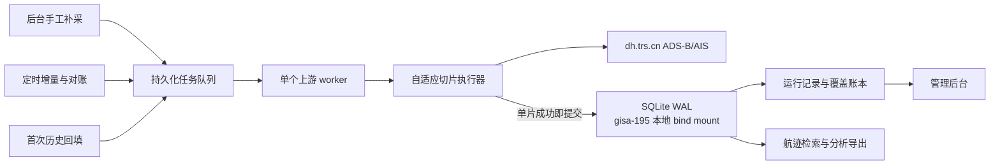

# 航迹数据完整回填与持续采集方案

- **实施系统：** `dy-track-explorer`
- **上游数据：** `dh.trs.cn` ADS-B、AIS 两个查询 API
- **历史起点：** 2026 年 7 月 20 日 00:00:00
- **方案日期：** 2026 年 8 月 1 日
- **关联案例：** 《美伊“暂停互袭”多源数据验证实录》《约旦拦截伊朗导弹事件多源验证与升级研判》
- **已有依据：** 《飞机与船舶航迹数据服务 API 实测与高效接入指南》《航迹数据 API 探索与采集工具技术方案及实施计划》

## 1. 结论

本轮要解决的不是“再加一个定时调用”，而是把 `dy-track-explorer` 从一次性 API 探索工具扩展为一个可持续运行、可核验完整性、可中断恢复的航迹采集系统。它要同时承担三类工作：

1. 回填 2026 年 7 月 20 日至首次切换时点的 ADS-B、AIS 全域历史记录；
2. 切换后持续按入库时间补收最新记录和迟到数据；
3. 由管理后台创建指定时间段的补采任务，并管理定时任务、运行记录和失败恢复。

推荐方案是：

- 保持现有 **Go + React 模块化单体**，不拆微服务、不引入消息队列；
- 使用 **SQLite WAL** 保存任务状态、切片检查点、完整上游记录和覆盖账本，数据库放在 `gisa-195` 宿主机本地持久化目录；
- 新增独立的持久化采集执行器，复用现有 `trsdh.Client`，但不让大批量采集结果经过浏览器或在内存中一次性聚合；
- 历史回填按“时间片单页化”采集，每个成功切片独立事务落库并形成检查点；
- 增量同步以 `loadTime` 水位线为主，采用重叠回看、每日重扫和周期对账吸收迟到、补录及历史重整；
- 管理后台提供任务创建、启停、立即执行、指定区间补采、安全取消、断点续跑、运行记录和覆盖状态；
- 本机只做开发和二进制/镜像验证，长期运行固定部署到 `gintbroker` 使用的 `gisa-195` 测试机，以 Docker 单容器运行。

这里必须校正一个前提：由于上游历史分页会变化，且上游没有稳定游标、数据源覆盖说明和快照版本，系统不能承诺“上游客观世界的绝对全量”。本方案可承诺的是**采集侧可验证完整**：指定范围内所有必要切片均成功落库、没有未解决的单秒超量或失败切片、重复扫描达到收敛、数据质量与覆盖账本可对账。页面和验收材料不得把该口径写成“权威全量”或“保证不漏”。

## 2. 需求理解与成功标准

### 2.1 冻结后的范围

按用户当前表述，本方案默认“完整数据”指：

- 数据集包括 ADS-B 与 AIS；
- 空间范围为 API 可返回的全域数据，不预设约旦、霍尔木兹等区域框；
- 时间范围从 2026 年 7 月 20 日 00:00:00 开始，持续到每次任务的冻结截止时点；
- 保存上游每条记录的全部字段，同时抽取分析常用字段；
- 历史回填、自动增量和手工补采共用同一采集、去重、审计和完整性口径。

区域查询、指定 ICAO/MMSI 查询属于后续使用方式，不能替代全域底库。数据提供方已提供 API 与账号，并已授权本项目按需保存、备份和使用这两类航迹数据；这是已确认输入，不再设置额外许可 Gate。

### 2.2 可判定成功标准

| 编号 | 成功标准 | 可判定验收 |
| --- | --- | --- |
| S1 | 7 月 20 日至切换时点的两类历史数据完成回填 | 两个数据集的覆盖账本连续；所有切片为 `succeeded`，无 `failed`、`blocked_dense_second` 或未处理区间 |
| S2 | 保存内容可复现 | 每条记录保留上游原始 JSON、`source_id`、内容哈希、原始观测/入库时间、采集时间和来源切片 |
| S3 | 新数据自动补入 | 定时任务按配置触发；水位线只在事务成功后推进；停止进程再启动后可从检查点继续 |
| S4 | 迟到和历史重整可吸收 | 增量重叠回看、每日 48 小时重扫和周期对账均可产生新增、重复、变更统计 |
| S5 | 可按需补采 | 管理员可选择数据集、时间范围和可选空间范围提交任务，运行结束后得到明确覆盖结果 |
| S6 | 可在后台运维 | 可查看、启停、立即执行、请求取消、重试失败切片、查看下次运行时间和运行详情 |
| S7 | 不静默丢数据 | 同 `source_id` 内容变化保留版本并记录冲突；单秒超过 1000、响应失败或解析失败均阻断该范围完成状态 |
| S8 | 不过度冲击上游 | 默认单个上游 worker；有超时、有限重试、退避、任务互斥和调用量指标 |
| S9 | 可恢复 | 数据库备份恢复演练后，任务、检查点、水位线、记录和覆盖账本一致，能够继续采集 |

### 2.3 非目标

- 本轮不在 `dy-track-explorer` 内实现航班计划、NOTAM、港口、船东、气象或事件归因；这些仍由其他来源交叉验证。
- 本轮不直接生成军事行动结论、目标识别或攻击性建议。
- 本轮不建设通用数据中台、分布式调度平台、Kafka 或微服务体系。
- 本轮不承诺从稀疏点位重建真实连续航路，也不把“有点位”解释为“运行正常”或“已完成过峡”。

## 3. 已确认事实、判断与证据缺口

### 3.1 已确认事实

| 事实 | 方案影响 |
| --- | --- |
| ADS-B、AIS 均支持观测时间、入库时间、矩形范围、对象标识、页码和页大小查询 | 可以建立历史回填、增量同步和指定区间补采三种入口 |
| `pageSize` 上限为 1000，`pageNum` 从 0 开始 | 大范围采集必须分片 |
| 历史分页不是稳定快照；相邻请求出现总数变化和跨页重复 | 禁止用普通 `pageNum++` 声称采全；必须把每个时间片压到单页 |
| 起止时间实测按闭区间处理 | 相邻秒级时间片必须使用 `next_start = previous_end + 1 second` |
| `endLoadTime` 实测有效 | 可以用入库水位线补收迟到数据 |
| 历史样本出现 ADS-B 最长约 22.7 小时、AIS 最长约 8 小时的入库延迟 | 只用短重叠窗口会漏数，必须安排日度回看 |
| 返回 `id` 只在当前样本内确认唯一，跨日期和跨重跑稳定性未确认 | 不能直接以 `UNIQUE(dataset, source_id)` 覆盖旧记录 |
| 时间字段时区、来源、覆盖质量和定位精度未说明 | 必须保存原值；时区未确认前不能生成伪 UTC 或绝对覆盖率 |
| 当前项目只有查询与探索能力，没有业务数据库、任务调度和管理页面 | 新需求需要新增真实存储、任务模型和管理 API/UI |
| 两个关联案例目前只能靠离散快照辅助判断 | 连续历史底库可以支持事件前后基线、活动量变化、航路偏移和对象回溯，但仍需外部来源确认业务事实 |

### 3.2 当前判断

- **推荐 SQLite WAL 作为当前默认落点。** 用户补充的规模是每天约几千条，长期环境固定为 `gisa-195` 单机单实例，主要写入者只有采集服务。按每天 5,000～10,000 条粗略上界，一年约 183 万～365 万条，SQLite 在正确索引和批量事务下足以承担；实际容量仍以 G1 探测为准。
- **SQLite 的优势不只是省掉网络。** 嵌入式调用通常延迟更低，但本机 PostgreSQL 的 loopback 网络开销也不是主要瓶颈。当前选择 SQLite 的决定性收益是少一个数据库服务、连接池、认证和网络故障面，部署、备份和回滚更简单。PostgreSQL 在多实例、多写、在线 HA 和重分析隔离方面更强，这些暂不是当前目标。
- **不需要消息队列。** 一个带持久化队列语义的 `collection_task/task_run/query_slice` 模型、数据库抢占和单上游 worker 已足以满足当前吞吐与恢复目标。
- **现有 `complete` 不能直接承担批量落库。** 它把完整结果聚合进内存并受 20,000 条、20 MiB 和 5 分钟限制，适合交互探索；持久化采集必须逐切片写入并释放响应。
- **先守住增量，再追历史。** 上线时先冻结切换水位并启动最新数据同步，然后用低优先级任务从 7 月 20 日向切换时点回填，避免回填期间继续扩大实时缺口。

### 3.3 实施前只需关闭的技术疑点

数据保存与使用授权已确认，不再作为阻断项。本机 `.env.local` 当前没有上游账号，因此日量、单秒峰值和 ID 稳定性放到 T0，使用已授权账号小样本只读探测，不单独再走确认流程。

| 编号 | 影响 | 最小验证 | 通过/失败处理 |
| --- | --- | --- | --- |
| G1 日量与容量 | 决定回填速度和磁盘水位 | ADS-B/AIS 抽取 7 月 20、25、31 日整日 `totalElements`，并以真实 JSON 导入 SQLite 测每条字节 | 主库 + WAL 峰值 + 1 份备份的一年预估不超过 `gisa-195` 当前可用空间的 40%；超过则先扩容或改 PostgreSQL，不边跑边等磁盘打满 |
| G2 单秒密度 | 决定时间二分能否穷尽 | 对抽样日高密窗递归到 1 秒，记录 `totalPages` | 单秒均不超过 1 页才可宣称该范围采集闭合；若超过 1000，精确标记该秒缺口并向提供方要稳定游标/导出，不用普通翻页冒充完整 |
| G3 `source_id` 稳定性 | 决定去重与变更语义 | 跨日、间隔重跑同窗，比较同 ID 对象、时间、坐标和内容哈希 | 无论结果如何都保留 `(dataset, source_id, content_hash)` 版本；同 ID 内容变化写冲突，不覆盖旧版 |
| G4 时间语义 | 决定 UTC 标准化 | 核对 `receiveTime/lastdyn/loadTime` 时区 | 未确认前保留原始字符串，标准时间为空；这不阻断按上游原始时间回填 |
| G5 调用频率 | 决定周期，不改变架构 | 单 worker 记录 P95、错误率、604 和 5xx | 从 15 分钟开始；若限流/超时则降频和延长回填，不自动增并发 |

G2 是唯一会阻断“该时间范围采集闭合”的上游技术条件；G1 只阻断不满足容量约束的长期部署，不阻断开发与小样本验证。

### 3.4 `gisa-195` 与 Jenkins 实时核验（2026-08-01 14:38 CST）

| 对象 | 已确认事实 | 对本项目的决定 |
| --- | --- | --- |
| SSH | `ssh -o BatchMode=yes gisa-195` 免密成功；主机 `192-168-211-195` | 后续可由 Jenkins 或受控终端通过同一 alias 部署 |
| 架构/容器 | `x86_64`，Docker `28.2.2`，`docker-compose 2.38.0`，cgroup v1/systemd | 首期只构建 `linux/amd64`，不为未需要的多架构增加复杂度 |
| 存储 | `/opt` 位于本地 XFS 根盘，198 GiB 中约 52 GiB 可用，非 NFS | SQLite WAL 条件成立；但根盘已用 74%，必须执行 G1 容量估算和 70/80/90% 水位保护 |
| 端口 | 3001、3100、3200、8001、18080 已占用；8080 当时空闲 | 宿主首期绑定 `127.0.0.1:8080`，不触碰现有 GISA/原型服务 |
| 网络 | `http://dh.trs.cn/datas/api/` 返回 200；`https://dh.trs.cn:443` 拒绝连接；Harbor `/v2/` 返回预期的未认证 401 | 上游只能按已知明文 HTTP 契约显式开启；Harbor 可达，push/pull 仍用 Jenkins Credentials |
| 工具 | 宿主有 `sqlite3`、`sha256sum`、`tar`、`curl`，没有 Python 和 Docker buildx | 备份/校验用应用子命令或 `sqlite3`；宿主只运行容器，不承担构建 |
| Jenkins | controller 为 `192.168.210.90:8088/jenkins`，仅一个在线 `master` 节点，10 executors，`linux/amd64`；`Shadowbroker #273` 成功部署当前 release | 复用 controller、Linux agent、Harbor credential ID 和 `gisa-195` SSH alias，但新建独立 `dy-track-explorer` Job，不改 `Shadowbroker` |
| Jenkins 权限 | `dy-track-explorer` Job 不存在；`ls-codex` 可读现有 Job，访问 `/newJob` 返回 403 | 实施 CI 前由 Jenkins 管理员一次性创建 Pipeline-from-SCM Job；不将这个权限问题扩展成项目内状态机 |

## 4. 目标覆盖矩阵

| 核心问题或指标 | 证据 | 对应措施 | 验证 | 状态 |
| --- | --- | --- | --- | --- |
| 7 月 20 日至今历史回填 | 上游支持时间过滤，但分页不稳定 | 秒级自适应时间切片；单页才接收；逐片事务落库和检查点 | 覆盖账本连续且无未解决切片；重复扫描收敛 | covered；单秒超页时该秒明确为 blocked，不虚报完整 |
| 自动获取最新数据 | `loadTime` 可用，历史有迟到 | 水位线 + 60 分钟重叠 + 每日 48 小时重扫 | 模拟迟到、重启和边界秒，记录最终被补入 | covered |
| 后台启停与立即执行 | 当前无任务管理 | 任务 API、持久化调度、启停/立即执行/安全取消 | 浏览器和 API 验证状态转移，并验证宿主非回环端口不可达 | covered |
| 指定时间段补采 | 查询接口支持时间和可选空间范围 | `backfill` 一次性任务复用同一采集引擎 | 指定失败区间补采后覆盖缺口关闭 | covered |
| 不重复、不静默覆盖 | ID 长期稳定性未知 | 原始 JSON + 内容哈希；同内容幂等；同 ID 变更留版本和冲突 | 重跑、冲突 fixture 和真实样本对账 | covered |
| 高效保存 | 当前 `complete` 有内存和响应上限 | 流式逐切片解码、批量事务写入、原生分区和必要索引 | 峰值内存有界；批次吞吐、WAL、磁盘增长可测 | covered |
| 可证明采集完整性 | 上游无快照和稳定游标 | 切片账本、失败阻断、收敛扫描、每日覆盖桶和差异统计 | 任一缺口在后台可见，完整状态有唯一判定 | covered |
| 对两个案例产生分析价值 | 当前只有离散快照 | 保存连续点和事件前后基线，提供按对象/区域/时间检索与导出 | 约旦航空、霍尔木兹海事各完成一组历史回放 | covered |
| 安全与可恢复 | 航迹和凭据敏感，持续写入有数据风险 | secret 注入、宿主回环绑定 + SSH tunnel、备份和恢复演练 | 非回环访问失败、日志/镜像 secret scan、恢复后对账 | covered |

目标覆盖矩阵无 `gap`。G1 容量预算不通过时不在该盘启动长期全量写入；G2 出现单秒超页时只影响对应时间范围的闭合判定，开发、增量采集和其他时间片不被整体阻断。

## 5. 推荐架构



### 5.1 保持模块化单体

新增模块建议：

| 模块 | 职责 |
| --- | --- |
| `internal/collector` | 持久化采集入口、自适应切片、逐片写入、完整性判定 |
| `internal/jobs` | 任务配置、调度、优先级、互斥、取消和恢复 |
| `internal/storage` | SQLite migration、repository、事务、备份入口和覆盖查询 |
| `internal/quality` | 字段解析、哈希、冲突、迟到量和覆盖指标 |
| `internal/httpapi` | 新增任务、运行、覆盖和数据检索 API；handler 不承载采集逻辑 |
| `web/src/features/tasks` | 定时任务、启停和立即执行 |
| `web/src/features/runs` | 运行、切片、失败和恢复 |
| `web/src/features/storage` | 时间覆盖、数据量、对象检索和导出 |

`trsdh.Client` 继续统一处理登录、token、超时、重试、gzip 和错误码。`explorer.Runner` 保留交互查询语义；采集器复用 client 和切片规则，不复用其内存聚合 DTO。

### 5.2 存储选型

默认使用 SQLite WAL：

- 使用单写入队列和批量事务，每个成功切片在一个事务中写记录、冲突、切片状态和覆盖桶，避免每条记录单独 fsync；
- 启动时执行 `PRAGMA journal_mode=WAL`、`PRAGMA foreign_keys=ON`、`PRAGMA busy_timeout=5000`；`synchronous` 默认先用 `FULL` 保证测试机异常掉电边界，真实性能不足时再用压测证据评估 `NORMAL`；
- 数据库、`-wal`、`-shm` 全部放在容器 `/data`，映射到 `gisa-195` 本地目录 `/opt/dy-track-explorer/data`；禁止放容器可写层或 NFS；
- `dataset + object_key + observed_time_raw` 建对象回溯索引，`dataset + load_time_raw` 建增量/迟到索引，覆盖页面需要的时间与状态列建立窄索引；避免为所有 JSON 字段建索引；
- 每条记录保留原始 JSON 文本/JSON blob，并抽取经纬度、对象标识、观测和入库时间等常用列；
- 设置 WAL checkpoint、`ANALYZE` 和磁盘水位任务；大规模删除只按经批准的留存策略执行，不在采集热路径自动 `VACUUM`；
- 在线备份使用 Go SQLite backup API、`VACUUM INTO` 或受控 `sqlite3 .backup`，备份后执行 `PRAGMA integrity_check` 并在独立目录恢复演练；不能只复制正在写入的 `.db` 而遗漏 WAL。
- SQLite driver 优先选择与目标 Go 版本和 `linux/amd64` 验证兼容的 pure-Go 实现，保留当前静态交叉编译优势；如果最终选择 CGO driver，就必须调整 `CGO_ENABLED=0`、补齐目标架构编译工具链并验证 builder/runtime libc，不得只在 macOS 本机编译通过。

以下任一条件出现时迁移 PostgreSQL：需要多个应用实例或多个写入者；数据库只能放网络文件系统；需要在线 HA；实测数据量、长查询或并发后台分析持续影响采集；单库备份/恢复窗口无法满足要求。当前不提前实现双数据库兼容层，避免让两套 SQL 语义拖累首期正确性。

### 5.3 最小数据模型

| 表 | 关键字段 | 作用 |
| --- | --- | --- |
| `collection_task` | `id`、`name`、`dataset`、`kind`、`schedule`、`schedule_timezone`、查询范围、优先级、`enabled` | 定时、首次回填和手工补采配置 |
| `task_run` | `id`、`task_id`、`trigger`、冻结截止时点、状态、计数、错误摘要、触发来源 | 一次可追溯执行 |
| `query_slice` | `run_id`、起止秒、可选空间片、状态、attempt、HTTP/业务码、`requestid`、记录数、响应哈希 | 检查点、重试和覆盖证明 |
| `track_observation` | 内部 ID、`dataset`、`source_id`、`object_key`、原始时间、标准时间可空、经纬度、`content_hash`、`raw_payload`、首末采集时间 | 完整保存上游记录和常用查询字段 |
| `observation_conflict` | 数据集、`source_id`、两个内容哈希、冲突类型、发现时间、处理状态 | 防止同 ID 变化被静默覆盖 |
| `task_watermark` | 任务、最大已提交 `loadTime`、最近成功截止时点 | 增量恢复；与记录写入同一事务推进 |
| `coverage_bucket` | 数据集、日期/小时、期望切片数、成功/失败数、唯一记录数、最小/最大时间、最近对账时间 | 后台覆盖视图和验收 |

建议以 `(dataset, source_id, content_hash)` 做幂等唯一约束。同一内容重跑只更新 `last_seen_at`；同一 `source_id` 内容变化则新增版本并写冲突。G3 证明 ID 长期稳定后，仍应保留原始版本审计，不在迁移中直接删除冲突历史。

### 5.4 `gisa-195` 容器化运行契约

部署目标固定为 `gintbroker` 当前使用的 `gisa-195` 测试机。本机只验证 `make verify`、二进制和 fake upstream；真实镜像 build/inspect 放 Jenkins Linux agent，长期运行与 SQLite 恢复演练放 `gisa-195`。

| 项目 | 预期契约 |
| --- | --- |
| 镜像 | `harbor.trscd.com.cn/trs/dy-track-explorer:<shortSha>-<BUILD_NUMBER>`，同时记录完整 OCI revision 和 registry digest；不使用 `latest` |
| 架构 | 已实测 Jenkins agent 和 `gisa-195` 均为 `linux/amd64`；首期用普通 Docker build，不把未证实的 buildx 当作前置 |
| 容器 | 单实例、`--restart unless-stopped`、前台运行 Go 服务、合理 `--stop-timeout` 让当前 SQLite 事务和 HTTP 请求结束 |
| 目录 | `/opt/dy-track-explorer/data` 持久化 SQLite，宿主目录归固定容器 UID/GID `10001:10001`；`/opt/dy-track-explorer/app.env` 保存运行配置与 secret，归 root 且权限 `0600` |
| 端口 | 容器 8080；宿主首期发布 `127.0.0.1:8080:8080`，该端口已实测空闲，不占用 3001/3100/3200/8001 |
| 访问 | 容器 `LISTEN_ADDR=:8080`，`PUBLIC_ORIGIN=http://localhost:8080`；管理员通过 `ssh -L 8080:127.0.0.1:8080 gisa-195` 访问。首期不改现有 Nginx/DNS，也不为单人测试环境引入 OIDC；以后需共享内网入口时再加反向代理认证 |
| 健康 | 容器内请求 `127.0.0.1:8080/healthz`，但 `Host` header 使用可配置的真实公开 authority；引入 SQLite 后 `/readyz` 还要验证数据库打开、migration 完成和数据目录可写，不因临时上游失败触发重启 |
| 数据 | `/data` 只映射宿主本地磁盘；容器删除、升级和回滚不删除数据库、WAL、SHM 或备份 |
| 外联 | 目标机需访问 Harbor 和 `dh.trs.cn`；上游仍为明文 HTTP 时只在受控网络显式启用，不将该开关表述为链路安全 |
| 加固 | stdout/stderr 日志配置 `max-size/max-file` 轮转；验证后启用 `no-new-privileges`、`cap-drop=ALL`，再评估只读根文件系统和 `/tmp` tmpfs |

当前 `dy-track-explorer/Dockerfile` 已能完成 Node + Go 多阶段构建、非 root 运行和健康检查，但正式内网部署前需要调整：

1. 删除首行 `# syntax=docker/dockerfile:1`，避免内网拉取外部 frontend；
2. 把 Docker Hub 的 `node/golang/alpine` 改为经 Harbor 实际核对的固定版本公司镜像，并用 `ARG` 暴露；
3. 接入版本 build args 和 OCI labels；首期固定 `linux/amd64`，当 Jenkins agent 确认有 buildx 且出现多架构需求时再接 `TARGETOS/TARGETARCH`；
4. 为 SQLite 增加 `/data` 运行契约，但以 bind mount 为准，不依赖镜像 `VOLUME` 隐式创建匿名卷；
5. 健康检查的 `Host` 可配置；当前硬编码 `localhost:8080` 恰好匹配首期 SSH tunnel，但以后切换内网域名时不应再改 Dockerfile；
6. 增加 `.dockerignore`，排除 `.env.local`、数据库/WAL、日志、输出、`.git` 和本地构建产物；
7. 新增 Jenkinsfile：参数最小化为 `RC_COMMIT`、`IMAGE_REPOSITORY`、`HARBOR_CREDENTIALS_ID`、`PUSH_IMAGE`、`DO_DEPLOY`、`DING_ROBOTID`；默认 `DO_DEPLOY=false`，使用现有 Docker agent 构建 `linux/amd64`，push 不可变 tag；部署逻辑未完成时 `DO_DEPLOY=true` 必须失败，不能打印“待实现”后绿色结束。
8. 增加数据库初始化后的 `/readyz` 判定、Docker 日志轮转和安全参数验证；应用升级前备份 SQLite，schema migration 必须向后兼容，否则旧镜像不能作为有效回滚。

容器化实现应以已补强的 `trs-containerize-project` skill 中 Go + React 模板为骨架，但所有 Harbor tag、Jenkins credentials、宿主端口、UID/GID、磁盘和认证入口都要按 `gisa-195` 现场重查。

## 6. 三类采集流程

### 6.1 首次历史回填

1. 以系统启动时点冻结 `cutover_at`，为 ADS-B、AIS 各创建一项回填任务。
2. 同时启动高优先级增量任务，保证 `cutover_at` 之后的新入库记录不继续形成缺口。
3. 历史任务从 7 月 20 日 00:00:00 向 `cutover_at` 推进，初始片长 1 小时、`pageSize=1000`、`pageNum=0`。
4. `totalPages=0` 时记录可审计零结果；`totalPages=1` 时批量写入记录并提交切片；`totalPages>1` 时丢弃探测页内容并按时间中点二分。
5. 小于 250 条的后续片可逐步扩大，超过 800 条时提前缩小；片长限定在 1 秒至 6 小时。
6. 单秒仍超过 1000 时标记 `blocked_dense_second` 并阻断覆盖完成。不得退回普通分页掩盖缺口。
7. 第一遍完成后重扫最近 48 小时和抽样历史日；差异仍增长则继续重扫，直到连续两轮没有新增/变更或达到预设最大轮次并转人工处置。

每个切片在一个事务中完成：写观测记录、写冲突、更新切片计数、更新覆盖桶。进程在任意切片间退出都可以续跑；已成功切片不重复请求，除非进入显式对账轮次。

### 6.2 自动增量同步

默认建议两个数据集都每 15 分钟触发一次，先保持一个共享上游 worker。该周期是保守起点，不是“实时”承诺；G5 实测后可调整，但后台应限制最短周期，避免管理员误设秒级轮询。

每次运行：

- `startLoadTime = last_committed_load_time - 60 minutes`；
- `endLoadTime = run_started_at - 2 minutes`，给正在写入的上游留出短暂稳定窗口；
- 观测时间范围从 7 月 20 日开始到本次截止时点，以捕获晚到的旧观测；
- 按 `loadTime` 方向切片、去重和落库；
- 只有全部必要切片成功提交后才推进水位线；失败运行保留已成功切片，下次从失败检查点恢复。

考虑到实测最大迟到约 22.7 小时，另设：

- 每日低峰重扫最近 48 小时观测窗口；
- 每周对 7 月 20 日以来的日级 `totalElements`、本地唯一记录数和内容变化做对账；
- 发现上游历史变化时生成定向补采任务，不让常规增量无限扩大回看成本。

### 6.3 手工指定区间补采

管理员选择：

- ADS-B、AIS 或两者；
- 开始和结束时间，精确到秒；
- 全域或可选矩形范围；
- 可选 ICAO/MMSI；
- “只补缺口”或“强制重扫并对账”。

提交前显示预估时间跨度、是否与现有任务重叠和当前队列。手工任务不直接抢占正在提交的切片；高优先级任务在当前切片结束后获得 worker。重复范围允许执行，但通过内容哈希幂等，不产生重复业务记录。

## 7. 任务状态与管理后台

### 7.1 状态语义

| 状态 | 含义 |
| --- | --- |
| `queued` | 已持久化，等待 worker |
| `running` | 已持有执行租约并处理切片 |
| `succeeded` | 所有必要切片成功，覆盖条件满足 |
| `failed` | 存在明确失败或未解决切片，不得标完整 |
| `cancel_requested` | 等待当前切片安全结束 |
| `cancelled` | 已停止新切片；已提交数据保留，可继续运行 |
| `skipped_overlap` | 定时触发时同任务已有运行实例，不重复排队 |

“暂停任务”只阻止新的定时触发，不取消当前运行；“取消本次运行”只在切片边界生效；“继续运行”复用原检查点。后台必须使用这三个不同动作，避免一个“停止”按钮混淆数据语义。

### 7.2 页面

| 页面 | 首期内容 |
| --- | --- |
| `/tasks` | 任务列表、周期、时区、启停、立即执行、编辑非运行中任务 |
| `/runs` | 触发方式、状态、进度、切片、记录数、重复/变更/错误、安全取消和继续运行 |
| `/storage` | 两类数据时间覆盖、日增量、对象数、磁盘占用、冲突和指定区间检索 |
| `/monitoring` | 上游成功率、P95、业务码、重试、token 刷新、积压、入库迟延和磁盘水位 |

必须突出显示“采集侧覆盖状态”和“上游源覆盖未知”的区别。零记录区间需要分类为：有效零结果、覆盖未知、尚未入库、请求失败或单秒超量，不能统一显示为“无活动”。

### 7.3 管理 API

最小契约建议：

```text
GET    /api/v1/tasks
POST   /api/v1/tasks
PATCH  /api/v1/tasks/{id}
POST   /api/v1/tasks/{id}/enable
POST   /api/v1/tasks/{id}/disable
POST   /api/v1/tasks/{id}/run
POST   /api/v1/runs
GET    /api/v1/runs
GET    /api/v1/runs/{id}
POST   /api/v1/runs/{id}/cancel
POST   /api/v1/runs/{id}/resume
GET    /api/v1/storage/coverage
GET    /api/v1/storage/observations
```

所有变更接口拒绝未知字段，并记录触发来源、时间和参数摘要。首期只通过宿主回环绑定和 SSH tunnel 访问，Host/Origin guard 拒绝非预期请求；若将来开放非回环入口，必须先接入反向代理认证，因为 Host/Origin guard 本身不是身份认证。凭据仍只从 secret 注入，后台只能显示“已配置/未配置”。

## 8. 完整性、质量与可观测性

### 8.1 完整性判定

一个时间范围只有同时满足以下条件，才显示“本次采集闭合”：

1. 范围被不重不漏的秒级切片覆盖；
2. 所有叶子切片为单页或可审计零结果；
3. 没有失败、取消、单秒超量或解析失败切片；
4. 每个成功切片的记录、切片状态和覆盖桶在同一事务提交；
5. 对账重扫已达到冻结的收敛标准；
6. 数据保存授权按本方案的已确认范围执行。

该状态命名为“本次采集闭合”，不命名为“上游绝对完整”。上游后续补录会产生新的对账差异，并把对应覆盖桶标为“需复核”。

### 8.2 关键指标

- 采集：请求数、成功率、P50/P95/P99、业务码、重试、token 刷新；
- 队列：等待任务、运行任务、最老积压时间、`skipped_overlap`；
- 数据：收到记录、唯一内容、新增、重复、版本变化、冲突、解析失败；
- 新鲜度：最大观测时间、最大 `loadTime`、采集截止水位、入库迟到分布；
- 完整性：成功/失败/超量切片、未覆盖秒数、需复核覆盖桶；
- 容量：数据库、WAL、备份大小、日增长和剩余可用天数。

日志只记录任务 ID、运行 ID、切片范围、参数摘要、状态、计数、耗时和 `requestid`；不记录用户名、密码、token、完整登录 URL或无限量响应正文。对实时坐标日志默认不输出。

### 8.3 面向案例的首批分析产物

底库完成后，先用两个案例验证它是否真正增加洞察，而不是只证明采集器能运行：

| 案例 | 数据窗口 | 首批产物 | 结论边界 |
| --- | --- | --- | --- |
| 约旦导弹与区域航空 | 事件前 24 小时、事件后 48 小时、7 月 20 日以来同星期同时段基线 | 唯一 ICAO、点数、可见航路、高度/速度分布、区域进入/离开和航路偏移候选 | 不能单独证明取消、返航、军事任务或空域恢复 |
| 霍尔木兹海事风险 | 7 月 20 日以来小时/日基线与事件窗口 | 唯一 MMSI、船型、速度/航向变化、低速/掉头/断面穿越候选和对象回溯 | 稀疏点位必须标置信度；事件仍需 IMO、NAVAREA、船东或港口确认 |

## 9. 安全、稳定性、备份与回滚

| 风险 | 防护与验证 | 回滚/处置 |
| --- | --- | --- |
| 明文上游链路泄露 | 延续 `Proxy=nil`、凭据 secret 注入、日志脱敏和受控部署网络；验证无 ambient proxy 和秘密输出 | 停止采集；轮换凭据；提供方支持 HTTPS 后关闭 insecure 开关 |
| 未授权访问后台并触发大量调用 | 宿主只绑定 `127.0.0.1:8080`，管理员走 SSH tunnel；写接口保留 Host/Origin 校验和频率限制 | 停止容器或禁用调度；如需开放共享入口，先加反向代理认证 |
| 上游过载或限流 | 单 worker、有限重试、指数退避、最短周期限制和全局调用预算 | 暂停回填，保留增量；降低频率，不自动扩并发 |
| 进程中断造成缺口 | 切片事务、租约超时、检查点和可恢复任务 | 重启后回收过期租约并从未成功切片继续 |
| 重复或同 ID 变化 | 内容哈希幂等、版本保留、冲突表 | 重跑不会重复；停止自动覆盖并人工核查冲突 |
| SQLite/WAL 或磁盘异常 | 数据库使用本地 bind mount；上线前容量 Gate；70% 告警、80% 暂停低优先级回填、90% 停止所有写入并告警；备份后做完整性和恢复检查 | 停止写入并保留现场；从最近有效备份恢复，再按覆盖账本补采；不得自动删除 7 月 20 日以来基线 |
| 数据库损坏或误操作 | 每日逻辑/物理备份、校验、异地或独立介质保存、定期恢复演练 | 恢复最近备份，按覆盖账本重放缺失切片 |
| schema 迁移失败 | 版本化 migration，先在备份副本演练；扩展式变更优先 | 停止新版本，恢复旧二进制；涉及数据变换时从备份恢复 |

发布时先部署数据库 migration 和后端兼容版本，再开放页面。回滚应用时保留向后兼容的表和新采数据，不自动执行 down migration 或删除数据。任务调度可以独立关闭，查询和历史数据仍保持可读。

## 10. 具体实施计划

### 10.1 变更范围与回滚边界

| 范围 | 预计文件/模块 | 说明 |
| --- | --- | --- |
| 配置与启动 | `cmd/server/main.go`、`internal/config/*`、`.env.example` | 加数据库路径、调度开关、备份目录、磁盘水位和优雅停机配置 |
| SQLite | `go.mod`、`go.sum`、`internal/storage/*`、`internal/storage/migrations/*` | 选择与 Go 1.26 / `linux/amd64` 验证兼容的 pure-Go SQLite driver；只做向后兼容 migration |
| 采集与任务 | `internal/collector/*`、`internal/jobs/*`、`internal/quality/*`、`internal/trsdh/*` | 逐片写入、单 worker、恢复、水位、冲突、覆盖和有界重试；保留现有 Explorer 语义 |
| API 与前端 | `api/openapi.yaml`、`internal/httpapi/*`、`internal/observability/*`、`web/src/features/{tasks,runs,storage,monitoring}/*`、`web/src/app/*` | 任务、运行、补采、覆盖、存储和监控界面 |
| 容器与 CI | `Dockerfile`、`.dockerignore`、`Jenkinsfile`、`scripts/run-docker.sh`、`README.md` | Harbor 基础镜像、非 root、`/data` bind mount、回环端口、日志轮转、构建/push/部署/回滚 |

明确不做：不改 `gintbroker`、`Shadowbroker` Job、3001/3100/3200/8001 容器；不引入 PostgreSQL、Kafka、K8S、多实例或通用 cron DSL；不删除已采集记录。应用回滚只切回上一个 digest 镜像并保留 `/data`；因 migration 只做 additive change，旧镜像必须仍能读库。真正替换活动数据库会丢失备份点后数据，不属于普通应用回滚，只在明确的数据恢复操作中执行。

### T0：冻结上游与环境基线

**目标：** 关闭 G1—G5 中会影响容量、完整性和调度参数的疑点，不重复做数据授权确认。

**修改范围：** 原方案执行记录；必要时在 `cmd/` 增加可复用的只读 probe 子命令，不写业务库。

**步骤：**

1. 通过 `.env.local` 或权限 `0600` 的临时 env 文件注入已授权账号；输出只记录“已配置”，不记密码/token。
2. ADS-B/AIS 分别采样 7 月 20、25、31 日日量，从高密窗递归到 1 秒；重跑同窗比较 ID 和内容哈希。
3. 将真实 JSON 样本写入临时 SQLite，计算每条字节、索引增量、WAL 峰值和备份大小；以现场约 52 GiB 可用空间判定一年预算。
4. 冻结首期参数：单 worker、15 分钟增量、60 分钟重叠、2 分钟稳定窗、每日 48 小时重扫；若实测限流，只降频不增并发。

**验证：** 每个样本输出数据集、窗口、`totalElements/totalPages`、耗时、响应字节、业务码和哈希统计；不出凭据和原始全量内容。G1 超预算则停在小样本；G2 超页则记录精确秒并保留后续补口。

**失败与回滚：** 本阶段不写正式库、不部署；失败只删除本机临时样本和临时库。

### T1：实现 SQLite 持久化采集内核

**目标：** 关闭 S1—S4、S7—S9 的后端核心，让任意中断都可从已提交切片继续。

**修改范围：** `go.mod/go.sum`、`internal/storage`、`internal/collector`、`internal/jobs`、`internal/quality`、`internal/config`、`internal/observability`、`cmd/server/main.go` 及对应测试。

**步骤：**

1. 引入并固定 pure-Go SQLite driver，建立版本化 migration 和第 5.3 节表/索引；启动时校验 `/data` 可写、WAL、FK、busy timeout 和 migration 版本。
2. 实现逐片事务：接受单页后流式解码，在同一事务写 observation/conflict/slice/coverage/watermark；超页页内容立即丢弃并二分。
3. 实现单 worker 持久化队列：增量优先，回填/补采低优先；过期 `running` 租约启动时回收；取消只在切片边界生效。
4. 实现服务启停：启动先 migration/检查再使 `/readyz` 就绪；`SIGTERM` 停止领取新切片，在 stop timeout 内结束当前事务。

**验证：** fake upstream 覆盖零结果、超页二分、闭区间边界秒、单秒超页、604 刷新、5xx 重试、中途 kill/restart、重跑幂等、同 ID 变更和磁盘水位；使用 `go test -race ./internal/storage/... ./internal/collector/... ./internal/jobs/... ./internal/httpapi/...`。

**失败与回滚：** 任一子写入失败回滚整个切片事务，不推进水位；回退本阶段 commit 可恢复原 Explorer，测试库可重建。

### T2：实现调度、指定区间补采和管理后台

**目标：** 关闭 S5—S6，让管理员在页面完成启停、立即运行、指定区间、取消、继续和覆盖查看。

**修改范围：** `api/openapi.yaml`、`internal/httpapi`、`web/src/features/tasks`、`web/src/features/runs`、`web/src/features/storage`、`web/src/features/monitoring`、路由/生成类型及测试。

**步骤：**

1. 按第 7.3 节实现 API，写接口严格 JSON schema、时间/矩形/对象校验、最小 5 分钟周期和同任务互斥；无限长区间在提交前给出预估。
2. 用标准库 timer 实现首期的“固定间隔 + 每日时点 + 每周时点”，并将 `next_run_at` 持久化；不引入通用 cron DSL。
3. 任务、运行、存储、监控四个页面共用覆盖状态，明确区分“有效零结果/失败/单秒超页/尚未采集/需重扫”。
4. 保留 Explorer 页面用于交互调试，但其 `complete` 仍标注 `best_effort`，不调用持久化大任务内核返回海量 JSON。

**验证：** OpenAPI 生成零漂移；API 覆盖创建/重复/越界/启停/立即执行/取消/继续；Vitest 覆盖主要状态转移和人工补采表单；执行 `make verify`。

**失败与回滚：** 后台错误不能改变已提交数据；可用配置关闭 scheduler 但保留查询和历史数据可读。

### T3：容器、Jenkins 与可回滚部署链

**目标：** 在已核验环境上建立独立、可重复的 build/push/deploy 路径，不影响 GISA 现有服务。

**修改范围：** `Dockerfile`、`.dockerignore`、`Jenkinsfile`、`scripts/run-docker.sh`、`.env.example`、`README.md` 及容器契约测试。

**步骤：**

1. 按第 5.4 节修改 Dockerfile：固定已核验 Harbor 基础镜像，pure-Go 静态构建，非 root 运行，`/data` 权限、OCI revision 和可配 Host 健康检查。
2. `run-docker.sh` 只接受精确镜像 ref/digest，要求 `/opt/dy-track-explorer/app.env` 存在且 mode `0600`，数据目录在本地 XFS 且 owner 为 `10001:10001`，使用 `127.0.0.1:8080:8080`、`--restart unless-stopped`、`--stop-timeout`、`json-file max-size/max-file`、`no-new-privileges`、`cap-drop=ALL`。
3. Jenkinsfile 先验证完整 `RC_COMMIT == checkout HEAD`，再 `make verify` 和真实 Docker build/inspect；只有 `PUSH_IMAGE=true` 才push，只有 `DO_DEPLOY=true` 才通过 `gisa-195` alias 部署。未实现的 deploy 分支必须红灯。
4. 由 Jenkins 管理员一次性创建 `dy-track-explorer` Pipeline-from-SCM Job。当前 `ls-codex` 没有 Create 权限；Job 创建后可继续用该账号读取 build/API。SCM 优先指向当前 GitHub `main`，如 Jenkins 无法稳定访问 GitHub，再将同一 commit 镜像到内网 GitLab，不在 Jenkins 运行时静默 fallback。

**验证：** 本机运行 `bash -n scripts/run-docker.sh`、静态 secret/build-arg 契约和 `make verify`；Jenkins controller 运行 Declarative Linter，再以 `DO_DEPLOY=false` 构建/push 一个 RC，核对 image 为 `linux/amd64`、revision 是完整 SHA、镜像 history 无 secret。

**失败与回滚：** build/push 失败时 195 零变更；deploy 新容器未通过 `/readyz` 时自动恢复上一容器/镜像，不删 `/data`，不操作其他容器或全局 Docker cache。

### T4：`gisa-195` 上线、回填、恢复演练与案例验收

**目标：** 在长期环境关闭 S1—S9，并产出两个案例可复核的连续航迹洞察。

**修改范围：** Jenkins `dy-track-explorer` Job、Harbor 镜像、`/opt/dy-track-explorer/{app.env,data,backups}`、宿主回环端口；方案文档本节执行记录。

**步骤：**

1. 部署前只读重查端口、磁盘、Harbor/HTTP 上游可达性，在宿主建 `app.env` 并设 `0600`；不经 Jenkins artifact 传递上游账号。
2. 部署后通过 SSH tunnel 访问后台，先创建并启用 ADS-B/AIS 增量任务，事务性记录 `cutover_at`；再创建从 `20260720000000` 到 `cutover_at` 的低优先级回填。
3. 监视失败/超量切片、上游 P95、日增长、DB/WAL 和磁盘水位；完成后运行 48 小时重扫和日级对账，只对有差异的窗发定向补采。
4. 使用 `sqlite3 .backup` 生成在线备份，执行 `PRAGMA integrity_check`和表行数/覆盖账本对账；把备份恢复到独立目录，用一次性容器和空闲回环端口验证 `/readyz`，不替换活动库。
5. 分别生成约旦航空事件前后对照与霍尔木兹海事基线，将“航迹观测候选”与外部事件事实分开。

**验证：** 连续运行 24 小时无重启循环；两数据集增量水位前进；7 月 20 日起覆盖账本无未说明缺口；备份 `integrity_check=ok` 且恢复容器就绪；管理后台能启停、立即运行、补采、取消和续跑；3001/3100/3200/8001 的容器 ID、revision 和 HTTP 前后不变。

**失败与回滚：** 上游错误先暂停回填保留增量；80% 磁盘水位暂停低优先级任务，90% 停止新写入；应用故障回滚上一镜像且保留库。只有实证库损坏时才进入活动库恢复，并在恢复前封存故障库、明确数据损失窗口。

### 10.2 验证矩阵

| 验证项 | 执行环境 | 命令/操作 | 通过标准 | 失败判定与证据 |
| --- | --- | --- | --- | --- |
| 全量静态/单测 | 开发机 | `make verify` | lint、typecheck、Vitest、Go test/vet、build 全通过 | 任一非 0；保留首个失败日志 |
| 持久化并发/中断 | 开发机 fake upstream | `go test -race ./internal/storage/... ./internal/collector/... ./internal/jobs/... ./internal/httpapi/...` | 无 race；kill/restart 后水位、切片和行数正确 | race、误推水位、重复行或丢切片 |
| 真实小样本 | 开发机，已授权账号 | T0 probe | 有日量、单秒密度、ID 变更、P95 和容量结论 | 凭据输出、样本不完整或容量无法判定 |
| Jenkinsfile | Jenkins controller | Declarative Pipeline Linter | controller 返回 valid | 语法/插件不兼容 |
| 镜像 | Jenkins Linux agent | `DO_DEPLOY=false` 的 build + push + inspect | `linux/amd64`、OCI revision/digest 正确，history 无 secret，健康 smoke 通过 | 镜像架构/身份漂移、secret 泄漏或容器不就绪 |
| 部署隔离 | `gisa-195` | Jenkins `DO_DEPLOY=true`；`docker inspect`、`ss -lnt`、HTTP smoke | 仅新容器和 `127.0.0.1:8080` 变化；现有服务不变 | 其他容器/端口/revision 变化或新容器重启 |
| 历史与增量 | `gisa-195` 管理后台/SQLite 只读查询 | 覆盖页、watermark、slice 对账 | 覆盖连续，所有缺口有明确状态，水位只在成功后前进 | 无状态断层、失败仍推水位或单秒超页被标成完整 |
| 备份恢复 | `gisa-195` 独立恢复目录/一次性容器 | `.backup`、`PRAGMA integrity_check`、行数/覆盖对账、`/readyz` | integrity `ok`，关键表与覆盖一致，恢复容器就绪 | 仅有备份文件但无法打开/就绪，或行数不一致 |

### 10.3 执行记录

| 阶段 | 状态 | 证据 | NEXT |
| --- | --- | --- | --- |
| T0 真实基线 | NOT_STARTED | 本轮已完成 Jenkins/`gisa-195` 环境只读核验；上游带账号样本待执行 | 注入已授权账号并运行 T0 probe |
| T1 采集内核 | NOT_STARTED | — | T0 容量参数冻结后实现 |
| T2 管理后台 | NOT_STARTED | — | T1 契约通过后实现 |
| T3 容器/CI | NOT_STARTED | Jenkins Job 尚不存在，`ls-codex` 无 Create 权限 | 完成代码与流水线后由管理员创建独立 Job |
| T4 上线/回填/验收 | NOT_STARTED | 8080 端口、XFS、Harbor/HTTP 上游可达已核验 | T3 image Gate 通过后部署 |

## 11. 不建议方案

| 方案 | 不建议原因 |
| --- | --- |
| 直接 `pageNum++` 抓完所有页 | 历史分页已实测不稳定，会重复和漏数 |
| 用现有浏览器 `complete` 一次查询 7 月 20 日至今 | 受 20,000 条、20 MiB、5 分钟和内存聚合限制，失败后没有持久化检查点 |
| 只按观测时间每 15 分钟拉最新窗口 | 会漏掉数小时至一天后才入库的迟到记录 |
| 只按 `source_id` upsert 覆盖 | 跨重跑稳定性未确认，会静默丢掉上游变更或 ID 冲突 |
| 一开始上 Kafka、微服务或分布式调度 | 当前只有一个上游且建议单 worker，新增组件不能解决分页不稳和源覆盖未知 |
| 用空间网格无条件解决单秒超量 | 只能覆盖具有有效坐标且矩形过滤可靠的记录，不能证明全域无遗漏 |
| 把采集成功等同于事件事实 | API 缺少计划、覆盖、来源和事件确认信息，会放大错误结论 |

## 12. 已确认输入与执行依赖

- **已确认：** 上游 API、账号、航迹保存、备份和案例使用均已授权，不再设置许可 Gate。
- **已确认：** `gisa-195` 的架构、Docker、本地 XFS、8080 端口、Harbor 和明文 HTTP 上游可达性支持首期单容器 + SQLite；当前 52 GiB 余量仍需 T0 容量样本证明可支撑一年。
- **执行依赖：** 已授权账号需以 `.env.local` 或 `app.env` 安全注入；不放 Git、Jenkins 参数、argv 或日志。
- **执行依赖：** Jenkins 管理员需一次性创建 `dy-track-explorer` Pipeline-from-SCM Job，因为当前 `ls-codex` 账号只读且 Job 不存在。这只阻断 T3 的真实 Jenkins build/deploy，不阻断 T0—T2 开发。
- **上游待补信息：** 时间字段时区和单秒超过 1000 时的稳定游标/离线导出。时区未明不阻断保留原值；只有真实出现单秒超页时，对应秒的“采集闭合”才被阻断。

[$checkpointed-plan-executor](/Users/liushen/Documents/cursorDevs/trsdevops/devops_console/.agents/skills/checkpointed-plan-executor/SKILL.md) /Users/liushen/Documents/githubDevs/dy-inta/devdoc/航迹数据完整回填与持续采集方案-20260801.md
