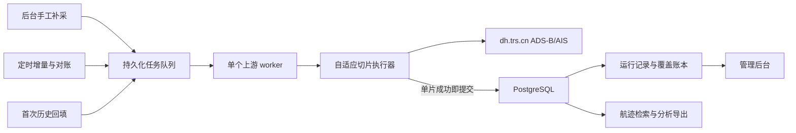

# 航迹数据完整回填与持续采集方案

- **实施系统：** `dy-track-explorer`
- **上游数据：** `dh.trs.cn` ADS-B、AIS 两个查询 API
- **历史起点：** 2026 年 7 月 20 日 00:00:00
- **方案日期：** 2026 年 8 月 1 日
- **关联案例：** 《美伊“暂停互袭”多源数据验证实录》《约旦拦截伊朗导弹事件多源验证与升级研判》
- **已有依据：** 《飞机与船舶航迹数据服务 API 实测与高效接入指南》《航迹数据 API 探索与采集工具技术方案及实施计划》

## 1. 结论

本轮要解决的不是“再加一个定时调用”，而是把 `dy-track-explorer` 从一次性 API 探索工具扩展为一个可持续运行、可核验完整性、可中断恢复的航迹采集系统。它要同时承担三类工作：

1. 回填 2026 年 7 月 20 日至首次切换时点的 ADS-B、AIS 全域历史记录；
2. 切换后持续按入库时间补收最新记录和迟到数据；
3. 由管理后台创建指定时间段的补采任务，并管理定时任务、运行记录和失败恢复。

推荐方案是：

- 保持现有 **Go + React 模块化单体**，不拆微服务、不引入消息队列；
- 使用 **PostgreSQL** 保存任务状态、切片检查点、完整上游记录和覆盖账本；
- 新增独立的持久化采集执行器，复用现有 `trsdh.Client`，但不让大批量采集结果经过浏览器或在内存中一次性聚合；
- 历史回填按“时间片单页化”采集，每个成功切片独立事务落库并形成检查点；
- 增量同步以 `loadTime` 水位线为主，采用重叠回看、每日重扫和周期对账吸收迟到、补录及历史重整；
- 管理后台提供任务创建、启停、立即执行、指定区间补采、安全取消、断点续跑、运行记录和覆盖状态。

这里必须校正一个前提：由于上游历史分页会变化，且上游没有稳定游标、数据源覆盖说明和快照版本，系统不能承诺“上游客观世界的绝对全量”。本方案可承诺的是**采集侧可验证完整**：指定范围内所有必要切片均成功落库、没有未解决的单秒超量或失败切片、重复扫描达到收敛、数据质量与覆盖账本可对账。页面和验收材料不得把该口径写成“权威全量”或“保证不漏”。

## 2. 需求理解与成功标准

### 2.1 冻结后的范围

按用户当前表述，本方案默认“完整数据”指：

- 数据集包括 ADS-B 与 AIS；
- 空间范围为 API 可返回的全域数据，不预设约旦、霍尔木兹等区域框；
- 时间范围从 2026 年 7 月 20 日 00:00:00 开始，持续到每次任务的冻结截止时点；
- 保存上游每条记录的全部字段，同时抽取分析常用字段；
- 历史回填、自动增量和手工补采共用同一采集、去重、审计和完整性口径。

区域查询、指定 ICAO/MMSI 查询属于后续使用方式，不能替代全域底库。若业务最终只允许保存特定区域或存在许可限制，应缩小采集范围并重新计算覆盖口径，不能在运行中静默少采。

### 2.2 可判定成功标准

| 编号 | 成功标准 | 可判定验收 |
| --- | --- | --- |
| S1 | 7 月 20 日至切换时点的两类历史数据完成回填 | 两个数据集的覆盖账本连续；所有切片为 `succeeded`，无 `failed`、`blocked_dense_second` 或未处理区间 |
| S2 | 保存内容可复现 | 每条记录保留上游原始 JSON、`source_id`、内容哈希、原始观测/入库时间、采集时间和来源切片 |
| S3 | 新数据自动补入 | 定时任务按配置触发；水位线只在事务成功后推进；停止进程再启动后可从检查点继续 |
| S4 | 迟到和历史重整可吸收 | 增量重叠回看、每日 48 小时重扫和周期对账均可产生新增、重复、变更统计 |
| S5 | 可按需补采 | 管理员可选择数据集、时间范围和可选空间范围提交任务，运行结束后得到明确覆盖结果 |
| S6 | 可在后台运维 | 可查看、启停、立即执行、请求取消、重试失败切片、查看下次运行时间和运行详情 |
| S7 | 不静默丢数据 | 同 `source_id` 内容变化保留版本并记录冲突；单秒超过 1000、响应失败或解析失败均阻断该范围完成状态 |
| S8 | 不过度冲击上游 | 默认单个上游 worker；有超时、有限重试、退避、任务互斥和调用量指标 |
| S9 | 可恢复 | 数据库备份恢复演练后，任务、检查点、水位线、记录和覆盖账本一致，能够继续采集 |

### 2.3 非目标

- 本轮不在 `dy-track-explorer` 内实现航班计划、NOTAM、港口、船东、气象或事件归因；这些仍由其他来源交叉验证。
- 本轮不直接生成军事行动结论、目标识别或攻击性建议。
- 本轮不建设通用数据中台、分布式调度平台、Kafka 或微服务体系。
- 本轮不承诺从稀疏点位重建真实连续航路，也不把“有点位”解释为“运行正常”或“已完成过峡”。

## 3. 已确认事实、判断与证据缺口

### 3.1 已确认事实

| 事实 | 方案影响 |
| --- | --- |
| ADS-B、AIS 均支持观测时间、入库时间、矩形范围、对象标识、页码和页大小查询 | 可以建立历史回填、增量同步和指定区间补采三种入口 |
| `pageSize` 上限为 1000，`pageNum` 从 0 开始 | 大范围采集必须分片 |
| 历史分页不是稳定快照；相邻请求出现总数变化和跨页重复 | 禁止用普通 `pageNum++` 声称采全；必须把每个时间片压到单页 |
| 起止时间实测按闭区间处理 | 相邻秒级时间片必须使用 `next_start = previous_end + 1 second` |
| `endLoadTime` 实测有效 | 可以用入库水位线补收迟到数据 |
| 历史样本出现 ADS-B 最长约 22.7 小时、AIS 最长约 8 小时的入库延迟 | 只用短重叠窗口会漏数，必须安排日度回看 |
| 返回 `id` 只在当前样本内确认唯一，跨日期和跨重跑稳定性未确认 | 不能直接以 `UNIQUE(dataset, source_id)` 覆盖旧记录 |
| 时间字段时区、来源、覆盖质量和定位精度未说明 | 必须保存原值；时区未确认前不能生成伪 UTC 或绝对覆盖率 |
| 当前项目只有查询与探索能力，没有业务数据库、任务调度和管理页面 | 新需求需要新增真实存储、任务模型和管理 API/UI |
| 两个关联案例目前只能靠离散快照辅助判断 | 连续历史底库可以支持事件前后基线、活动量变化、航路偏移和对象回溯，但仍需外部来源确认业务事实 |

### 3.2 当前判断

- **推荐 PostgreSQL，而不是把 SQLite 作为默认生产落点。** 原因不是追求架构复杂度，而是本轮范围变成全域、持续增长的高频观测，并同时存在后台写入、管理查询、补采和备份。SQLite 只适合作为单机演示备选，前提是容量探测证明数据量有限、只有一个进程且数据库位于本地磁盘。
- **不需要消息队列。** 一个带持久化队列语义的 `collection_task/task_run/query_slice` 模型、数据库抢占和单上游 worker 已足以满足当前吞吐与恢复目标。
- **现有 `complete` 不能直接承担批量落库。** 它把完整结果聚合进内存并受 20,000 条、20 MiB 和 5 分钟限制，适合交互探索；持久化采集必须逐切片写入并释放响应。
- **先守住增量，再追历史。** 上线时先冻结切换水位并启动最新数据同步，然后用低优先级任务从 7 月 20 日向切换时点回填，避免回填期间继续扩大实时缺口。

### 3.3 会改变方案的关键未知项

本机当前 `.env.local` 未配置上游用户名和密码，因此本轮不能安全取得 7 月 20 日以来的全域日总量、单秒峰值和跨重跑 ID 样本。以下项目必须在实施前用只读探测关闭：

| Gate | 为什么影响方案 | 最小验证 | Pass | Fail 分支 |
| --- | --- | --- | --- | --- |
| G1 数据许可与留存 | 决定是否允许长期保存完整航迹及备份 | 取得数据提供方/项目负责人书面口径，明确用途、人员、期限、备份和删除要求 | 允许保存本方案范围 | 只保留运行摘要或按批准区域缩小范围，不启动全量回填 |
| G2 全域日量与增长 | 决定磁盘、分区、回填周期和备份窗口 | ADS-B/AIS 分别抽取 7 月 20 日、25 日、31 日整日 `totalElements`，并取每条存储字节样本 | 90 日主库估算不超过可用磁盘 40%，另有可恢复备份空间 | 扩容或调整存储；不得边跑边等磁盘打满 |
| G3 单秒密度 | 决定时间二分能否穷尽 | 对抽样日的高密时段递归到 1 秒，记录 `totalPages` | 任一 1 秒片均不超过 1 页 | 要求提供方增加稳定游标/导出接口；空间分片只能做有坐标记录的降级，不能宣称全量 |
| G4 `source_id` 稳定性 | 决定长期幂等键和更新语义 | 跨日期、间隔重跑同窗，比较同 ID 的对象、时间、坐标和内容哈希 | 同 ID 关键语义稳定 | 保留版本，使用 `(dataset, source_id, content_hash)` 去重并记录冲突，不覆盖 |
| G5 时间语义 | 决定区间边界和 UTC 标准化 | 向提供方确认 `startPubTime/endPubTime`、响应观测时间和 `loadTime` 的时区，并用已知样本核对 | 口径一致且可验证 | 保留原始字符串，标准时间为空；调度时区与数据时区分开显示 |
| G6 调用频率 | 决定实时周期和回填并行度 | 单 worker 小规模运行，记录 P95、错误率、604、502/503/504，并取得服务方频率口径 | 默认周期稳定且未触发限制 | 降低周期、延长回填，不自行增加并发 |
| G7 部署形态 | 决定数据库和管理认证 | 确认单实例/多实例、本地盘/网络盘、访问人员 | PostgreSQL 可用，后台已有受控认证入口 | 本机单实例可临时用 SQLite；非回环且无认证时禁止开放管理写接口 |

G1 和 G3 是硬阻断项：失败时不能以“尽力结果”冒充完整底库。其他 Gate 失败时有明确降级分支，但必须在覆盖页面显示限制。

## 4. 目标覆盖矩阵

| 核心问题或指标 | 证据 | 对应措施 | 验证 | 状态 |
| --- | --- | --- | --- | --- |
| 7 月 20 日至今历史回填 | 上游支持时间过滤，但分页不稳定 | 秒级自适应时间切片；单页才接收；逐片事务落库和检查点 | 覆盖账本连续且无未解决切片；重复扫描收敛 | 条件覆盖，依赖 G1/G3 |
| 自动获取最新数据 | `loadTime` 可用，历史有迟到 | 水位线 + 60 分钟重叠 + 每日 48 小时重扫 | 模拟迟到、重启和边界秒，记录最终被补入 | covered |
| 后台启停与立即执行 | 当前无任务管理 | 任务 API、持久化调度、启停/立即执行/安全取消 | 浏览器和 API 验证状态转移与权限 | covered |
| 指定时间段补采 | 查询接口支持时间和可选空间范围 | `backfill` 一次性任务复用同一采集引擎 | 指定失败区间补采后覆盖缺口关闭 | covered |
| 不重复、不静默覆盖 | ID 长期稳定性未知 | 原始 JSON + 内容哈希；同内容幂等；同 ID 变更留版本和冲突 | 重跑、冲突 fixture 和真实样本对账 | covered |
| 高效保存 | 当前 `complete` 有内存和响应上限 | 流式逐切片解码、批量事务写入、原生分区和必要索引 | 峰值内存有界；批次吞吐、WAL、磁盘增长可测 | covered |
| 可证明采集完整性 | 上游无快照和稳定游标 | 切片账本、失败阻断、收敛扫描、每日覆盖桶和差异统计 | 任一缺口在后台可见，完整状态有唯一判定 | covered |
| 对两个案例产生分析价值 | 当前只有离散快照 | 保存连续点和事件前后基线，提供按对象/区域/时间检索与导出 | 约旦航空、霍尔木兹海事各完成一组历史回放 | covered |
| 安全与可恢复 | 航迹和凭据敏感，持续写入有数据风险 | secret 注入、最小权限、后台认证、备份和恢复演练 | 负向权限测试、秘密扫描、恢复后对账 | covered |

不存在未说明的 `gap`。G1/G3 未通过前，推荐方案只能进入工程准备和小样本验证，不能宣称完成全量回填。

## 5. 推荐架构



### 5.1 保持模块化单体

新增模块建议：

| 模块 | 职责 |
| --- | --- |
| `internal/collector` | 持久化采集入口、自适应切片、逐片写入、完整性判定 |
| `internal/jobs` | 任务配置、调度、优先级、互斥、取消和恢复 |
| `internal/storage` | PostgreSQL migration、repository、事务和覆盖查询 |
| `internal/quality` | 字段解析、哈希、冲突、迟到量和覆盖指标 |
| `internal/httpapi` | 新增任务、运行、覆盖和数据检索 API；handler 不承载采集逻辑 |
| `web/src/features/tasks` | 定时任务、启停和立即执行 |
| `web/src/features/runs` | 运行、切片、失败和恢复 |
| `web/src/features/storage` | 时间覆盖、数据量、对象检索和导出 |

`trsdh.Client` 继续统一处理登录、token、超时、重试、gzip 和错误码。`explorer.Runner` 保留交互查询语义；采集器复用 client 和切片规则，不复用其内存聚合 DTO。

### 5.2 存储选型

默认使用 PostgreSQL 原生能力：

- 按观测日期做月分区；当前 7 月、8 月可直接建月分区，达到大规模后再评估日分区；
- `dataset + object_key + observed_time_raw` 建业务检索索引，`load_time_raw` 建增量和迟到分析索引；
- 大时间范围扫描优先使用时间列 BRIN；对象回溯使用 B-tree；
- 每条记录保存 `raw_payload JSONB`，并抽取经纬度、对象标识、观测和入库时间等常用列；
- 不在首期引入 PostGIS、TimescaleDB 或外部对象存储；只有空间分析或数据量实测证明原生 PostgreSQL 不足时再增加。

SQLite WAL 作为备选仅适用于单机演示：一个写进程、本地文件系统、容量与备份窗口已验证、无多人并发分析。不得把 SQLite WAL 文件放在 NFS，也不得为了“一套代码兼容两种数据库”引入模糊 SQL 层；若确认用 PostgreSQL，就只实现 PostgreSQL repository。

### 5.3 最小数据模型

| 表 | 关键字段 | 作用 |
| --- | --- | --- |
| `collection_task` | `id`、`name`、`dataset`、`kind`、`schedule`、`schedule_timezone`、查询范围、优先级、`enabled` | 定时、首次回填和手工补采配置 |
| `task_run` | `id`、`task_id`、`trigger`、冻结截止时点、状态、计数、错误摘要、创建人 | 一次可审计执行 |
| `query_slice` | `run_id`、起止秒、可选空间片、状态、attempt、HTTP/业务码、`requestid`、记录数、响应哈希 | 检查点、重试和覆盖证明 |
| `track_observation` | 内部 ID、`dataset`、`source_id`、`object_key`、原始时间、标准时间可空、经纬度、`content_hash`、`raw_payload`、首末采集时间 | 完整保存上游记录和常用查询字段 |
| `observation_conflict` | 数据集、`source_id`、两个内容哈希、冲突类型、发现时间、处理状态 | 防止同 ID 变化被静默覆盖 |
| `task_watermark` | 任务、最大已提交 `loadTime`、最近成功截止时点 | 增量恢复；与记录写入同一事务推进 |
| `coverage_bucket` | 数据集、日期/小时、期望切片数、成功/失败数、唯一记录数、最小/最大时间、最近对账时间 | 后台覆盖视图和验收 |

建议以 `(dataset, source_id, content_hash)` 做幂等唯一约束。同一内容重跑只更新 `last_seen_at`；同一 `source_id` 内容变化则新增版本并写冲突。G4 证明 ID 长期稳定后，仍应保留原始版本审计，不在迁移中直接删除冲突历史。

## 6. 三类采集流程

### 6.1 首次历史回填

1. 以系统启动时点冻结 `cutover_at`，为 ADS-B、AIS 各创建一项回填任务。
2. 同时启动高优先级增量任务，保证 `cutover_at` 之后的新入库记录不继续形成缺口。
3. 历史任务从 7 月 20 日 00:00:00 向 `cutover_at` 推进，初始片长 1 小时、`pageSize=1000`、`pageNum=0`。
4. `totalPages=0` 时记录可审计零结果；`totalPages=1` 时批量写入记录并提交切片；`totalPages>1` 时丢弃探测页内容并按时间中点二分。
5. 小于 250 条的后续片可逐步扩大，超过 800 条时提前缩小；片长限定在 1 秒至 6 小时。
6. 单秒仍超过 1000 时标记 `blocked_dense_second` 并阻断覆盖完成。不得退回普通分页掩盖缺口。
7. 第一遍完成后重扫最近 48 小时和抽样历史日；差异仍增长则继续重扫，直到连续两轮没有新增/变更或达到预设最大轮次并转人工处置。

每个切片在一个事务中完成：写观测记录、写冲突、更新切片计数、更新覆盖桶。进程在任意切片间退出都可以续跑；已成功切片不重复请求，除非进入显式对账轮次。

### 6.2 自动增量同步

默认建议两个数据集都每 15 分钟触发一次，先保持一个共享上游 worker。该周期是保守起点，不是“实时”承诺；G6 通过后可调整，但后台应限制最短周期，避免管理员误设秒级轮询。

每次运行：

- `startLoadTime = last_committed_load_time - 60 minutes`；
- `endLoadTime = run_started_at - 2 minutes`，给正在写入的上游留出短暂稳定窗口；
- 观测时间范围从 7 月 20 日开始到本次截止时点，以捕获晚到的旧观测；
- 按 `loadTime` 方向切片、去重和落库；
- 只有全部必要切片成功提交后才推进水位线；失败运行保留已成功切片，下次从失败检查点恢复。

考虑到实测最大迟到约 22.7 小时，另设：

- 每日低峰重扫最近 48 小时观测窗口；
- 每周对 7 月 20 日以来的日级 `totalElements`、本地唯一记录数和内容变化做对账；
- 发现上游历史变化时生成定向补采任务，不让常规增量无限扩大回看成本。

### 6.3 手工指定区间补采

管理员选择：

- ADS-B、AIS 或两者；
- 开始和结束时间，精确到秒；
- 全域或可选矩形范围；
- 可选 ICAO/MMSI；
- “只补缺口”或“强制重扫并对账”。

提交前显示预估时间跨度、是否与现有任务重叠和当前队列。手工任务不直接抢占正在提交的切片；高优先级任务在当前切片结束后获得 worker。重复范围允许执行，但通过内容哈希幂等，不产生重复业务记录。

## 7. 任务状态与管理后台

### 7.1 状态语义

| 状态 | 含义 |
| --- | --- |
| `queued` | 已持久化，等待 worker |
| `running` | 已持有执行租约并处理切片 |
| `succeeded` | 所有必要切片成功，覆盖条件满足 |
| `failed` | 存在明确失败或未解决切片，不得标完整 |
| `cancel_requested` | 等待当前切片安全结束 |
| `cancelled` | 已停止新切片；已提交数据保留，可继续运行 |
| `skipped_overlap` | 定时触发时同任务已有运行实例，不重复排队 |

“暂停任务”只阻止新的定时触发，不取消当前运行；“取消本次运行”只在切片边界生效；“继续运行”复用原检查点。后台必须使用这三个不同动作，避免一个“停止”按钮混淆数据语义。

### 7.2 页面

| 页面 | 首期内容 |
| --- | --- |
| `/tasks` | 任务列表、周期、时区、启停、立即执行、编辑非运行中任务 |
| `/runs` | 触发方式、状态、进度、切片、记录数、重复/变更/错误、安全取消和继续运行 |
| `/storage` | 两类数据时间覆盖、日增量、对象数、磁盘占用、冲突和指定区间检索 |
| `/monitoring` | 上游成功率、P95、业务码、重试、token 刷新、积压、入库迟延和磁盘水位 |

必须突出显示“采集侧覆盖状态”和“上游源覆盖未知”的区别。零记录区间需要分类为：有效零结果、覆盖未知、尚未入库、请求失败或单秒超量，不能统一显示为“无活动”。

### 7.3 管理 API

最小契约建议：

```text
GET    /api/v1/tasks
POST   /api/v1/tasks
PATCH  /api/v1/tasks/{id}
POST   /api/v1/tasks/{id}/enable
POST   /api/v1/tasks/{id}/disable
POST   /api/v1/tasks/{id}/run
POST   /api/v1/runs
GET    /api/v1/runs
GET    /api/v1/runs/{id}
POST   /api/v1/runs/{id}/cancel
POST   /api/v1/runs/{id}/resume
GET    /api/v1/storage/coverage
GET    /api/v1/storage/observations
```

所有变更接口拒绝未知字段并记录操作人、时间和参数摘要。非回环部署必须由既有 OIDC/SSO 或反向代理认证保护，至少区分只读查看者和任务管理员；当前 Host/Origin guard 不能替代身份认证。凭据仍只从 secret 注入，后台只能显示“已配置/未配置”。

## 8. 完整性、质量与可观测性

### 8.1 完整性判定

一个时间范围只有同时满足以下条件，才显示“本次采集闭合”：

1. 范围被不重不漏的秒级切片覆盖；
2. 所有叶子切片为单页或可审计零结果；
3. 没有失败、取消、单秒超量或解析失败切片；
4. 每个成功切片的记录、切片状态和覆盖桶在同一事务提交；
5. 对账重扫已达到冻结的收敛标准；
6. G1 数据范围与留存许可仍有效。

该状态命名为“本次采集闭合”，不命名为“上游绝对完整”。上游后续补录会产生新的对账差异，并把对应覆盖桶标为“需复核”。

### 8.2 关键指标

- 采集：请求数、成功率、P50/P95/P99、业务码、重试、token 刷新；
- 队列：等待任务、运行任务、最老积压时间、`skipped_overlap`；
- 数据：收到记录、唯一内容、新增、重复、版本变化、冲突、解析失败；
- 新鲜度：最大观测时间、最大 `loadTime`、采集截止水位、入库迟到分布；
- 完整性：成功/失败/超量切片、未覆盖秒数、需复核覆盖桶；
- 容量：数据库、WAL、备份大小、日增长和剩余可用天数。

日志只记录任务 ID、运行 ID、切片范围、参数摘要、状态、计数、耗时和 `requestid`；不记录用户名、密码、token、完整登录 URL或无限量响应正文。对实时坐标日志默认不输出。

### 8.3 面向案例的首批分析产物

底库完成后，先用两个案例验证它是否真正增加洞察，而不是只证明采集器能运行：

| 案例 | 数据窗口 | 首批产物 | 结论边界 |
| --- | --- | --- | --- |
| 约旦导弹与区域航空 | 事件前 24 小时、事件后 48 小时、7 月 20 日以来同星期同时段基线 | 唯一 ICAO、点数、可见航路、高度/速度分布、区域进入/离开和航路偏移候选 | 不能单独证明取消、返航、军事任务或空域恢复 |
| 霍尔木兹海事风险 | 7 月 20 日以来小时/日基线与事件窗口 | 唯一 MMSI、船型、速度/航向变化、低速/掉头/断面穿越候选和对象回溯 | 稀疏点位必须标置信度；事件仍需 IMO、NAVAREA、船东或港口确认 |

## 9. 安全、稳定性、备份与回滚

| 风险 | 防护与验证 | 回滚/处置 |
| --- | --- | --- |
| 明文上游链路泄露 | 延续 `Proxy=nil`、凭据 secret 注入、日志脱敏和受控部署网络；验证无 ambient proxy 和秘密输出 | 停止采集；轮换凭据；提供方支持 HTTPS 后关闭 insecure 开关 |
| 未认证后台触发大量调用 | 默认回环；非回环必须接既有认证和角色；写接口做审计和频率限制 | 禁用管理写接口，保留只读监控 |
| 上游过载或限流 | 单 worker、有限重试、指数退避、最短周期限制和全局调用预算 | 暂停回填，保留增量；降低频率，不自动扩并发 |
| 进程中断造成缺口 | 切片事务、租约超时、检查点和可恢复任务 | 重启后回收过期租约并从未成功切片继续 |
| 重复或同 ID 变化 | 内容哈希幂等、版本保留、冲突表 | 重跑不会重复；停止自动覆盖并人工核查冲突 |
| 磁盘/WAL 打满 | 上线前容量 Gate；70% 告警、80% 暂停低优先级回填、90% 停止所有写入并告警 | 扩容或按批准策略归档；不得自动删除 7 月 20 日以来基线 |
| 数据库损坏或误操作 | 每日逻辑/物理备份、校验、异地或独立介质保存、定期恢复演练 | 恢复最近备份，按覆盖账本重放缺失切片 |
| schema 迁移失败 | 版本化 migration，先在备份副本演练；扩展式变更优先 | 停止新版本，恢复旧二进制；涉及数据变换时从备份恢复 |

发布时先部署数据库 migration 和后端兼容版本，再开放页面。回滚应用时保留向后兼容的表和新采数据，不自动执行 down migration 或删除数据。任务调度可以独立关闭，查询和历史数据仍保持可读。

## 10. 分阶段落地与验收

### P0：关闭 Gate 与冻结基线

- 完成 G1—G7 的最小验证；
- 冻结上游时间语义、初始 `cutover_at`、容量预算、周期和并发；
- 用真实小样本建立 `source_id`、内容哈希、单秒密度和日量报告。

**通过条件：** G1/G3 通过；其他 Gate 有明确选择；磁盘、备份和上游调用预算可支撑首次回填。

### P1：持久化采集内核

- 建立 PostgreSQL migration、repository、任务/运行/切片/观测/覆盖表；
- 实现逐片事务写入、内容哈希、冲突保留、检查点、恢复和指标；
- 用 fake upstream 覆盖零结果、超页二分、边界秒、单秒超量、失败重试、进程中断和同 ID 变化。

**通过条件：** 任何失败路径都不会推进错误水位或把范围标为完成；重跑幂等；峰值内存不随完整时间范围线性增长。

### P2：守住增量并完成历史回填

- 先启动两个数据集的增量任务；
- 再执行 7 月 20 日至 `cutover_at` 的低优先级历史回填；
- 运行重扫和对账，关闭失败切片和覆盖缺口。

**通过条件：** S1—S5、S7—S8 达标；两个数据集覆盖账本连续；数据库增长与预估相符。

### P3：管理后台与恢复闭环

- 实现 `/tasks`、`/runs`、`/storage`、`/monitoring`；
- 验证启停、立即执行、补采、安全取消、继续运行、权限负向路径；
- 完成备份恢复和应用回滚演练。

**通过条件：** 管理员无需命令行即可完成三类采集和故障恢复；无权限用户不能触发或修改任务。

### P4：案例回放验收

- 生成约旦航空与霍尔木兹海事两套事件前后对照；
- 与现有情报文档的公开源结论交叉核对；
- 记录数据稀疏、覆盖未知和无法归因的边界。

**通过条件：** 至少形成一项仅靠离散实时快照无法稳定得到、但由连续历史数据支持的可复核洞察；不把航迹单源候选升级为事件事实。

## 11. 不建议方案

| 方案 | 不建议原因 |
| --- | --- |
| 直接 `pageNum++` 抓完所有页 | 历史分页已实测不稳定，会重复和漏数 |
| 用现有浏览器 `complete` 一次查询 7 月 20 日至今 | 受 20,000 条、20 MiB、5 分钟和内存聚合限制，失败后没有持久化检查点 |
| 只按观测时间每 15 分钟拉最新窗口 | 会漏掉数小时至一天后才入库的迟到记录 |
| 只按 `source_id` upsert 覆盖 | 跨重跑稳定性未确认，会静默丢掉上游变更或 ID 冲突 |
| 一开始上 Kafka、微服务或分布式调度 | 当前只有一个上游且建议单 worker，新增组件不能解决分页不稳和源覆盖未知 |
| 用空间网格无条件解决单秒超量 | 只能覆盖具有有效坐标且矩形过滤可靠的记录，不能证明全域无遗漏 |
| 把采集成功等同于事件事实 | API 缺少计划、覆盖、来源和事件确认信息，会放大错误结论 |

## 12. 待确认事项

实施前只需要用户或提供方确认会改变方案的事项：

1. 是否允许把 7 月 20 日以来 ADS-B/AIS 完整记录长期落盘、备份和供案例分析使用；
2. 目标部署环境是否可提供 PostgreSQL、本地或受控块存储、备份空间及既有认证入口；
3. 上游时间字段时区、可接受调用频率，以及单秒超过 1000 时是否能提供稳定游标或离线导出。

其他细节，如默认任务名称、页面列顺序、15 分钟周期是否调整为 10 或 30 分钟，可以在上述 Gate 通过后按实测数据确定，不需要阻断工程准备。
