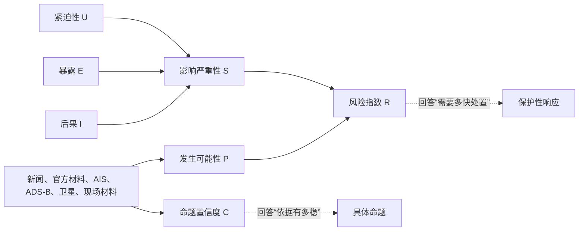
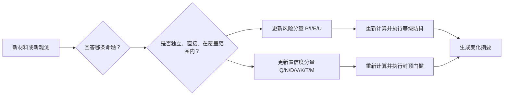

# 风险指数与命题置信度：一份能算、能解释、能追溯的通俗说明

- **版本：** v0.1
- **日期：** 2026-08-05
- **适用对象：** 业务、产品、算法、数据、研发、演示与评审人员
- **适用场景：** 多源情报专题中的风险评估、命题核验和变化摘要
- **重要边界：** 本文给出的是 DYINT 建议方法。权重和阈值尚需历史案例校准；校准完成前，产品应优先展示等级、理由和缺口，不把示例分数包装成已经验证的客观结果。

只想快速看懂的读者，可以先读第一、四、八章；需要核对算法时再读第二、三、五章；产品和研发实施关注第六、七章。

## 一、30 秒分清两个概念

先记住两句话：

> **风险指数**回答：“未来一段时间内，我们担心的情景如果发生，会带来多大、多少、多久来不及处理的危险？”

> **命题置信度**回答：“针对某一句具体判断，我们现在的证据基础有多稳？”

一个生活例子就能看出区别。天气预报说下午可能有雷暴，学校正在组织露天运动会：

- 雷暴概率较高、操场上人数很多、留给疏散的时间很短，因此**风险较高**。
- 如果判断只来自一张未经核实的聊天截图，**置信度较低**。
- 即使置信度不高，学校也不能把风险当成低风险；合理做法是先准备避险，同时尽快核验气象雷达和官方预警。

在情报产品里同样如此：一条后果严重但尚未充分证实的威胁，可能是“高风险、低置信”；一条已经确认但影响有限的历史事实，也可能是“低风险、高置信”。

“指数/分数”和“等级”也不是一回事。指数用于计算、排序和比较前后变化；等级把一段分数映射成处置语言，例如“升高”或“高”。阈值未经校准时，等级和解释通常比分数的小数点更可靠。

| 对比项 | 风险指数 | 命题置信度 |
| --- | --- | --- |
| 评估对象 | 一个有对象、有时间窗的未来风险情景 | 一条可以被支持或反驳的具体命题 |
| 核心问题 | 值不值得采取保护性措施 | 当前判断能不能站得住 |
| 主要输入 | 发生可能性、后果、暴露、紧迫性 | 来源与数据质量、独立性、直接性、覆盖、一致性、新鲜度、方法校准 |
| 典型输出 | 0—100 指数、低/戒备/升高/高/严重 | 低/中/中高/高，并列出依据和缺口 |
| 最常见错误 | 把新闻热度或事件严重程度直接当风险 | 给整件事件一个万能置信度，或把信源可靠度直接当置信度 |

两者共享同一批证据，但使用证据的目的不同：



## 二、风险指数到底怎么算

### 2.1 先把“风险针对什么”说完整

“美伊冲突风险 82 分”不是完整的评估对象。它缺少三个关键信息：担心什么情景、影响谁、看多长时间。

可计算的写法应类似：

> **评估对象：** 未来 24 小时内，美伊直接军事行动继续扩大，并对中东民航、商业航运或能源设施运行造成明显影响的风险。

这句话把风险锁定在：

- **情景：** 直接行动继续扩大；
- **影响对象：** 民航、商业航运和能源设施运行；
- **时间窗：** 未来 24 小时；
- **评估时点：** 当前知识截止时间。

已经发生的历史事件不再计算“会不会发生”。例如“7 月 30 日美方是否实施了行动”属于命题核验问题；风险评估应转向“未来 24 小时是否继续升级、会不会影响民用运行”。

### 2.2 风险由四个问题组成

风险计算分两步。先算影响严重性，再与发生可能性相乘：

$$
S = 0.50I + 0.30E + 0.20U
$$

$$
R = 100 \times P \times S
$$

各分量都归一到 `0—1`：

| 分量 | 用大白话解释 | 典型判断依据 |
| --- | --- | --- |
| $P$ 发生可能性 | 未来时间窗内，这个情景有多可能发生 | 已发生行动、报复声明、行为信号、可靠反证、历史基线 |
| $I$ 后果严重性 | 一旦发生，最可能造成多严重的后果 | 人员安全、民航、港口、商船、能源和关键设施影响 |
| $E$ 暴露度 | 有多少对象会受到影响，这些对象有多关键 | 航班、船舶、港口、航道、供应链节点和业务依赖 |
| $U$ 紧迫性 | 留给核验和响应的时间有多短 | 影响是否已经开始、可能在几小时还是几天后发生 |

首版把后果放在 50%，暴露放在 30%，紧迫性放在 20%。这是 DYINT 的建议政策权重，不是 NIST 给出的固定比例，也不是自然定律。每次调整权重都要生成新算法版本，并用历史案例重新回测。

### 2.3 一个从原始判断算到风险等级的例子

以下数字只用于讲解算法，不代表当前美伊专题的正式分数。

评估对象仍是“未来 24 小时直接行动扩大并影响海空民用运行”。分析人员根据当时可见材料给出：

| 分量 | 示例值 | 为什么这样评估 |
| --- | ---: | --- |
| $P$ | 0.65 | 直接行动已经发生，但后续扩大仍有不确定性 |
| $I$ | 0.80 | 一旦扩大，可能影响民航、航运和能源运行 |
| $E$ | 0.60 | 高风险区域内存在较多商业和能源运输对象 |
| $U$ | 0.70 | 后续行动可能在数小时到一天内发生 |

先算影响严重性：

$$
S = 0.50\times0.80 + 0.30\times0.60 + 0.20\times0.70 = 0.72
$$

再算风险：

$$
R = 100\times0.65\times0.72 = 46.8 \approx 47
$$

按首版建议阈值，`47` 属于“升高”。产品不能只显示这个结果，还应同时给出一句解释：

> 风险升高。主要原因是直接行动已经发生，潜在影响覆盖民航、航运和能源运行；但未来 24 小时是否继续扩大仍有不确定性。

### 2.4 风险等级只是处置尺，不是自然真理

| 指数 | 建议等级 | 默认处置含义 |
| ---: | --- | --- |
| 0—19 | 低 | 常规观察 |
| 20—39 | 戒备 | 增加核验 |
| 40—59 | 升高 | 建立专项监测 |
| 60—84 | 高 | 人工复核并准备保护性措施 |
| 85—100 | 严重 | 立即人工审批和业务连续性响应 |

这些阈值要通过历史案例检验误报、漏报和等级跳变情况。未完成校准前，`47` 和 `49` 的差异没有产品宣传中看起来那么精确；“升高，接近高风险边界”比“风险精确为 47 分”更诚实。

还有三条不能被乘法公式掩盖的规则：

1. **低概率、灾难性后果要单独标记。** 涉及重大民航、核设施或关键航道安全时，可以触发人工高优先级复核，但必须记录这是政策覆盖，不得偷偷修改公式。
2. **数据缺失不等于风险下降。** 没有发现航迹，可能是没有活动，也可能是接收覆盖不足。覆盖不足首先影响置信度，不能自动把风险调低。
3. **已发生事实和未来风险分开。** 历史行动是否发生由命题状态和置信度表达；风险指数负责未来情景和后续影响。

## 三、命题置信度到底怎么算

### 3.1 置信度必须绑在一句具体判断上

同一事件里可以同时存在下列结论：

| 具体命题 | 可能的当前状态 | 为什么不能合成一个“事件置信度” |
| --- | --- | --- |
| 7 月 30 日发生了美方直接行动 | 已确认、中高置信 | 官方材料和独立报道直接回答该问题 |
| 行动窗口内保障活动增强 | 有支持、中高置信 | ADS-B 的加油机结构与行动时间重合 |
| 某一架公开航迹航空器直接参战 | 待核、低置信 | 航迹没有任务、载荷和指挥关系 |
| 某个目标已经被摧毁 | 待核、低置信 | 缺少卫星、现场或独立损害评估 |

如果把这些命题压成“事件置信度 84 分”，读者很容易误以为“行动已经确认”同时证明了“具体参战”和“目标毁伤”。正确做法是一条命题一个状态、一份依据和一个置信度。

### 3.2 信源可靠度只是置信度的一种原料

可以把一条证据想成一名证人：

- **信源可靠度**看这名证人过去是否可靠、身份是否明确、是否可能受到立场影响。
- **命题置信度**看整起案件的证据基础：证人是否亲眼看到、其他证人是否独立、监控是否覆盖关键时段、证词是否一致、材料是否及时、判断方法是否经过验证。

因此：

- 一个可靠机构发布了声明，只能证明“该机构作出了这一声明”；其中的战果主张仍需独立验证。
- 十家媒体转发同一份声明，仍然属于一个信息组，不能当成十份独立证据。
- 同一架飞机的一百个 ADS-B 点是连续观测，不是一百个独立来源。
- 高可靠来源如果没有直接回答当前命题，也不能显著提高该命题置信度。

### 3.3 七个分量分别问什么

建议的原始置信度为：

$$
C_{raw}=100\times(0.25Q+0.20N+0.15D+0.15V+0.10K+0.10T+0.05M)
$$

| 分量 | 权重 | 普通读者可以这样问 |
| --- | ---: | --- |
| $Q$ 来源与数据质量 | 25% | 来源身份清楚吗？数据字段和采集方法可靠吗？ |
| $N$ 独立性 | 20% | 是多个真正独立的信息组，还是同一稿源被反复转载？ |
| $D$ 直接性与模态互补 | 15% | 证据直接回答命题吗？有没有新闻之外的信号或影像？ |
| $V$ 覆盖度 | 15% | 关键时间和区域真的被观测到了吗？空结果是否可信？ |
| $K$ 一致性 | 10% | 支持材料和反证能否形成一致解释？ |
| $T$ 新鲜度 | 10% | 系统得到数据时，它是否仍能用于当时的判断？ |
| $M$ 方法校准 | 5% | 这套算法是否经过历史案例回放和版本评测？ |

这里的“覆盖度”很重要。雷达没有看到目标，只有在雷达当时开机、覆盖了正确区域、具备发现能力时，才是一条有意义的空结果。AIS、ADS-B 也一样。

### 3.4 先过硬门槛，再看加权分数

加权平均有一个危险：多个一般项可能把一个致命缺口“平均掉”。因此系统要先执行硬门槛：

| 致命缺口 | 处理方式 |
| --- | --- |
| 没有原始来源、算法版本或证据引用 | 显示“不可计算”，不输出数字 |
| 只有一个独立信息组 | 最高不超过 59 |
| 只有新闻，且主要依赖事件参与方口径 | 最高不超过 69 |
| 关键矛盾尚未解决 | 最高不超过 69，并显示“有争议” |
| 关键时空范围存在明显采集缺口 | 最高不超过 59 |
| 使用了未验证字段或明显异常值 | 排除该特征，不允许只扣几分后继续使用 |

可以把它理解为考试资格线：总分再高，关键科目没有参加，也不能判定“全部合格”。

### 3.5 两条命题的完整算例

下面仍是教学数据，目的是展示同一事件中不同命题为什么会得到不同置信度。

**命题 A：行动确实发生。** 官方声明、AP 独立报道和时间相符的 ADS-B 行为旁证形成多个信息组：

| $Q$ | $N$ | $D$ | $V$ | $K$ | $T$ | $M$ | 计算结果 |
| ---: | ---: | ---: | ---: | ---: | ---: | ---: | ---: |
| 0.80 | 0.75 | 0.85 | 0.70 | 0.85 | 0.90 | 0.40 | 77.75，约 78 |

`78` 落在“中高”。方法校准分只有 `0.40`，提醒用户这套评分仍处于验证阶段；它不会被其他分量悄悄掩盖。

**命题 B：具体目标已经被摧毁。** 目前主要是参与方主张，缺少卫星和现场独立材料：

| $Q$ | $N$ | $D$ | $V$ | $K$ | $T$ | $M$ | 计算结果 |
| ---: | ---: | ---: | ---: | ---: | ---: | ---: | ---: |
| 0.45 | 0.15 | 0.25 | 0.20 | 0.35 | 0.70 | 0.40 | 33.50，约 34 |

`34` 为“低”。这说明“行动发生”达到中高置信，并不会自动把“目标毁伤”一起拉高。

建议的置信度分档为：

| 分数 | 等级 |
| ---: | --- |
| 0—39 | 低 |
| 40—59 | 中 |
| 60—79 | 中高 |
| 80—100 | 高 |

在历史样本校准完成前，页面可以展示“中高”和主要依据，不必把 `77.75` 伪装成测量仪器得到的精密读数。

## 四、风险和置信度为什么可能一高一低

| 组合 | 说明 | 产品动作 |
| --- | --- | --- |
| 高风险、高置信 | 严重情景有较充分证据支持 | 启动人工审批和保护性响应，持续监测 |
| 高风险、低置信 | 后果可能很重，但证据仍不完整 | 先采取可逆的预防措施，同时加速核验；不能因低置信就忽略风险 |
| 低风险、高置信 | 事实清楚，影响有限或已经受控 | 常规观察，保留证据和判断版本 |
| 低风险、低置信 | 既没有明显危险信号，观测基础也不稳 | 不下强结论，优先补覆盖和独立来源 |

最容易犯的错误，是把“置信度下降”自动翻译成“风险下降”。例如 ADS-B 采集链中断后，系统对空中态势的把握变差，置信度应下降；外部风险并不会因为系统看不见而自动降低。

## 五、变化摘要怎样影响风险和置信度

### 5.1 先问：世界变了，还是我们知道得更多了

每条新信息进入系统后，先判断它属于哪一种变化：

- **世界状态变化：** 行动规模扩大、受影响对象增加、响应时间缩短。这类变化主要更新风险的 $P$、$I$、$E$、$U$。
- **知识状态变化：** 新增独立来源、覆盖恢复、矛盾解决、数据迟到。这类变化主要更新置信度的 $Q$、$N$、$D$、$V$、$K$、$T$、$M$。
- **两者同时变化：** 新证据既证明升级信号出现，也让判断基础更稳，风险和置信度都可能上升。



### 5.2 六种常见变化，不要机械加减分

| 新变化 | 风险怎样变 | 置信度怎样变 |
| --- | --- | --- |
| 新增一个独立、同向的官方或传感信息组 | 相关未来情景的 $P$ 可能上升 | 独立性、直接性和一致性提高，通常上升 |
| 同一原始稿源新增十篇转载 | 基本不变 | 基本不变，仍算一个信息组 |
| 新增可靠的目标毁伤或民用影响材料 | 后果或暴露上升，风险上升 | 只有材料独立、直接且质量合格时才上升 |
| 采集链中断、覆盖不足 | 通常维持，不自动下降 | 覆盖度下降，可能触发封顶 |
| 可靠反证出现 | 发生可能性和风险可能下降 | 矛盾未解决时先下降；解释闭合后，对“低风险判断”的置信度可以上升 |
| 历史数据后来补齐 | 回溯评估可以更新；原实时判断保留 | 回溯版可以提高，原知识截止版本不被静默改写 |

历史补充数据本身不是质量问题。关键是时间语义要清楚：`observed_at` 表示事件何时发生，`loaded_at` 表示系统何时得到材料。8 月 5 日获得的 7 月 30 日观测可以完善回溯分析，但不能声称系统在 7 月 30 日当时已经掌握它。

### 5.3 一个“风险 47→60、置信度 58→75”的完整推演

仍使用前面的教学情景。初始状态为：

- $P=0.65$、$I=0.80$、$E=0.60$、$U=0.70$；
- $S=0.72$；
- 风险 $R=46.8$，约为 `47`，等级“升高”。

随后新增一个独立报道组和一组与行动窗重合的 ADS-B 保障活动旁证。它们直接支持“行动与保障活动增强”，并使未来短时升级更值得警惕。假设：

- $P$ 从 `0.65` 上升到 `0.80`；
- 紧迫性 $U$ 从 `0.70` 上升到 `0.85`；
- 后果 $I$ 和暴露 $E$ 不变。

新的影响严重性为：

$$
S_{new}=0.50\times0.80+0.30\times0.60+0.20\times0.85=0.75
$$

新的风险为：

$$
R_{new}=100\times0.80\times0.75=60
$$

风险从 `46.8` 上升到 `60.0`，增加 `13.2` 分。用对称分解计算，其中约 `11.0` 分来自发生可能性提高，约 `2.2` 分来自紧迫性提高。变化摘要因此可以准确写成“主要由升级可能性上调驱动”，而不是让大模型自由编一个理由。

置信度的初始和更新分量如下：

| 状态 | $Q$ | $N$ | $D$ | $V$ | $K$ | $T$ | $M$ | 置信度 |
| --- | ---: | ---: | ---: | ---: | ---: | ---: | ---: | ---: |
| 更新前 | 0.70 | 0.40 | 0.55 | 0.55 | 0.60 | 0.80 | 0.30 | 57.50，约 58 |
| 更新后 | 0.80 | 0.75 | 0.80 | 0.65 | 0.80 | 0.85 | 0.30 | 74.75，约 75 |

置信度增加 `17.25` 分，贡献可追溯为：来源和数据质量 `+2.5`、独立性 `+7.0`、直接性 `+3.75`、覆盖 `+1.5`、一致性 `+2.0`、新鲜度 `+0.5`，方法校准没有变化。

这段变化应显示为：

> **评估对象：** 未来 24 小时直接行动扩大并影响海空民用运行。
>
> **风险：** 47→60，由“升高”进入“高”。约 11 分来自升级可能性上调，约 2 分来自响应窗口缩短。
>
> **命题置信度：** 58→75，由“中”升为“中高”。主要因为新增独立报道组和 ADS-B 行为旁证；同稿源转载未重复计分。
>
> **没有改变的判断：** 航迹仍不能证明具体航空器参战或目标毁伤。
>
> **关键缺口：** 卫星或现场损害材料、完整民航数据和连续海事覆盖。

这些数字是算法教学示例，不是对当前事件的正式重算。

### 5.4 分数变了，等级不一定立刻变

新证据到来后可以立即重算分数，但对外等级需要防抖：

- 普通等级变化可要求连续两个评估周期跨过阈值，或持续一段经业务校准的时间；
- 高影响硬触发可以立即进入人工复核队列，但不自动对外发布；
- 页面允许显示“分数已变化，等级暂未变化”；
- 对外通知、业务连续性响应和等级下调必须保留人工审批记录。

## 六、产品应该怎样展示

### 6.1 首屏只回答四个问题

1. **评估什么：** 情景、影响对象、时间窗和知识截止时间；
2. **风险多高：** 等级和主要驱动因素；
3. **哪些命题已经站稳：** 每条命题的状态和置信度；
4. **还缺什么：** 覆盖、独立来源、影像、现场材料或方法校准。

不要在事件标题旁放一个万能“事件置信度”。推荐显示：

```text
事件状态：行动已确认
风险等级：高（未来 24 小时海空运行风险）
关键缺口：目标毁伤待核

命题核验：
- 行动发生：已确认｜中高
- 保障增强：有支持｜中高
- 具体参战：待核｜低
- 目标毁伤：待核｜低
```

### 6.2 点击分数后必须能看到来龙去脉

风险详情至少展示：

- $P$、$I$、$E$、$U$ 的当前值和上次值；
- 每个分量由哪些事实触发；
- 风险阈值、政策覆盖和算法版本；
- 为什么分数变化、为什么等级变化或未变化。

命题置信度详情至少展示：

- 具体命题；
- 独立信息组，而不是简单的新闻条数；
- $Q$、$N$、$D$、$V$、$K$、$T$、$M$ 的贡献；
- 封顶门槛、反证、覆盖缺口和被排除的数据字段；
- 人工复核人、复核时间和结论版本。

### 6.3 大模型负责表达，不负责偷偷算分

评分引擎根据结构化台账确定分量、门槛和变化贡献。大模型可以把计算结果改写成自然语言，不能自行决定权重、修改分数、补造因果或把模拟数据写入正式判断。

每次评估至少保存：`assessment_id`、`claim_id`、`observed_at`、`loaded_at`、知识截止时间、算法版本、分量值、证据贡献、封顶规则、变化原因和人工复核记录。这样才能复核“当时为什么这样判断”，也能在算法升级后重放历史案例。

## 七、上线前必须完成的校准

参考成熟指数说明中“权重需要根据实际运行修正”的做法，本项目还需把校准做得更可检验：

1. 选取一批有明确后续结果的历史案例，标注命题、风险情景、证据到达时间和最终结果；
2. 冻结算法版本和权重，回放当时可见的信息，禁止使用后来才获得的材料“穿越答题”；
3. 检查高风险事件的漏报、普通事件的误报、等级频繁跳变和置信度是否与证据完整程度一致；
4. 调整权重和阈值后生成新版本，保留旧版本结果，不能覆盖历史审计记录；
5. 校准稳定前，对外优先使用“低、中、中高、高”和解释文字，精确分数只在内部评测中使用。

## 八、最容易记住的八条规则

1. 风险必须写明“什么情景、影响谁、未来多久”。
2. 已发生事实是否成立，看命题状态和置信度；未来后果是否需要处置，看风险。
3. 风险由发生可能性和影响共同决定，影响还包括后果、暴露和紧迫性。
4. 置信度必须绑定具体命题，不能给整件事一个万能分数。
5. 信源可靠度只是证据属性，不等于命题置信度。
6. 多篇转载不等于多份独立证据；多个传感点也不等于多个独立来源。
7. 看不见不等于不存在。覆盖不足时先降低置信度，不自动降低风险。
8. 变化摘要必须指出哪一个分量被哪一条新证据改变；大模型只负责把已计算结果说清楚。

## 九、方法来源与适用边界

- [NIST SP 800-30 Rev.1：Guide for Conducting Risk Assessments](https://csrc.nist.gov/pubs/sp/800/30/r1/final)提供“发生可能性与潜在影响共同形成风险”的原则。
- [ODNI ICD 203：Analytic Standards](https://www.dni.gov/files/documents/ICD/ICD-203.pdf)要求区分事件发生可能性和分析置信度，并说明来源质量、信息缺口、假设和判断变化。
- 本文的具体权重、阈值、封顶规则和变化分解继承并重写自[《美伊专题风险、置信度与 AIS/ADS-B 证据融合分析》](美伊专题风险置信度与航迹证据融合分析-20260804.md)，属于 DYINT 建议实现，不是 NIST 或 ODNI 直接规定的算法。
- 写法参考《传播力指数说明_201603.docx》“先定义维度、再给指标和权重、解释权重理由、补分类边界和校准说明”的组织方式；本文没有沿用其业务指标、公式或权重。
- 本文所有数值算例都是教学用假设，不代表当前美伊专题的正式风险或置信度结果。
