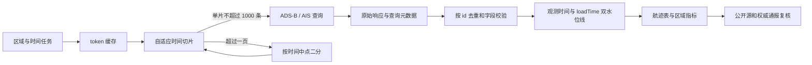

# 飞机与船舶航迹数据服务 API 实测与高效接入指南

- **测试对象：** `dh.trs.cn` 数据服务中的 ADS-B 与 AIS 查询接口
- **接口文档：** [钉钉文档《数据服务接口》](https://alidocs.dingtalk.com/i/nodes/0eMKjyp814Zalvz4FePqK6y4JxAZB1Gv)
- **交互原型：** [《飞机与船舶航迹数据 API 探索工具交互 Mock》](飞机与船舶航迹数据API探索工具交互Mock.html)
- **测试时间：** 2026 年 7 月 31 日 16:36—16:45 CST
- **关联案例：** [《美伊“暂停互袭”多源数据验证实录》](美伊暂停互袭多源数据验证实录-20260727.md)、[《约旦拦截伊朗导弹事件多源验证与升级研判》](约旦拦截伊朗导弹事件多源验证与升级研判-20260729.md)

本文记录接口文档口径、真实调用结果、已发现的问题，以及 Python 3 和 Go 的推荐接入方式。测试使用小范围、短时间窗和受控请求量，没有进行压力测试。文中不记录用户名、密码、token、完整原始响应或可用于定位敏感对象的实时位置。

## 1. 结论

这套服务可以补充两个案例目前缺少的历史区域航迹数据：

- ADS-B 可按观测时间、ICAO 和矩形范围查询，返回飞机标识、位置、高度、速度、航向、机型、注册号和飞机类别。
- AIS 可按观测时间、MMSI 和矩形范围查询，返回船舶标识、名称、位置、航速、航向、转向率、船型、长度和 IMO。
- 两个接口都支持 `loadTime` 入库时间过滤。实测确认文档误写的 `endLoadTime` 参数有效，可用于增量同步和补收迟到数据。
- 单页有效上限为 1000。响应支持 gzip，565 条 ADS-B 样本从 170,117 字节压缩到 28,818 字节，传输量减少约 83%。

当前适合把它定位为“区域历史回溯和趋势分析的补充源”，暂不宜作为唯一事实源或高可靠实时流：

- 历史分页不是稳定快照。相同查询条件的相邻请求中，总数由 22 变为 21，第二页与前一次第一页重复 4 条。直接按 `pageNum++` 翻页会重复或漏数。
- 历史入库延迟和航迹密度不稳定。7 月 29 日样本中，ADS-B 入库延迟中位约 5.8 小时，AIS 约 4 小时；单架飞机 30 分钟可能只有 1 个点，单船一天可能只有 2 个点。
- 接口没有返回数据来源、接收站、覆盖质量、定位精度、时区、航班计划、航行状态或事件确认信息。它能证明“服务在某时空范围内记录了这些点”，不能单独证明航班正常运行、船舶实际过峡、军事行动结果或海事事件归因。

推荐先用 Python 完成历史回溯和数据质量基线；确需长期连续采集时，再将同一协议实现为 Go 服务。分页采用“自适应时间切片，保证每片不超过一页”，增量采用 `loadTime` 水位线、重叠回看和 `id` 去重。

## 2. 接口契约

### 2.1 基本地址与认证

文档给出的基本地址是：

```text
http://dh.trs.cn/datas/api
```

登录接口：

```text
POST /ssoapplogin?username=<user>&password=<digest>&timestamp=<milliseconds>
```

其中：

```text
digest = md5(md5(原始密码) + timestamp)
```

`timestamp` 为毫秒时间戳，文档称有效窗口为 3 分钟。登录成功后，业务请求在 header 中携带：

```http
TRSDH-Access-Token: <token>
```

文档称 token 有效期为 2 小时。本次测试只确认了 token 可以复用，没有等待 2 小时验证实际过期时点。未带 token 时，服务仍返回 HTTP 200，业务体为 `code=604`、`msg=用户未登录，不可访问相关的服务`。调用方必须同时检查 HTTP 状态和业务 `code`。

### 2.2 ADS-B 查询

```text
POST /base/osint/aircraft/adsb/list
Content-Type: application/json
```

| 参数 | 必填 | 实测或文档含义 |
| --- | --- | --- |
| `startPubTime` | 是 | 观测/上报开始时间，`yyyyMMdd` 或 `yyyyMMddHHmmss` |
| `endPubTime` | 是 | 观测/上报结束时间；实测同一秒起止可以命中，按闭区间处理更安全 |
| `startLoadTime` | 否 | 入库开始时间，可用于增量同步 |
| `endLoadTime` | 否 | 入库结束时间；文档误写为第二个 `startLoadTime`，实测参数有效 |
| `icao` | 否 | 飞机 ICAO 24-bit 地址，精确过滤有效 |
| `minLon`、`minLat`、`maxLon`、`maxLat` | 否 | 矩形范围；样本未发现越界点 |
| `pageNum` | 否 | 从 0 开始 |
| `pageSize` | 否 | 默认 20，上限 1000；传 1001 时服务静默改为 1000 |
| `sorts` | 否 | 支持 `pubTime`、`loadTime`，前缀 `-` 表示倒序 |

ADS-B 返回字段均以 JSON string 为主：

| 字段 | 含义 | 使用注意 |
| --- | --- | --- |
| `id` | 记录唯一标识 | 本轮样本内唯一，优先作为幂等键 |
| `icao` | ICAO 地址 | 适合对象级轨迹归并，不等同于航班号 |
| `country` | 国家/注册关联信息 | 生成逻辑和权威来源未说明 |
| `lon`、`lat` | 经度、纬度 | 字符串，需要解析和范围校验 |
| `receiveTime` | 点位接收时间 | 接口不返回名为 `pubTime` 的字段，建议映射为 `observed_at_source` |
| `loadTime` | 服务入库时间 | 用于增量水位线和迟到量统计 |
| `heading` | 航向 | 单位未在响应中声明，按角度使用前应向服务方确认 |
| `height` | 高度 | 文档称单位为米 |
| `speed` | 速度 | 文档称单位为公里/小时 |
| `type` | 飞机型号 | 可能为空或来源不明，需要字典质量检查 |
| `registration` | 注册号 | 565 条样本中 2 条为空 |
| `planeType` | 飞机类别 | 可见“军机”等类别，分类来源、准确率和更新机制未说明 |

接口不返回 callsign、航班号、起降机场、计划航路、垂直速度、应答机码、地面状态、接收站、定位精度或覆盖质量。涉及航班取消、绕飞、返航和空域限制时，仍需结合 NOTAM、机场、航司、ADSB.lol/OpenSky 和天气数据。

### 2.3 AIS 查询

```text
POST /base/osint/ship/ais/list
Content-Type: application/json
```

时间、空间、分页和排序参数与 ADS-B 相同，对象过滤参数改为 `mmsi`。

| 字段 | 含义 | 使用注意 |
| --- | --- | --- |
| `id` | 记录唯一标识 | 本轮样本内唯一，优先作为幂等键 |
| `mmsi` | MMSI | 对象级过滤有效 |
| `name` | 船名 | 名称可能随广播和清洗规则变化，不宜单独作为主键 |
| `country` | 国籍/船旗关联信息 | 生成逻辑和权威来源未说明 |
| `lon`、`lat` | 经度、纬度 | 字符串，需要解析和范围校验 |
| `lastdyn` | 动态点接收时间 | 建议映射为 `observed_at_source` |
| `loadTime` | 服务入库时间 | 用于增量水位线和迟到量统计 |
| `heading` | 船首向 | 单位未明确，通常为角度，接入前应确认 |
| `sog` | 对地航速 | 单位未明确，不能直接假定为节 |
| `cog` | 对地航向 | 单位未明确 |
| `rot` | 转向率 | 单位和编码规则未明确 |
| `type` | 船型 | 可见“货船”等类别，分类字典未提供 |
| `length` | 船长 | 单位未明确，通常为米，接入前应确认 |
| `imo` | IMO 编号 | 100 条样本中 3 条为空，不能作为全量主键 |

接口不返回航行状态、目的港、预计到达时间、吃水、宽度、船旗代码、呼号、AIS 消息类型、接收站、信号质量或位置精度。它适合做区域活动量、对象回溯、速度/航向变化和断面穿越候选分析；海事事件仍需船方、港口、NAVAREA、IMO、保险或现场材料确认。

## 3. 实测结果

### 3.1 测试范围

为对应两份案例，测试使用以下非目标级区域框：

- 约旦及周边航空：`lon 34.0—40.0`、`lat 29.0—34.0`。
- 霍尔木兹及周边航空：`lon 54.5—58.0`、`lat 25.0—28.0`。
- 霍尔木兹及周边海事：`lon 54.0—58.5`、`lat 24.0—28.0`。

历史样本主要选择 2026 年 7 月 29 日，便于与约旦导弹事件和霍尔木兹海事风险窗口对齐。测试结果是服务能力和数据质量样本，不是对事件本身的新事实认定。

### 3.2 功能与协议

| 测试项 | 结果 | 结论 |
| --- | --- | --- |
| 登录 | HTTP 200，业务 `code=200` | 认证算法和当前凭据有效 |
| 无 token 调用 | HTTP 200，业务 `code=604` | 不能只依赖 HTTP 状态判断成功 |
| gzip | 565 条 ADS-B：170,117 B → 28,818 B | 应始终发送 `Accept-Encoding: gzip` |
| 连接复用 | 响应 header 为 `Connection: close` | 服务端当前主动断开，客户端连接池收益有限 |
| 限流信息 | 未见 `X-RateLimit-*` 或 `Retry-After` | 不能推测并发配额，需向服务方确认 |
| `pageSize=0` | 按默认值 20 返回 | 不要用 0 表示“只取总数” |
| `pageSize=1001` | 返回 `size=1000` | 上限 1000，超限被静默截断 |
| 反向时间窗 | HTTP 200、空结果 | 客户端必须先校验 `start <= end`，不能把空结果当作有效零值 |
| 精确 ICAO/MMSI | 返回对象均匹配请求标识 | 对象过滤有效 |
| `endLoadTime` | 返回入库时间全部处于指定窗口 | 文档字段名为笔误，真实参数可用 |

本轮业务请求耗时约 1.3—6.7 秒，登录请求约 1.5—8.7 秒。没有做并发和容量测试，不能据此推导服务吞吐上限。

### 3.3 数据量、完整性与新鲜度

| 样本 | 结果 | 说明 |
| --- | --- | --- |
| 7 月 29 日 00:00—06:00 约旦 ADS-B | 565 条、17 个 ICAO | `id`、位置、时间等主要字段完整；`registration` 缺 2 条 |
| 7 月 29 日 05:30—06:00 约旦 ADS-B | 约 21—22 条 | 相同历史查询的总数仍发生变化 |
| 7 月 29 日 05:00—06:00 霍尔木兹 ADS-B | 15 条 | 能取得区域航空历史点，但对象密度不均 |
| 7 月 29 日 00:00—06:00 霍尔木兹 AIS | 100 条、97 个 MMSI | 主要字段完整，IMO 缺 3 条 |
| 某架飞机 30 分钟对象查询 | 1 条 | 不能默认得到秒级或连续航迹 |
| 某艘船 24 小时对象查询 | 2 条、2 个位置 | 两点相隔约 9.5 小时，不足以重建连续航线 |

历史入库延迟按 `loadTime - receiveTime/lastdyn` 计算：

| 数据 | 最小 | 中位 | 最大 |
| --- | ---: | ---: | ---: |
| 约旦 ADS-B 6 小时样本 | 约 2.2 小时 | 约 5.8 小时 | 约 22.7 小时 |
| 霍尔木兹 AIS 6 小时样本 | 约 2.0 小时 | 约 4.0 小时 | 约 8.0 小时 |

7 月 31 日 16:43 CST 附近的 12 小时查询显示：

- 约旦 ADS-B 最新 `receiveTime` 为 16:40:23，最新 `loadTime` 为 16:42:30；按同一时区理解，观测新鲜度约 3 分钟。
- 霍尔木兹 AIS 最新 `lastdyn` 为 16:01:59，最新 `loadTime` 为 16:20:10；按同一时区理解，观测新鲜度约 42 分钟。

接口没有说明时间字段时区，因此上述分钟差只用于同次测试的相对判断。正式入库前应要求服务方明确时区；在此之前保留原始时间字符串和采集端 `observed_at`，不要擅自转换成 UTC。

文档称 ADS-B 可查询 2026 年 4 月起的数据，AIS 可查询 2026 年 5 月起的数据。实测在霍尔木兹范围内查询 5 月 1 日 AIS 得到 132 条；中东大范围 4 月 1 日和 4 月 15 日 ADS-B 为零，5 月 1 日得到 9,256 条。零结果既可能是区域覆盖不足，也可能是实际数据起点较晚，不能据此确认或否定全库 4 月留存。正式接入需要服务方提供按区域、日期和数据源划分的覆盖清单。

### 3.4 分页一致性

按 `pubTime` 升序查询约旦 05:30—06:00 数据：

1. 第一次第 0 页返回总数 22。
2. 随后第 1 页返回总数 21。
3. 第 1 页的 5 条中有 4 条与前一次第 0 页重复。

倒序排序本身有效，但 `pubTime` 没有作为字段返回，只能用 `receiveTime` 间接核对。接口也不支持把 `id` 加入排序，无法建立唯一稳定顺序。即使查询历史时间窗，分页期间也可能发生数据重整、补录或非一致读。

因此不要使用下面这种普通翻页：

```text
pageNum = 0
while pageNum < totalPages:
    fetch(pageNum)
    pageNum += 1
```

可靠做法是把时间窗切小到 `totalPages == 1`，一次取完该片；所有片段仍按 `id` 去重。若一片超过 1000 条，按时间中点二分，直到每片不超过一页。

## 4. 两个案例怎样使用这批数据

### 4.1 约旦与周边航空

建议围绕事件前后窗口建立三类数据集：

| 数据集 | 时间范围 | 用途 |
| --- | --- | --- |
| 事件窗口 | 7 月 29 日 05:15—06:30 CST，并覆盖后续第二次来袭时段 | 观察区域活动量、可见航路和高度/速度变化 |
| 日内对照 | 事件前后各 6—24 小时 | 区分短时波动与持续变化 |
| 历史基线 | 30—90 天内同星期、同时段、同范围 | 判断活动量和航路偏移是否异常 |

基础派生指标包括唯一 ICAO 数、有效位置点数、高度和速度分布、航迹连续度、进入/离开区域次数和可见航路偏移。由于 API 缺少航班计划、接收覆盖和空域限制信息，指标只能描述“被服务记录的活动”，不能计算真实恢复率。NOTAM、机场和航司信息负责确认运行限制；ADSB.lol/OpenSky 负责第二网络复核；METAR 用于排除天气解释。

### 4.2 霍尔木兹船流

建议按 10/15/60 分钟和日度两类窗口聚合：

- 区域内唯一 MMSI、有效位置点和船型分布。
- `sog`、`cog` 与位置序列支持的移动、低速和可能锚泊状态。
- 在固定断面两侧出现的连续点，用于生成“可能穿越”候选。
- 指定 MMSI 的对象级回溯，用于取得船名、船旗、位置和运动信息。

本轮样本表明部分船一天只有两个点，断面穿越和掉头判断必须设置最小点数、最大点间隔和人工复核条件。API 不能替代 PortWatch 的长期日度口径，也不能替代 IMO、NAVAREA、船东或港口对具体事件的确认。对“3 艘油轮”这类缺少船名和时间的位置未知主张，不应先在全库中盲目搜索并将任意异常船迹强行对应。

## 5. 高效且可靠的调用方案

### 5.1 总体流程



### 5.2 token 管理

- 进程内缓存 token，不要每个业务请求前登录。
- 按文档的 2 小时有效期，在 100—110 分钟主动刷新；多 worker 使用 singleflight/互斥锁，避免同时登录。
- 收到 HTTP 200 但业务 `code=604` 时，刷新一次并重放该只读请求；再次失败立即报错，不无限登录重试。
- 用户名和密码从环境变量或密钥管理服务读取。不要把凭据放在 URL、命令参数、日志、异常栈或 Git 仓库中。

### 5.3 历史回溯：单页时间切片

初始以 1 小时为一个片段，请求 `pageSize=1000`、`pageNum=0`：

1. `totalPages == 0`：记录有效零结果，继续下一片。
2. `totalPages == 1`：保存该片并按 `id` 去重。
3. `totalPages > 1`：丢弃当前不完整内容，按时间中点二分后递归请求。
4. 时间精度已到 1 秒仍超过 1000：停止并告警。服务端没有唯一稳定排序，继续翻页无法保证完整性。

由于起止时间实测为闭区间，相邻历史片段使用 `next_start = previous_end + 1 second`。为处理服务端后补和重整，整个任务完成后再对最近若干片段重跑一次，以 `id` 覆盖写入。

可以按上一片密度调节后续窗口：小于 250 条时逐步扩大，超过 800 条时提前缩小。窗口范围建议限制在 1 分钟至 6 小时，避免一次请求统计过大范围。

### 5.4 增量同步：入库水位线

增量任务同时给出较宽的观测时间范围和较窄的入库时间范围：

```json
{
  "startPubTime": "20260701000000",
  "endPubTime": "20260731235959",
  "startLoadTime": "<last_load_time_minus_overlap>",
  "endLoadTime": "<this_run_cutoff>",
  "pageNum": 0,
  "pageSize": 1000,
  "sorts": "loadTime"
}
```

推荐流程：

- 水位线以成功持久化后的最大 `loadTime` 为准，不用本机当前时间代替。
- 每次向前重叠 30—60 分钟，按 `id` 幂等覆盖，吸收迟到数据和边界秒。
- 每日再回看最近 24—48 小时；历史样本出现过 22.7 小时入库延迟，只跑短重叠窗口可能漏掉迟到记录。
- 每周按事件窗口或区域做一次总量核对，发现历史总数变化时触发补采。
- 保存 `query_started_at`、`query_finished_at`、请求参数、HTTP 状态、业务 `code`、`requestid`、记录数、最大观测时间、最大 `loadTime` 和响应 SHA-256。

### 5.5 并发、超时和重试

服务没有公布限流配额，响应也没有限流 header，且当前为 `Connection: close`。本次未做压力测试，默认使用 1 个 worker；服务方确认容量后再逐步提高到 2—4 个区域/时间片并发，并以 P95 延迟、错误率和对方限流反馈决定上限。

建议配置：

- 连接超时 5 秒，单请求总超时 30—45 秒。
- 网络超时、连接重置和 HTTP 502/503/504 最多重试 3 次，采用带抖动的指数退避。
- 参数错误、业务鉴权错误和可重复的空结果不做盲目重试。
- 重试只针对同一个只读时间片；写入端按 `id` 幂等，避免重复数据。
- 始终请求 gzip。服务端修复 keep-alive 后，Python/Go 的长生命周期 client 才能明显减少连接成本。

### 5.6 存储与质量控制

建议分三层保存：

| 层 | 内容 | 目的 |
| --- | --- | --- |
| Raw | 原始 JSON、查询参数、采集时间、响应摘要和 SHA-256 | 复现与审计；凭据和 token 必须剔除 |
| Normalized | 解析后的经纬度、数值、原始时间字符串、待确认时区、对象标识 | 统一 ADS-B/AIS 数据质量处理 |
| Derived | 轨迹段、区域统计、断面穿越候选、异常指标 | 服务案例研判和展示 |

关键质量指标：

- `records_received`、`unique_ids`、`duplicate_ratio`。
- `max_observed_time`、`max_load_time`、`ingest_delay_seconds`。
- 经纬度越界率、数值解析失败率、关键标识缺失率。
- 每 ICAO/MMSI 点数、点间隔中位数和最大值。
- 查询总数变化、切片二分次数、`totalPages > 1` 次数。
- HTTP 延迟、业务错误码、token 刷新和重试次数。

空结果必须分类为：请求成功且在已知覆盖内为零、区域覆盖未知、数据尚未入库、参数错误或请求失败。不能把它们统一写成“没有飞机/船舶活动”。

## 6. Python 3 参考实现

Python 适合先完成接口验证、历史回溯、字段画像和案例分析。下面示例使用 `httpx`（安装命令：`python3 -m pip install httpx`），凭据只从环境变量读取。

```python
from __future__ import annotations

import hashlib
import os
import threading
import time
from datetime import datetime, timedelta
from typing import Any, Iterator

import httpx


BASE_URL = os.environ.get(
    "TRSDH_BASE_URL", "http://dh.trs.cn/datas/api"
).rstrip("/")
USERNAME = os.environ["TRSDH_USERNAME"]
PASSWORD = os.environ["TRSDH_PASSWORD"]


class DHClient:
    def __init__(self) -> None:
        self._http = httpx.Client(
            timeout=httpx.Timeout(40.0, connect=5.0),
            headers={"Accept": "application/json", "Accept-Encoding": "gzip"},
        )
        self._token = ""
        self._refresh_at = 0.0
        self._lock = threading.Lock()

    def _login(self) -> None:
        timestamp = str(int(time.time() * 1000))
        first = hashlib.md5(PASSWORD.encode()).hexdigest()
        digest = hashlib.md5((first + timestamp).encode()).hexdigest()
        response = self._http.post(
            f"{BASE_URL}/ssoapplogin",
            params={"username": USERNAME, "password": digest, "timestamp": timestamp},
        )
        response.raise_for_status()
        body = response.json()
        if str(body.get("code")) != "200" or not body.get("data"):
            raise RuntimeError(f"login failed: code={body.get('code')} msg={body.get('msg')}")
        self._token = body["data"]
        self._refresh_at = time.monotonic() + 100 * 60

    def _ensure_token(self) -> None:
        if self._token and time.monotonic() < self._refresh_at:
            return
        with self._lock:
            if not self._token or time.monotonic() >= self._refresh_at:
                self._login()

    def query(self, path: str, payload: dict[str, Any]) -> dict[str, Any]:
        for attempt in range(2):
            self._ensure_token()
            response = self._http.post(
                f"{BASE_URL}/{path.lstrip('/')}",
                json=payload,
                headers={"TRSDH-Access-Token": self._token},
            )
            response.raise_for_status()
            body = response.json()
            if str(body.get("code")) == "200":
                return body
            if str(body.get("code")) == "604" and attempt == 0:
                self._refresh_at = 0.0
                continue
            raise RuntimeError(f"query failed: code={body.get('code')} msg={body.get('msg')}")
        raise RuntimeError("unreachable")


def fmt(value: datetime) -> str:
    return value.strftime("%Y%m%d%H%M%S")


def fetch_complete_slice(
    client: DHClient,
    path: str,
    start: datetime,
    end: datetime,
    filters: dict[str, Any],
) -> Iterator[dict[str, Any]]:
    payload = {
        **filters,
        "startPubTime": fmt(start),
        "endPubTime": fmt(end),
        "pageNum": 0,
        "pageSize": 1000,
        "sorts": "pubTime",
    }
    body = client.query(path, payload)
    page = body["data"]
    if page["totalPages"] <= 1:
        yield from page["content"]
        return

    span_seconds = int((end - start).total_seconds())
    if span_seconds <= 0:
        raise RuntimeError(f"more than 1000 records in one second: {fmt(start)}")
    middle = start + timedelta(seconds=span_seconds // 2)
    yield from fetch_complete_slice(client, path, start, middle, filters)
    yield from fetch_complete_slice(
        client, path, middle + timedelta(seconds=1), end, filters
    )


client = DHClient()
rows = fetch_complete_slice(
    client,
    "/base/osint/aircraft/adsb/list",
    datetime(2026, 7, 29, 5, 15),
    datetime(2026, 7, 29, 6, 30),
    {"minLon": 34.0, "minLat": 29.0, "maxLon": 40.0, "maxLat": 34.0},
)
deduplicated = {row["id"]: row for row in rows}
print(len(deduplicated))
```

生产实现还需补充带抖动重试、Raw 持久化、SHA-256、指标、结构化日志和时区确认。不要在日志中打印登录参数、token 或完整请求 header。

## 7. Go 参考实现

Go 更适合长期运行的采集服务。标准库已能完成 MD5、HTTP、JSON 和超时控制。下面保留认证和业务错误处理的核心结构；时间切片算法与 Python 版本相同。

```go
package dhclient

import (
	"context"
	"crypto/md5"
	"encoding/hex"
	"encoding/json"
	"fmt"
	"net/http"
	"net/url"
	"os"
	"strings"
	"sync"
	"time"
)

type Response struct {
	Code any             `json:"code"`
	Msg  string          `json:"msg"`
	Data json.RawMessage `json:"data"`
}

type Client struct {
	baseURL   string
	username  string
	password  string
	http      *http.Client
	mu        sync.Mutex
	token     string
	refreshAt time.Time
}

func New() (*Client, error) {
	base := envOr("TRSDH_BASE_URL", "http://dh.trs.cn/datas/api")
	return &Client{
		baseURL:  strings.TrimRight(base, "/"),
		username: os.Getenv("TRSDH_USERNAME"),
		password: os.Getenv("TRSDH_PASSWORD"),
		http:     &http.Client{Timeout: 40 * time.Second},
	}, nil
}

func md5hex(value string) string {
	sum := md5.Sum([]byte(value))
	return hex.EncodeToString(sum[:])
}

func (c *Client) ensureToken(ctx context.Context) error {
	c.mu.Lock()
	defer c.mu.Unlock()
	if c.token != "" && time.Now().Before(c.refreshAt) {
		return nil
	}
	timestamp := fmt.Sprintf("%d", time.Now().UnixMilli())
	query := url.Values{
		"username":  {c.username},
		"password":  {md5hex(md5hex(c.password) + timestamp)},
		"timestamp": {timestamp},
	}
	req, err := http.NewRequestWithContext(
		ctx, http.MethodPost, c.baseURL+"/ssoapplogin?"+query.Encode(), nil,
	)
	if err != nil {
		return err
	}
	resp, err := c.http.Do(req)
	if err != nil {
		return err
	}
	defer resp.Body.Close()
	if resp.StatusCode != http.StatusOK {
		return fmt.Errorf("login HTTP status %d", resp.StatusCode)
	}
	var body struct {
		Code any    `json:"code"`
		Msg  string `json:"msg"`
		Data string `json:"data"`
	}
	if err := json.NewDecoder(resp.Body).Decode(&body); err != nil {
		return err
	}
	if fmt.Sprint(body.Code) != "200" || body.Data == "" {
		return fmt.Errorf("login failed: code=%v msg=%s", body.Code, body.Msg)
	}
	c.token = body.Data
	c.refreshAt = time.Now().Add(100 * time.Minute)
	return nil
}

func envOr(key, fallback string) string {
	if value := os.Getenv(key); value != "" {
		return value
	}
	return fallback
}
```

业务查询方法应在 `ensureToken` 后发送 JSON，并设置 `TRSDH-Access-Token` 和 `Accept: application/json`。使用 Go 默认 transport 时不要手工设置 `Accept-Encoding`，由 transport 自动请求并解压 gzip；若自行设置该 header，则必须自行处理 gzip 响应。当前服务返回 `Connection: close`，不能指望连接池改善现状。对业务 `code=604` 只刷新一次 token；分页仍按时间二分，不实现普通页码循环。

## 8. 工具侧适配和待确认事项

API 由外部提供方维护，以下问题不作为我方整改前置条件。探索工具应先通过交互提示、自动切片、质量诊断和保守默认值适配；获得补充说明后再更新字段字典和调用策略。

| 优先级 | 已知或待确认事项 | 工具侧处理 |
| --- | --- | --- |
| P0 | 历史分页可能重复和漏数 | 默认启用自适应时间切片和 `id` 去重；普通翻页仅保留在专家调试模式 |
| P0 | 时间字段时区和闭开区间未完整说明 | 同时展示原始时间、CST/UTC 试算和“时区待确认”标记，不静默转换 |
| P1 | 区域覆盖和延迟没有清单 | 展示最新观测、最新入库、入库延迟和空结果分类，支持按日探测覆盖 |
| P1 | 限流与容量未公布 | 默认单 worker、可配置低并发；记录请求延迟和错误码，不做自动压测 |
| P1 | 部分字段单位、枚举和生成逻辑未说明 | 字段解释区区分“文档明确”“实测确认”“待确认”，未知单位不参与派生判断 |
| P1 | 没有来源、接收覆盖和定位质量字段 | 质量面板显式列为缺失，不把记录数直接解释为真实活动量 |
| P2 | 响应为 `Connection: close` | 使用长生命周期 client，但不把连接复用计入性能收益预期 |
| P2 | 没有增量游标或批量导出 | 用 `loadTime` 重叠水位线和时间片任务实现可恢复采集 |

## 9. 接入验收清单

- [ ] 已记录当前账号权限、数据许可、留存范围、限流和时间字段时区；未确认项在界面和结果中明确标记。
- [ ] token 在进程内复用，刷新采用 singleflight，日志无凭据和 token。
- [ ] 历史回溯使用单页时间切片；超页自动二分，不使用普通页码遍历。
- [ ] 增量同步使用 `startLoadTime`、`endLoadTime`、重叠水位线和 `id` 幂等写入。
- [ ] Raw 响应、查询参数、采集时间和 SHA-256 可追溯，敏感 header 已剔除。
- [ ] 时间保留原始字符串；时区确认后才统一转 UTC。
- [ ] 数值字段完成类型、单位、范围和空值校验。
- [ ] 空结果能区分无活动、无覆盖、未入库、参数错误和请求失败。
- [ ] ADS-B 与 NOTAM、机场/航司、第二接收网络交叉验证。
- [ ] AIS 与 PortWatch、IMO、NAVAREA、船东/港口材料交叉验证。
- [ ] 监控重复率、入库延迟、覆盖新鲜度、分页变化、错误码和请求延迟。
- [ ] 已完成小规模回放，结果可复现；扩大并发前取得服务方容量确认。
